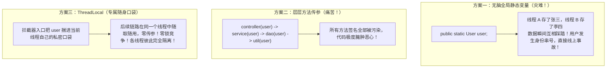
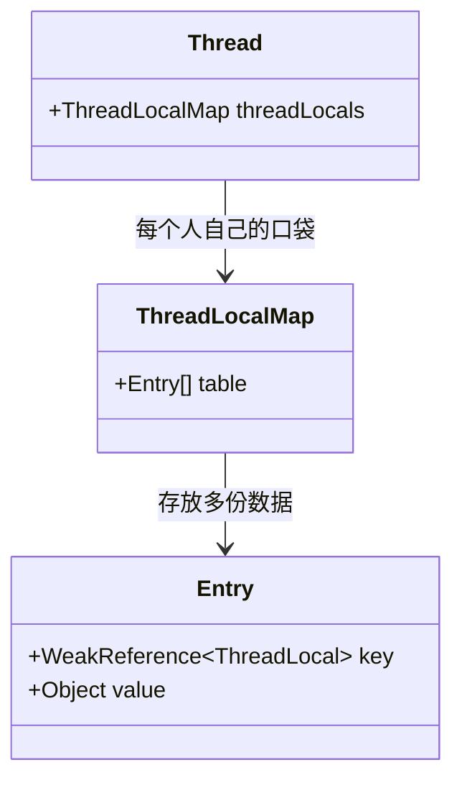

# 🎒 10 · ThreadLocal 详解（打工人的私密口袋与内存泄漏防坑）

> **一句话导读**：既不想一层层繁琐传参，又不想加锁排队？`ThreadLocal` 就像为每个打工人量身定制的**“专属私密工装口袋”**。搞懂它的内存引用链和生产清理铁律，你就能彻底攻克这个面试大杀器。

---

## 👔 核心心智模型：打工人的专属私密小口袋

在企业级 Web 开发中，我们经常遇到这种需求：
> 用户发起一个 HTTP 请求。在 Controller 层拦截器拿到了用户的 `UserContext`（用户 ID、租户编码、链路跟踪 `TraceId`）。
> 后续的 Service 层、DAO 层、工具类方法全都要用到这个 `UserContext`。

**我们该怎么传递它？**



---

## 🔍 底层真相大揭秘：数据到底存在哪里？

很多初学者直觉上以为：`ThreadLocal` 内部维护了一个巨大的全局 `ConcurrentHashMap<Thread, Object>`，以线程作为 Key 存数据。

**大错特错！现实恰恰完全相反！**



> 💡 **核心真相**：
> 1. 数据根本不在 `ThreadLocal` 对象里，而是在**每个 `Thread` 线程对象自己的属性 `threadLocals` 里**！
> 2. `ThreadLocal` 仅仅是一把**“钥匙（Key）”**，用来告诉当前线程：“请从你自己的口袋里，根据我这把钥匙把属于你的那份数据掏出来”。

---

## 💥 震撼面试官：弱引用为什么会引发内存泄漏？

面试官最爱问：“为什么 `ThreadLocal` 会发生内存泄漏？为什么要用弱引用？”
这道题用一张**对象引用关系链图**就能讲得明明白白：

```mermaid
flowchart LR
    subgraph Stack["Java 栈帧"]
        Ref["ThreadLocalRef<br/>(强引用指针)"]
        CurThread["CurrentThreadRef<br/>(当前运行的线程)"]
    end

    subgraph Heap["Java 堆内存"]
        TLObj["ThreadLocal 实例对象"]
        MapObj["Thread.currentThread().threadLocals<br/>(ThreadLocalMap)"]
        EntryObj["Entry 节点"]
        ValObj["实际存储的业务大对象 Value<br/>(比如 10MB 缓存)"]
    end

    Ref ==>|强引用| TLObj
    CurThread ==>|强引用| MapObj
    MapObj --> EntryObj
    EntryObj -.->|🚨 弱引用 (WeakReference)| TLObj
    EntryObj ==>|🚨 强引用| ValObj
```

### 🔬 逐帧慢动作分析：

1. **为什么 Key 要设计成弱引用？**
   - 如果 Key 是强引用，那么只要你的线程还在跑，哪怕你的业务方法已经执行完了、栈里的 `ThreadLocalRef` 已经销毁了，这个 `ThreadLocal` 对象也**永远无法被垃圾回收**！
   - 设计为**弱引用**的好处是：只要栈上的强引用断开，下一次 GC 发生时，JVM 会自动把 Key（ThreadLocal 对象）回收掉，Key 自动变成 `null`。
2. **那为什么还会内存泄漏？（致命元凶：线程池 + Value 强引用！）**
   - 当 Key 被 GC 回收变成 `null` 之后，在 `Entry` 数组里就出现了一个个 `[key: null, value: 10MB大对象]` 的**死魂灵**。
   - 在传统的单次线程中，线程执行完毕死掉后，整个 `Thread` 和它的 `ThreadLocalMap` 会被一并回收，不会泄漏。
   - **但现代企业级项目全部使用线程池！核心线程永远不会死亡！**
   - 此时存在一条顽固的强引用链：
     `Thread (常驻核心线程) -> ThreadLocalMap -> Entry -> Value (业务大对象)`
   - **结果**：Key 已经成了 null，你再也无法通过代码拿到这个 Value；但 GC 又因为强引用链的存在绝对不敢回收它！随着请求成千上万次涌入，这些无家可归的 Value 越堆越多，最终直接引爆 **`OutOfMemoryError`（OOM 内存溢出）！**

---

## 🛡️ 生产铁律：`remove()` 必须写在 `finally` 块中！

防止内存泄漏的解药极其简单，但必须作为团队研发规范严格落实：

```java
public class UserContextHolder {
    // 静态常量，作为全局唯一的访问钥匙
    private static final ThreadLocal<String> USER_CONTEXT = new ThreadLocal<>();

    public static void set(String userId) {
        USER_CONTEXT.set(userId);
    }

    public static String get() {
        return USER_CONTEXT.get();
    }

    // 🚨 核心救命方法：清空当前线程口袋里的脏数据
    public static void clear() {
        USER_CONTEXT.remove();
    }
}
```

### 标准业务使用模板

```java
public class WebRequestInterceptor {
    public void handleRequest(String userId) {
        try {
            // 1. 请求刚进来，放入上下文
            UserContextHolder.set(userId);
            
            // 2. 模拟后续深层次业务调用，零传参使用
            doService();
        } finally {
            // 🚨 铁律：在 finally 的第一行执行 remove()，绝不带到下一次请求！
            UserContextHolder.clear();
        }
    }

    private void doService() {
        System.out.println("当前登录用户 ID: " + UserContextHolder.get());
    }
}
```

---

## 🚀 进阶追问：子线程想继承父线程的数据怎么办？

在很多异步场景下，主线程收到了请求，想启动一个子线程异步去记日志，子线程想拿主线程的 `userId` 怎么办？

1. **普通 `ThreadLocal`**：**拿不到！**（子线程口袋是空的）。
2. **`InheritableThreadLocal`（可继承的 ThreadLocal）**：
   - 在 `new Thread()` 创建新子线程的瞬间，JDK 会把父线程口袋里的数据拷贝一份到子线程口袋中。
   - **⚠️ 致命陷阱**：在**线程池**环境下完全失效！因为线程池里的线程是预先建好的、反复复用的，根本不会触发新线程创建时的拷贝逻辑，依然会拿到旧的脏数据！
3. **终极武器：阿里开源 `TransmittableThreadLocal`（TTL）**：
   - 阿里开源的 `TTL` 专门解决线程池上下文传递问题。它通过对 `Runnable` 进行装饰拦截，在任务提交和真正执行时动态注入与恢复上下文，是分布式链路追踪（如 SkyWalking）的底层核心构件。

---

## 🧠 一分钟复盘核心记忆卡

1. **数据归属**：数据存在 `Thread` 内部的 `ThreadLocalMap` 里，`ThreadLocal` 本身只是一把查数据的 Key。
2. **内存泄漏元凶**：**核心线程池长期常驻 + Entry.value 是强引用**。
3. **生产黄金守则**：**先 `set`，在 `finally` 中必 `remove`！**

---

## 🧭 下一步

学完了任务编排与线程隔离，我们即将进入第四阶段——**高并发重器与前沿革命**。
第一站，就是 Java 领域被优化到了极致的性能怪兽字典——**`ConcurrentHashMap`**。
请进入下一篇：[[08-并发容器-ConcurrentHashMap]]！
