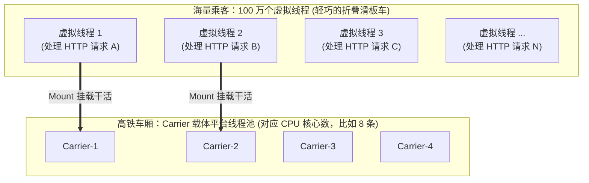

# 🚀 11 · 虚拟线程深入（Java 21 划时代高并发革命）

> **一句话导读**：单机轻松承载 100 万并发不再是天方夜谭！Java 21 推出的**虚拟线程（Virtual Threads）**彻底终结了“回调地狱”，让我们重归最自然、最优雅的“一请求一线程”同步编程时代。

---

## 💥 历史痛点：平台线程为什么“太贵了”？

在 Java 21 之前，Java 里的线程被称为**平台线程（Platform Thread）**：
- **1:1 内核绑定**：你每 `new` 一个 Java 线程，底层操作系统就必须创建一个沉重的内核线程。
- **内存占用沉重**：每个平台线程默认分配约 1MB 栈内存。如果开 2000 个线程，光线程栈就吃掉 2GB 内存！
- **上下文切换昂贵**：操作系统在几千个内核线程间切换调度，CPU 耗费大量算力在“保存现场与恢复现场”的内核态开销上。

为了榨干多核性能，业界曾被迫走向**响应式编程（Reactive Programming，如 WebFlux / RxJava）**。虽然吞吐量上去了，但代码被拆成碎片化的回调链条，调用栈支离破碎，排查错误时犹如天书，被开发者戏称为“程序员的折寿地狱”。

---

## 🚅 核心心智模型：高铁与折叠滑板车

Java 21（Project Loom）给出了堪称降维打击的答案——**虚拟线程（Virtual Threads）**：



### 挂载（Mount）与卸载（Unmount）的魔法：
1. **轻如鸿毛**：虚拟线程是由 **JVM 自身管理的用户态线程**，初始内存开销仅有几百字节，创建 100 万个虚拟线程占用的内存还不如十几个平台线程多！
2. **遇水让路（智能卸载）**：
   - 虚拟线程 1 正在 Carrier 载体线程上全速运算（**Mount 挂载**）；
   - 突然它发起了网络调用（如 `httpClient.send`、查 MySQL、`Thread.sleep`），需要等待 200ms；
   - **JVM 瞬间将虚拟线程 1 的调用栈原样保存在堆内存中，并将其从 Carrier 线程上卸载（Unmount）！**
   - Carrier 载体线程立刻转身去执行虚拟线程 2 的代码；
   - 200ms 后网络数据返回，JVM 调度器随便找一个空闲的 Carrier 线程，把虚拟线程 1 的栈重新恢复（**重新 Mount**），接着往下跑！

> 🌟 **终极意义**：
> 你可以像写单线程代码一样，简单直白地写**同步阻塞代码**，而底层却获得了超越反应式异步非阻塞的惊人吞吐量！

---

## 💻 震撼实验：一口气跑 10 万个并发任务！

保存为 `VirtualMillionDemo.java` 亲自见证奇迹：

```java
import java.time.Duration;
import java.time.Instant;
import java.util.concurrent.Executors;
import java.util.stream.IntStream;

public class VirtualMillionDemo {
    public static void main(String[] args) {
        Instant start = Instant.now();

        // 为每个任务创建一个轻量的虚拟线程（Java 21 新增神器）
        try (var executor = Executors.newVirtualThreadPerTaskExecutor()) {
            // 一口气提交 10 万个并发任务！
            IntStream.range(0, 100_000).forEach(i -> {
                executor.submit(() -> {
                    // 模拟每个请求都需要阻塞等待 1 秒（查数据库/调RPC）
                    Thread.sleep(Duration.ofSeconds(1));
                    return i;
                });
            });
        } // 自动 close 会等待这 10 万个任务全部执行完毕！

        Instant end = Instant.now();
        System.out.println("🎉 10 万个虚拟线程全部执行完毕！总耗时: " + 
                Duration.between(start, end).toMillis() + "ms");
    }
}
```

### 运行结果：
在普通的 8 核笔记本上运行，10 万个阻塞任务仅耗时 **约 1.5 秒到 2 秒** 全部完成！
而如果用旧时代的平台线程跑 10 万个，你的电脑早就在疯狂爆内存甚至直接蓝屏卡死了！

---

## ⚠️ 虚拟线程的两大使用禁忌与避坑军规

虚拟线程虽好，但绝不是“银弹”，盲目使用依然会踩大雷：

### 🚨 禁忌一：绝不要池化虚拟线程（Never Pool Virtual Threads）！
- **为什么？**
  - 传统线程池是因为创建平台线程太昂贵、销毁太心疼，才搞出池子复用；
  - 虚拟线程**廉价至极**，生命周期极短，用完就扔。
  - **最佳实践**：直接使用 `Executors.newVirtualThreadPerTaskExecutor()`，**一个任务一个虚拟线程**，永远不要把虚拟线程放进 `ThreadPoolExecutor` 里复用！

### 🚨 禁忌二：警惕“载体被钉住”（Thread Pinning）
当虚拟线程执行到以下两类代码并发生 I/O 阻塞时，JVM **无法完成卸载**，导致底层的 Carrier 平台线程被死死卡住无法转去服务其他人：
1. **在 `synchronized` 块内部发生阻塞**（注：JDK 24+ 已开始消除此限制，但在 JDK 21 LTS 下仍需警惕）；
2. **在执行 JNI 本地 Native 方法或外部 C 库时**。

> 🛡️ **生产解药**：
> 在可能会发生慢 I/O 等待的临界区中，将陈旧的 `synchronized` 改造替换为 **`ReentrantLock`**（`ReentrantLock` 底层使用 JUC 的 LockSupport，对虚拟线程的卸载机制 100% 友好兼容！）。

### 🚨 禁忌三：虚拟线程绝不适合 CPU 密集型计算
- 如果你的任务是全天候 100% 满负荷算质数、加解密、渲染视频，没有丝毫 I/O 阻塞等待；
- 此时瓶颈纯粹在于物理 CPU 核心算力本身，开虚拟线程不会带来任何额外提速，乖乖使用固定大小的核心平台线程池即可。

---

## 🧠 一分钟复盘核心记忆卡

1. **核心本质**：由 JVM 管理的用户态轻量线程，M 个虚拟线程复用 N 个载体平台线程（M:N 协程调度）。
2. **核心优势**：在 I/O 密集型业务中，同步代码风格获得非阻塞异步性能，彻底扫清反应式回调地狱。
3. **避坑铁律**：一任务一线程不搞池化；慢 I/O 避开 `synchronized` 优先用 `ReentrantLock`。

---

## 🧭 下一步

恭喜你！到这里，你已经掌握了 Java 并发的全部核心武器库！
然而在真实的高并发生产线上，即便架构再精妙，也难免会遭遇可怕的故障：**死锁、CPU 飙高 100%、线程池打满拒绝**。
线上着火了怎么抓凶手？
请进入第五阶段：[[14-死锁与并发问题排查]]！
