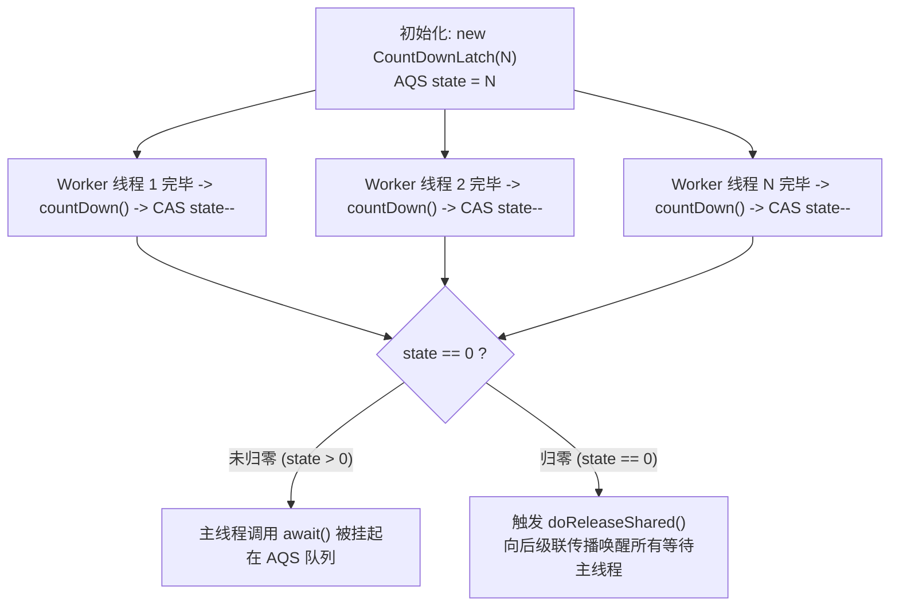
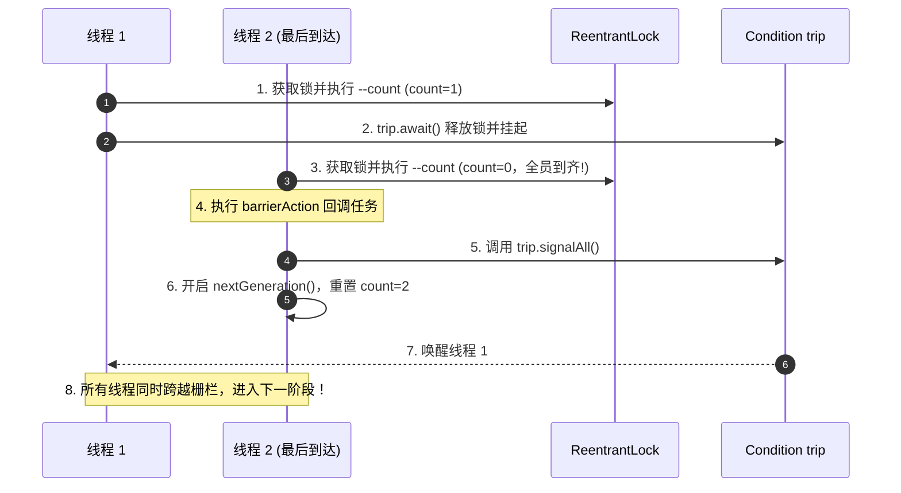
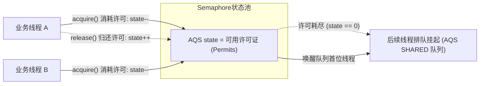

# 12 · JUC 同步工具类底层原理与协同架构

> **导读**：在多线程协作与分布式任务调度中，单纯的互斥锁（如 `ReentrantLock`）只能解决单一临界区的独占访问，无法优雅应对“主任务等待多子任务完成”、“多线程分步协同栅栏”以及“瞬时流量并发限流”等复杂协同场景。JUC 基于 AQS 共享模式与管程条件队列，封装了三大核心同步工具：`CountDownLatch`、`CyclicBarrier` 与 `Semaphore`。本文深入拆解三者的底层源码实现、状态转移模型与工业级高可用实战。

---

## 一、三大同步工具类核心能力矩阵

| 同步工具 | 核心底层架构 | 同步状态语义 | 是否支持循环复用 | 线程等待拓扑关系 | 典型工业级场景 |
| :--- | :--- | :--- | :---: | :--- | :--- |
| **`CountDownLatch`** | AQS 共享模式（`Sync`） | `state` 代表未完成的前置任务计数（从 N 递减至 0） | ❌ **单次使用**（不可重置） | 一个或多个监听线程等待一组前置工作线程完成 | 移动端首页多接口并行聚合、主任务批处理防早退 |
| **`CyclicBarrier`** | 显式锁与条件变量（`ReentrantLock` + `Condition`） | 内部计数器 `count` 减至 0 时触发换代（`nextGeneration`） | ✅ **支持无限循环** | 一组并发线程相互等待，彼此全员到齐后共同跨越栅栏 | 复杂科学计算分步汇总、分布式高并发压测流量齐发 |
| **`Semaphore`** | AQS 共享模式（支持公平/非公平） | `state` 代表当前可用的共享许可证数量（Permits） | ✅ **持续流转**（借出与归还动态平衡） | 许可证耗尽时，后续申请线程进入 AQS 队列阻塞等待 | 敏感数据库连接池保护、下游脆弱第三方系统防打垮限流 |

---

## 二、CountDownLatch 底层实现与源码剖析

### 1. AQS 共享模式状态流转
`CountDownLatch` 内部组合了一个继承自 AQS 的私有静态内部类 `Sync`：
- **初始化**：构造函数 `new CountDownLatch(N)` 会将 AQS 的 `state` 设为 $N$。
- **`await()` 底层时序**：调用 AQS 的 `acquireSharedInterruptibly(1)`。
  - 重写方法 `tryAcquireShared(arg)`：直接判定 `return (getState() == 0) ? 1 : -1;`。
  - 若 `state > 0`，返回 `-1`，当前调用线程被封装为 `Node.SHARED` 共享节点追加至 CLH 同步队列尾部并挂起；
  - 若 `state == 0`，返回 `1`，调用线程无阻塞穿透执行。
- **`countDown()` 底层时序**：调用 AQS 的 `releaseShared(1)`。
  - 重写方法 `tryReleaseShared(arg)`：通过 CAS 自旋无锁递减 `state`；
  - 当且仅当某次递减后使得 `state == 0` 时，方法返回 `true`，触发 AQS 的 `doReleaseShared()`，顺着同步队列自头至尾向后**级联传播唤醒**所有处于挂起等待状态的主线程。



### 2. 电商详情页多服务并行聚合代码实战

```java
import java.util.concurrent.CountDownLatch;
import java.util.concurrent.TimeUnit;

public class ProductDetailAggregator {
    public static void main(String[] args) throws InterruptedException {
        long startTime = System.currentTimeMillis();
        // 定义 3 个子任务门禁
        CountDownLatch latch = new CountDownLatch(3);

        // 异步任务 1：查询商品基础 SKU 信息
        new Thread(() -> {
            try {
                Thread.sleep(150); // 模拟网络 RPC
                System.out.println("SKU 基础信息加载成功");
            } finally {
                // 🚨 铁律：countDown 必须写在 finally 块中，防止异常导致主线程死等！
                latch.countDown();
            }
        }).start();

        // 异步任务 2：查询商品库存实时数据
        new Thread(() -> {
            try {
                Thread.sleep(220);
                System.out.println("库存信息加载成功");
            } finally {
                latch.countDown();
            }
        }).start();

        // 异步任务 3：查询当前用户营销卡券权益
        new Thread(() -> {
            try {
                Thread.sleep(180);
                System.out.println("用户专属优惠券加载成功");
            } finally {
                latch.countDown();
            }
        }).start();

        // 主线程限时等待，设置 500ms 超时防卫，避免远程服务故障拖垮线程池
        boolean completed = latch.await(500, TimeUnit.MILLISECONDS);
        long cost = System.currentTimeMillis() - startTime;

        if (completed) {
            System.out.println("✅ 数据全量聚合成功，耗时: " + cost + "ms (接近单次最长 RPC 耗时)");
        } else {
            System.out.println("⚠️ 部分接口调用超时，触发降级兜底返回！");
        }
    }
}
```

---

## 三、CyclicBarrier 底层实现与循环换代

与 `CountDownLatch` 不同，`CyclicBarrier` **并未直接继承 AQS**，而是基于独占锁 `ReentrantLock` 搭配条件变量 `Condition` 实现多线程循环屏障。

### 1. 核心字段与“代（Generation）”的概念
```java
public class CyclicBarrier {
    private final ReentrantLock lock = new ReentrantLock();
    private final Condition trip = lock.newCondition();
    private final int parties;       // 每一代固定需要凑齐的线程总数
    private final Runnable barrierCommand; // 全员就位后触发的屏障回调任务
    
    private Generation generation = new Generation(); // 当前代标识
    private int count;              // 当前代剩余未就位的线程计数
    
    private static class Generation {
        boolean broken = false;     // 记录栅栏是否被破坏
    }
}
```

### 2. `await()` 执行时序与换代流程
1. **加锁互斥**：调用 `await()` 首先获取内部的独占可重入锁 `lock.lock()`。
2. **状态校验**：检查当前代的 `broken` 状态，若已破损直接抛出 `BrokenBarrierException`。
3. **计数递减**：`int index = --count;`
   - **全员到齐（`index == 0`）**：
     - 若指定了 `barrierCommand`，由当前最后一个到达的线程优先同步执行该回调逻辑；
     - 调用 `nextGeneration()`：唤醒条件队列上挂起的所有线程（`trip.signalAll()`）、重置计数 `count = parties`、生成全新的 `generation = new Generation()`，开启下一轮迭代。
   - **未到齐（`index > 0`）**：
     - 当前线程调用 `trip.await()` 释放锁并在条件队列中挂起等待。
4. **栅栏破损（Barrier Broken）机制**：如果在等待期间，某个线程被外部中断（`interrupt`）或发生超时，底层会调用 `breakBarrier()`，将 `generation.broken` 设为 `true`，并唤醒所有正在等待的其他线程，同步抛出 `BrokenBarrierException`，避免其余线程陷入无限等待。



---

## 四、Semaphore 底层实现与限流架构

`Semaphore`（信号量）用于控制同时访问特定共享资源的线程并发数量。

### 1. AQS 共享状态与许可流转
- **初始化**：`new Semaphore(permits)` 将 AQS 的 `state` 初始化为可用许可证数量。
- **获取许可（`acquire()`）**：
  - 调用 `acquireSharedInterruptibly(1)`。
  - **非公平模式（NonfairSync）**：`tryAcquireShared` 内部执行自旋 CAS 计算 `int remaining = current - acquires;`。若 `remaining < 0`，返回负数，当前线程进入 AQS 队列排队；若 `remaining >= 0` 且 CAS 成功，返回剩余数，直接获取成功。
  - **公平模式（FairSync）**：在 CAS 前调用 `hasQueuedPredecessors()`，若队列前方已有正在排队的线程，严禁插队，直接返回 `-1` 入队等待，严格遵循先进先出（FIFO）。
- **释放许可（`release()`）**：
  - 调用 `releaseShared(1)`。
  - 通过 CAS 自旋增加 `state`：`int current = getState(); int next = current + releases;`。
  - 释放成功后唤醒同步队列中的后继等待节点。



---

### 场景演示：发射自检、车队集结与通行限流

- **火箭发射前各组自检打卡（`CountDownLatch`）**：总控台（主线程）等待 3 项自检完成（`await()`），电力、燃料、气象 3 个小组各自检毕打卡（`countDown()` 扣减 AQS `state`），计数归零瞬间总控台被唤醒点火（一次性不可重置）；
- **越野车队分段集结发车（`CyclicBarrier`）**：5 辆车穿越沙漠，先到一号集结点的车辆在栅栏前熄火等待（`trip.await()`），全员到齐后领航员统一鸣笛（触发 `barrierCommand` 回调），栅栏放行并开启下一赛段（循环复用 Generation）；
- **古桥景区承载力限流（`Semaphore` 信号量）**：桥上限行 50 人（许可证 `permits = 50`），游客上桥必须领走一张通行号牌（`acquire()` 扣减 AQS `state`），桥上满员则后续游客在门外排队，下桥出闸时归还号牌（`release()`）即放行下一人。

---

## 🧭 下一步

掌握了基于 AQS 打造的显式锁与高级同步协作工具后，我们已经完整建立了单机高并发的核心控制图谱。
然而在企业级系统架构中，任意创建非托管的裸线程（`new Thread`）会引发 CPU 资源耗尽与系统崩溃灾难。
工业级生产开发必须依赖**线程池（ThreadPoolExecutor）**统一调度与管控线程生命周期。
请进入下一篇核心实战：[[07-线程池原理与参数]]！
