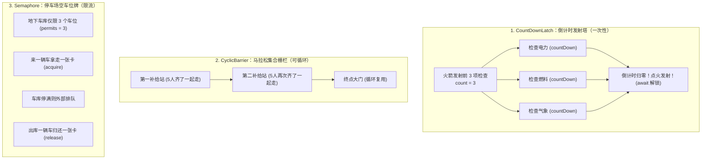

# 🚥 12 · JUC 同步工具类（团队协作三大红绿灯）

> **一句话导读**：多线程协作不能靠瞎猜（`sleep` 猜时间）。JUC 为我们量身打造了三款“指挥交通红绿灯”——组团开黑的 `CountDownLatch`、集结发车的 `CyclicBarrier` 与车位限流的 `Semaphore`。

---

## 🎭 核心心智模型：三大神器生活大白话



| 工具名称 | 核心机制 | 能否重复使用？ | 谁在等？ | 典型场景 |
| :--- | :--- | :--- | :--- | :--- |
| **`CountDownLatch`** | 减法计数器（从 N 减到 0） | ❌ **一次性**（减到 0 后不可重置） | 一个或多个线程等待“某些事件全部发生” | 接口多服务并行查询、主线程等待子任务全部完成 |
| **`CyclicBarrier`** | 集合栅栏（凑齐人数一起放行） | ✅ **可循环复用** | 所有参与的线程互相等待“彼此全部到齐” | 多线程分步并行计算、模拟高并发压测齐发 |
| **`Semaphore`** | 许可证发放与回收 | ✅ **长期流转** | 抢不到许可证的线程在门外等待 | 接口高并发限流、数据库连接池 |

---

## 🚀 1. CountDownLatch：组团开黑与多接口并行查询

### 🎮 生活比喻：王者荣耀 5 排组队
房间里需要凑齐 5 个人。房主开好了房间（`new CountDownLatch(5)`）在等待（`await()`）。5 个玩家陆陆续续点进房间并点击“准备”（`countDown()`）。只要最后一个人准备完毕，倒计时归零，游戏立刻开局！

### 💻 电商实战：微服务详情页并行聚合（避免串行卡顿）

```java
import java.util.concurrent.CountDownLatch;
import java.util.concurrent.TimeUnit;

public class ProductDetailAggregatorDemo {
    public static void main(String[] args) throws InterruptedException {
        long start = System.currentTimeMillis();
        // 门禁：需要等 3 个远程微服务接口返回
        CountDownLatch latch = new CountDownLatch(3);

        // 模拟接口 1：查商品基础信息（耗时 200ms）
        new Thread(() -> {
            try {
                Thread.sleep(200);
                System.out.println("1. 商品基本信息获取成功！");
            } catch (InterruptedException ignored) {
            } finally {
                latch.countDown(); // 减 1
            }
        }).start();

        // 模拟接口 2：查商品库存（耗时 300ms）
        new Thread(() -> {
            try {
                Thread.sleep(300);
                System.out.println("2. 商品库存获取成功！");
            } catch (InterruptedException ignored) {
            } finally {
                latch.countDown(); // 减 1
            }
        }).start();

        // 模拟接口 3：查用户专属优惠券（耗时 250ms）
        new Thread(() -> {
            try {
                Thread.sleep(250);
                System.out.println("3. 用户优惠券获取成功！");
            } catch (InterruptedException ignored) {
            } finally {
                latch.countDown(); // 减 1
            }
        }).start();

        // 主线程在此等待，最多等 1 秒（防止某个服务挂掉导致死等）
        boolean allDone = latch.await(1, TimeUnit.SECONDS);
        long cost = System.currentTimeMillis() - start;

        if (allDone) {
            System.out.println("🎉 所有数据全部加载完毕，组装返回！总耗时: " + cost + "ms (接近最长单接口耗时)");
        } else {
            System.out.println("⚠️ 部分接口超时未返回，执行降级处理！");
        }
    }
}
```

> [!TIP]
> **生产避坑铁律**：`countDown()` **必须写在 `finally` 块中**！如果放在业务代码末尾，一旦中途抛出运行时异常导致 `countDown()` 没执行，主线程就会在 `await` 处死等直到超时。

---

## 🏃 2. CyclicBarrier：分阶段集结号与高并发齐发

### 🧗 生活比喻：旅行团爬山
导游带领 3 名队员爬山（`new CyclicBarrier(3, barrierAction)`）。谁先爬到半山腰的休息亭，谁就坐下等（`barrier.await()`）。只有当 3 个人全到了，导游宣布：“大家合影留念，继续向山顶进发！”。到了山顶，大家再次等齐，循环往复。

### 💻 实战代码：模拟 3 个运动员发令起跑

```java
import java.util.concurrent.CyclicBarrier;

public class CyclicBarrierDemo {
    public static void main(String[] args) {
        int runners = 3;
        // 构造参数 1：需要等几个人；参数 2：人齐之后顺手执行的回调任务
        CyclicBarrier barrier = new CyclicBarrier(runners, () -> {
            System.out.println("📣【发令枪响】所有运动员已就位，起跑！\n");
        });

        for (int i = 1; i <= runners; i++) {
            final int id = i;
            new Thread(() -> {
                try {
                    System.out.println("运动员 " + id + " 正在走向起跑线...");
                    Thread.sleep((long) (Math.random() * 1000)); // 走过去的耗时不同
                    System.out.println("运动员 " + id + " 已就位，等待其他人...");
                    
                    // 所有人卡在此处等待，直到最后一个人到达！
                    barrier.await(); 

                    // 栅栏放行后，大家同时往下冲！
                    System.out.println("运动员 " + id + " 飞奔冲刺！");
                } catch (Exception e) {
                    e.printStackTrace();
                }
            }).start();
        }
    }
}
```

---

## 🅿️ 3. Semaphore：地下车库限流与资源控制

### 🚗 生活比喻：仅有 3 个车位的停车场
- 停车场只有 3 个车位（`new Semaphore(3)`）。
- 来了 5 辆车抢车位，先到先得。前 3 辆顺利进库（`acquire()`，剩余许可扣减为 0）；
- 后来的第 4、第 5 辆车只能在道闸口排队等待；
- 只要里面有一辆车办完离开（`release()`），道闸立刻放行下一辆车进库！

### 💻 实战代码：保护下游脆弱系统的限流器

```java
import java.util.concurrent.ExecutorService;
import java.util.concurrent.Executors;
import java.util.concurrent.Semaphore;

public class SemaphoreRateLimitDemo {
    public static void main(String[] args) {
        // 限流：最多只允许 3 个并发线程同时调用敏感资源
        Semaphore semaphore = new Semaphore(3);
        ExecutorService pool = Executors.newFixedThreadPool(6);

        for (int i = 1; i <= 6; i++) {
            final int userId = i;
            pool.execute(() -> {
                try {
                    System.out.println("用户 " + userId + " 正在排队申请令牌...");
                    semaphore.acquire(); // 拿不到令牌就挂起等待
                    
                    System.out.println("✅ 用户 " + userId + " 拿到令牌！正在办理业务...");
                    Thread.sleep(1500); // 模拟业务处理
                    System.out.println("👋 用户 " + userId + " 业务办理完毕，归还令牌。");
                } catch (InterruptedException e) {
                    Thread.currentThread().interrupt();
                } finally {
                    semaphore.release(); // 务必在 finally 归还许可证！
                }
            });
        }
        pool.shutdown();
    }
}
```

---

## ⚖️ 面试大热点：CountDownLatch vs CyclicBarrier 深度辨析

很多面试官喜欢刁难：“都是等人齐，这两个到底有什么本质区别？”

| 对比维度 | `CountDownLatch` | `CyclicBarrier` |
| :--- | :--- | :--- |
| **等待的主体** | **某个监听线程在等其他线程完成**（主线程当监工） | **参与的多个线程彼此互相等待**（队员互相等） |
| **计数方式** | 减法。一个人可以连续多次 `countDown()` | 减法计数到 0 后自动重置。必须每个线程调用一次 `await()` |
| **可否复用** | ❌ **一次性**，计数变成 0 无法复原 | ✅ **可反复循环使用** |
| **异常行为** | 某个子任务异常，只要计数减了就不影响其他人继续 | 某个线程被中断或超时，整个栅栏会被破坏（`BrokenBarrierException`） |

---

## 🧠 一分钟复盘核心记忆卡

- **`CountDownLatch`**：火箭发射倒计时，多等一，只能用一次。
- **`CyclicBarrier`**：集合发车，互相等，可循环多轮。
- **`Semaphore`**：车位牌限流，许可借出必须归还，平滑高并发洪峰。

---

## 🧭 下一步

前面我们创建线程都是 `new Thread(...)`。但在生产工业级项目里，**随意 `new Thread` 简直就是自寻死路**！
工业界必须使用**线程池**来集中管控线程资源。
请进入第三阶段第一篇重头戏：[[07-线程池原理与参数]]！
