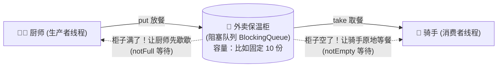
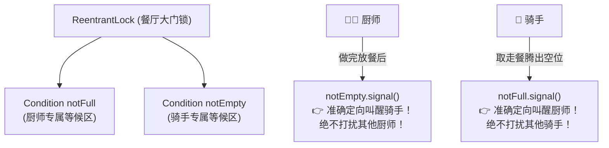

# 📦 13 · 线程协作与阻塞队列（外卖保温柜的协作哲学）

> **一句话导读**：单靠锁只能解决“抢地盘”，无法解决“互相打配合”。用“外卖保温柜与餐厅传菜口”的生产者—消费者模型，带你彻底搞懂从 `wait/notify` 到 `Condition`，再到工业级 `BlockingQueue` 的进化之路。

---

## 🥡 核心心智模型：外卖保温柜与传菜口

在多线程世界里，光有互斥锁是不够的：
> 想象一个场景：
> - **厨师（生产者）** 炒完菜，要放到外卖保温柜里；
> - **骑手（消费者）** 赶到店里，要从保温柜取走外卖。



- **柜子空了**：骑手来取餐，发现柜子里空空如也。他不能像无头苍蝇一样每隔 1 毫秒开一次柜门（消耗 CPU），而应该去旁边坐下**等候通知**。
- **柜子满了**：厨师炒菜极快，把柜子塞爆了。厨师必须**暂停做菜**，等骑手拿走一份腾出空间后，再继续炒菜。

这就是并发编程最经典的**生产者—消费者模型**。实现这套协作，Java 经历了 **三代技术的演进**：

---

## 👴 第一代：原始的 `wait()` 与 `notify()`

在 Java 最早期，所有线程协作都必须挂在 `Object` 对象的监视器锁上。

```java
public class ClassicWaitNotifyDemo {
    private String food = null;

    // 骑手取餐
    public synchronized String takeFood() throws InterruptedException {
        // 🚨 核心铁律：必须用 while 循环检查条件，绝不能用 if！
        while (food == null) {
            System.out.println("骑手：没餐了，我交出锁，在旁边等通知...");
            wait(); // 释放锁，线程挂起休眠！
        }
        String myFood = food;
        food = null; // 取走餐
        System.out.println("骑手：顺利取走 [" + myFood + "]，通知厨师做菜！");
        notifyAll(); // 唤醒等待的厨师
        return myFood;
    }

    // 厨师做餐
    public synchronized void putFood(String newFood) {
        while (food != null) {
            try { wait(); } catch (InterruptedException e) { Thread.currentThread().interrupt(); }
        }
        this.food = newFood;
        System.out.println("厨师：做好了 [" + newFood + "] 放入柜子，通知骑手！");
        notifyAll(); // 唤醒等待的骑手
    }
}
```

### ⚠️ 面试必考连环问：为什么必须用 `while` 不能用 `if`？
很多新手会写 `if (food == null) { wait(); }`。
**这是致命的 Bug！因为存在“虚假唤醒（Spurious Wakeup）”！**
1. 操作系统在底层可能在没有收到任何通知的情况下由于信号中断等原因意外唤醒线程；
2. 如果有多个骑手在等餐，厨师放进 1 份餐后调用了 `notifyAll()`，所有骑手同时被叫醒争抢同一把锁；
3. 第一个骑手抢到锁把餐拿走了，轮到第二个骑手醒来往下走时，餐已经没了！如果是 `if`，他就直接往下执行取空气，报空指针异常；**而用 `while`，他醒来后会重新判断一次条件**，发现还是空的，自觉继续休眠！

---

## 👦 第二代：精准呼叫的 `Condition`

`Object.wait()` 有个极其令人头疼的缺陷：**只有一个全局等待池**。
- 厨师做好了菜，想叫醒骑手，调用 `notifyAll()` 却会**把其他正在等待的厨师也一起吵醒**！这在并发高时会引发无意义的 CPU 争抢（惊群效应）。

`ReentrantLock` 带来的 **`Condition`（条件对象）** 彻底解决了这个问题：**一把大锁可以绑定多个独立的条件队列！**



### 💻 经典手写一个固定容量的有界队列

```java
import java.util.concurrent.locks.Condition;
import java.util.concurrent.locks.ReentrantLock;

public class BoundedBuffer<T> {
    private final Object[] items;
    private int putIndex, takeIndex, count;
    
    private final ReentrantLock lock = new ReentrantLock();
    private final Condition notFull = lock.newCondition();  // 厨师等候条件
    private final Condition notEmpty = lock.newCondition(); // 骑手等候条件

    public BoundedBuffer(int capacity) {
        items = new Object[capacity];
    }

    // 生产放餐
    public void put(T x) throws InterruptedException {
        lock.lock();
        try {
            while (count == items.length) {
                // 柜子满了，厨师去专属条件区休眠
                notFull.await(); 
            }
            items[putIndex] = x;
            if (++putIndex == items.length) putIndex = 0;
            count++;
            // 定向叫醒等待的骑手！
            notEmpty.signal();
        } finally {
            lock.unlock();
        }
    }

    // 消费取餐
    @SuppressWarnings("unchecked")
    public T take() throws InterruptedException {
        lock.lock();
        try {
            while (count == 0) {
                // 柜子空了，骑手去专属条件区休眠
                notEmpty.await(); 
            }
            T x = (T) items[takeIndex];
            if (++takeIndex == items.length) takeIndex = 0;
            count--;
            // 定向叫醒等待的厨师！
            notFull.signal();
            return x;
        } finally {
            lock.unlock();
        }
    }
}
```

---

## 👨 第三代：工业级开箱即用——`BlockingQueue`

在真实的生产开发中，我们**几乎不需要自己手写上面的锁和 Condition**。
JUC 早就帮我们封装好了工业级利器：**`BlockingQueue`（阻塞队列）**！

### 核心操作方法分类（搞清四组 API）：

| 操作类型 | 抛出异常 | 返回特殊值 | 阻塞等待到底（推荐） | 超时退出（推荐） |
| :--- | :--- | :--- | :--- | :--- |
| **插入元素** | `add(e)` (满则抛异常) | `offer(e)` (满则返回 false) | **`put(e)`** (满则挂起死等) | **`offer(e, timeout, unit)`** (限时等待) |
| **移除元素** | `remove()` (空则抛异常) | `poll()` (空则返回 null) | **`take()`** (空则挂起死等) | **`poll(timeout, unit)`** (限时等待) |
| **检查元素** | `element()` | `peek()` | 不支持 | 不支持 |

---

## 🏆 阻塞队列家族四大天王选型

| 队列名称 | 底层数据结构 | 容量特点 | 核心特点与避坑 |
| :--- | :--- | :--- | :--- |
| **`ArrayBlockingQueue`** | 数组 | **必须指定有界容量** | 内部只有 **1 把锁** 共同控制入队与出队，简单稳定，适合小吞吐量确定容量场景。 |
| **`LinkedBlockingQueue`** | 单向链表 | **可选有界**（默认 `Integer.MAX_VALUE`） | 内部有 **2 把锁**（`putLock` 和 `takeLock`），入队和出队互不干扰，吞吐量极大！**🚨 生产避坑：绝不能使用默认无参构造！否则默认近 20 亿的容量会在任务堆积时直接把内存打爆 OOM！** |
| **`SynchronousQueue`** | 无缓冲队列 | **容量为 0** | **“一手交钱，一手交货”**。没有空间存数据，每个 put 必须等一个 take，否则直接阻塞。常用于线程池 `Executors.newCachedThreadPool()`。 |
| **`DelayQueue`** | 优先级堆 | 无界 | 元素必须实现 `Delayed` 接口，只有到了指定的到期时间才能被 `take()` 出来。经典场景：**订单 30 分钟未支付自动超时关闭、缓存自动过期**。 |

---

## 💻 工业级生产实战：优雅的生产者—消费者

保存为 `BlockingQueueDemo.java`：

```java
import java.util.concurrent.ArrayBlockingQueue;
import java.util.concurrent.BlockingQueue;
import java.util.concurrent.TimeUnit;

public class BlockingQueueDemo {
    public static void main(String[] args) throws InterruptedException {
        // 容量为 3 的保温柜
        BlockingQueue<String> queue = new ArrayBlockingQueue<>(3);

        // 生产者线程：厨师做菜
        Thread producer = new Thread(() -> {
            try {
                for (int i = 1; i <= 5; i++) {
                    String order = "订单#" + i;
                    System.out.println("👨‍🍳 厨师：准备放餐 " + order);
                    queue.put(order); // 柜子满了会自动在这里阻塞等待！
                    System.out.println("✅ 厨师：已放入 " + order + "，当前柜子数量: " + queue.size());
                    Thread.sleep(200); // 炒菜耗时
                }
            } catch (InterruptedException e) {
                Thread.currentThread().interrupt();
            }
        });

        // 消费者线程：骑手取餐
        Thread consumer = new Thread(() -> {
            try {
                while (true) {
                    // 超时等待取餐，超过 2 秒没新单就自动打卡下班
                    String order = queue.poll(2, TimeUnit.SECONDS);
                    if (order == null) {
                        System.out.println("🛵 骑手：等了 2 秒没新单，打卡收工！");
                        break;
                    }
                    System.out.println("🛵 骑手：取到 " + order + "，开始配送！");
                    Thread.sleep(600); // 配送耗时比做菜慢，模拟积压
                }
            } catch (InterruptedException e) {
                Thread.currentThread().interrupt();
            }
        });

        producer.start();
        consumer.start();
        producer.join();
        consumer.join();
    }
}
```

---

## 🧠 一分钟复盘核心记忆卡

1. **协作核心**：条件不满足时交出锁休眠（`wait/await`），条件改变后通知对方醒来（`notify/signal`）。
2. **防坑军规**：等待条件检查**永远使用 `while` 而非 `if`**，防止虚假唤醒。
3. **工具选型**：能用现成的 `BlockingQueue` 就绝不要自己手写锁与条件唤醒；创建 `LinkedBlockingQueue` 时**必须显式指定容量大小**，坚决对无界队列说“不”。

---

## 🧭 下一步

掌握了阻塞队列，你就已经掌握了后面核心组件——**线程池**的半壁江山！
不过在进入线程池之前，JUC 还有三把极度高频的“多线程红绿灯”——`CountDownLatch`、`Semaphore` 与 `CyclicBarrier`。
请进入下一篇：[[12-JUC同步工具类]]！
