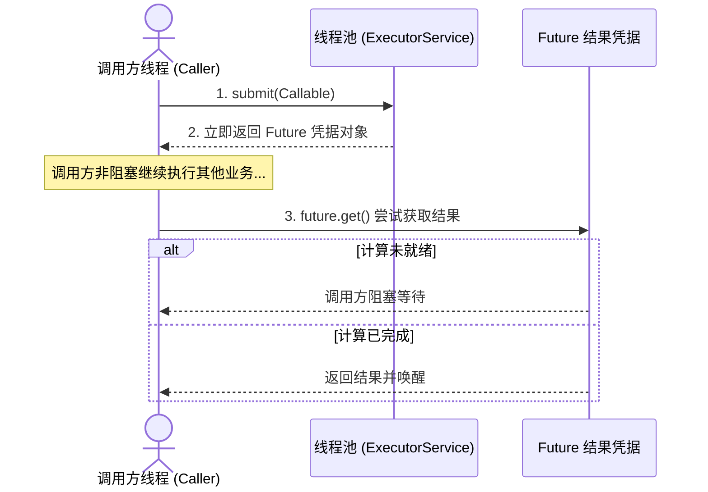
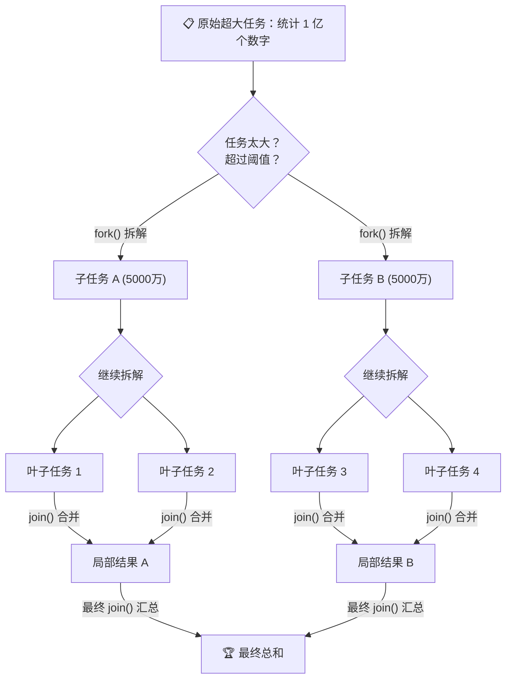
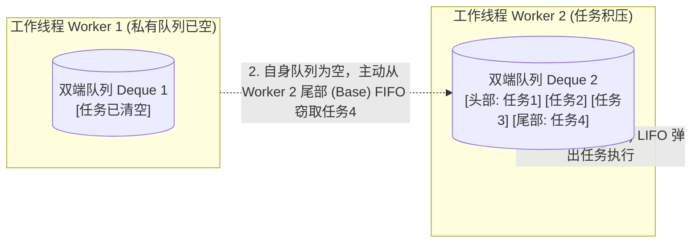

# 📜 15 · Future 与 ForkJoin 任务模型（异步凭证与工作窃取机制）

> **一句话导读**：异步任务如何获取计算结果？超大计算任务如何高效并行拆解？掌握 Future 异步凭证模型与 ForkJoinPool 的分治及工作窃取（Work-Stealing）算法，深入理解现代任务并发体系。

---

## 📜 核心概念：Future 异步结果模型
 
在并发编程中，不同任务提交接口遵循不同的返回值契约：
- **`Runnable`**：无返回值（`void run()`），仅负责异步触发执行，调用端无法直接拿到计算结果或捕获受检异常；
- **`Callable<V>`**：具备返回值（`V call() throws Exception`），允许异步计算并抛出受检异常；
- **`Future<V>`**：异步计算结果的占位凭证（Placeholder / Promise），代表一个在未来某个时间点可供读取的计算结果。

### 1. 异步结果获取生命周期



### 💻 极简体验代码

```java
import java.util.concurrent.*;

public class FutureBasicsDemo {
    public static void main(String[] args) throws Exception {
        ExecutorService pool = Executors.newSingleThreadExecutor();

        // 提交一个带返回值的异步任务
        Future<String> future = pool.submit(() -> {
            Thread.sleep(1000); // 模拟耗时远程计算或数据聚合
            return "SUCCESS: 异步计算结果报表";
        });

        System.out.println("主线程：已提交异步任务并持有 Future 凭证，继续执行本地其他逻辑...");

        // 1. 检查任务是否已就绪（非阻塞）
        System.out.println("任务已执行完毕？" + future.isDone()); // false

        // 2. 获取异步结果：若计算未完成，get() 会在此阻塞等待！
        // 💡 生产推荐：永远使用带超时的 get(timeout, unit)，规避依赖服务卡死！
        String result = future.get(2, TimeUnit.SECONDS);
        System.out.println("主线程：成功获取异步返回结果 -> " + result);

        pool.shutdown();
    }
}
```

---

## 😤 传统 Future 的三大硬伤（为什么要引入 CompletableFuture？）

传统的 `Future` 虽好，但在复杂的工程场景下，它有三个让人抓狂的缺陷：

1. **必须阻塞死等（`get()` 阻塞）**：想拿结果，要么在 `future.get()` 前傻等，要么写一个低效的 `while (!future.isDone())` 死循环轮询，白白浪费 CPU。
2. **无法链式回调（无法编排流水线）**：
   - 比如：“外卖做好了 -> 请自动叫骑手配送 -> 骑手送达后 -> 请自动发短信给客户”。
   - 传统的 `Future` 根本没有 `thenRun` 这种回调函数，你必须自己写一堆复杂的嵌套代码。
3. **多任务聚合极度别扭**：
   - 如果你要同时查 10 个接口，任何一个返回就行，或者 10 个全部返回才合并。传统 `Future` 要写极其繁琐的样板代码。

为了解决这三大痛点，Java 8 彻底推出了革命性的 **`CompletableFuture`**（我们在下一篇 [[09-CompletableFuture异步编程]] 会深度拆解！）。

---

## 🪓 ForkJoinPool：任务分治拆解与工作窃取算法

当你面临一个**体量极其庞大的 CPU 密集型任务**（例如计算 1 亿个整数的总和、超大规模图像像素处理）时，单线程算太慢，普通线程池拆分又太繁琐。

Java 7 为此专门推出了 **`ForkJoinPool`** 框架。它的底层灵魂是两个：**分治（Fork/Join）** 与 **工作窃取（Work-Stealing）**。

### 1. 分治思想（Fork & Join）



---

## ⚙️ 核心机制：工作窃取算法（Work-Stealing）

在递归分治场景下，不同子任务的计算复杂度或数据量可能存在差异，容易导致**线程负载失衡**：部分线程已执行完所有任务陷入空闲，而其他线程的队列中仍积压着大量未处理任务。

`ForkJoinPool` 通过**工作窃取算法（Work-Stealing）**充分压榨多核 CPU 算力：



### 底层运行规则与设计优势：
1. **独立双端队列（WorkQueue）**：每个工作线程都维护一个私有的双端队列（基于数组循环队列实现的 Deque）；
2. **本地 LIFO 访问**：工作线程在处理自己生成的子任务时，从私有队列的**头部（Top）压入和弹出**任务（后进先出），能够最大化利用 CPU 缓存局部性（Cache Locality）；
3. **窃取端 FIFO 访问**：当空闲工作线程的队列为空时，它会作为“窃取者（Stealer）”随机选择另一个工作队列，从其**尾部（Base）窃取**任务（先进先出）；
4. **两端操作消除竞争**：拥有者从头部存取，窃取者从尾部窃取，**访问队列两端天然隔离**，绝大部分情况下无需加全局互斥锁，仅在队列仅剩最后一个元素时通过 CAS 协同，极大降低了线程间争抢的开销。

---

## 💻 实战代码：用 ForkJoin 计算 1 亿个数之和

保存为 `ForkJoinSumDemo.java`：

```java
import java.util.concurrent.ForkJoinPool;
import java.util.concurrent.RecursiveTask;

// 继承 RecursiveTask<T>（带返回值的分治任务）
public class ForkJoinSumDemo extends RecursiveTask<Long> {
    private static final int THRESHOLD = 10_000; // 任务切分阈值：1万
    private final long[] numbers;
    private final int start;
    private final int end;

    public ForkJoinSumDemo(long[] numbers, int start, int end) {
        this.numbers = numbers;
        this.start = start;
        this.end = end;
    }

    @Override
    protected Long compute() {
        int length = end - start;
        // 1. 如果任务足够小，直接单线程循环计算
        if (length <= THRESHOLD) {
            long sum = 0;
            for (int i = start; i < end; i++) {
                sum += numbers[i];
            }
            return sum;
        }

        // 2. 任务太大，一劈为二，递归 fork
        int middle = start + length / 2;
        ForkJoinSumDemo leftTask = new ForkJoinSumDemo(numbers, start, middle);
        ForkJoinSumDemo rightTask = new ForkJoinSumDemo(numbers, middle, end);

        // 异步执行左半部分
        leftTask.fork();
        // 右半部分在当前线程计算（节省一次线程调度）
        Long rightResult = rightTask.compute();
        // 等待左半部分结果
        Long leftResult = leftTask.join();

        // 3. 汇总合并
        return leftResult + rightResult;
    }

    public static void main(String[] args) {
        long[] data = new long[10_000_000]; // 1000万数据
        for (int i = 0; i < data.length; i++) data[i] = i + 1;

        ForkJoinPool pool = new ForkJoinPool();
        ForkJoinSumDemo task = new ForkJoinSumDemo(data, 0, data.length);

        long start = System.currentTimeMillis();
        Long total = pool.invoke(task);
        long cost = System.currentTimeMillis() - start;

        System.out.println("计算完毕！总和 = " + total + "，耗时: " + cost + "ms");
        pool.shutdown();
    }
}
```

> 💡 **彩蛋**：Java 8 引入的 `parallelStream()`（并行流），其底层默认使用的就是全局公共的 `ForkJoinPool.commonPool()`！

---

## 🧠 一分钟复盘核心记忆卡

1. **`Future`**：异步结果提货单。记得一定要带超时获取（`get(timeout)`），避免被慢任务永久卡死。
2. **`ForkJoinPool`**：CPU 密集型超大任务利器。核心两板斧：**分治拆解 + 工作窃取（双端队列防争抢）**。

---

## 🧭 下一步

前面说到，传统 `Future` 无法进行链式编排和多任务并行聚合。
Java 8 为此祭出了被称为“现代异步终极答案”的武器——**`CompletableFuture`**。
它是如何把异步编程写得像流水线一样丝滑的？
请进入下一篇：[[09-CompletableFuture异步编程]]！
