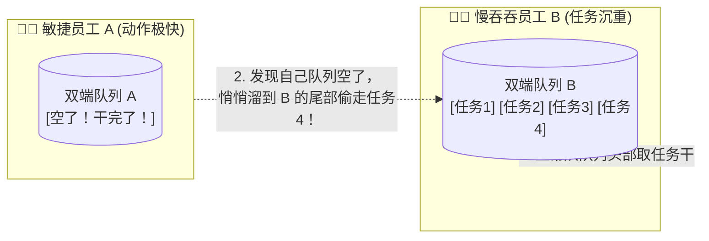

# 📜 15 · Future 与 ForkJoin 任务模型（外卖小票与工作窃取算法）

> **一句话导读**：异步任务执行完了怎么拿结果？大任务怎么高效拆解？掌握了“外卖小票”`Future` 和“敏捷打工人偷活”`ForkJoinPool`，你就掌握了任务并行分治的核心思想。

---

## 🎟️ 心智模型 1：Future——外卖小票的爱与恨

我们平时提交任务：
- `Runnable`：就像你派跑腿小哥去给朋友送花，你只管让他去（`void run()`），不需要他给你带回什么值。
- `Callable<V>`：就像你去奶茶店点了一杯波霸奶茶，店员收了钱，会交给你一张**取餐小票（`Future<V>`）**。

```mermaid
flowchart LR
    Client["你 (调用方线程)"] -->|1. submit(Callable)| Kitchen["🥤 奶茶吧台 (线程池)"]
    Kitchen -- "2. 立即给你一张取餐小票" --> Ticket["🎫 Future 结果凭证"]
    
    Note over Client: 你拿着小票刷手机、逛商场...<br/>(主线程不阻塞)
    
    Client -->|3. future.get() 凭票取茶| Ticket
    Ticket -.->|还没做好，只能站台前死等| Client
    Ticket -->|做好了，拿走奶茶！| Client
```

### 💻 极简体验代码

```java
import java.util.concurrent.*;

public class FutureBasicsDemo {
    public static void main(String[] args) throws Exception {
        ExecutorService pool = Executors.newSingleThreadExecutor();

        // 提交一个带返回值的任务
        Future<String> future = pool.submit(() -> {
            Thread.sleep(1000); // 模拟耗时制作
            return "🧋 珍珠奶茶（加冰五分糖）";
        });

        System.out.println("主线程：拿到了外卖小票，先去刷刷短视频...");

        // 1. 检查是否做好了（非阻塞）
        System.out.println("做好了吗？" + future.isDone()); // false

        // 2. 凭票取餐：若没做完，get() 会在此阻塞死等！
        // 💡 生产推荐：永远使用带超时的 get(2, TimeUnit.SECONDS)！
        String drink = future.get(2, TimeUnit.SECONDS);
        System.out.println("主线程：成功喝到 -> " + drink);

        pool.shutdown();
    }
}
```

---

## 😤 传统 Future 的三大硬伤（为什么要引入 CompletableFuture？）

传统的 `Future` 虽好，但在复杂的工程场景下，它有三个让人抓狂的缺陷：

1. **必须阻塞死等（`get()` 阻塞）**：想拿结果，要么在 `future.get()` 前傻等，要么写一个低效的 `while (!future.isDone())` 死循环轮询，白白浪费 CPU。
2. **无法链式回调（无法编排流水线）**：
   - 比如：“外卖做好了 -> 请自动叫骑手配送 -> 骑手送达后 -> 请自动发短信给客户”。
   - 传统的 `Future` 根本没有 `thenRun` 这种回调函数，你必须自己写一堆复杂的嵌套代码。
3. **多任务聚合极度别扭**：
   - 如果你要同时查 10 个接口，任何一个返回就行，或者 10 个全部返回才合并。传统 `Future` 要写极其繁琐的样板代码。

为了解决这三大痛点，Java 8 彻底推出了革命性的 **`CompletableFuture`**（我们在下一篇 [[09-CompletableFuture异步编程]] 会深度拆解！）。

---

## 🪓 心智模型 2：ForkJoinPool——大包干拆解与敏捷高手“偷活”

当你面临一个**体量极其庞大的 CPU 密集型任务**（例如计算 1 亿个整数的总和、超大规模图像像素处理）时，单线程算太慢，普通线程池拆分又太繁琐。

Java 7 为此专门推出了 **`ForkJoinPool`** 框架。它的底层灵魂是两个：**分治（Fork/Join）** 与 **工作窃取（Work-Stealing）**。

### 1. 分治思想（Fork & Join）

```mermaid
flowchart TD
    Big["📋 原始超大任务：统计 1 亿个数字"] --> Fork1{"任务太大？<br/>超过阈值？"}
    Fork1 -- "fork() 拆解" --> Sub1["子任务 A (5000万)"]
    Fork1 -- "fork() 拆解" --> Sub2["子任务 B (5000万)"]
    
    Sub1 --> Fork2{"继续拆解"}
    Sub2 --> Fork3{"继续拆解"}
    Fork2 --> Leaf1["叶子任务 1"] & Leaf2["叶子任务 2"]
    Fork3 --> Leaf3["叶子任务 3"] & Leaf4["叶子任务 4"]
    
    Leaf1 & Leaf2 -->|join() 合并| Join1["局部结果 A"]
    Leaf3 & Leaf4 -->|join() 合并| Join2["局部结果 B"]
    Join1 & Join2 -->|最终 join() 汇总| Final["🏆 最终总和"]
```

---

## 🥷 核心精髓：工作窃取算法（Work-Stealing）

很多团队总会有这种现象：活分下去之后，有的员工干得快，提前收工在摸鱼；有的员工分到的任务特别重，累死累活干不完。

`ForkJoinPool` 用极度精妙的机制杜绝了这种算力浪费：



1. 每个工作线程内部都有一个私有的**双端队列（Deque）**；
2. 线程自己干活时，从自己队列的**头部（Head）**拿任务；
3. 当一个敏捷线程把自己的队列全清空后，他绝不摸鱼休眠，而是主动去其他繁忙线程的队列**尾部（Tail）“窃取”一个任务**帮他执行！
4. **为什么一个从头拿，一个从尾偷？**
   - **完全避免冲突！** 两个线程访问队列的两端，几乎不需要加互斥大锁，极大降低了 CAS 竞争，将多核 CPU 的吞吐量压榨到了物理极致！

---

## 💻 实战代码：用 ForkJoin 计算 1 亿个数之和

保存为 `ForkJoinSumDemo.java`：

```java
import java.util.concurrent.ForkJoinPool;
import java.util.concurrent.RecursiveTask;

// 继承 RecursiveTask<T>（带返回值的分治任务）
public class ForkJoinSumDemo extends RecursiveTask<Long> {
    private static final int THRESHOLD = 10_000; // 任务切分阈值：1万
    private final long[] numbers;
    private final int start;
    private final int end;

    public ForkJoinSumDemo(long[] numbers, int start, int end) {
        this.numbers = numbers;
        this.start = start;
        this.end = end;
    }

    @Override
    protected Long compute() {
        int length = end - start;
        // 1. 如果任务足够小，直接单线程循环计算
        if (length <= THRESHOLD) {
            long sum = 0;
            for (int i = start; i < end; i++) {
                sum += numbers[i];
            }
            return sum;
        }

        // 2. 任务太大，一劈为二，递归 fork
        int middle = start + length / 2;
        ForkJoinSumDemo leftTask = new ForkJoinSumDemo(numbers, start, middle);
        ForkJoinSumDemo rightTask = new ForkJoinSumDemo(numbers, middle, end);

        // 异步执行左半部分
        leftTask.fork();
        // 右半部分在当前线程计算（节省一次线程调度）
        Long rightResult = rightTask.compute();
        // 等待左半部分结果
        Long leftResult = leftTask.join();

        // 3. 汇总合并
        return leftResult + rightResult;
    }

    public static void main(String[] args) {
        long[] data = new long[10_000_000]; // 1000万数据
        for (int i = 0; i < data.length; i++) data[i] = i + 1;

        ForkJoinPool pool = new ForkJoinPool();
        ForkJoinSumDemo task = new ForkJoinSumDemo(data, 0, data.length);

        long start = System.currentTimeMillis();
        Long total = pool.invoke(task);
        long cost = System.currentTimeMillis() - start;

        System.out.println("计算完毕！总和 = " + total + "，耗时: " + cost + "ms");
        pool.shutdown();
    }
}
```

> 💡 **彩蛋**：Java 8 引入的 `parallelStream()`（并行流），其底层默认使用的就是全局公共的 `ForkJoinPool.commonPool()`！

---

## 🧠 一分钟复盘核心记忆卡

1. **`Future`**：异步结果提货单。记得一定要带超时获取（`get(timeout)`），避免被慢任务永久卡死。
2. **`ForkJoinPool`**：CPU 密集型超大任务利器。核心两板斧：**分治拆解 + 工作窃取（双端队列防争抢）**。

---

## 🧭 下一步

前面说到，传统 `Future` 无法进行链式编排和多任务并行聚合。
Java 8 为此祭出了被称为“现代异步终极答案”的武器——**`CompletableFuture`**。
它是如何把异步编程写得像流水线一样丝滑的？
请进入下一篇：[[09-CompletableFuture异步编程]]！
