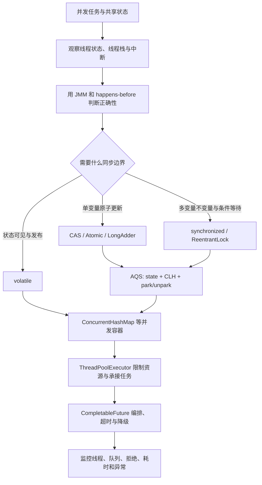

# 并发编程：本章总结与复习

> [!abstract] 一句话总结
> Java 并发的主线是先用线程状态和 JMM 判断程序如何运行、共享数据是否正确，再选择 volatile、CAS、锁与并发容器建立同步边界，最后用线程池和 CompletableFuture 治理任务、资源、超时与异常。

## 核心知识概览

| 模块 | 核心问题 | 关键结论 | 对应笔记 |
| --- | --- | --- | --- |
| 线程运行与诊断 | 线程处于什么状态，如何停止与排障 | interrupt 是协作式取消；CPU 高、锁竞争和队列等待要分别观察 RUNNABLE、BLOCKED、WAITING/TIMED_WAITING 及线程栈 | [[01-线程基础与生命周期]] |
| 内存语义 | 一个线程的写入何时能被另一个线程正确观察 | 并发正确性要落到原子性、可见性、有序性和 happens-before；没有同步关系时，未复现不等于正确 | [[02-Java内存模型JMM]] |
| 基础同步 | 只需可见性还是需要保护完整不变量 | volatile 适合状态标志和安全发布，不保证复合操作原子性；synchronized 提供互斥、可见性和可重入 monitor 语义 | [[03-volatile与synchronized]] |
| 原子更新与同步器 | 如何在竞争下更新状态并组织等待线程 | CAS 适合低竞争单变量更新，但有 ABA 和自旋成本；AQS 用 state、CLH 队列与 park/unpark 支撑独占和共享同步 | [[04-CAS与原子类]]、[[05-AQS原理]] |
| 显式锁 | 何时需要比 synchronized 更灵活的锁能力 | ReentrantLock 提供中断、超时、公平策略和多个 Condition；读写锁只在读多写少且临界区较长时更可能受益 | [[06-ReentrantLock与读写锁]] |
| 任务与资源治理 | 如何限制线程、缓冲流量并处理过载 | ThreadPoolExecutor 按 core → queue → max → reject 接收任务；参数必须受任务特征、下游容量和延迟目标约束 | [[07-线程池原理与参数]] |
| 并发数据结构 | 多线程如何安全共享 Map 和复合更新 | ConcurrentHashMap 用空桶 CAS、桶级 synchronized、协作扩容和分散计数；复合操作应使用 compute、merge、putIfAbsent | [[08-并发容器-ConcurrentHashMap]] |
| 异步编排 | 如何并行调用、组合结果并统一处理失败 | CompletableFuture 能转换、扁平化和合并异步阶段，但生产使用必须显式治理专属线程池、底层超时、异常和上下文传递 | [[09-CompletableFuture异步编程]] |

## 全章主线

## 快速复习

1. `Thread.start()` 才会创建新线程；直接调用 `run()` 只是在当前线程执行普通方法。`wait()` 会释放 monitor，`sleep()` 不会。
2. interrupt 不是强制终止。阻塞方法抛出 `InterruptedException` 时可能清除标志，不能处理取消就应恢复中断或继续向上抛出。
3. 共享可变状态是否安全，最终要看是否存在 happens-before；常见边界包括 volatile 写读、同一锁释放获取、`start`、`join`、`Future#get` 和门闩操作。
4. volatile 只保证可见性和相关有序性，`count++` 仍是读、改、写三步；保护多个变量的一致性要使用锁或其他原子边界。
5. CAS 低竞争时能减少阻塞，但竞争激烈会反复自旋；ABA 可用版本戳识别，CAS 重试循环中不能放不可重复的外部副作用。
6. AQS 把同步器统一成 `volatile state + CLH 等待队列`：获取失败的线程入队并 park，释放成功后唤醒后继；Condition 被 signal 后仍需重新竞争锁。
7. ReentrantLock 适合需要 `tryLock`、超时、可中断或多个 Condition 的场景；显式锁必须在 `finally` 中释放，读锁直接升级写锁可能死锁。
8. 线程池执行顺序是先 core、再入队、队列满后扩到 max、最后拒绝。生产中应显式使用有界队列、线程命名、拒绝/降级策略和业务隔离。
9. ConcurrentHashMap 的单次操作线程安全不代表任意“先查再改”组合安全；`computeIfAbsent` 等原子方法的回调必须短小，不能在桶级同步路径中执行慢 RPC。
10. CompletableFuture 的 Async 方法未指定 Executor 时通常使用 commonPool；`orTimeout` 只让 Future 超时完成，并不会自动停止底层 HTTP 或 JDBC 调用。

## 自测问题

1. 线上出现 CPU 飙高、接口卡住和线程数持续增长时，如何结合线程状态、线程名与 `jstack` 分别定位？
2. 为什么普通 boolean 停止标志和未同步发布对象可能出错？请用 happens-before 解释，而不是用“本机能运行”证明。
3. volatile、AtomicInteger、LongAdder、synchronized 与 ReentrantLock 分别适合什么场景，各自不能解决什么？
4. AQS 获取失败后的入队、park、唤醒和重新竞争流程是什么？公平锁与非公平锁的关键差别在哪里？
5. 如果数据库连接池最大为 20，为什么把查询线程池设置成 200 通常不能提升吞吐？线程池参数应和哪些指标一起确定？
6. 如何设计一条并行调用两个下游的 CompletableFuture 链，使其具备专属线程池、单调用超时、整体超时、降级和异常观测？

## 下一章衔接

下一章进入 [[../04-Spring生态/_index|Spring 生态]]：把本章的线程安全、代理调用边界、线程池隔离和 ThreadLocal 上下文带入 IoC 单例 Bean、AOP、事务、MVC 异步请求与微服务调用治理中。

## 相关编号双链

- 线程与内存：[[01-线程基础与生命周期]] · [[02-Java内存模型JMM]] · [[03-volatile与synchronized]]
- 同步机制：[[04-CAS与原子类]] · [[05-AQS原理]] · [[06-ReentrantLock与读写锁]]
- 工程实践：[[07-线程池原理与参数]] · [[08-并发容器-ConcurrentHashMap]] · [[09-CompletableFuture异步编程]]
