# 🏆 99 · 并发编程通关总复盘与面试全景图

> **一句话导读**：恭喜你通关了 Java 并发编程的所有硬核章节！这里将全章的核心骨架、生动比喻、避坑军规与大厂必考点提炼为终极复盘手册，助你在求职面试与生产实战中所向披靡。

---

## 🗺️ 并发知识大一统全景图

```mermaid
flowchart TD
    classDef root fill:#ffd666,stroke:#d48806,stroke-width:2px;
    classDef branch fill:#bae7ff,stroke:#1890ff,stroke-width:1px;

    Concurrency["Java 并发编程核心宇宙"]:::root

    Concurrency --> C1["1. 底座核心与硬件抽象"]:::branch
    C1 --> C11["线程生命周期与协作机制 ([[01-线程基础与生命周期]])"]
    C1 --> C12["JMM 规范与 Happens-Before 原则 ([[02-Java内存模型JMM]])"]
    C1 --> C13["volatile 内存屏障与 synchronized 锁升级 ([[03-volatile与synchronized]])"]
    C1 --> C14["CAS 硬件原子原语与 LongAdder 分段累加 ([[04-CAS与原子类]])"]

    Concurrency --> C2["2. JUC 锁与协作骨架"]:::branch
    C2 --> C21["AQS 同步状态管理与双向链表排队 ([[05-AQS原理]])"]
    C2 --> C22["ReentrantLock 与读写分离锁机制 ([[06-ReentrantLock与读写锁]])"]
    C2 --> C23["生产者消费者模型与 BlockingQueue ([[13-线程协作与阻塞队列]])"]
    C2 --> C24["CountDownLatch / Semaphore 等同步工具 ([[12-JUC同步工具类]])"]

    Concurrency --> C3["3. 任务编排与工业主力"]:::branch
    C3 --> C31["ThreadPoolExecutor 7 参数与 5 大状态 ([[07-线程池原理与参数]])"]
    C3 --> C32["Future 凭证模型与 ForkJoin 分治窃取 ([[15-Future与ForkJoin任务模型]])"]
    C3 --> C33["CompletableFuture 多任务异步编排流水线 ([[09-CompletableFuture异步编程]])"]
    C3 --> C34["ThreadLocal 线程局部变量与内存泄漏防御 ([[10-ThreadLocal详解]])"]

    Concurrency --> C4["4. 高并发重器与前沿"]:::branch
    C4 --> C41["ConcurrentHashMap 锁粒度与并发安全扩容 ([[08-并发容器-ConcurrentHashMap]])"]
    C4 --> C42["Java 21 虚拟线程轻量调度与并发模型革新 ([[11-虚拟线程深入]])"]

    Concurrency --> C5["5. 线上实战与救火"]:::branch
    C5 --> C51["死锁四大必要条件与 jstack/Arthas 排查 ([[14-死锁与并发问题排查]])"]
```

---

## ⚡ 30 秒极速秒杀：大厂高频面试速查卡片

| 核心主题 | 技术心智模型 | 面试高频必杀答题要点 |
| :--- | :--- | :--- |
| **JMM** | 线程工作内存与主存交互规约 | 区分 JMM 与 JVM 运行时内存区域；牢记 **Happens-Before** 原则是为了保证多线程间的可见性与有序性；底层靠 CPU 内存屏障与缓存一致性协议保证。 |
| **volatile** | 轻量级可见性与禁止指令重排 | 保证**可见性**与**有序性（内存屏障禁止重排）**，但**绝不保证原子性**；DCL 单例中必须加 volatile 防止半初始化对象引用逸出。 |
| **synchronized** | Monitor 监视器与对象头锁升级 | 保证原子性、可见性、有序性；锁信息存在对象头 **Mark Word** 里；JDK 15+ 废弃偏向锁，核心在**无锁 -> 轻量级锁（CAS 自旋） -> 重量级锁（OS 互斥量）**间流转。 |
| **CAS 与原子类** | 硬件级原子比较交换与乐观重试 | 硬件级 `cmpxchg` 原子操作；三大软肋：高并发自旋耗 CPU、单变量限制、**ABA 问题**（用 `AtomicStampedReference` 版本号解决）；高并发分段统计用 **`LongAdder`**。 |
| **AQS** | 状态位控制与 CLH 双向链表排队 | `volatile int state` 状态 + CLH 双向变体链表 + `LockSupport.park/unpark`；双向链表是为了 O(1) 处理超时与中断取消。 |
| **ReentrantLock** | 显式重入互斥锁与多条件队列 | 比 synchronized 强在：支持 `tryLock` 超时放弃、可中断、支持公平锁、读写锁（`ReentrantReadWriteLock` 读读共享/读写互斥）；加锁写在 `try` 外，解锁写在 `finally` 第一行。 |
| **阻塞队列** | 生产者消费者线程解耦与缓冲 | 生产者与消费者模型；条件检查必须用 `while` 防虚假唤醒；`ArrayBlockingQueue` 单锁有界，`LinkedBlockingQueue` 双锁高吞吐但**切记显式指定容量防 OOM**。 |
| **线程池** | 线程资源复用与生命周期管控 | **执行顺序**：核心满 -> 进队列 -> 队列满 -> 扩最大 -> 最大满 -> 触发拒绝；**5 大状态与 ctl**：单个 `AtomicInteger ctl` 掌控（高 3 位为状态 RUNNING < SHUTDOWN < STOP < TIDYING < TERMINATED，低 29 位为工作线程数）；严禁 `Executors` 裸奔；`shutdown` 消化队列 vs `shutdownNow` 强制中断清空队列。 |
| **CompletableFuture** | 声明式非阻塞任务编排流水线 | 微服务接口并行聚合神器（`allOf`）；链式编排避免回调地狱；**生产铁律：必须显式传入自定义业务线程池**，避免共用公共池引发雪崩。 |
| **ThreadLocal** | 线程专属上下文独立存储隔离 | 数据在每个 `Thread` 自己的 `threadLocals` 里；Key 是弱引用，Value 是强引用；**生产铁律：必须在 `finally` 块中调用 `remove()` 防止内存泄漏**。 |
| **虚拟线程** | 用户态轻量协程调度（M:N 映射） | Java 21 划时代革新，M:N 协程调度，轻量到几百字节；I/O 阻塞自动卸载（Unmount），重归同步阻塞写法；**严禁池化，慢 I/O 避免 synchronized 改用 ReentrantLock 防 Pinning**。 |
| **死锁排查** | 循环等待死锁环检测与预防 | 打破死锁核心招数：**全局统一加锁顺序**；线上排查直接用 `jstack` 搜 `Java-level deadlock`，CPU 飙高用 Arthas 的 `thread -n 3`。 |

---

## 📜 生产并发编程十大约法三章（血泪规约）

1. **【严禁裸奔线程】** 业务系统严禁随意 `new Thread()`，所有线程必须交由受管的 `ThreadPoolExecutor` 统一定义。
2. **【防 OOM 规约】** 严禁使用 `Executors.newFixedThreadPool` 和 `newCachedThreadPool`，阻塞队列容量必须有界！
3. **【线程起名规约】** 创建线程池时必须自定义 `ThreadFactory`，给线程起有辨识度的业务前缀，排查日志救命。
4. **【加解锁安全规约】** 显式锁加锁 `lock.lock()` 必须在 `try` 外部，`unlock()` 必须在 `finally` 块第一行。
5. **【条件等待规约】** `wait()` 和 `await()` 必须在 `while` 循环体中检查条件，严禁使用 `if` 防止虚假唤醒。
6. **【ThreadLocal 规约】** 使用 `ThreadLocal` 必须在 `finally` 中显式调用 `remove()`，绝不带到下一个复用请求。
7. **【CompletableFuture 规约】** 异步任务必须传入独立的业务线程池，禁止无参使用默认的 `ForkJoinPool.commonPool()`。
8. **【防死锁规约】** 涉及多把锁嵌套获取时，所有业务路径必须严格保持**相同的加锁顺序**。
9. **【I/O 超时规约】** 任何多线程依赖的外部 HTTP、RPC、数据库调用，必须配置严格的 Connect/Read Timeout，绝不永续等待。
10. **【虚拟线程规约】** Java 21 虚拟线程绝不搞池化，一任务一线程，阻塞临界区首选 `ReentrantLock` 规避 Pinning。

---

## 🎓 恭喜通关！

至此，你已经从根本上攻克了 Java 后端开发中最具挑战性的硬骨头之一！
你可以随时通过 [[_index]] 查阅各个专项知识点，也可以前往 [[../10-知识串联与专题/01-JMM到JUC并发工具的完整链路|01-JMM到JUC并发工具的完整链路]] 进一步探索跨领域的深度融合。祝你代码无 Bug，线上永不宕机！
