# 🏆 99 · 并发编程通关总复盘与面试全景图

> **一句话导读**：恭喜你通关了 Java 并发编程的所有硬核章节！这里将全章的核心骨架、生动比喻、避坑军规与大厂必考点提炼为终极复盘手册，助你在求职面试与生产实战中所向披靡。

---

## 🗺️ 并发知识大一统全景图

```mermaid
flowchart TD
    classDef root fill:#ffd666,stroke:#d48806,stroke-width:2px;
    classDef branch fill:#bae7ff,stroke:#1890ff,stroke-width:1px;

    Concurrency["Java 并发编程核心宇宙"]:::root

    Concurrency --> C1["1. 底座核心与硬件抽象"]:::branch
    C1 --> C11["线程生命周期与协作机制 ([[01-线程基础与生命周期]])"]
    C1 --> C12["JMM 规范与 Happens-Before 原则 ([[02-Java内存模型JMM]])"]
    C1 --> C13["volatile 内存屏障与 synchronized 锁升级 ([[03-volatile与synchronized]])"]
    C1 --> C14["CAS 硬件原子原语与 LongAdder 分段累加 ([[04-CAS与原子类]])"]

    Concurrency --> C2["2. JUC 锁与协作骨架"]:::branch
    C2 --> C21["AQS 同步状态管理与双向链表排队 ([[05-AQS原理]])"]
    C2 --> C22["ReentrantLock 与读写分离锁机制 ([[06-ReentrantLock与读写锁]])"]
    C2 --> C23["生产者消费者模型与 BlockingQueue ([[13-线程协作与阻塞队列]])"]
    C2 --> C24["CountDownLatch / Semaphore 等同步工具 ([[12-JUC同步工具类]])"]

    Concurrency --> C3["3. 任务编排与工业主力"]:::branch
    C3 --> C31["ThreadPoolExecutor 7 参数与 5 大状态 ([[07-线程池原理与参数]])"]
    C3 --> C32["Future 凭证模型与 ForkJoin 分治窃取 ([[15-Future与ForkJoin任务模型]])"]
    C3 --> C33["CompletableFuture 多任务异步编排流水线 ([[09-CompletableFuture异步编程]])"]
    C3 --> C34["ThreadLocal 线程局部变量与内存泄漏防御 ([[10-ThreadLocal详解]])"]

    Concurrency --> C4["4. 高并发重器与前沿"]:::branch
    C4 --> C41["ConcurrentHashMap 锁粒度与并发安全扩容 ([[08-并发容器-ConcurrentHashMap]])"]
    C4 --> C42["Java 21 虚拟线程轻量调度与并发模型革新 ([[11-虚拟线程深入]])"]

    Concurrency --> C5["5. 线上实战与救火"]:::branch
    C5 --> C51["死锁四大必要条件与 jstack/Arthas 排查 ([[14-死锁与并发问题排查]])"]
```

---

## ⚡ 大厂面试必杀 12 连问（第一性原理直击要害）

> [!question]- Q1：JMM 与 JVM 内存区域有什么本质区别？Happens-Before 原则是干什么的？
> - **概念边界**：JVM 运行时数据区（堆、栈、方法区等）是 JVM 进程运行时的**物理内存空间划分**；JMM（Java 内存模型）是一套**规范协议**，定义了多线程并发访问共享主内存时变量的可见性、有序性与原子性规则。
> - **Happens-Before 原则**：为了在不牺牲 CPU 指令重排性能的前提下，为开发者提供跨线程的可见性与有序性承诺。底层依赖 CPU 内存屏障（Memory Barrier）与缓存一致性协议（MESI）实现。

> [!question]- Q2：volatile 关键字能保证原子性吗？DCL 单例中为什么必须加 volatile？
> - **不能保证原子性**：volatile 仅保证共享变量的**可见性**（写后立即刷新主存并使其他缓存行失效）与**有序性**（通过内存屏障禁止指令重排序），但面对 `count++` 这类复合非原子操作无能为力。
> - **DCL 单例必加原因**：`new Object()` 分解为三步：① 分配内存空间；② 执行构造函数初始化；③ 将引用指向分配的内存。若发生指令重排导致 ① -> ③ -> ②，其他线程会在外层非空检查时提前拿到尚未初始化的半成品对象引用，引发严重业务空指针异常。

> [!question]- Q3：synchronized 锁升级全过程是怎样的？JDK 15+ 为什么废弃偏向锁？
> - **锁升级流转**：对象的锁状态存储在对象头 Mark Word 中。流程：**无锁 -> 偏向锁（单线程记录线程ID） -> 轻量级锁（多线程交替竞争，CAS 自旋在栈帧生成锁记录） -> 重量级锁（竞争激烈，膨胀为 OS 底层的互斥量 Mutex，线程阻塞挂起）**。
> - **废弃偏向锁根因**：偏向锁在撤销锁时需要进入全局安全点（STW），在大并发且多线程竞争普遍的现代云原生架构中，偏向锁撤销的 STW 性能开销远超其带来的单线程优化收益。

> [!question]- Q4：CAS 有哪些致命缺陷？什么是 ABA 问题？高并发计数选什么？
> - **三大缺陷**：① 循环自旋耗费大量 CPU 算力；② 只能保证单变量原子操作；③ **ABA 问题**（变量值从 A 变成 B 又改回 A，CAS 误判为未曾修改）。
> - **ABA 破解**：使用带有版本号/时间戳的 `AtomicStampedReference` 进行版本号递增比对。
> - **高并发计数选型**：首选 **`LongAdder`**。通过“热点分段化（Cell[] 数组）”化整为零，不同线程分散更新各自的独立单元格，读取时累加，彻底消除单点 CAS 自旋争用。

> [!question]- Q5：AQS（AbstractQueuedSynchronizer）的底层骨架是什么？为什么等待队列是双向链表？
> - **三大核心骨架**：① `volatile int state` 核心同步状态位；② CLH 双向队列变体（Node 链表）管理阻塞排队线程；③ 基于 `LockSupport.park()/unpark()` 实现线程的挂起与精准定向唤醒。
> - **双向链表设计原因**：当排在队列中间的某个等待线程由于超时或被外部中断而放弃排队时，双向链表能够支持 $O(1)$ 时间复杂度快速找到其前驱节点（prev）和后继节点（next）完成出队断链操作。

> [!question]- Q6：ReentrantLock 相比 synchronized 有哪些优势？编码时有哪些黄金守则？
> - **四大核心优势**：① 支持响应中断（`lockInterruptibly()`）；② 支持超时自动放弃（`tryLock(timeout)`）；③ 支持公平锁与非公平锁切换；④ 支持绑定多个独立的 `Condition` 条件队列，实现定向条件唤醒。
> - **生产编码守则**：加锁 `lock.lock()` 必须在 `try` 块外部紧邻调用，防止加锁异常时在 `finally` 误解锁；`unlock()` 必须写在 `finally` 块的第一行。

> [!question]- Q7：阻塞队列中，条件等待为什么必须用 while 不能用 if？常见队列如何选型？
> - **必须用 while 原因**：防御**虚假唤醒（Spurious Wakeup）**与**多线程并发争锁竞争失效**。线程被唤醒重新抢到锁后，必须在 `while` 循环体中重新校验前置资源条件，避免因资源被先醒来的其他线程抢走而引发空指针或状态错乱。
> - **队列选型**：`ArrayBlockingQueue` 数组单锁有界，内存连续；`LinkedBlockingQueue` 链表双锁（读写分离锁）高吞吐，**生产严禁使用无参构造（默认容量为 Integer.MAX_VALUE 极易引发 OOM）**，必须显式传入有界容量。

> [!question]- Q8：线程池任务提交后的完整执行流程是怎样的？5 大生命周期状态如何流转？
> - **执行顺序**：核心线程满 -> 放入阻塞队列排队 -> 队列满 -> 扩容创建最大线程执行 -> 达到最大线程且队列仍满 -> 触发拒绝策略（Abort/CallerRuns/Discard/DiscardOldest）。
> - **5 大状态与 ctl 控制**：底层用一个 32 位的 `AtomicInteger ctl` 掌控，高 3 位代表状态（`RUNNING < SHUTDOWN < STOP < TIDYING < TERMINATED` 单调递增），低 29 位代表工作线程数。
> - **停机辨析**：`shutdown()` 温和停机，不接新任务但消化已排队任务；`shutdownNow()` 暴风骤雨停机，清空并返回队列任务，向所有工作线程发送中断信号。

> [!question]- Q9：CompletableFuture 生产实战中有哪些防坑铁律？
> - **生产第一铁律**：**必须显式传入自定义业务线程池**，严禁使用无参重载方法！因为无参重载默认使用全局唯一的 `ForkJoinPool.commonPool()`，所有业务共用极易因某个慢 I/O 任务耗尽公共线程池引发系统雪崩。
> - **异常透传**：链式编排务必在末端使用 `exceptionally` 或 `handle` 兜底异常，避免异步线程内部抛出异常被静默吞噬无法感知。

> [!question]- Q10：ThreadLocal 为什么会发生内存泄漏？如何彻底杜绝？
> - **泄漏诱因**：数据存在每个 `Thread` 的 `ThreadLocalMap` 中，其 `Entry` 的 Key 是 `ThreadLocal` 的弱引用，但 Value 是强引用。当 Key 被 GC 回收成 null 后，在长寿的核心线程池线程中，仍然存在 `Thread -> ThreadLocalMap -> Entry -> Value` 的强引用链，无法被 GC 回收，长期积累导致 OOM。
> - **生产铁律**：先 `set`，在 `finally` 块中**必须显式调用 `remove()`** 清理上下文！跨线程池传递数据必须采用阿里开源的 `TransmittableThreadLocal`（TTL）。

> [!question]- Q11：Java 21 虚拟线程为什么严禁池化？什么是 Pinning（载体线程固定）？
> - **严禁池化原因**：虚拟线程是极其廉价的用户态调度轻量协程（仅占几百字节），生命周期极短，设计哲学是“一任务一线程，用完即弃”。池化不仅失去轻量优势，反而增加了对象复用与清理的复杂性。
> - **Pinning 规避**：当虚拟线程在 `synchronized` 同步块或执行本地 JNI 代码时发生 I/O 阻塞，虚拟线程将无法从底层的 Carrier 操作系统平台线程上卸载（Unmount），导致平台线程一并被阻塞。**生产解法**：高并发慢 I/O 临界区全面改用 `ReentrantLock` 替代 `synchronized`。

> [!question]- Q12：死锁发生的四个必要条件是什么？线上发生死锁排查套路是什么？
> - **四大必要条件**：互斥条件、请求与保持条件、不剥夺条件、**循环等待条件**。
> - **预防设计**：打破死锁的最有效手段是**全局严格保持一致的加锁顺序**，或使用带超时的 `tryLock()`。
> - **线上排查**：直接执行 `jstack <PID>` 检索日志底部的 `Found one Java-level deadlock`，或在 Arthas 中执行 `thread -b` 直取阻塞其他线程的死锁元凶线程。

---

## 📜 生产并发编程十大约法三章（血泪规约）

1. **【严禁裸奔线程】** 业务系统严禁随意 `new Thread()`，所有线程必须交由受管的 `ThreadPoolExecutor` 统一定义。
2. **【防 OOM 规约】** 严禁使用 `Executors.newFixedThreadPool` 和 `newCachedThreadPool`，阻塞队列容量必须有界！
3. **【线程起名规约】** 创建线程池时必须自定义 `ThreadFactory`，给线程起有辨识度的业务前缀，排查日志救命。
4. **【加解锁安全规约】** 显式锁加锁 `lock.lock()` 必须在 `try` 外部，`unlock()` 必须在 `finally` 块第一行。
5. **【条件等待规约】** `wait()` 和 `await()` 必须在 `while` 循环体中检查条件，严禁使用 `if` 防止虚假唤醒。
6. **【ThreadLocal 规约】** 使用 `ThreadLocal` 必须在 `finally` 中显式调用 `remove()`，绝不带到下一个复用请求。
7. **【CompletableFuture 规约】** 异步任务必须传入独立的业务线程池，禁止无参使用默认的 `ForkJoinPool.commonPool()`。
8. **【防死锁规约】** 涉及多把锁嵌套获取时，所有业务路径必须严格保持**相同的加锁顺序**。
9. **【I/O 超时规约】** 任何多线程依赖的外部 HTTP、RPC、数据库调用，必须配置严格的 Connect/Read Timeout，绝不永续等待。
10. **【虚拟线程规约】** Java 21 虚拟线程绝不搞池化，一任务一线程，阻塞临界区首选 `ReentrantLock` 规避 Pinning。

---

## 🎓 恭喜通关！

至此，你已经从根本上攻克了 Java 后端开发中最具挑战性的硬骨头之一！
你可以随时通过 [[_index]] 查阅各个专项知识点，也可以前往 [[../10-知识串联与专题/01-JMM到JUC并发工具的完整链路|01-JMM到JUC并发工具的完整链路]] 进一步探索跨领域的深度融合。祝你代码无 Bug，线上永不宕机！
