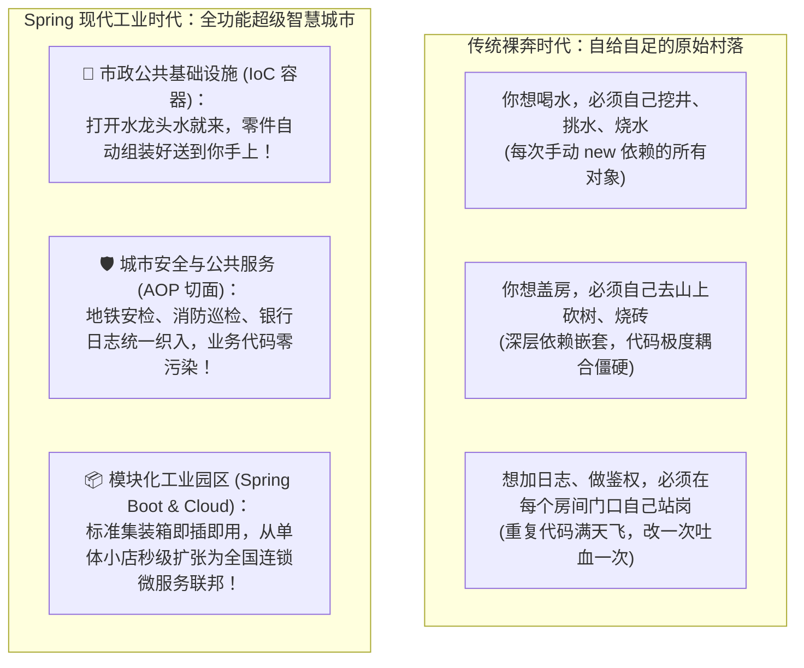
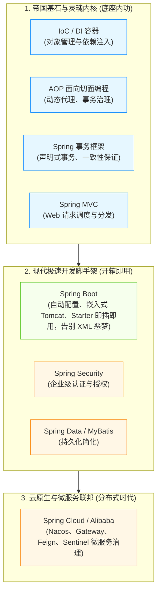
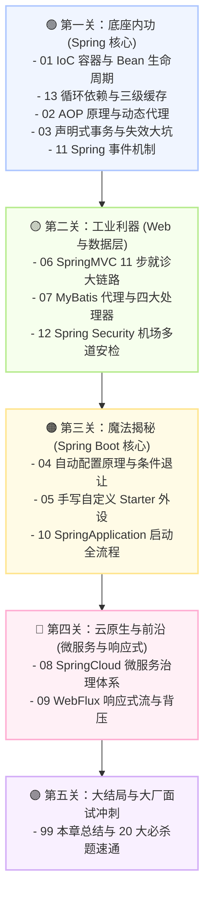

# 🏰 00 · Spring 生态全景与心智模型（为什么它能统治 Java 二十年？）

> **一句话导读**：流水的技术栈，铁打的 Spring。从最初推翻重量级 EJB 暴政的轻量级革命，到如今掌控现代企业级后端与云原生微服务的庞大帝国，读懂 Spring 的架构哲学，你就拿到了通往高级后端架构师的金钥匙。

---

## 🏛️ 核心心智模型：一座超级现代化的智慧城市

如果把一个 Java 业务系统比作一个**社会生活体系**，那么没有 Spring 和有了 Spring 的体验完全是两个世界：

---

## 🌳 Spring 家族全家桶：他们各自扮演什么角色？

面对 Spring 家族庞大的生态名词（Framework、Boot、Cloud、Security、Data……），很多初学者容易被乱花迷眼。用一张**分层演进图**彻底理顺它们的关系：

1. **Spring Framework（帝国的基石）**：
   - 核心只有两个灵魂：**IoC（控制反转）** 和 **AOP（面向切面编程）**。
   - 它解决了 Java 对象之间的解耦与通用功能的集中治理。
2. **Spring Boot（现代开发的加速引擎）**：
   - 过去配一个 Spring MVC 项目要写几十上百行枯燥的 XML 配置文件；
   - Spring Boot 提出了**“约定优于配置（Convention Over Configuration）”**，通过内嵌 Web 服务器（Tomcat）、自动配置（AutoConfiguration）和起步依赖（Starter），让你 10 秒钟就能跑起来一个生产级 Web 接口！
3. **Spring Cloud（分布式微服务的航空母舰）**：
   - 当单体应用随着业务膨胀拆分成几十个微服务时，服务去哪找、怎么调用、网络崩了怎么熔断？Spring Cloud 提供了成套的分布式解决方案。

---

## 🗺️ Spring 生态通关进阶地图（5 大关卡）

不要漫无目的地乱看！请按照以下为你量身定制的**五大认知关卡**逐层通关：

---

## 💡 征服 Spring 的三大思维心法

1. **“代理”是一切魔法的源泉**：
   - 为什么加个 `@Transactional` 就能自动提交回滚？
   - 为什么加个 `@Cacheable` 就能自动走 Redis？
   - 为什么没有实现类的 Mapper 接口能查数据库？
   - **记住：你拿到的从来不是真正的原始对象，而是 Spring 为你精心打造的“代理人”！** 所有的魔法，都是代理人在替你负重前行。
2. **区分“配置阶段”与“运行阶段”**：
   - Spring 启动时是在“搭积木”（解析注解、生成 BeanDefinition、实例化对象、注入依赖、织入代理）；
   - 请求到来时是在“流水线操作”（反射调用方法、环绕通知拦截、事务提交）。搞清生命周期的先后次序，排查 Bug 就能手到擒来。
3. **追问“为什么”，而不是“怎么配”**：
   - 不要死背配置项，多思考：如果不这么设计会带来什么痛点？为什么解决循环依赖必须是三级缓存而不是两级？

准备好了吗？让我们直接从这座现代化智慧城市的市政基础设施——[[01-IoC容器与Bean生命周期]] 启程！
