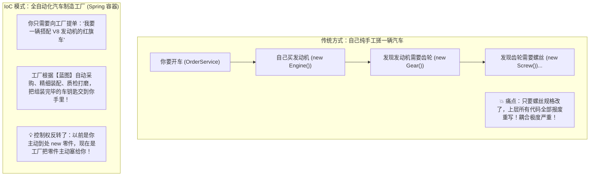
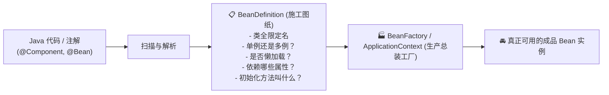
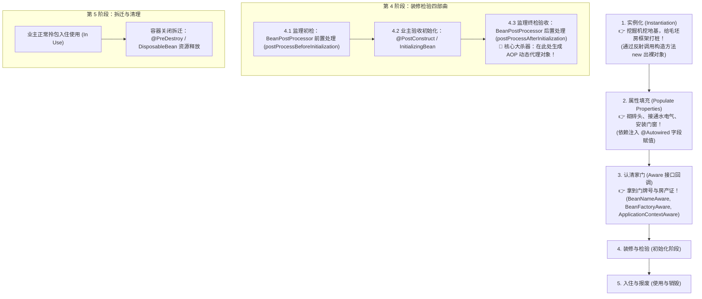

# 🏭 01 · IoC 容器与 Bean 生命周期（汽车生产线与预售精装房）

> **一句话导读**：别再死记硬背“控制反转”和“依赖注入”了！Spring 的 IoC 容器就是一座顶级的**“全自动化汽车组装总装车间”**。搞懂一个 Bean 从图纸设计到报废回收的完整旅程，Spring 的底层骨架你就吃透了一半。

---

## 🚗 核心心智模型：自己造车 vs 现代化汽车工厂

很多人初学 Spring 时，最困惑的就是为什么简单的对象创建要搞得这么复杂：



### 专业术语大白话翻译：
- **IoC（Inversion of Control，控制反转）**：**思想境界**。对象的创建权、组装权、生命周期管理权，从程序员手中**反转交给了 Spring 容器**。
- **DI（Dependency Injection，依赖注入）**：**实现手段**。容器在把对象造出来的过程中，动态地把这个对象所依赖的其他组件“注入”进去（比如把 `Engine` 螺丝拧进 `Car` 里面）。
- **Bean**：在 Spring 容器里登记在册、由容器统一管理生命周期的 Java 对象。

---

## 🏗️ 幕后功臣：图纸（BeanDefinition）与工厂（BeanFactory）

在 Spring 真正 `new` 出一个对象之前，它必须先有一张**施工图纸**：



> 💡 **大厂面试追问：`BeanFactory` 和 `ApplicationContext` 有什么区别？**
> - **`BeanFactory`（最底层简陋小车间）**：Spring 最基础的 IoC 容器接口，只提供最基础的 `getBean` 检索能力。采用**懒加载**（只有你真正向它要对象时才去创建）。
> - **`ApplicationContext`（现代化超级数字化大厂）**：`BeanFactory` 的子接口，具备了工厂的所有能力，并且自带企业级全套外挂：**国际化支持（MessageSource）、事件广播机制（ApplicationEventPublisher）、环境配置解析（Environment）、AOP 自动集成**。应用启动时默认预先实例化所有单例 Bean。

---

## 💉 依赖注入的三种姿势：为什么 Spring 官方强推构造器？

在日常开发中，我们有 3 种方式把依赖注入进来：

```java
// 姿势 1：属性字段注入 (最常见，但最不推荐！)
@Service
public class OrderService {
    @Autowired 
    private InventoryService inventoryService; 
}

// 姿势 2：Setter 方法注入 (可选依赖时可用)
@Service
public class OrderService {
    private InventoryService inventoryService;
    @Autowired
    public void setInventoryService(InventoryService inventoryService) {
        this.inventoryService = inventoryService;
    }
}

// 姿势 3：构造器注入 (🌟 Spring 官方强烈推荐首选！)
@Service
public class OrderService {
    private final InventoryService inventoryService;

    // 单构造器时 @Autowired 注解甚至可以完全省略！
    public OrderService(InventoryService inventoryService) {
        this.inventoryService = inventoryService;
    }
}
```

### 🚨 为什么字段注入 `@Autowired` 被官方嫌弃？
1. **隐藏依赖关系**：外部如果不启动 Spring 容器，你写单测时直接 `new OrderService()`，里面的 `inventoryService` 是 `null`，很容易报空指针！
2. **无法将依赖声明为 `final`**：构造器注入可以让属性声明为 `final`，确保对象创建出来后**不可变、线程安全**。
3. **更容易闻到代码的“坏味道”**：当一个类的构造器入参多达 7、8 个时，你会立刻警觉这个类违反了单一职责原则，必须重构；而字段注入不管写多少个都不显眼，容易造出超级臃肿的大怪物。

---

## 🔄 Bean 的完整生命周期：精装房交付五大阶段

面试中最恐怖的连环问：“请详细描述 Spring Bean 的生命周期流程。”
不要死记硬背！把它想象成**一套预售期房从图纸规划到业主入住、最终拆迁的全过程**：



### 五大阶段深度拆解：

1. **实例化（Instantiation）**：
   - 内存里刚通过反射 `Class.newInstance()` 或者构造方法把对象 new 出来。此时它只是一个“裸对象”，内部的 `@Autowired` 字段全部都是 `null`！
2. **属性填充（Populate Properties）**：
   - Spring 顺着图纸，扫描这个对象需要哪些依赖，调用 setter 或反射暴力将其他 Bean 注入进来。
3. **Aware 接口回调（认清自身坐标）**：
   - 框架问对象：“你想不想知道自己在 Spring 里叫啥名字？” -> 实现 `BeanNameAware`。
   - “你想不想拿到整个 Spring 大工厂的控制权？” -> 实现 `ApplicationContextAware`。
4. **初始化（Initialization - 关键扩展点）**：
   - **`BeanPostProcessor.postProcessBeforeInitialization`**：后置处理器前置拦截（比如处理 `@PostConstruct` 注解）。
   - **`InitializingBean / init-method`**：执行业务自己定义的初始化逻辑（比如加载本地缓存、建立网络长连接）。
   - **`BeanPostProcessor.postProcessAfterInitialization`**：**全框架最重要的扩展点！**
     - Spring AOP 在这里偷偷发力！**如果该 Bean 需要被切面拦截（比如加了 `@Transactional`），Spring 会在此处用动态代理把它包装成代理对象返回！**
5. **销毁（Destruction）**：
   - 容器关闭时，执行 `@PreDestroy` 或 `DisposableBean` 的 `destroy()` 方法，关闭连接池、清理临时文件。

---

## 💻 动手实验：代码亲眼印证生命周期时序

保存为 `BeanLifecycleDemo.java` 亲自运行验证：

```java
import jakarta.annotation.PostConstruct;
import jakarta.annotation.PreDestroy;
import org.springframework.beans.BeansException;
import org.springframework.beans.factory.BeanNameAware;
import org.springframework.beans.factory.InitializingBean;
import org.springframework.beans.factory.config.BeanPostProcessor;
import org.springframework.context.annotation.AnnotationConfigApplicationContext;
import org.springframework.context.annotation.Bean;
import org.springframework.context.annotation.Configuration;

public class BeanLifecycleDemo {

    static class House implements BeanNameAware, InitializingBean {
        public House() {
            System.out.println("1. 构造方法：地基打好了（实例化）");
        }

        @Override
        public void setBeanName(String name) {
            System.out.println("2. BeanNameAware：拿到房产证门牌号 -> " + name);
        }

        @PostConstruct
        public void postConstruct() {
            System.out.println("4. @PostConstruct：开始贴瓷砖木地板");
        }

        @Override
        public void afterPropertiesSet() {
            System.out.println("5. InitializingBean：全屋通水通电完毕");
        }

        @PreDestroy
        public void preDestroy() {
            System.out.println("7. @PreDestroy：房屋到期拆迁，收拾家具");
        }
    }

    // 装修监理（后置处理器）
    static class HouseInspector implements BeanPostProcessor {
        @Override
        public Object postProcessBeforeInitialization(Object bean, String beanName) throws BeansException {
            if (bean instanceof House) {
                System.out.println("3. 监理前置验收 (BeforeInitialization)");
            }
            return bean;
        }

        @Override
        public Object postProcessAfterInitialization(Object bean, String beanName) throws BeansException {
            if (bean instanceof House) {
                System.out.println("6. 监理终检验收合格，交钥匙！(AfterInitialization - 代理生成点)");
            }
            return bean;
        }
    }

    @Configuration
    static class AppConfig {
        @Bean
        House house() { return new House(); }
        @Bean
        HouseInspector inspector() { return new HouseInspector(); }
    }

    public static void main(String[] args) {
        System.out.println("====== Spring 容器启动 ======");
        var context = new AnnotationConfigApplicationContext(AppConfig.class);

        System.out.println("\n====== 业主正常入住使用 ======");
        House house = context.getBean(House.class);

        System.out.println("\n====== Spring 容器关闭 ======");
        context.close();
    }
}
```

**控制台完美输出：**
```text
====== Spring 容器启动 ======
1. 构造方法：地基打好了（实例化）
2. BeanNameAware：拿到房产证门牌号 -> house
3. 监理前置验收 (BeforeInitialization)
4. @PostConstruct：开始贴瓷砖木地板
5. InitializingBean：全屋通水通电完毕
6. 监理终检验收合格，交钥匙！(AfterInitialization - 代理生成点)

====== 业主正常入住使用 ======

====== Spring 容器关闭 ======
7. @PreDestroy：房屋到期拆迁，收拾家具
```

---

## 🧠 一分钟复盘核心记忆卡

1. **IoC/DI 本质**：交出对象的创建与维护权，由自动化总装车间统一供给。
2. **图纸与工厂**：注解解析成 `BeanDefinition`，由 `ApplicationContext` 集中装配。
3. **生命周期口诀**：**“先造骨架（实例化），再装水电（属性注入），认清家门（Aware），两头监理（PostProcessor），入住与拆迁（使用与销毁）”**。

---

## 🧭 下一步

在对象实例化的过程中，有一个最令程序员和面试官抓狂的经典难题：
**如果 A 对象需要注入 B，而 B 对象又同时需要注入 A（循环依赖），Spring 是怎么破解这个死扣的？为什么必须用三级缓存？**
请进入下一篇重磅专题：[[13-Spring循环依赖与三级缓存]]！
