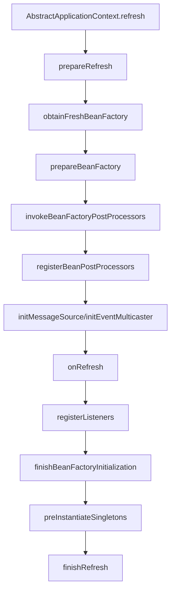
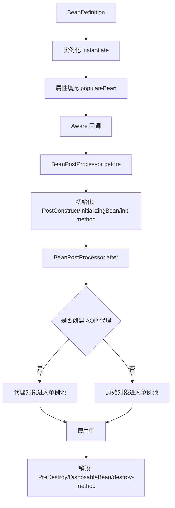

# IoC容器与Bean生命周期

> [!abstract] 一句话总结
> IoC 容器把类与配置解析成 BeanDefinition，再由 BeanFactory 完成实例化、依赖注入、初始化、代理包装和销毁；精通点是 `refresh` 主流程、后处理器顺序、AOP 代理创建时机和三级缓存。

## 📌 精准定位

- 负责对象创建、依赖装配、生命周期回调和扩展点编排。
- 不负责业务对象的线程安全，单例 Bean 的可变字段仍会被多线程共享。
- 关键边界：`new` 出来的对象不走容器，`@Autowired`、AOP、`@PostConstruct` 都不会生效。
- 面试重点：能讲清 Bean 从扫描到可用的完整链路，以及循环依赖、代理缺失、Bean 创建过早等问题。

## 🧩 核心概念

| 概念 | 具体含义 | 精通要点 |
| ---- | -------- | -------- |
| BeanDefinition | Bean 的元数据，包含 class、scope、构造参数、属性和 init/destroy 方法。 | 会定位 `DefaultListableBeanFactory` 的 `beanDefinitionMap`。 |
| BeanFactory | 容器底层接口，核心动作是 `getBean`。 | 理解懒加载、依赖查找和单例缓存。 |
| ApplicationContext | 在 BeanFactory 外增加事件、资源、环境和国际化。 | Spring Boot Web 常见上下文是 `ServletWebServerApplicationContext`。 |
| BeanFactoryPostProcessor | 在 Bean 实例化前修改 BeanDefinition。 | `ConfigurationClassPostProcessor` 解析配置类。 |
| BeanPostProcessor | 初始化前后插入逻辑，AOP 代理也靠它完成。 | 重点关注 before/after initialization 和 early proxy。 |
| FactoryBean | 本身是 Bean，但用于生产另一个对象。 | `&beanName` 拿 FactoryBean 本身。 |

## ⚙️ refresh 主流程



关键节点：

1. `obtainFreshBeanFactory`：准备 BeanFactory。
2. `invokeBeanFactoryPostProcessors`：解析配置类、扫描 Bean、注册 BeanDefinition。
3. `registerBeanPostProcessors`：注册影响生命周期的后处理器，包括 AOP 相关处理器。
4. `finishBeanFactoryInitialization`：预实例化非懒加载单例。
5. `preInstantiateSingletons`：触发单例 Bean 创建。

## 🧬 Bean 生命周期



标准顺序：

1. 实例化对象。
2. 属性填充和依赖注入。
3. `BeanNameAware`、`BeanFactoryAware`、`ApplicationContextAware`。
4. `BeanPostProcessor#postProcessBeforeInitialization`。
5. `@PostConstruct`。
6. `InitializingBean#afterPropertiesSet`。
7. 自定义 `init-method`。
8. `BeanPostProcessor#postProcessAfterInitialization`，AOP 代理通常在这里返回。
9. 容器关闭时执行 `@PreDestroy`、`DisposableBean#destroy`、`destroy-method`。

## 🔁 三级缓存与循环依赖

Spring 单例循环依赖核心缓存：

| 缓存 | 含义 | 作用 |
| ---- | ---- | ---- |
| `singletonObjects` | 一级缓存，完整单例对象 | 最终可用 Bean |
| `earlySingletonObjects` | 二级缓存，早期引用 | 已提前暴露的对象或早期代理 |
| `singletonFactories` | 三级缓存，ObjectFactory | 延迟生成早期引用，给 AOP 机会 |

### 能解决什么

```java
@Service
class A { @Autowired B b; }
@Service
class B { @Autowired A a; }
```

这种单例属性注入循环依赖可以解决，因为 A 实例化后可提前暴露引用，B 注入 A 的早期引用，最后 A 完成初始化。

### 不能解决什么

```java
@Service
class A { A(B b) {} }
@Service
class B { B(A a) {} }
```

构造器循环依赖无法解决，因为对象还没实例化完，无法提前暴露引用。

### 为什么需要三级缓存

如果只有二级缓存，AOP 代理对象可能创建时机不对。三级缓存通过 `ObjectFactory` 延迟生成早期引用，让 `SmartInstantiationAwareBeanPostProcessor#getEarlyBeanReference` 有机会返回代理对象，避免注入原始对象导致代理失效。

## 🧪 常见案例

### 案例 1：对象不是 Spring 创建，注入不生效

```java
OrderService service = new OrderService();
service.create(); // @Autowired、@Transactional 都不会生效
```

原因：绕过容器，Spring 无法做依赖注入和代理。

修复：从容器获取 Bean，或让调用方也交给 Spring 管理。

### 案例 2：`@PostConstruct` 调用事务方法不生效

```java
@PostConstruct
public void init() {
  this.createOrder(); // 本类调用，不经过代理
}

@Transactional
public void createOrder() {}
```

原因：本类自调用绕过 AOP 代理，而且初始化阶段代理可能尚未完全可用。

修复：启动后用事件监听、ApplicationRunner，或拆到其他 Bean 调用。

### 案例 3：BeanPostProcessor 过早 getBean

某些后处理器提前调用 `getBean`，可能导致 Bean 在所有 BPP 注册完成前就被创建，从而缺少 AOP 代理。

排查：启动日志中常见 `BeanPostProcessorChecker` 提示该 Bean 不适合被所有后处理器处理。

## 🔍 源码入口 / 关键组件

- `AbstractApplicationContext#refresh`
- `PostProcessorRegistrationDelegate#invokeBeanFactoryPostProcessors`
- `ConfigurationClassPostProcessor`
- `DefaultListableBeanFactory#preInstantiateSingletons`
- `AbstractBeanFactory#doGetBean`
- `AbstractAutowireCapableBeanFactory#doCreateBean`
- `DefaultSingletonBeanRegistry#getSingleton`
- `AutowiredAnnotationBeanPostProcessor`
- `AnnotationAwareAspectJAutoProxyCreator`

## ⚠️ 生产坑与注意事项

- 构造器循环依赖无法靠三级缓存解决。
- `@PostConstruct` 中调用本类事务方法不会经过代理。
- `BeanPostProcessor` 过早 `getBean` 会导致代理不完整。
- `@Configuration(proxyBeanMethods=false)` 会改变 Bean 方法互调语义。
- 单例 Bean 持有可变状态会产生并发问题。
- 启动类扫描路径不对，会导致 Bean 未注册。
- `FactoryBean` 和普通 Bean 名称获取方式不同。

## 🧭 排查路径

- 启动失败：看 `BeanCreationException` 最内层 cause。
- 注入不生效：确认对象是否由 Spring 创建，包扫描是否覆盖。
- 循环依赖：不要只打开 `allow-circular-references`，优先拆职责。
- 代理缺失：检查 final、自调用、private 方法、Bean 创建过早。
- Bean 来源不清楚：看 BeanDefinition 的 resource/source，或调试 `registerBeanDefinition`。

## 🎯 面试问题

> [!question] 高频问题
> - Q: Bean 生命周期顺序？
>   - A: 实例化、属性填充、Aware、后处理器 before、初始化、后处理器 after、可用、销毁。
> - Q: 三级缓存解决什么？
>   - A: 解决单例属性注入循环依赖，并通过三级缓存的 ObjectFactory 给 AOP 提前代理留机会。
> - Q: 为什么构造器循环依赖解决不了？
>   - A: 构造器注入时对象还没创建完成，无法提前暴露早期引用。
> - Q: BeanFactory 和 ApplicationContext 区别？
>   - A: BeanFactory 是容器基础能力，ApplicationContext 增加事件、资源、环境、国际化，并通常预实例化单例。
> - Q: FactoryBean 是什么？
>   - A: 一个能生产其他对象的特殊 Bean。拿产品对象用 `beanName`，拿工厂本身用 `&beanName`。

## 🎤 面试 3 层回答

### 30 秒版

Spring IoC 的核心是先把配置解析成 BeanDefinition，再由 BeanFactory 按生命周期创建 Bean。重点流程是实例化、依赖注入、Aware、初始化、BeanPostProcessor、AOP 代理和销毁。

### 2 分钟版

我会从 `refresh` 主流程讲起：先准备 BeanFactory，再执行 BeanFactoryPostProcessor 解析配置和扫描 BeanDefinition，然后注册 BeanPostProcessor，最后预实例化单例。单个 Bean 创建时，会经过实例化、属性填充、Aware、初始化前后处理器和销毁回调。循环依赖依赖三级缓存，只支持单例属性注入，构造器循环依赖不支持。

### 项目版

项目里如果遇到注入不生效、事务不生效或 AOP 缺失，我会先判断对象是不是容器创建的，再看是否本类自调用、final/private、Bean 创建过早或包扫描路径问题。

## ✅ 精通检查清单

- 能画出 `refresh` 主流程。
- 能讲清 Bean 生命周期顺序。
- 能解释 BeanFactoryPostProcessor 与 BeanPostProcessor 区别。
- 能说明三级缓存和循环依赖边界。
- 能定位注入不生效、代理缺失、Bean 创建失败问题。

## 🔗 关联笔记

- [[_index]]
- [[20-Java后端/00-总览/学习仪表盘]]
- [[03-Spring事务管理]]
- [[02-AOP原理与应用]]
- [[04-SpringBoot自动配置原理]]

## 📚 参考资料

- Spring Framework Reference: Core Technologies
- Spring 源码 `org.springframework.beans.factory.support`
