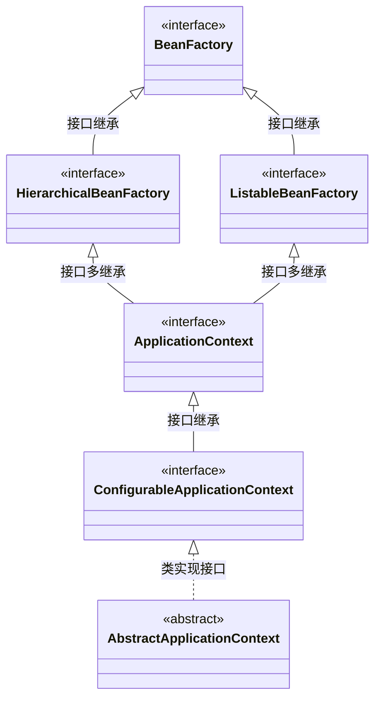
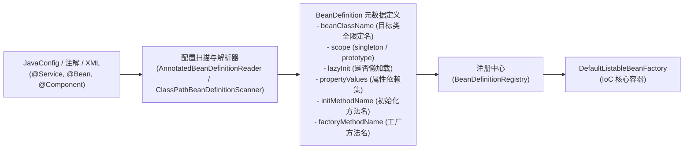
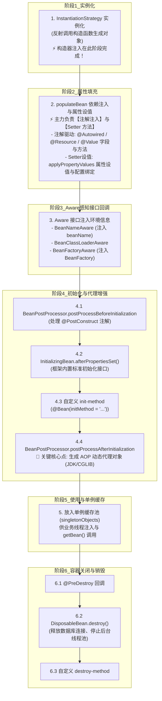

# 01 · IoC 容器架构与 Bean 生命周期底层时序

> **导读**：Spring 框架的核心是控制反转（IoC）与依赖注入（DI）。IoC 将对象的生命周期管理与组件组装权从业务代码中剥离，转由容器集中统一编排。理解从配置解析生成 `BeanDefinition`、容器刷新 `refresh()` 主线，到单个 Bean 的实例化、属性填充、Aware 回调、双向后置处理器（`BeanPostProcessor`）拦截以及 AOP 代理生成的完整生命周期，是掌握 Spring 生态体系最底层的基石。

---

## 一、IoC 与 DI 核心概念定义与架构抽象

### 1. 概念定义
- **IoC（Inversion of Control，控制反转）**：一种软件架构设计思想。对象的创建、装配、生命周期流转不再由调用者通过硬编码显式控制（如 `new`），而是将控制权交由外部框架容器管理。
- **DI（Dependency Injection，依赖注入）**：IoC 思想的具体工程实现手段。容器在运行期间，根据组件之间的依赖配置，动态地将目标对象所依赖的协作对象通过构造函数、属性方法或反射注入其中。
- **Bean**：在 Spring 中，由 Spring IoC 容器所管理、装配并维护其完整生命周期的 Java 对象。

### 2. 核心架构抽象：BeanFactory 与 ApplicationContext
Spring 的 IoC 容器体系由两大核心层次构成：



> [!tip] 为什么 ApplicationContext 看起来是“多继承”？
> **Java 的类（Class）是单继承的，但 Java 的接口（Interface）完全支持多继承！**
> 图中上层节点全都是 **接口（Interface）**。`ApplicationContext` 作为一个超级门面，通过 `extends ListableBeanFactory, HierarchicalBeanFactory, MessageSource...` 实现了**接口能力聚合**；只有最底层的 `AbstractApplicationContext` 才是通过 `implements` 实现接口的**抽象类**。


| 容器类型 | 核心定位与特征 | 初始化与加载机制 | 典型适用场景 |
| :--- | :--- | :--- | :--- |
| **`BeanFactory`** | Spring 最底层的 IoC 基础根接口，提供基础的 `getBean()`、`containsBean()`、`getType()` 等组件访问规范。 | **延迟加载（Lazy Loading）**：仅在调用 `getBean()` 时才真正实例化目标 Bean。 | 资源极度受限的嵌入式设备或轻量级独立运行环境。 |
| **`ApplicationContext`** | `BeanFactory` 的高级子接口，面向企业级全功能应用上下文。集成了国际化（`MessageSource`）、事件发布（`ApplicationEventPublisher`）、资源加载（`ResourceLoader`）与 AOP 自动代理。 | **预实例化（Pre-instantiation）**：容器在启动调用 `refresh()` 时，默认预先实例化并缓存所有单例 Bean。 | 绝大多数现代企业级微服务、Web 应用及分布式中间件。 |

---

## 二、配置解析与元数据建模：BeanDefinition

在 Spring 创建对象之前，首先要通过扫描将各类配置（注解 `@Component`、XML 配置、JavaConfig `@Bean`）解析为统一的元数据模型——**`BeanDefinition`**。



`BeanDefinition` 屏蔽了底层配置来源的差异性，使得容器可以按照完全标准化、程序化的数据结构执行后续的对象组装与生命周期流转。

---

## 三、三种依赖注入方式对比与选型原则

| 注入方式 | 代码形态 | 生命周期发生阶段 | 优点 | 缺点 / 官方评价 |
| :--- | :--- | :---: | :--- | :--- |
| **构造器注入**<br>（Constructor） | `public OrderService(InventoryService inv) { this.inv = inv; }` | **阶段 1：实例化**<br>（`createBeanInstance`） | 1. **强制依赖**：确保对象创建时即处于可用状态；<br>2. **支持 `final`**：字段不可变，原生线程安全；<br>3. **易于单测**：脱离容器也可直接 `new` 注入 Mock 对象；<br>4. **避免循环依赖**。 | 构造函数参数过多时代码较长（提示类职责过重，倒逼单一职责重构）。<br>🌟 **Spring 官方强烈推荐首选**。 |
| **Setter 方法注入**<br>（Setter） | `public void setInv(InventoryService inv) { this.inv = inv; }` | **阶段 2：属性填充**<br>（`populateBean`） | 支持运行时动态更改依赖，适合可选依赖（Optional Dependencies）。 | 无法将字段声明为 `final`；对象在实例化与 Setter 调用之间存在短暂的未完备状态。 |
| **字段反射注入**<br>（Field） | `@Autowired private InventoryService inv;` | **阶段 2：属性填充**<br>（`populateBean`） | 代码极其精炼，编写速度快。 | 1. **隐藏依赖边界**：脱离容器后单测难以进行；<br>2. **破坏封装性**：依赖反射强行侵入 `private` 字段。<br>❌ **Spring 官方不推荐使用**。 |

> [!important] 依赖注入在生命周期中的核心结论
> **依赖注入（DI）并非全在 `populateBean` 阶段！**
> - **构造器注入** 发生在 **阶段 1：实例化阶段**（在反射调用构造器 `new` 的一瞬间，依赖就已经就绪并传入）；
> - **阶段 2：属性填充（`populateBean`）** 则主要负责 **注解驱动注入**（`@Autowired`、`@Resource`、`@Value` 的字段/方法）与 **Setter 方法注入**（显式属性设值与外部配置绑定）。


---

## 四、Spring Bean 完整生命周期时序规范

Bean 在 Spring 容器中的流转并非简单的 `new` 与垃圾回收，而是由多个精细的生命周期阶段和前后置扩展点协同构成的严格时序：



### 关键扩展点源码细节剖析：
1. **实例化（Instantiation）**：
   - 容器通过 `createBeanInstance()` 利用反射选择合适的构造函数实例化对象。
   - **⚡ 构造器注入在此完成**：若采用构造器注入（如 `public OrderService(PaymentService ps)`），Spring 在调用有参构造函数前便已解析并传入对应依赖 Bean；若无构造器注入，则调用无参构造函数生成原始裸对象（此时其所有标记了 `@Autowired` 的字段仍为 `null`）。
   - **🔍 有参构造函数的依赖解析与死锁处理机制**：
     - **深度优先递归解析（DFS On-Demand）**：Spring **并未在启动前进行全局依赖的拓扑排序**。当遇到有参构造器需要依赖项时，Spring 会暂停当前 Bean 的创建，通过 JVM 方法调用栈递归发起 `getBean(dependencyBean)`。调用栈天然具备后进先出特性，最底层被依赖的 Bean 会先完全经历“实例化 -> 属性填充 -> 初始化”并放入单例池，随后弹栈返回给上层构造函数传参调用；
     - **构造器循环依赖与 Fail-Fast 报错**：若发生循环依赖（A 构造器需要 B，B 构造器又需要 A），Spring 在再次递归调用 `getBean("A")` 时，会通过内部的 `singletonsCurrentlyInCreation` 集合检测到 `"A"` 已在创建列表中。由于构造函数尚未返回，**堆内存中连半成品裸对象的引用都尚未生成，三级缓存无从提前暴露**，Spring 判定死锁闭环形成，直接抛出 `BeanCurrentlyInCreationException` 终止容器启动；
     - **工程破局方案**：在构造器参数前添加 `@Lazy` 注解（如 `public A(@Lazy B b)`），Spring 会生成一个 CGLIB 动态代理占位符传给构造器，切断启动时的初始化闭环，直到真正调用方法时才触发实际 Bean 的加载；根本方案则是通过中介者模式或事件解耦。
2. **属性填充（Populate Properties）**：
   - 容器调用 `populateBean()` 执行属性装配，**该阶段主要由“注解注入”与“Setter 方法注入”两大主力构成**：
     - **注解驱动注入（现代主力）**：底层依赖 `InstantiationAwareBeanPostProcessor.postProcessProperties()` 扩展点：
       - `AutowiredAnnotationBeanPostProcessor`：解析 `@Autowired`、`@Value`（外部配置/SpEL 解析）以及 `@Inject`（JSR-330 规范），支持对字段直接反射赋值或调用带注解的 Setter 方法；
       - `CommonAnnotationBeanPostProcessor`：解析 `@Resource`（JSR-250 规范，优先按 Name 匹配后反射或 Setter 赋值）；
       - `PersistenceAnnotationBeanPostProcessor`：解析 JPA 的 `@PersistenceContext` 注入 `EntityManager`。
     - **Setter 方法注入与配置绑定**：通过 `applyPropertyValues()` 遍历属性值集，经由 `TypeConverter` 类型转换后，反射调用 JavaBean 标准的 `setXxx(...)` 方法（如 XML `<property>` 配置、Spring Boot `@ConfigurationProperties` 绑定的外部环境属性）。
     - **短路前置拦截**：在开始填充前还会调用 `postProcessAfterInstantiation()`，若任何处理器返回 `false` 则直接短路跳过属性填充。
3. **Aware 感知接口回调（为什么需要？三大生产实战场景）**：
   - **核心第一性原理**：Spring 提倡“无侵入（Non-invasive）”，绝大多数业务 Bean 只需要做被动受管的普通 POJO；但**框架级组件、通用工具类与中间件 SDK** 必须具备“反向操控容器或自查身份”的特权，`Aware` 接口就是 Spring 为特权组件开辟的**受控反向访问通道**。
   - **三大生产实战落地场景**：
     - **场景 A：全局上下文获取工具类（`ApplicationContextAware`）**：在非 Spring 受管类（如静态 Util 方法、多线程 Runnable、第三方 SDK 回调、WebSocket 端点）中无法直接 `@Autowired`，通过实现该接口把 `ApplicationContext` 注入并赋给全局静态变量，实现 `SpringContextUtil.getBean(...)` 随时随地动态取 Bean；
     - **场景 B：策略模式与插件化自注册（`BeanNameAware`）**：支付策略、规则引擎等多种实现类在启动时，通过 `setBeanName` 感知自己在 Spring 容器中的 Bean ID，随后在初始化阶段自动将自己注册到策略分发 Map 中，彻底消除硬编码映射；
     - **场景 C：破解单例注入多例（Prototype）失效（`BeanFactoryAware`）**：当单例 Service 必须在每次业务调用时动态获取一个全新的多例任务对象时，直接 `@Autowired` 会因单例只初始化一次而导致多例失效；通过持有 `BeanFactory` 引用，在业务方法内动态调用 `beanFactory.getBean(PrototypeTask.class)` 即可获取全新实例。
4. **初始化阶段（Initialization：为什么绝不能在构造函数里写业务初始化？）**：
   - **反常识警示**：千万不要在构造函数里写业务初始化逻辑！在构造函数执行时，字段上的 `@Autowired` / `@Resource` 依赖还是 `null`，直接调用必抛致命的 `NullPointerException`。必须等待所有属性注入与 Aware 回调完成后，在初始化阶段执行。
   - **三大步骤分工与生产实战**：
     - **`postProcessBeforeInitialization`（初始化前置处理）**：`CommonAnnotationBeanPostProcessor` 在此触发 `@PostConstruct` 注解。**生产实战**：拉起 Netty 客户端网络长连接、读取配置执行合法性参数校验、加载本地 Caffeine 缓存预热；
     - **`InitializingBean.afterPropertiesSet()` 与 `init-method`**：Spring 内置的标准接口与 `@Bean(initMethod="...")` 配置。**生产实战**：中间件 SDK（如 KafkaConsumer 启动后台拉取线程、Dubbo 暴露本地服务、RocketMQ Consumer 注册监听）；
     - **`postProcessAfterInitialization`（初始化后置处理 —— 全框架最核心的 AOP 调包现场！）**：
       - **动态代理生成**：`AbstractAutoProxyCreator` 在此检查原始 Bean 是否被任何切面拦截（如 `@Transactional` 事务、`@Async` 异步、`@SentinelResource` 限流）。
       - **狸猫换太子**：若命中切面，容器会在此阶段**使用 JDK 动态代理或 CGLIB 代理包装原始 Bean，并最终将生成的代理对象存入 Spring 单例池**！后续业务代码注入并调用的实际上是增强后的代理对象。
5. **销毁阶段（Destruction：生产级“优雅停机”的物理防线）**：
   - **为什么不能直接 `kill -9` 拔电源？**：直接杀死进程会导致在途请求瞬间断连（上游报错 502/连接重置）、线程池队列中排队的上万任务被强制抛弃、内存缓冲区中的日志与监控数据丢失。
   - **三大生产优雅停机行为**：
     - **注册中心主动摘牌**：在微服务节点停机前，通知 Nacos / Eureka 立即下线本实例，促使 API 网关与下游消费者在毫秒级内将流量无损切走；
     - **线程池排空在途请求**：Spring 触发 `@PreDestroy` / `DisposableBean.destroy()` 时，调用 `ThreadPoolTaskExecutor.shutdown()`，拒绝接收新任务并阻塞等待在途队列任务执行完毕；
     - **系统底层资源安全释放**：调用 HikariCP 连接池 `close()` 安全释放与 MySQL 的物理连接、Netty EventLoop 优雅关闭、本地内存写缓冲数据强制 `flush` 刷入磁盘。

---

## 五、实战验证：生命周期完整时序控制台追踪

```java
import jakarta.annotation.PostConstruct;
import jakarta.annotation.PreDestroy;
import org.springframework.beans.BeansException;
import org.springframework.beans.factory.BeanNameAware;
import org.springframework.beans.factory.InitializingBean;
import org.springframework.beans.factory.config.BeanPostProcessor;
import org.springframework.context.annotation.AnnotationConfigApplicationContext;
import org.springframework.context.annotation.Bean;
import org.springframework.context.annotation.Configuration;

public class LifecycleVerifyDemo {

    static class BusinessService implements BeanNameAware, InitializingBean {
        public BusinessService() {
            System.out.println("[步骤 1] 构造方法执行 (实例化完成)");
        }

        @Override
        public void setBeanName(String name) {
            System.out.println("[步骤 2] BeanNameAware 接口回调，注入 Bean 标识: " + name);
        }

        @PostConstruct
        public void postConstruct() {
            System.out.println("[步骤 3] @PostConstruct 注解方法执行 (初始化前置处理)");
        }

        @Override
        public void afterPropertiesSet() {
            System.out.println("[步骤 4] InitializingBean.afterPropertiesSet() 执行");
        }

        public void customInit() {
            System.out.println("[步骤 5] 自定义 init-method 执行 (初始化完成)");
        }

        @PreDestroy
        public void preDestroy() {
            System.out.println("[步骤 7] @PreDestroy 执行，开始清理资源");
        }
    }

    static class LoggingPostProcessor implements BeanPostProcessor {
        @Override
        public Object postProcessBeforeInitialization(Object bean, String beanName) throws BeansException {
            if (bean instanceof BusinessService) {
                System.out.println("[扩展点] BeanPostProcessor.postProcessBeforeInitialization 介入");
            }
            return bean;
        }

        @Override
        public Object postProcessAfterInitialization(Object bean, String beanName) throws BeansException {
            if (bean instanceof BusinessService) {
                System.out.println("[扩展点] BeanPostProcessor.postProcessAfterInitialization 介入 (AOP 代理包装点)");
            }
            return bean;
        }
    }

    @Configuration
    static class Config {
        @Bean(initMethod = "customInit")
        BusinessService businessService() {
            return new BusinessService();
        }

        @Bean
        LoggingPostProcessor loggingPostProcessor() {
            return new LoggingPostProcessor();
        }
    }

    public static void main(String[] args) {
        System.out.println("====== Spring 容器启动初始化 ======");
        var context = new AnnotationConfigApplicationContext(Config.class);

        System.out.println("\n====== 业务 Bean 就绪，正常调用 ======");
        BusinessService service = context.getBean(BusinessService.class);

        System.out.println("\n====== 容器关闭 ======");
        context.close();
    }
}
```

---

## 🛠️ 依赖注入深度剖析：@Autowired、@Resource 与构造器注入哲学

在日常开发与大厂面试中，关于依赖注入（DI）的实现机制与最佳实践，存在三大高频考察深水区：

### 1. `@Autowired` vs `@Resource` 底层查找匹配机制

| 对比维度 | `@Autowired`（Spring 原生注解） | `@Resource`（JSR-250 Java 标准注解） |
| :--- | :--- | :--- |
| **来源规范** | Spring 框架独有（`org.springframework.beans.factory.annotation`） | Java 规范原生标准（`jakarta.annotation` / `javax.annotation`） |
| **默认匹配策略** | **优先按类型（ByType）** 进行查找注入 | **优先按名称（ByName）** 进行查找注入 |
| **存在多个实现时** | 1. 优先根据**字段名/属性名**匹配 Bean 名称；<br/>2. 配合 **`@Qualifier("beanName")`** 精准指定；<br/>3. 被标注 **`@Primary`** 的实现类具有最高裁决权。 | 1. 显式指定 `name` 属性（`@Resource(name = "userDaoImpl")`）；<br/>2. 若未指定且未找到同名 Bean，则**降级按类型（ByType）**匹配。 |
| **支持的注入位置** | 构造器、Setter 方法、字段、任意配置方法 | 字段、Setter 方法（**不支持构造器注入**） |

---

### 2. 为什么 Spring 官方强推“构造器注入”，反对“字段 `@Autowired` 注入”？

在过去的代码中，很多开发者习惯直接在字段上写 `@Autowired private UserService userService;`。但在 Spring 官方文档与 SonarQube 代码审查规范中，**明确将字段注入列为 Bad Practice**，全面推崇**构造器注入（Constructor Injection）**：

```java
// ❌ 差劲实践：字段注入（看似简洁，暗藏四大生产陷阱）
@Service
public class OrderService {
    @Autowired
    private PaymentService paymentService;
    @Autowired
    private StockService stockService;
}

// ✅ 官方推崇：构造器注入（配合 Lombok @RequiredArgsConstructor 极简编写）
@Service
@RequiredArgsConstructor
public class OrderService {
    private final PaymentService paymentService;
    private final StockService stockService;
}
```

#### 💡 构造器注入的四大不可替代优势：
1. **原生支持 `final` 不可变性（Thread-Safety）**：
   - 依赖项被声明为 `final`，在 JVM 实例化阶段必须初始化完成，**赋值后不可被篡改**，从根本上杜绝了多线程并发环境下的引用安全问题；
2. **彻底杜绝空指针（NPE）延迟暴露**：
   - 字段注入的对象如果脱离 Spring 容器被手动 `new OrderService()`，其内部依赖全为 `null`，调用时会在运行时抛出致命的 `NullPointerException`；
   - 构造器注入要求调用端在编译期必须传入完整的依赖项，**绝对无法构造出一个“半生不熟”的残缺对象**；
3. **单元测试无需反射黑魔法**：
   - 编写单元测试时，字段注入必须启动庞大的 Spring 容器，或使用反射工具（`ReflectionTestUtils`）强制破坏 `private` 访问权限注入 Mock 对象；
   - 构造器注入只需轻量执行 `new OrderService(mockPayment, mockStock)`，测试执行极速且优雅；
4. **尽早暴露设计缺陷与循环依赖**：
   - 如果一个类的构造函数需要传入 7~8 个依赖，会极其直观地警示开发者该类违反了**“单一职责原则（SRP）”**；
   - 同时构造器循环依赖无法通过三级缓存解决，能在应用启动初始化阶段立刻触发 **Fail-Fast 报错**，杜绝深水区暗礁。

---

### 3. `@Configuration` 的 CGLIB 增强原理（Full 模式 vs Lite 模式）

阅读 Spring 配置类时，很多人会困惑一个现象：

```java
@Configuration
public class DataSourceConfig {

    @Bean
    public DataSource dataSource() {
        return new HikariDataSource();
    }

    @Bean
    public JdbcTemplate jdbcTemplate() {
        // 疑问：这里直接调用了上面的 dataSource() 方法，难道不会重复 new 一个新的 DataSource 吗？
        return new JdbcTemplate(dataSource());
    }
}
```

#### 揭秘：为什么两个 `@Bean` 方法互相调用，依然能拿到同一个单例？
- **Full 模式（全模式）**：
  当类被标注为 `@Configuration(proxyBeanMethods = true)` 时，Spring 在 `ConfigurationClassPostProcessor` 后置处理器中，会**使用 CGLIB 动态生成该配置类的代理子类**；
  代理子类中植入了 `BeanMethodInterceptor` 拦截器：当代码调用 `dataSource()` 时，拦截器首先会去 Spring 单例池（`BeanFactory`）中检查名为 `dataSource` 的 Bean 是否已经存在；
  如果已经存在，**直接从容器中获取已有单例返回**，根本不会执行方法体内部的 `new` 操作！只有容器中不存在时，才会放行调用父类真实方法进行创建。
- **Lite 模式（轻量模式）**：
  如果类仅仅标注了 `@Component`，或者配置了 `@Configuration(proxyBeanMethods = false)`，Spring 不会生成 CGLIB 代理，方法调用退化为普通的 Java 本地方法调用，每次调用都会触发一次真实的 `new` 实例化，破坏了单例语义！

---

### 场景演示：汽车总装流水线模型

- **技术规格蓝图（`BeanDefinition`）**：开工前定义好车型、参数与依赖部件规格（类全限定名、Scope、属性依赖与初始化方法名）；
- **冲压底盘裸车架（实例化 Instantiation）**：通过反射构造方法 new 出原始空壳裸对象，内部字段全为 null；
- **机械臂装配动力总成（属性填充 / DI）**：自动将发动机、变速箱等依赖组件注入车体槽位；
- **车架激光刻印 VIN 码（Aware 接口）**：让对象获得门牌身份标识（`BeanNameAware`、`BeanFactoryAware`）；
- **通电初验（`postProcessBeforeInitialization` & `@PostConstruct`）**：初始化前置处理与自定义启动检查；
- **特装工位加装防弹装甲（`postProcessAfterInitialization` AOP 代理点）**：针对特殊车辆在此处加装外层防护，用动态代理包装原始对象后注入单例池；
- **到期环保拆解（销毁 Destruction）**：车辆报废时回收油电资源（`@PreDestroy` / `DisposableBean` 释放系统连接）。

---

## 🧭 下一步

在 Bean 实例化与属性填充的过程中，如果两个 Bean 互相持有对方的依赖引用（即类 A 需要注入类 B，类 B 又需要注入类 A），就会产生著名的**循环依赖（Circular Dependency）**难题。
Spring 是如何在不引发递归死循环的前提下，凭借**三级缓存机制**完成循环解耦的？
请进入下一篇：[[13-Spring循环依赖与三级缓存]]！
