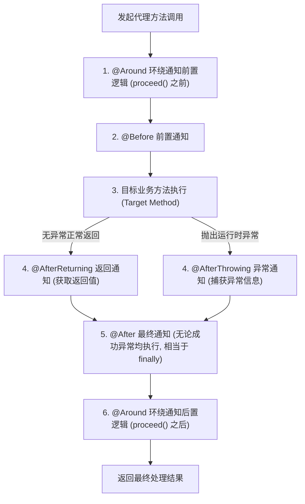
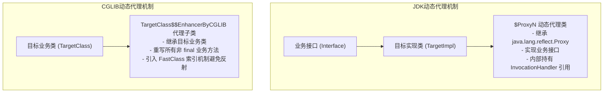
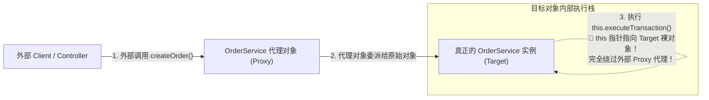

# 02 · AOP 架构原理与动态代理底层实现

> **导读**：在企业级后端架构中，日志记录、权限鉴权、分布式链路追踪与事务控制等横切关注点（Cross-Cutting Concerns）往往散落在各个业务模块中。若通过硬编码侵入，将导致代码严重耦合且难以维护。Spring AOP（面向切面编程）通过运行时动态代理技术，将非业务逻辑与核心业务解耦。本文深入剖析 AOP 核心规范术语、五大通知调用链时序、JDK 动态代理与 CGLIB FastClass 字节码底层机制，以及生产级高频陷阱“自调用失效”的成因与解决方案。

---

## 一、AOP 核心规范术语与设计模型

面向切面编程（Aspect-Oriented Programming）是面向对象编程（OOP）的有力补充。OOP 通过纵向继承封装对象内部属性与行为，而 AOP 则通过横向织入（Weaving）实现跨模块横切关注点的统一收拢。

### 1. 核心术语与标准规范

| 规范术语 | 英文标识 | 核心技术定义与运行时行为 | 规范标准对应（AspectJ / JSR-330） |
| :--- | :--- | :--- | :--- |
| **切面** | **Aspect** | 封装横切关注点的模块化单元，包含一组切入点（Pointcut）与对应通知（Advice）的集合。使用 `@Aspect` 注解标记。 | `@Aspect` 注解类 |
| **连接点** | **JoinPoint** | 程序执行流中明确能够被切面插入拦截的特定点。在 Spring AOP 中，连接点**专指业务方法的调用与执行**（不支持字段访问或构造器拦截）。 | `org.aspectj.lang.JoinPoint` |
| **切入点** | **Pointcut** | 用于匹配连接点的断言表达式（如 AspectJ execution 语法或 `@annotation` 自定义注解匹配），确定通知在哪些具体方法上触发。 | `@Pointcut("execution(* com.service..*.*(..))")` |
| **通知 / 增强** | **Advice** | 切面在特定连接点处所执行的横切拦截代码逻辑。包含前置、后置、环绕、异常等具体通知动作。 | `MethodInterceptor` / `BeforeAdvice` |
| **目标对象** | **Target** | 包含核心业务逻辑、被一个或多个切面所拦截并增强的原始原始业务 Bean 实例。 | 原始未代理对象 |
| **AOP 代理** | **AOP Proxy** | 由 Spring AOP 框架在运行时生成的代理对象，内部封装了目标对象与拦截器链。客户端实际调用的是代理对象。 | JDK Proxy 或 CGLIB 代理子类 |
| **织入** | **Weaving** | 将切面逻辑与目标业务对象整合以构建最终代理对象的过程。Spring AOP 采用**运行时动态代理织入**。 | 运行时由 `AbstractAutoProxyCreator` 完成 |

---

## 二、五大通知类型与拦截器链执行时序

Spring AOP 支持五种标准的通知类型，其底层通过**责任链模式（Chain of Responsibility）**组合成 `MethodInterceptor` 链式调用：



> [!NOTE] 环绕通知（`@Around`）的控制特权
> `@Around` 是能力最强大的通知类型。环绕通知接收 `ProceedingJoinPoint` 作为入参，拥有对方法执行流程的绝对控制权：
> 1. **决定是否放行**：可根据入参校验结果决定是否调用 `joinPoint.proceed()`；
> 2. **篡改入参及返回值**：可在 `proceed(args)` 中传入修改后的参数，或在返回前改写返回数据；
> 3. **性能耗时统计**：包裹目标方法前后，计算纳秒/毫秒级系统执行时延；
> 4. **异常拦截与吞没**：可使用 `try-catch` 自行处理抛出的异常并执行服务降级。

---

## 三、动态代理底层实现机制：JDK 代理 vs CGLIB

Spring AOP 的底层代理创建依赖于两种完全不同的字节码处理技术：



### 1. JDK 动态代理（Interface-Based Proxy）
- **实现原理**：利用 JDK 原生 `java.lang.reflect.Proxy` 与 `InvocationHandler`。在运行时，JVM 动态生成名为 `$Proxy0` 的字节码类。
- **底层技术约束**：**目标类必须实现至少一个接口**。
  - **根本原因**：Java 语言仅支持单继承规范。动态生成的代理类 `$Proxy0` 已经在底层强制继承了 `java.lang.reflect.Proxy`，因此它无法再继承任何其他的业务抽象类，只能通过实现相同的业务接口来完成多态向上转型。
- **调用开销**：每次代理方法的调用，底层均通过反射机制触发 `InvocationHandler.invoke(proxy, method, args)`。

### 2. CGLIB 动态代理（Subclass-Based Proxy）
- **实现原理**：基于开源底层的 ASM 字节码操作框架，在内存中直接动态生成目标类的**派生子类（Subclass）**，并重写父类中所有的非 `final` 方法。
- **FastClass 索引机制（性能核心优化）**：
  - CGLIB 彻底摒弃了反射调用的低效路径。它为目标类和代理类分别生成一个 `FastClass` 字节码辅助类；
  - 每个方法在 `FastClass` 中被赋予唯一的整数索引（Index）；
  - 调用时直接通过索引执行 `switch-case` 跳转，**实现直接的原生方法指令调用**，其调用性能显著优于传统反射。
- **底层技术约束**：目标类或目标方法不能被 `final` 修饰（`final` 类无法派生子类，`final` 方法无法被子类重写）。

### 3. 两种代理机制对比与 Spring 策略变迁

| 对比维度 | JDK 动态代理 | CGLIB 动态代理 |
| :--- | :--- | :--- |
| **实现前提** | 目标类必须显式实现接口 | 目标类与方法不能被 `final` 修饰 |
| **字节码生成方式** | 运行时通过 JVM 原生类加载生成 | 运行时通过第三方 ASM 框架生成子类字节码 |
| **方法调用开销** | 依赖反射调用 `Method.invoke()` | 通过 FastClass 索引机制直接调用，调用吞吐量更高 |
| **Spring Framework 策略** | 若目标类实现了接口，默认优先使用 JDK 代理 | 若未实现接口，自动回退至 CGLIB 代理 |
| **Spring Boot 2.x/3.x 策略** | 配置 `spring.aop.proxy-target-class=false` 时开启 | **默认全局强制启用 CGLIB**（避免开发中因类型强制转换抛出 `BeanNotOfRequiredTypeException`） |

---

## 四、生产级高频陷阱：自调用失效（Self-Invocation）深度剖析

在实际开发中，开发者经常遇到如下“切面不生效 / 事务不回滚”的严重缺陷：

```java
@Service
public class OrderService {

    // 外部 HTTP 请求直接调用的无事务方法
    public void createOrder() {
        System.out.println("1. 记录订单前置基础流水...");
        
        // 🚨 致命隐患：当前类内部直接调用带事务的方法！
        this.executeTransaction(); 
    }

    // 期望被 AOP 事务切面增强的方法
    @Transactional(rollbackFor = Exception.class)
    public void executeTransaction() {
        System.out.println("2. 插入订单表与扣减账户余额...");
        throw new RuntimeException("数据库扣款失败，期望事务回滚！");
    }
}
```

### 1. 根本死因：代理对象穿透
AOP 的横切拦截机制完全建立在**代理对象（Proxy）**的基础上。当外部客户端发起调用时，请求到达代理类，代理类执行切面逻辑后再委托给目标对象。



在执行 `this.executeTransaction()` 时，Java 运行时的 `this` 指针直接指向堆内存中的**原始裸业务对象（Target）**，而非容器中的代理对象。本次方法调用纯属对象内部的本地私有方法跳转，根本未经过代理对象的拦截器链，因此切面逻辑完全失效。

### 2. 工业级解决方案对比

| 解决方案 | 具体代码实现 | 架构评价与推荐等级 |
| :--- | :--- | :--- |
| **方案一：业务重构与职责拆分（推荐）** | 将 `executeTransaction()` 方法剥离至独立的 `OrderTransactionService` 类中，并在 `OrderService` 中通过依赖注入调用。 | **⭐⭐⭐⭐⭐ 最佳实践**。<br>从根本上消除自调用，符合面向对象单一职责设计原则。 |
| **方案二：自身依赖注入（Self-Injection）** | 在类中通过 `@Autowired @Lazy private OrderService self;` 注入自身代理，使用 `self.executeTransaction()` 代替 `this`。 | **⭐⭐⭐ 可行方案**。<br>实现快捷，但必须使用 `@Lazy` 防范单例创建时期的循环依赖。 |
| **方案三：AopContext 暴露当前代理** | 开启 `@EnableAspectJAutoProxy(exposeProxy = true)`，通过 `((OrderService) AopContext.currentProxy()).executeTransaction()` 调用。 | **⭐⭐ 极度不推荐**。<br>严重破坏代码解耦，使业务逻辑与底层 Spring AOP 框架产生强耦合。 |

---

### 场景演示：航站楼安检拦截网络

- **旅客登机核心业务（目标对象 Target 与业务方法）**：包含真实机票与行李数据的核心流程；
- **安检与出入境联检规约（切面 Aspect）**：统一将行李检查、防伪验真从各个登机口剥离，在必经通道集中管控；
- **前置刷脸验票（前置通知 `@Before`）**：进入通道前校验身份与入参；
- **X光机违禁品报警扣留（异常通知 `@AfterThrowing`）**：遇到危险品抛出异常并阻断通行；
- **过通道全程计时统计（环绕通知 `@Around`）**：包裹进出全过程，记录通行耗时与动态放行；
- **安检陪同员代理引导（动态代理 Proxy）**：外部旅客不直接闯入机坪，由代理人先行引导过检，再交接给机组（目标对象）；
- **免税店私下穿行（自调用失效 Self-Invocation）**：旅客进入大厅后在内部私下跳转（`this.method()`），完全绕开了外侧安检门，导致拦截规则失效。

---

## 🧭 下一步

在 Spring 框架中，AOP 最核心、最广泛的工业级应用当属**声明式事务管理（`@Transactional`）**。
为什么加了注解就能保证数据库操作的 ACID 特性？传播属性与只读事务在底层是如何控制数据库物理连接的？为什么业务异常往往无法触发正常回滚？
请进入下一篇核心专题：[[03-Spring事务管理]]！
