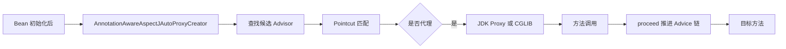

# AOP原理与应用

> [!abstract] 一句话总结
> AOP 用代理把横切逻辑织入 Spring Bean 方法调用链；精通点是 Advisor 匹配、JDK/CGLIB 代理选择和 ReflectiveMethodInvocation 拦截器链。

## 📌 精准定位

- 负责事务、权限、审计、埋点、重试等横切逻辑。
- 不负责替代业务建模，复杂分支不应藏进切面。
- 关键边界：Spring AOP 只拦截 Spring Bean 的外部方法调用，本类内部调用默认失效。

## 🧩 核心概念

| 概念 | 具体含义 | 精通要点 |
| ---- | -------- | -------- |
| JoinPoint | 可增强连接点，Spring AOP 主要是方法执行。 | 知道 Spring AOP 和 AspectJ 范围差异。 |
| Pointcut | 匹配类和方法。 | 表达式过宽会引入性能和语义风险。 |
| Advice | 前置、后置、异常、环绕等增强逻辑。 | Around 必须正确调用 proceed 并传播异常。 |
| Advisor | Pointcut + Advice 的组合。 | 实际代理按 Advisor 构造拦截器链。 |

## ⚙️ 工作原理 / 主流程



1. EnableAspectJAutoProxy 导入自动代理创建器。
2. AbstractAutoProxyCreator#postProcessAfterInitialization 判断是否包装 Bean。
3. 有接口且未强制 proxyTargetClass 时倾向 JDK 动态代理，否则使用 CGLIB。
4. JdkDynamicAopProxy#invoke 或 CglibAopProxy#intercept 创建 MethodInvocation。
5. 多个切面顺序由 Order、Ordered 或默认排序决定。

## 💻 代码 / 配置 / 伪代码

```java
@Aspect
@Component
class AuditAspect {
  @Around("@annotation(auditable)")
  Object around(ProceedingJoinPoint pjp, Auditable auditable) throws Throwable {
    long start = System.nanoTime();
    try { return pjp.proceed(); }
    catch (Throwable ex) { throw ex; }
    finally { Metrics.timer("audit.cost").record(System.nanoTime() - start, TimeUnit.NANOSECONDS); }
  }
}
```

## 🔍 源码入口 / 关键组件

- AnnotationAwareAspectJAutoProxyCreator
- AbstractAutoProxyCreator#wrapIfNecessary
- DefaultAopProxyFactory#createAopProxy
- ReflectiveMethodInvocation#proceed
- TransactionInterceptor#invoke

## ⚠️ 生产坑与注意事项

- self-invocation 不经过代理。
- final 类或 final 方法无法被 CGLIB 覆盖。
- 环绕通知吞异常会导致事务误提交。
- 切点扫到高频 getter 会带来额外耗时。
- 多个切面顺序不明确会改变事务、日志、权限语义。

## 🧭 排查路径

- 用 AopUtils.isAopProxy 确认是否代理。
- 切面不生效检查包扫描、Aspect Bean、切点和方法可见性。
- 性能异常采样 proceed 链路和切面耗时。
- 切面顺序冲突时显式设置 Order 并写集成测试。

## 🎯 面试问题

> [!question] 高频问题
> - Q: JDK 代理和 CGLIB 区别？
>   - A: JDK 基于接口，CGLIB 基于子类覆盖方法。
> - Q: 内部调用为什么失效？
>   - A: 调用的是目标对象 this，不是 Spring 代理对象。
> - Q: AOP 和拦截器区别？
>   - A: AOP 作用于 Bean 方法，MVC 拦截器作用于 Handler 请求链。
> - Q: 多个切面怎么排序？
>   - A: Order 数值越小越外层，进入早退出晚。
> - Q: 生产切面怎么写？
>   - A: 轻量、可观测、不吞异常、不做慢 IO。

## ✅ 精通检查清单

- 能画出主流程，并标出最容易失败的节点。
- 能说出至少 3 个源码入口或关键组件。
- 能写出最小配置、SQL、伪代码或状态机。
- 能结合生产故障说明监控指标、排查命令和修复动作。
- 能和相邻方案做取舍对比，而不是只背定义。

## 🔗 关联笔记

- [[_index]]
- [[20-Java后端/00-总览/学习仪表盘]]

## 📚 参考资料

- Spring Framework Reference: AOP
- Spring 源码 org.springframework.aop.framework
