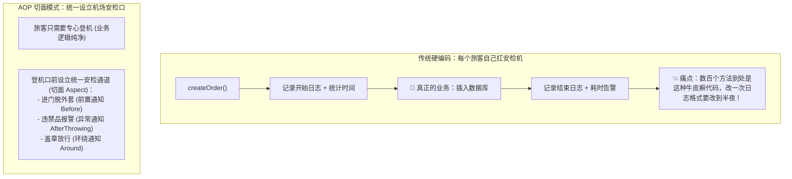
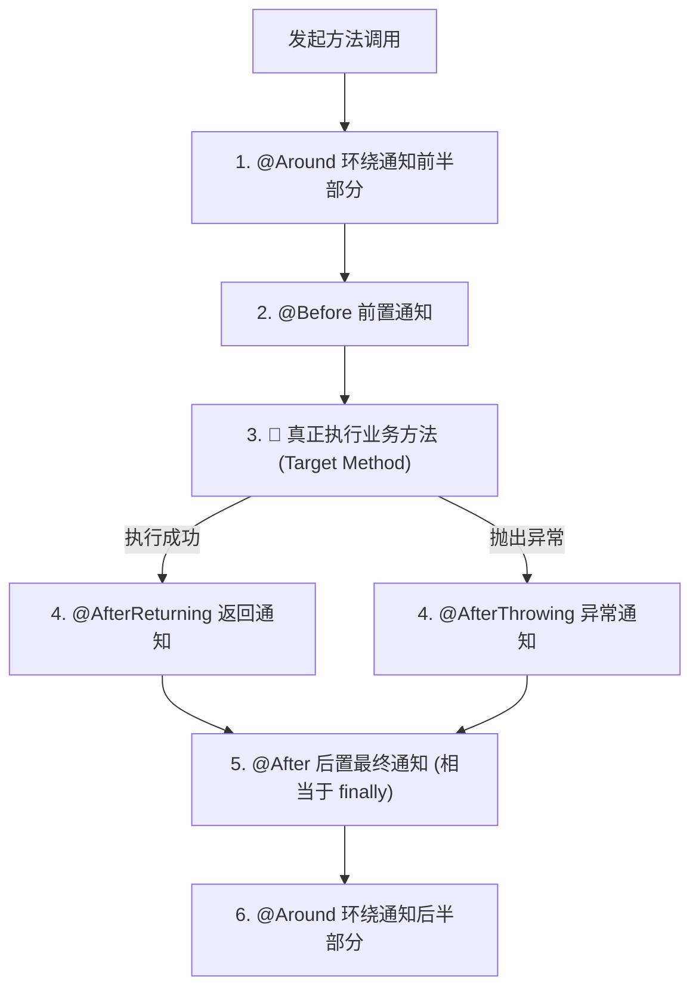
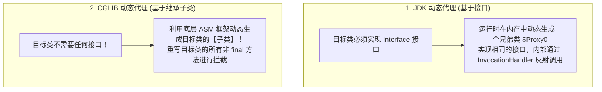

# 🛡️ 02 · AOP 原理与应用（房产中介与机场安检通道）

> **一句话导读**：不想在几百个业务方法里到处复制粘贴日志、权限和事务？AOP（面向切面编程）就像在每个重要路口设立的**“机场全自动化安检通道”**。搞懂动态代理的替身术和“自调用失效”陷阱，你就掌握了 Spring 最核心的拦截艺术。

---

## ✈️ 核心心智模型：业务旅客与机场安检通道

假设你正在开发一套电商系统，里面有几百个方法：创建订单、扣减库存、退款、查询商品……
现在老板提了一个需求：“**在所有关键方法执行前打印入参日志，执行后统计耗时，出现异常发告警短信！**”



> 💡 **AOP 核心定义**：
> **AOP（Aspect-Oriented Programming，面向切面编程）**，旨在把那些与业务核心无关、却在多个模块中普遍存在的**“横切关注点”（如日志、事务、安全鉴权、性能监控）**从业务代码中剥离出来，模块化地横向织入。

---

## 📖 AOP 五大核心黑话大白话词典

Spring AOP 的术语常常吓退新手，其实全都是纸老虎：

| 专业术语 | 英文名 | 现实生活比喻 | 对应技术含义 |
| :--- | :--- | :--- | :--- |
| **切面** | **Aspect** | **机场安检管理规范总则** | 包含了“在什么地点、做什么拦截”的整体配置类（用 `@Aspect` 修饰）。 |
| **连接点** | **JoinPoint** | **航站楼里所有能设立关卡的门** | 程序执行过程中能够插入切面的点（在 Spring 中通常就是指**方法调用**）。 |
| **切入点** | **Pointcut** | **精准划定：仅在国际出发 5 号登机口设卡** | 用表达式指定具体要拦截哪些包、哪些类的哪些方法（例如 `execution(* com..service.*.*(..))`）。 |
| **通知 / 增强** | **Advice** | **安检员具体的动作** | 具体的拦截代码逻辑（在方法执行前、执行后、还是异常时跑）。 |
| **目标对象** | **Target** | **接受安检的旅客本人** | 真正写业务逻辑的原始 Bean 实例。 |
| **织入** | **Weaving** | **把安检员正式派驻到登机口上班** | 把切面代码通过动态代理技术融合到目标方法的过程。 |

---

## 🎭 核心五大通知类型（Advice）



- **`@Before`（前置通知）**：目标方法执行前跑，用来校验参数或验权。
- **`@AfterReturning`（返回通知）**：方法**正常无异常执行完毕**后跑，可以拿到方法的返回值。
- **`@AfterThrowing`（异常通知）**：方法抛出未捕获异常时触发，用来做告警或打错误日志。
- **`@After`（最终通知）**：不管成功还是失败，最后必定执行（相当于 `finally` 块）。
- **`@Around`（环绕通知 - 🌟 王牌功能）**：包办一切！你可以决定是否调用 `joinPoint.proceed()`，可以修改入参、修改返回值，甚至拦截吞掉异常！统计耗时必用环绕通知。

---

## 👥 底层替身术：JDK 动态代理 vs CGLIB 字节码生成

这是大厂面试几乎必考的基石题：“Spring AOP 底层到底是怎么实现代理的？”



| 对比维度 | JDK 动态代理 | CGLIB 动态代理 |
| :--- | :--- | :--- |
| **是否必须有接口？** | **必须有**（如果类没实现接口，JDK 代理当场报错） | **不需要**（直接生成子类） |
| **实现原理** | Java 官方原生反射包 `Proxy.newProxyInstance` | 基于开源 ASM 框架直接在运行时修改和生成字节码 |
| **天然限制** | 只能代理接口中声明的方法 | **目标类不能是 `final`**，需要拦截的方法也不能是 `final`（因为子类无法继承重写 final 方法！） |
| **Spring Boot 默认选择** | 旧版 Spring 如果有接口默认选 JDK | **Spring Boot 2.x/3.x 起，全面默认强制使用 CGLIB！**（通过统一使用类继承代理，杜绝因强制类型转换导致的偶发报错） |

---

## 💥 生产最高频翻车事故：自调用失效（this.method 陷阱）

90% 的初学者甚至部分中级工程师，都在这个阴沟里翻过车：

```java
@Service
public class OrderService {
    
    // 外部调用的入口方法（没加事务/切面）
    public void createOrder() {
        System.out.println("1. 创建订单基本信息...");
        
        // 🚨 翻车现场：同一个类内部直接调用 check()！
        this.check(); 
    }

    // 希望被 AOP 切面拦截的方法（比如加了日志、事务 @Transactional）
    @LogAnnotation
    public void check() {
        System.out.println("2. 校验库存与订单合规性...");
    }
}
```

### 现象：
你在外部 Controller 调用 `orderService.createOrder()`，发现控制台打印了这两句话，但是：
**`@LogAnnotation` 上的切面日志根本没打印！如果是 `@Transactional` 事务也直接失效！**

### 🔬 逐帧死因剖析：

```mermaid
flowchart LR
    Caller["外部 Controller"] ==>|调用 createOrder()| Proxy["OrderService 的代理对象 (中介)"]
    
    Proxy -->|1. 执行切面逻辑后，转给真正的目标对象| Real["真正的 OrderService 实例 (Target)"]
    
    Real -.->|2. 内部调用 this.check()！<br/>🚨 this 指向的是自己（Target 裸对象）！<br/>完全绕过了外部的 Proxy 代理！| Real
```

> 🚨 **真相大白**：
> 1. AOP 的一切魔法，都寄生在 **代理对象（Proxy）** 身上；
> 2. 外部请求打过来，首先访问的是 **Proxy 代理人**，代理人执行切面逻辑；
> 3. 但一旦代码执行进入了真正的业务方法，此时上下文里的 `this` 指向的是**真正的内部裸对象**！
> 4. `this.check()` 相当于裸对象自己调用自己，**根本没有经过代理对象的安检门**，切面自然全部失效！

---

## 🛡️ 破解自调用失效的三大神技

| 解决姿势 | 代码实操 | 优缺点与评价 |
| :--- | :--- | :--- |
| **姿势一：业务拆分（推荐首选）** | 把 `check()` 拆到另一个独立的 `OrderCheckService` 里面，注入进来调用。 | **🌟 架构最优解**！符合面向对象单一职责原则。 |
| **姿势二：自己注入自己** | 在类里通过 `@Autowired @Lazy private OrderService self;`，然后用 `self.check()` 替代 `this.check()`。 | 简单快捷，但稍显怪异（需要 `@Lazy` 防循环依赖）。 |
| **姿势三：强行从上下文中捞代理** | 开启 `@EnableAspectJAutoProxy(exposeProxy = true)`，在代码中写：`((OrderService) AopContext.currentProxy()).check();` | 能用，但代码与 Spring AOP 强耦合，极具侵入性。 |

---

## 🧠 一分钟复盘核心记忆卡

1. **AOP 本质**：通过**动态代理**在目标方法执行的前后织入横切公共逻辑。
2. **两套替身**：有接口可用 JDK 代理，无接口用 CGLIB 生成子类；Spring Boot 默认优先使用 CGLIB。
3. **避坑铁律**：**切忌在类内部通过 `this.method()` 调用带切面/事务的方法**，否则必遭穿透失效！

---

## 🧭 下一步

AOP 最具价值的王牌杀手级应用，毫无疑问就是**声明式事务管理（`@Transactional`）**。
为什么加了一个注解就能自动回滚？为什么有时候写了注解数据库却依旧没回滚？
请进入下一篇大厂面试必问专题：[[03-Spring事务管理]]！
