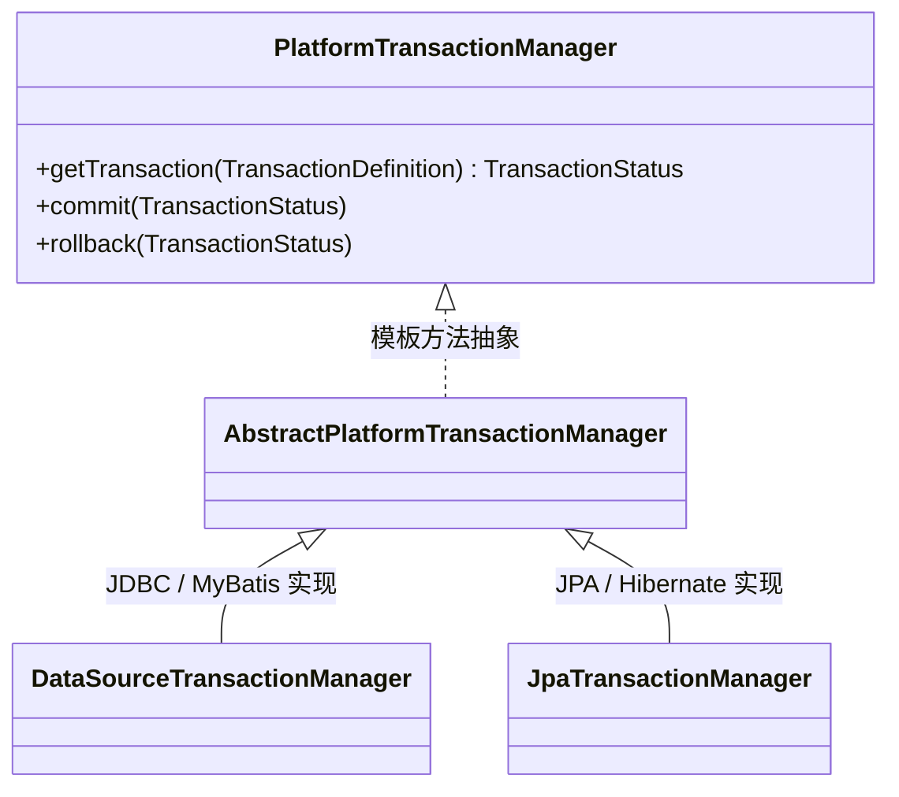
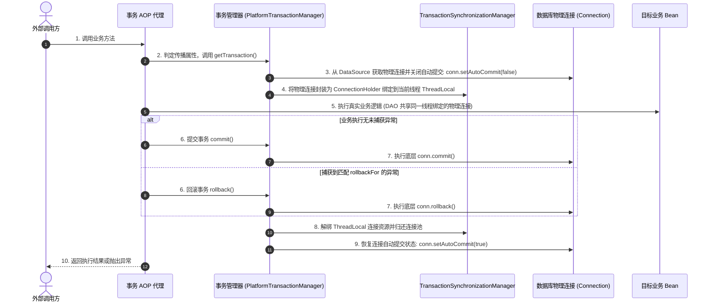

# 03 · Spring 声明式事务原理与传播机制深度解析

> **导读**：在企业级应用研发中，保证跨多表操作的原子性与数据强一致性是核心诉求。Spring 的声明式事务通过 AOP 动态代理和 `ThreadLocal` 资源绑定，将繁琐的底层 JDBC 事务控制高度抽象为 `@Transactional` 注解。然而，因对底层连接挂起、保存点机制以及代理调用穿透理解不深，导致线上事务失效、锁等待超时及数据不一致的故障屡见不鲜。本文从事务管理器架构、7 大传播行为底层机制、大事务危害，到 7 大经典失效场景的源码根因，进行系统性剖析。

---

## 一、Spring 事务架构与运行模型

Spring 并不直接管理底层数据库事务，而是通过统一的抽象接口规范适配不同的持久化技术（JDBC、MyBatis、Hibernate、JPA 等）。

### 1. 核心抽象接口体系
Spring 事务体系的核心是 **`PlatformTransactionManager`**（或响应式环境下的 `ReactiveTransactionManager`）：



### 2. 声明式事务底层执行时序
当调用标记了 `@Transactional` 的方法时，Spring AOP 切面 `TransactionInterceptor` 介入，驱动完整的事务生命周期：



---

## 二、7 大事务传播行为底层运行机制

事务传播行为（Propagation Behavior）定义了当一个事务方法被另一个事务方法调用时，当前事务应如何流转与嵌套。

### 1. 7 大事务传播行为技术规范详解

1. **`PROPAGATION_REQUIRED`（融入已有事务，无则新建 —— 默认策略）**
   - **底层事务流转**：若当前存在事务，则直接**融入当前事务**；若当前无事务，则**新建物理事务**并绑定到当前线程 `ThreadLocal`。
   - **异常与回滚联动**：所有调用方共享同一个底层数据库连接与事务，任何一个子方法抛出未捕获异常均会导致整个事务被标记为 `rollbackOnly`，触发**全局回滚**。
   - **典型业务场景**：绝大多数常规业务单据写入、账户余额增减等强一致性操作。

2. **`PROPAGATION_REQUIRES_NEW`（挂起外部事务，强制新建独立事务）**
   - **底层事务流转**：无论当前是否存在事务，均**创建全新独立物理事务**；若当前已存在事务，则将其连接及上下文**挂起（Suspend）**。
   - **异常与回滚联动**：新事务拥有完全独立的底层数据库连接；新事务的提交或回滚与外部事务互不干扰（内部回滚不影响外部，除非异常向外抛出未被捕获）。
   - **典型业务场景**：**操作审计日志落盘、订单流水号/分布式号段生成**（即使外部主业务发生异常回滚，审计操作与已消耗号段仍必须持久化成功）。

3. **`PROPAGATION_NESTED`（基于 Savepoint 保存点的嵌套子事务）**
   - **底层事务流转**：全程使用**同一个物理数据库连接**。若当前存在事务，则在当前事务内建立**保存点（Savepoint）**；若当前无事务，行为等同于 `REQUIRED`。
   - **异常与回滚联动**：嵌套子事务抛出异常时，外部事务若捕获该异常，可仅**局部回滚至该保存点**，外部事务仍可继续提交；但若外部事务发生回滚，则**连同子事务全量回滚**。
   - **典型业务场景**：批量任务对账中单条数据失败时跳过继续处理剩余数据、多渠道阶梯重试扣款。

4. **`PROPAGATION_SUPPORTS`（支持事务，有则融，无则非事务运行）**
   - **底层事务流转**：若当前存在事务，则融入该事务；若当前无事务，则以**纯非事务（普通只读连接）**方式执行。
   - **异常与回滚联动**：在事务内运行时受外层事务的全局回滚约束；在无事务状态下各 SQL 独立自动提交。
   - **典型业务场景**：通用只读数据查询方法、幂等辅助统计接口（单独调用时不加排他锁提高并发，被外层事务调用时能维持一致性读）。

5. **`PROPAGATION_NOT_SUPPORTED`（不支持事务，有则挂起）**
   - **底层事务流转**：**始终以非事务方式运行**；若当前已存在事务，则将外部事务的物理连接**挂起**。
   - **异常与回滚联动**：自身绝不开启事务，执行期间不持有任何事务性排他行锁。
   - **典型业务场景**：耗时极长的报表大屏数据聚合、外部慢网络 RPC 调用（避免长耗时阻塞外部事务导致数据库连接池被耗尽与锁超时）。

6. **`PROPAGATION_MANDATORY`（强制要求环境必须处于事务中）**
   - **底层事务流转**：**强制要求当前调用上下文必须已存在事务**；若调用时无事务，直接抛出 `IllegalTransactionStateException`。
   - **异常与回滚联动**：必须依托上层事务运行，异常联动全局回滚。
   - **典型业务场景**：严禁被独立裸调用、必须由上层编排控制严格原子边界的核心数据组件（如底层库存强扣落库逻辑）。

7. **`PROPAGATION_NEVER`（严禁处于事务中运行）**
   - **底层事务流转**：**强制要求当前绝不能处于事务中**；若调用时检测到已存在事务，直接抛出 `IllegalTransactionStateException`。
   - **异常与回滚联动**：自身绝不以事务方式运行。
   - **典型业务场景**：严禁加锁的大吞吐量只读导出任务、或者特定不支持事务参与的底层流水线。

### 2. 底层技术实现对比：`REQUIRES_NEW` vs `NESTED`
- **`REQUIRES_NEW` 的挂起机制**：
  Spring 调用 `TransactionSynchronizationManager.suspend()` 将原事务的 `ConnectionHolder` 从当前线程的 `ThreadLocal` 中取出，保存在 `SuspendedResourcesHolder` 对象中；随后向连接池申请**第二个独立的物理连接**绑定到线程并开启新事务；执行完毕提交并解绑后，再调用 `resume()` 将原物理连接恢复到 `ThreadLocal`。
- **`NESTED` 的保存点机制**：
  全程仅使用**同一个底层物理数据库连接**。在进入嵌套方法前，底层驱动执行 `Savepoint savepoint = conn.setSavepoint();`；若嵌套方法抛出异常，捕获后执行 `conn.rollback(savepoint);` 释放保存点，主事务无需整体回滚。

---

## 三、大厂高频面试真题：Spring 事务失效的 7 大根因剖析

在生产排障中，因事务失效导致脏数据入库属于 P1/P2 级严重故障。其核心成因主要归结为以下 7 类：

### 1. 根因一：内部方法自调用（Self-Invocation）穿透代理
```java
@Service
public class TradeService {
    public void createOrder() {
        // 🚨 致命缺陷：通过 this 直接调用同类事务方法！
        this.saveTradeData(); 
    }

    @Transactional(rollbackFor = Exception.class)
    public void saveTradeData() {
        // 发生异常，但事务绝对不会回滚！
    }
}
```
- **技术本质**：`@Transactional` 建立在 AOP 动态代理机制上。外部请求调用的是代理对象，而类内部的 `this.saveTradeData()` 属于目标裸对象（Target）的内部方法跳转，程序计数器未经过代理类的拦截器链，因此 `TransactionInterceptor` 根本未介入。
- **解决规范**：将事务方法剥离到独立的 Service 类中调用，或通过构造器/Setter 引入依赖类。

### 2. 根因二：异常被业务代码主动捕获未向外抛出
```java
@Transactional(rollbackFor = Exception.class)
public void executePayment() {
    try {
        orderDao.deductBalance();
        stockDao.reduceStock(); // 假设此处抛出异常
    } catch (Exception e) {
        // 🚨 致命缺陷：异常被本地捕获且未重新向外抛出！
        log.error("扣减失败", e);
    }
}
```
- **技术本质**：`TransactionInterceptor` 依赖捕获目标方法向外抛出的异常来决定触发 `rollback()`。如果业务代码在内部通过 `try-catch` 拦截了异常且未重新抛出，AOP 切面认为目标方法已正常执行完毕，顺理成章调用 `conn.commit()` 提交部分脏数据。
- **解决规范**：捕获后必须 `throw e;` 重新抛出，或者显式声明手动回滚：
  `TransactionAspectSupport.currentTransactionStatus().setRollbackOnly();`。

### 3. 根因三：抛出受检异常（Checked Exception）未指定 rollbackFor
```java
@Transactional // 🚨 隐患：未显式配置 rollbackFor
public void processBatchFile() throws IOException {
    orderDao.insert();
    throw new IOException("文件读写失败"); // 属于受检异常
}
```
- **技术本质**：Spring 事务规范（`DefaultTransactionAttribute`）默认的回滚策略为：**仅当捕获到 `RuntimeException` 或 `Error` 时触发回滚**。若抛出的是受检异常（如 `IOException`、`SQLException` 或自定义继承自 `Exception` 的业务异常），Spring 默认直接提交事务！
- **生产军规**：**所有声明式事务注解必须无条件声明 `@Transactional(rollbackFor = Exception.class)`**。

### 4. 根因四：方法修饰符非 `public`
- **技术本质**：Spring 在解析事务注解时（`AbstractFallbackTransactionAttributeSource.computeTransactionAttribute`），会显式校验 `Modifier.isPublic(method.getModifiers())`。若方法为 `private`、`protected` 或包级可见，Spring 判定其不具备事务元数据，直接忽略切面拦截。

### 5. 根因五：多线程异步执行导致连接上下文丢失
```java
@Transactional(rollbackFor = Exception.class)
public void asyncOrderProcess() {
    orderDao.insertOrder();
    // 🚨 致命缺陷：在异步子线程中执行核心数据库写入
    CompletableFuture.runAsync(() -> {
        accountDao.deductMoney(); // 抛异常无法连带回滚主事务
    });
}
```
- **技术本质**：Spring 事务物理连接与事务状态严格依托于主线程的 `ThreadLocal`。新开启的子线程拥有独立的线程栈，无法获取父线程绑定的 `ConnectionHolder`，在子线程内执行的数据库操作属于全新的自动提交连接，彻底脱离父级事务管控。

### 6. 根因六：底层数据库存储引擎不支持事务
- 例如 MySQL 中由于历史遗留原因将表引擎设置为了 `MyISAM`。由于底层存储引擎本身不支持事务日志（Redo/Undo Log），无论上层框架如何调用 `commit` 或 `rollback`，数据库物理层面均无法实现数据回退。

### 7. 根因七：所属 Bean 未被 Spring IoC 容器纳管
- 例如开发者手动通过 `new OrderService()` 实例化对象并调用，或者遗漏了 `@Service`、`@Component` 等注解，导致该对象完全游离在 Spring 容器与 AOP 代理体系之外。

---

## 四、生产级架构军规：避免大事务（Long-Running Transaction）

大事务是导致生产数据库连接池耗尽、锁等待超时、主从延迟飙高的元凶。

### 1. 大事务的核心技术危害
1. **连接池耗尽**：一个事务若持续运行 5 秒（包含慢网络 RPC 或复杂计算），则该数据库物理连接在此 5 秒内被独占无法释放，瞬间打满 HikariCP 等连接池；
2. **锁冲突加剧**：在事务提交之前，所有加在行记录上的排他锁（X 锁）与间隙锁（Gap Lock）持续保持不释放，引发大批并发业务线程进入等待甚至死锁；
3. **主从同步严重延迟**：大事务写入的大容量 Binlog 在主库提交后一次性推送到从库，从库 SQL 线程重放耗时极长，导致从库只读副本延迟暴增。

### 2. 编程式事务 `TransactionTemplate` 精细化收缩边界

```java
import org.springframework.stereotype.Service;
import org.springframework.transaction.support.TransactionTemplate;

@Service
public class ProductionOrderService {
    private final TransactionTemplate transactionTemplate;

    public ProductionOrderService(TransactionTemplate transactionTemplate) {
        this.transactionTemplate = transactionTemplate;
    }

    public void submitOrder() {
        // 1. 外部慢网络调用与参数校验（非事务区域，不占用数据库连接）
        verifyUserRiskStatus();
        callThirdPartyCouponApi();

        // 2. 核心原子数据库写入（精细化控制在毫秒级事务范围内）
        transactionTemplate.execute(status -> {
            try {
                orderMapper.insertOrder();
                inventoryMapper.reduceStock();
                return true;
            } catch (Exception e) {
                // 标记仅回滚并向外抛出
                status.setRollbackOnly();
                throw e;
            }
        });

        // 3. 异步非关键操作（短信通知、MQ 投递）
        sendOrderCreatedMq();
    }
}
```

---

### 场景演示：转账结算与独立审计

- **跨行转账出账与入账（`PROPAGATION_REQUIRED` 默认事务）**：出账扣款与入账增额共享同一个物理连接，任何一步抛异常导致全局原子回滚；
- **风控审计日志强制落盘（`PROPAGATION_REQUIRES_NEW` 独立事务）**：转账失败并不影响操作审计日志的记录，原事务被挂起（`suspend()`），开辟全新独立物理连接写入日志并独立提交，随后恢复主事务；
- **多笔优惠券阶梯核销（`PROPAGATION_NESTED` 保存点事务）**：同一连接内通过 Savepoint 实现局部子事务，单张券失效仅回滚至保存点，不破坏整体转账流程；
- **业务类私下调用（自调用失效）**：必须经由 Spring 代理对象进入方法，同类内部直接 `this.save()` 会绕过事务拦截切面；
- **柜员私有印章（`ThreadLocal` 绑定连接）**：数据库物理连接按线程私有隔离，新启子线程异步操作无法感知父线程的事务连接。

---

## 🧭 下一步

在真实的交易与账务系统中，当订单事务成功提交后，往往需要发送短信通知、推送站内信或向消息队列（MQ）投递消息。
如果直接在事务方法体内调用外部网络服务，一旦网络阻塞会导致大事务连接耗尽；而如果在外部方法调用，一旦本地事务回滚短信却已提前飞出去了！
Spring 是如何通过**事件发布机制（ApplicationEventPublisher）**与 **`@TransactionalEventListener`（事务提交监听器）**实现业务解耦与事务最终一致性的？
请进入第一关收官之作：[[11-Spring事件机制]]！
