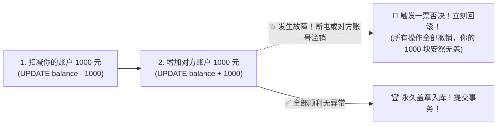
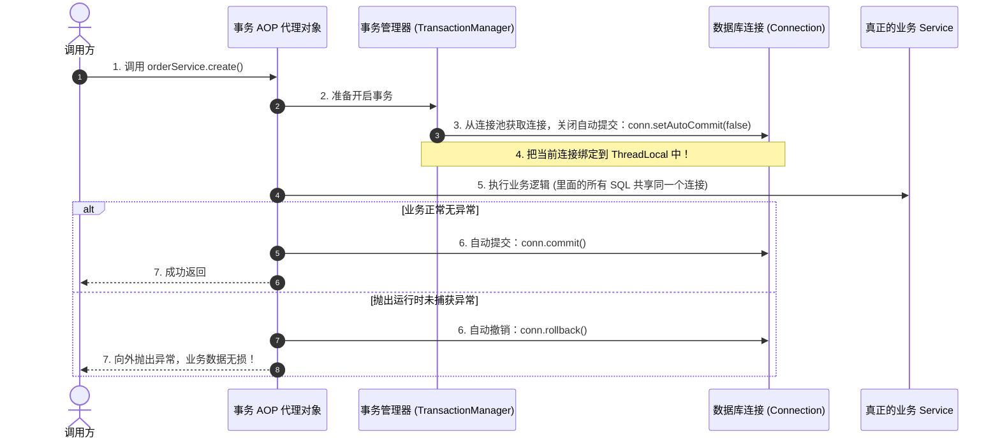
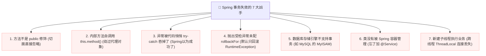

# 💳 03 · Spring 事务管理（银行柜台一票否决与 7 大失效死穴）

> **一句话导读**：加了 `@Transactional` 却依然没回滚，导致线上超卖数百万？Spring 事务的本质就是一套**“基于 AOP 的数据库连接保镖”**。掌握事务的 7 种传播行为和**大厂必考的 7 大失效死穴**，让你彻底告别线上一致性灾难。

---

## 🏦 核心心智模型：银行联合转账与一票否决权

什么是事务？想象你在银行办理一笔转账：



这就是数据库的 **ACID 特性**（原子性、一致性、隔离性、持久性）。
而 Spring 的主要贡献是：**让你不用再手写繁杂的 JDBC 事务模板代码，用一个声明式注解 `@Transactional` 就能包办一切！**

---

## 🔬 揭开面纱：`@Transactional` 是如何施展魔法的？

很多人以为 `@Transactional` 是数据库自带的功能，其实**它完全是基于我们在上一篇学到的 AOP 动态代理机制实现的！**

Spring 内部有一个叫做 `TransactionInterceptor` 的核心切面：



---

## 💥 大厂面试王炸：Spring 事务失效的 7 大高频血泪坑

面试官最喜欢问：“你在实际开发中，遇到过哪些 `@Transactional` 失效的场景？如何排查？”
**请将以下 7 大经典死穴刻在骨子里：**



### 1. 坑一：同类内部方法自调用（最隐蔽、最常见！）
```java
@Service
public class OrderService {
    public void createOrder() {
        // 🚨 翻车！调用同类的私有/公有事务方法，直接走 this，绕过了代理对象！
        this.insertOrder(); 
    }

    @Transactional
    public void insertOrder() {
        // 这里的事务注解完全无效！发生异常绝不回滚！
    }
}
```
- **解法**：重构代码将 `insertOrder` 移至独立的 Service，或通过自己注入自己调用。

### 2. 坑二：把异常悄悄用 `try-catch` 吞掉了
```java
@Transactional
public void payOrder() {
    try {
        orderDao.updateStatus();
        accountDao.deductMoney(); // 假设这里抛出异常
    } catch (Exception e) {
        // 🚨 翻车！异常被你自己吞了，Spring 以为一切安好，直接执行 conn.commit()！
        log.error("支付出错了", e);
    }
}
```
- **解法**：`catch` 记录日志后，**必须再次向外 `throw e`**；或者手动标记回滚：`TransactionAspectSupport.currentTransactionStatus().setRollbackOnly();`。

### 3. 坑三：默认只回滚 `RuntimeException`（抛出受检异常未回滚）
```java
@Transactional // 🚨 隐患！
public void readFileAndUpdateDb() throws IOException {
    orderDao.insert();
    throw new IOException("读取文件失败"); // IOException 是 Checked Exception！
}
```
- **原因**：Spring 默认只在遇到 `RuntimeException` 或 `Error` 时才回滚！遇到 `Exception` 的其他子类（受检异常）默认**直接提交**！
- **生产军规**：**永远显式加上 `rollbackFor = Exception.class`！**
  ```java
  @Transactional(rollbackFor = Exception.class)
  ```

### 4. 坑四：方法不是 `public` 修饰
- Spring 的 `AbstractFallbackTransactionAttributeSource` 在解析方法属性时，会明确检查 `Modifier.isPublic(method.getModifiers())`。
- 如果修饰符是 `private`、`protected` 或包级可见，Spring 会直接忽略事务切面！

### 5. 坑五：多线程异步操作（跨线程连接丢失）
```java
@Transactional
public void mainTask() {
    orderDao.insert();
    // 🚨 翻车！新线程里的操作完全不受当前事务管控！
    new Thread(() -> {
        stockDao.deduct(); // 如果这里抛异常，主线程早已提交，无法一起回滚！
    }).start();
}
```
- **原因**：Spring 事务依赖的是当前线程绑定的 `ThreadLocal` 数据库连接。新开子线程拥有全新的线程栈，根本拿不到主线程的事务连接。

---

## 🌊 事务的 7 大传播行为（Propagation）大白话速记

当两个带事务的方法发生嵌套调用时（方法 A 调 方法 B），事务究竟该如何表现？

| 传播属性 | 现实生活大白话 | 典型场景 |
| :--- | :--- | :--- |
| **`REQUIRED`** *(默认)* | **“有组织就加入组织，没组织就自立山头”**。<br/>如果 A 有事务，B 就融进去；如果 A 没有，B 自己开一个。 | 90% 的绝大多数业务场景。 |
| **`REQUIRES_NEW`** | **“不管你有没有组织，我都必须自己开一个全新事务，互不相干”**。<br/>挂起 A 的事务，B 自己开独立事务，B 的回滚与否不影响 A。 | **记录操作日志、发放独立优惠券**（就算主业务报错，日志也必须成功落库！）。 |
| **`NESTED`** | **“大局为重，设立保存点（Savepoint）”**。<br/>如果 A 有事务，B 成为嵌套子事务；B 如果失败，可以只回滚 B 自己的部分，A 可以决定是否继续。 | 批量发送消息或批量处理（某一条失败不影响整体）。 |
| **`SUPPORTS`** | **“随遇而安”**。A 有我就有，A 没有我也没有。 | 查询类方法。 |
| **`NOT_SUPPORTED`** | **“独善其身”**。以无事务方式执行，如果 A 有事务就先把 A 挂起。 | 耗时极长、不需要事务保护的外部计算。 |
| **`MANDATORY`** | **“必须有靠山”**。A 必须有事务，如果没有直接抛异常！ | 必须依赖上层事务调用的关键子方法。 |
| **`NEVER`** | **“清高绝不沾边”**。绝不允许在事务中执行，有事务就抛异常！ | 明确禁止事务包裹的特殊场景。 |

---

## 💻 工业级标准：声明式与编程式事务的最佳组合

在很多超高并发或涉及慢 I/O（比如调外部第三方微信支付接口）的场景中，**使用大范围的 `@Transactional` 会导致数据库长连接被长时间霸占，拖垮数据库连接池！**

此时推荐使用 Spring 提供的**编程式事务（`TransactionTemplate`）**，精准缩小事务粒度：

```java
import org.springframework.stereotype.Service;
import org.springframework.transaction.support.TransactionTemplate;

@Service
public class OptimizedOrderService {
    private final TransactionTemplate transactionTemplate;

    public OptimizedOrderService(TransactionTemplate transactionTemplate) {
        this.transactionTemplate = transactionTemplate;
    }

    public void processOrder() {
        // 1. 慢操作：调用外部远程接口，绝不能放在数据库事务里！
        callExternalPayment();

        // 2. 精准极简事务：只把真正的数据库写操作包裹起来！
        transactionTemplate.execute(status -> {
            try {
                orderDao.insert();
                stockDao.deduct();
                return true;
            } catch (Exception e) {
                status.setRollbackOnly(); // 发生异常回滚
                throw e;
            }
        });

        // 3. 异步操作：发短信、发邮件
        sendNotification();
    }
}
```

---

## 🧠 一分钟复盘核心记忆卡

1. **核心本质**：Spring 事务就是通过 **AOP 动态代理 + ThreadLocal 绑定数据库连接** 自动实现 `commit` 和 `rollback`。
2. **生产铁律**：**永远配置 `rollbackFor = Exception.class`**，切忌在类内部自调用，切忌在事务方法里做慢 I/O 网络请求！
3. **传播行为**：最常用 `REQUIRED`（融入）与 `REQUIRES_NEW`（独立起灶炉）。

---

## 🧭 下一步

在事务执行成功后，我们经常需要发短信、扣减积分或通知下游模块。如果直接在事务代码里调用，一旦发短信超时就会拖慢核心事务。
如何在当前进程内优雅地完成事件发布与解耦，并在事务提交后才触发通知？
请进入下一篇：[[11-Spring事件机制]]！
