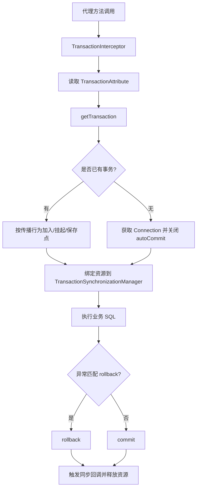
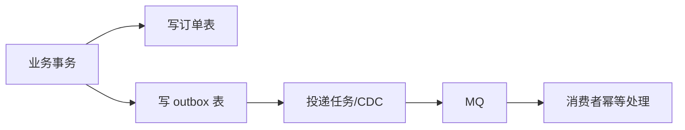

# Spring事务管理

> [!abstract] 一句话总结
> Spring 事务用 AOP 把业务方法包进 PlatformTransactionManager 的提交/回滚模板；精通点是传播行为、隔离级别、rollback 规则、线程连接绑定和事务失效边界。

## 📌 精准定位

- 负责把一段数据库操作纳入同一个事务上下文。
- 不负责跨库、消息和远程调用的天然一致。
- 关键边界：事务上下文绑定在线程上，异步线程和本类内部调用默认拿不到事务。
- 面试重点不是只背 `@Transactional`，而是能解释“为什么失效、怎么排查、如何和 MySQL 锁/MVCC、MQ 一致性联动”。

## 🧩 核心概念

| 概念 | 具体含义 | 精通要点 |
| ---- | -------- | -------- |
| PlatformTransactionManager | 事务管理器抽象，JDBC 常用 DataSourceTransactionManager。 | 理解 getTransaction、commit、rollback。 |
| TransactionInterceptor | 事务 AOP 拦截器。 | 主入口是 invokeWithinTransaction。 |
| 传播行为 | REQUIRED、REQUIRES_NEW、NESTED 等参与规则。 | 能说清挂起、新连接和保存点。 |
| rollback 规则 | 默认 RuntimeException 和 Error 回滚。 | 受检异常要显式 rollbackFor。 |
| 线程绑定 | 事务资源绑定在 ThreadLocal。 | 异步线程、线程池切换默认不继承事务。 |
| 事务同步回调 | afterCommit、beforeCommit 等回调。 | 适合提交后发事件，不适合替代 MQ 可靠投递。 |

## ⚙️ 工作原理 / 主流程



1. `@EnableTransactionManagement` 注册事务 Advisor。
2. 事务切面匹配 `@Transactional` 方法。
3. 进入方法前根据传播行为获取或创建事务。
4. `DataSourceTransactionManager#doBegin` 获取连接、关闭自动提交、绑定到线程。
5. MyBatis/JdbcTemplate 通过 `DataSourceUtils` 取同一连接。
6. `RuleBasedTransactionAttribute#rollbackOn` 决定异常是否回滚。
7. 提交或回滚后清理 `TransactionSynchronizationManager` 中的资源。

## 💻 代码 / 配置 / 伪代码

```java
@Service
class OrderAppService {
  @Transactional(rollbackFor = Exception.class)
  public void createOrder(CreateOrderCmd cmd) {
    orderMapper.insert(cmd.toOrder());
    stockMapper.deduct(cmd.skuId(), cmd.count());
    outboxMapper.insert(OutboxEvent.orderCreated(cmd.orderId()));
  }
}
```

## 🔍 源码入口 / 关键组件

- `TransactionInterceptor#invoke`
- `TransactionAspectSupport#invokeWithinTransaction`
- `AbstractPlatformTransactionManager#getTransaction`
- `AbstractPlatformTransactionManager#commit`
- `AbstractPlatformTransactionManager#rollback`
- `DataSourceTransactionManager#doBegin`
- `TransactionSynchronizationManager`
- `DataSourceUtils#getConnection`

## 🔁 传播行为深挖

| 传播行为 | 已有事务时 | 无事务时 | 典型场景 | 风险 |
| -------- | ---------- | -------- | -------- | ---- |
| REQUIRED | 加入当前事务 | 新建事务 | 默认业务写操作 | 内层异常影响外层整体回滚 |
| REQUIRES_NEW | 挂起外层，新建事务 | 新建事务 | 记录审计、失败日志 | 多占一个连接，嵌套多会打满连接池 |
| NESTED | 创建保存点 | 新建事务 | 局部失败可回滚到保存点 | 依赖数据库保存点，和 REQUIRES_NEW 不同 |
| SUPPORTS | 加入事务 | 非事务执行 | 查询方法 | 写操作误用可能没有事务 |
| NOT_SUPPORTED | 挂起事务 | 非事务执行 | 长耗时非事务操作 | 不能依赖事务一致性 |
| MANDATORY | 加入事务 | 抛异常 | 必须被外层事务包裹 | 调用方忘记开事务会失败 |
| NEVER | 抛异常 | 非事务执行 | 禁止事务场景 | 较少使用 |

### NESTED 与 REQUIRES_NEW 的核心区别

- `NESTED` 仍在同一个物理事务中，只是创建保存点；外层最终回滚时，内层即使成功也会一起回滚。
- `REQUIRES_NEW` 会挂起外层事务，开启新的物理事务；内层提交后，外层回滚不影响内层。
- `REQUIRES_NEW` 需要额外数据库连接，高并发下可能把连接池打满。

## ⚠️ 事务失效矩阵

| 场景 | 是否生效 | 原因 | 修复 |
| ---- | -------- | ---- | ---- |
| private 方法加 `@Transactional` | 否 | Spring AOP 代理无法拦截 private 方法 | 放到 public 方法或独立 Bean |
| final 方法/类 | 通常否 | CGLIB 无法重写 final 方法 | 避免 final，或使用接口代理但仍要经过代理 |
| 本类内部调用 | 否 | `this.method()` 绕过代理 | 拆到另一个 Service，或通过代理对象调用 |
| 异步线程中执行 DB | 否 | 事务资源绑定当前线程 | 异步方法单独开启事务，避免依赖外层事务 |
| 异常被 catch 不抛出 | 默认提交 | 拦截器看不到异常 | 重新抛出，或 `setRollbackOnly()` |
| 抛 checked exception | 默认不回滚 | 默认只回滚 RuntimeException/Error | `rollbackFor = Exception.class` |
| 多数据源事务管理器不匹配 | 可能不生效 | Mapper 使用的数据源和事务管理器不是同一个 | 指定正确 transactionManager |
| 方法不是 public | 可能不生效 | 代理和事务属性解析边界 | 事务入口统一使用 public |
| 数据库引擎不支持事务 | 否 | 如 MyISAM | 使用 InnoDB |
| DDL 语句 | 不可靠 | MySQL DDL 可能隐式提交 | 避免在业务事务里执行 DDL |

## 🧪 典型案例

### 案例 1：自调用导致事务失效

```java
@Service
class OrderService {
  public void create() {
    saveOrder(); // this.saveOrder()，不会经过代理
  }

  @Transactional
  public void saveOrder() {
    orderMapper.insert(...);
    stockMapper.deduct(...);
  }
}
```

修复：

```java
@Service
class OrderAppService {
  private final OrderTxService orderTxService;

  public void create() {
    orderTxService.saveOrder();
  }
}

@Service
class OrderTxService {
  @Transactional(rollbackFor = Exception.class)
  public void saveOrder() {
    orderMapper.insert(...);
    stockMapper.deduct(...);
  }
}
```

### 案例 2：catch 异常后事务提交

```java
@Transactional
public void createOrder() {
  orderMapper.insert(...);
  try {
    stockMapper.deduct(...);
  } catch (Exception e) {
    log.error("deduct failed", e);
  }
}
```

这里异常被吞掉，事务拦截器认为方法正常返回，会提交订单。修复方式：

- 重新抛出异常。
- 或调用 `TransactionAspectSupport.currentTransactionStatus().setRollbackOnly()`。

### 案例 3：事务里调用 RPC 导致连接池耗尽

```java
@Transactional
public void pay() {
  orderMapper.updateStatus(...);
  remoteCouponService.sendCoupon(...); // 慢 RPC
  accountMapper.updateBalance(...);
}
```

问题：事务持有连接和行锁期间等待网络调用，RPC 慢会放大锁等待和连接池占用。

修复：

- 事务内只做本地数据库状态变更。
- 提交后通过 outbox/MQ 异步发券。
- 远程调用必须有超时、重试和幂等。

### 案例 4：REQUIRES_NEW 打满连接池

外层事务持有一个连接，内层 `REQUIRES_NEW` 又申请一个连接。如果一个请求内循环调用多次，或并发很高，连接池容易耗尽。

排查信号：

- HikariCP active connection 接近 max。
- 线程栈卡在获取连接。
- MySQL `innodb_trx` 中长事务增多。

修复：

- 减少 `REQUIRES_NEW` 使用。
- 审计日志可异步写。
- 必须使用时限制并发和循环次数。

## 🧩 事务与 MySQL 锁 / MVCC 的关系

- Spring 事务只负责在 Java 层开启、提交、回滚事务；真正的锁、MVCC、隔离级别由数据库实现。
- 隔离级别通过连接设置传给数据库，例如 RC/RR。
- 在事务内执行当前读，如 `SELECT ... FOR UPDATE`、`UPDATE`，会触发 InnoDB 加锁。
- 长事务会延迟 undo 清理，可能导致历史版本堆积。
- 事务里做慢 RPC 或大批量处理，会延长锁持有时间，引发锁等待和死锁概率上升。

## 📬 DB + MQ 一致性

### 错误做法

```java
@Transactional
public void createOrder() {
  orderMapper.insert(...);
  mq.send(orderCreatedEvent); // 如果这里成功但事务回滚，消息脏发；如果这里失败但事务提交，消息丢失
}
```

### 推荐做法：Outbox 本地消息表

```java
@Transactional(rollbackFor = Exception.class)
public void createOrder() {
  orderMapper.insert(...);
  outboxMapper.insert(new OutboxEvent("ORDER_CREATED", orderId, payload));
}
```

然后后台任务或 CDC 投递 outbox：



优点：业务数据和消息记录在同一个本地事务里提交。缺点是链路更长，需要处理重试、去重、状态更新和监控。

## 🧭 排查路径

- 不回滚：看异常类型、是否被吞、是否经过代理、是否匹配 rollback 规则。
- 没有开启事务：看方法可见性、本类调用、是否被 Spring 管理、AOP 是否生效。
- 锁等待：查 `information_schema.innodb_trx`、`performance_schema.data_locks`、`SHOW ENGINE INNODB STATUS`。
- 连接池打满：排查长事务、`REQUIRES_NEW`、事务内 RPC、慢 SQL。
- 多数据源异常：确认 `transactionManager` 与 Mapper 所用数据源一致。
- DB+MQ 不一致：查业务表、outbox 表、MQ 投递日志、消费者幂等表。

## 🎯 面试问题

> [!question] 高频问题
> - Q: Spring 事务为什么会失效？
>   - A: 本质是没有经过事务代理，或代理看不到异常，或事务资源不在当前线程。典型包括 private/final 方法、本类自调用、异步线程、异常被 catch、checked exception 未配置 rollbackFor、多数据源事务管理器不匹配。
> - Q: 默认什么异常回滚？
>   - A: RuntimeException 和 Error。受检异常默认不回滚，需要 `rollbackFor = Exception.class`。
> - Q: NESTED 和 REQUIRES_NEW 区别？
>   - A: NESTED 用同一个物理事务的保存点，外层回滚会影响内层；REQUIRES_NEW 挂起外层并开启新事务，内层提交后不受外层回滚影响，但会多占连接。
> - Q: 事务为什么不要调 RPC？
>   - A: 网络延迟会拉长连接和锁持有时间，RPC 失败语义也无法天然绑定 DB 提交，容易造成锁等待、连接池耗尽和数据不一致。
> - Q: 事务如何绑定线程？
>   - A: `TransactionSynchronizationManager` 用 ThreadLocal 保存连接、事务同步回调等资源，所以异步线程默认没有外层事务。
> - Q: DB+MQ 一致怎么做？
>   - A: 常用本地消息表/outbox、事务消息或 CDC。普通事务内直接发 MQ 不能保证数据库提交和消息投递一致。

## 🎤 面试 3 层回答

### 30 秒版

Spring 事务本质是 AOP 拦截方法，在方法前获取连接并绑定到当前线程，方法正常提交，异常匹配 rollback 规则就回滚。它最容易出问题的地方是代理没生效、异常没抛出、异步线程丢事务，以及事务里做了慢 RPC 或 MQ。

### 2 分钟版

我会从三个层面讲：第一，源码主线是 `TransactionInterceptor -> TransactionAspectSupport -> PlatformTransactionManager`；第二，事务资源通过 `TransactionSynchronizationManager` 绑定线程，所以自调用、异步、多数据源都会影响事务边界；第三，数据库锁和 MVCC 由 MySQL 实现，Spring 只是控制提交回滚。生产上要避免长事务、事务里 RPC，以及 DB+MQ 直接耦合，跨资源一致性用 outbox 或事务消息。

### 项目版

在订单/秒杀项目里，创建订单、扣库存和写 outbox 必须在一个本地事务里完成；真正发送 MQ 放到事务提交之后的异步投递。这样可以避免订单提交了但消息没发，或者消息发了但事务回滚。支付回调和超时关单用状态机条件更新，事务尽量短，避免锁等待。

## ✅ 精通检查清单

- 能画出事务代理和提交/回滚主流程。
- 能说清 `TransactionInterceptor`、`PlatformTransactionManager`、`TransactionSynchronizationManager` 的职责。
- 能列出事务失效矩阵，并解释根因。
- 能区分 REQUIRED、REQUIRES_NEW、NESTED。
- 能结合 MySQL 锁和 MVCC 解释长事务风险。
- 能给出 DB+MQ 一致性的 outbox 方案。

## 🔗 关联笔记

- [[_index]]
- [[20-Java后端/00-总览/学习仪表盘]]
- [[../05-数据库与存储/03-MySQL锁机制]]
- [[../05-数据库与存储/02-事务与隔离级别]]
- [[../06-中间件/03-消息可靠性-顺序-幂等]]
- [[../09-项目实战/01-项目-高并发秒杀系统]]

## 📚 参考资料

- Spring Framework Reference: Transaction Management
- MySQL Reference Manual: InnoDB Transactions
- Microservices Patterns: Transactional Outbox
