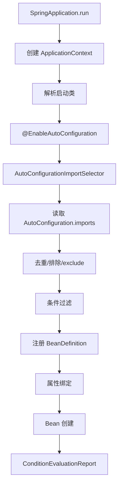

# SpringBoot自动配置原理

> [!abstract] 一句话总结
> Spring Boot 自动配置根据 classpath、属性和条件注解决定是否注册 Bean；精通点是 `AutoConfiguration.imports` 加载、`@Conditional` 匹配、属性绑定、用户 Bean 覆盖默认 Bean 和条件报告排查。

## 📌 精准定位

- 负责把常见框架集成的默认 Bean 和属性绑定打包成可组合配置。
- 不负责自动推断所有业务语义，冲突配置仍要显式排查。
- 关键边界：classpath 少一个依赖、属性变化、用户 Bean 顺序变化都会改变自动配置结果。
- 面试重点：自动配置如何加载、条件如何匹配、为什么加依赖会多 Bean、如何排查自动配置没生效。

## 🧩 核心概念

| 概念 | 具体含义 | 精通要点 |
| ---- | -------- | -------- |
| `@SpringBootApplication` | 组合配置类、自动配置和包扫描。 | 启动类位置影响扫描范围。 |
| `AutoConfigurationImportSelector` | 读取自动配置候选并过滤。 | Boot 3 使用 `AutoConfiguration.imports`。 |
| `@Conditional` | 按 class、bean、property、resource 等条件匹配。 | 会用 conditions report 排查。 |
| `@ConfigurationProperties` | 把外部配置绑定到类型安全对象。 | 关注前缀、默认值、校验和优先级。 |
| Starter | 聚合依赖。 | 本身通常不写配置逻辑。 |
| Autoconfigure | 自动配置代码。 | 和 starter 解耦，便于复用。 |

## ⚙️ 工作原理 / 主流程



1. `SpringApplication` 准备环境、监听器和上下文。
2. `ConfigurationClassParser` 解析启动类和导入配置。
3. `@EnableAutoConfiguration` 导入 `AutoConfigurationImportSelector`。
4. `getAutoConfigurationEntry` 读取候选自动配置。
5. `ConditionEvaluator` 判断每个 `@Conditional` 是否匹配。
6. 用户自定义 Bean 通常通过 `@ConditionalOnMissingBean` 覆盖默认 Bean。
7. 条件匹配结果写入 `ConditionEvaluationReport`，用于排查。

## 🧪 自动配置示例

```java
@AutoConfiguration
@ConditionalOnClass(RedisClient.class)
@EnableConfigurationProperties(CacheProps.class)
class CacheAutoConfiguration {
  @Bean
  @ConditionalOnMissingBean
  CacheClient cacheClient(CacheProps props) {
    return new RedisCacheClient(props.getTtl(), props.getNamespace());
  }
}
```

`META-INF/spring/org.springframework.boot.autoconfigure.AutoConfiguration.imports`：

```text
com.example.cache.CacheAutoConfiguration
```

属性类：

```java
@ConfigurationProperties(prefix = "demo.cache")
public class CacheProps {
  private Duration ttl = Duration.ofMinutes(10);
  private String namespace = "default";
}
```

## 🔎 常见条件注解

| 注解 | 作用 | 常见问题 |
| ---- | ---- | -------- |
| `@ConditionalOnClass` | classpath 存在某类才生效 | 少依赖导致配置不生效 |
| `@ConditionalOnMissingClass` | classpath 不存在某类才生效 | 测试/生产 classpath 不一致 |
| `@ConditionalOnBean` | 容器有某 Bean 才生效 | Bean 创建顺序影响匹配 |
| `@ConditionalOnMissingBean` | 容器没有某 Bean 才注册默认 Bean | 用户 Bean 类型/名称不匹配导致覆盖失败 |
| `@ConditionalOnProperty` | 属性满足条件才生效 | 属性名拼错、profile 不对 |
| `@ConditionalOnResource` | 资源存在才生效 | classpath 资源缺失 |
| `@ConditionalOnWebApplication` | Web 环境才生效 | 测试环境不是 Web 上下文 |

## 🧭 排查自动配置

### 方式 1：启动加 debug

```bash
java -jar app.jar --debug
```

查看 Positive matches 和 Negative matches。

### 方式 2：Actuator conditions

```http
GET /actuator/conditions
```

关注：

- 哪个自动配置类匹配了。
- 哪个条件没满足。
- 是缺 class、缺 bean、缺 property，还是 profile 不对。

### 方式 3：查看 Bean 来源

- 看 BeanDefinition 的 resource/source。
- IDE 调试 `registerBeanDefinition`。
- Actuator `/actuator/beans` 查看 Bean 来源和依赖。

## 🧱 Starter 与 Autoconfigure

推荐拆分：

```text
demo-cache-spring-boot-starter
  └── 只放依赖聚合

demo-cache-spring-boot-autoconfigure
  └── 自动配置类、Properties、Condition
```

原因：

- starter 方便业务引入。
- autoconfigure 可被多个 starter 或场景复用。
- 自动配置逻辑不要和业务代码混在一起。

## 🧪 典型案例

### 案例 1：加了 starter 后多出默认 Bean

现象：引入某 starter 后，应用中出现一个默认 `CacheClient`。

原因：classpath 中有 `RedisClient`，`@ConditionalOnClass` 成立；业务没有自定义 `CacheClient`，`@ConditionalOnMissingBean` 成立。

排查：看 conditions report。

修复：定义自己的 `CacheClient` Bean，或通过属性关闭自动配置。

### 案例 2：用户 Bean 没有覆盖默认 Bean

原因可能有：

- 用户 Bean 类型不是自动配置判断的类型。
- Bean 名称不同且条件按名称判断。
- 自动配置先判断时用户 BeanDefinition 尚未注册。
- 泛型类型导致 `OnBeanCondition` 判断不符合预期。

修复：

- 明确返回类型，不要只返回接口不匹配的父类型。
- 使用官方推荐覆盖点。
- 查看 `ConditionEvaluationReport`。

### 案例 3：配置属性不生效

排查顺序：

1. prefix 是否正确。
2. profile 是否激活。
3. 配置优先级是否被环境变量/启动参数覆盖。
4. 是否启用了 `@EnableConfigurationProperties` 或扫描。
5. 类型转换是否失败。

## ⚠️ 生产坑与注意事项

- 启动类放太深导致扫描不到业务 Bean。
- 引入 starter 后默认 Bean 悄悄生效。
- `@ConditionalOnMissingBean` 受配置类顺序和搜索策略影响。
- 属性拼错不一定启动失败，建议加 metadata 和校验。
- 测试 classpath 与生产不同会改变装配结果。
- 自动配置里不要做重 IO 或外部连接，Bean 创建应轻量。
- 默认配置要可关闭、可覆盖、可观测。

## 🔍 源码入口 / 关键组件

- `SpringApplication#run`
- `EnableAutoConfiguration`
- `AutoConfigurationImportSelector#getAutoConfigurationEntry`
- `AutoConfigurationImportSelector#getCandidateConfigurations`
- `OnClassCondition`
- `OnBeanCondition`
- `OnPropertyCondition`
- `ConfigurationPropertiesBinder`
- `ConditionEvaluationReport`

## 🎯 面试问题

> [!question] 高频问题
> - Q: 自动配置怎么加载？
>   - A: `@EnableAutoConfiguration` 导入 `AutoConfigurationImportSelector`，读取 `AutoConfiguration.imports` 中的候选配置，再按条件注解过滤并注册 BeanDefinition。
> - Q: 如何覆盖默认 Bean？
>   - A: 声明自己的同类型或同名 Bean，前提是默认配置用了 `@ConditionalOnMissingBean`，并且类型/名称匹配条件判断。
> - Q: starter 和 autoconfigure 区别？
>   - A: starter 聚合依赖，autoconfigure 放自动配置代码。starter 通常依赖 autoconfigure。
> - Q: 为什么加依赖会多 Bean？
>   - A: 新依赖让 `@ConditionalOnClass` 成立，激活相关自动配置。
> - Q: 怎么排查没生效？
>   - A: 看 `ConditionEvaluationReport` 或 `/actuator/conditions`，确认 class、bean、property、profile 条件。

## 🎤 面试 3 层回答

### 30 秒版

Spring Boot 自动配置就是根据 classpath、属性和已有 Bean 判断要不要注册默认 Bean。它通过 `AutoConfigurationImportSelector` 读取自动配置候选，再用各种 `@Conditional` 过滤。

### 2 分钟版

启动时 `@SpringBootApplication` 间接启用自动配置，`AutoConfigurationImportSelector` 会从 `AutoConfiguration.imports` 读取候选类。每个自动配置类上通常有 `@ConditionalOnClass`、`@ConditionalOnProperty`，Bean 方法上有 `@ConditionalOnMissingBean`。所以引入依赖会改变 classpath，属性会改变匹配结果，用户自定义 Bean 可以覆盖默认 Bean。排查时看 conditions report。

### 项目版

如果项目中引入 starter 后出现 Bean 冲突或默认配置不符合预期，我会先打开 `/actuator/conditions` 看是哪条自动配置生效，再看 `@ConditionalOnMissingBean` 的匹配类型，最后通过自定义 Bean、配置属性或 exclude 自动配置解决。

## ✅ 精通检查清单

- 能画出自动配置加载流程。
- 能说明 Boot 3 的 `AutoConfiguration.imports`。
- 能解释常见 Conditional 注解。
- 能区分 starter 和 autoconfigure。
- 能用 conditions report 排查自动配置问题。
- 能设计一个可覆盖、可关闭、可观测的 starter。

## 🔗 关联笔记

- [[_index]]
- [[20-Java后端/00-总览/学习仪表盘]]
- [[01-IoC容器与Bean生命周期]]
- [[05-SpringBoot Starter机制]]

## 📚 参考资料

- Spring Boot Reference: Auto-configuration
- Spring Boot 源码 `org.springframework.boot.autoconfigure`
