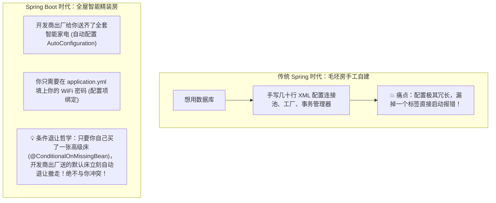
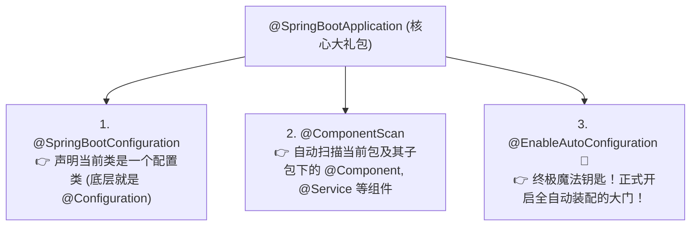
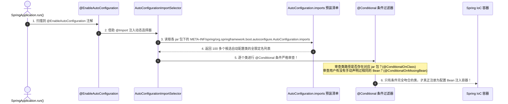

# 🪄 04 · SpringBoot 自动配置原理（全屋智能预装与条件注解退让）

> **一句话导读**：为什么只要在 `pom.xml` 里加一行依赖，连 XML 都不用写，直接 `@Autowired` 就能连上 Redis / 数据库？Spring Boot 的本质就像**“全屋智能精装房”**。看懂 `@EnableAutoConfiguration` 和条件注解的“贴心退让机制”，你就彻底洞穿了现代 Java 开发的最大魔法。

---

## 🛋️ 核心心智模型：毛坯房配置地狱 vs 全屋智能精装房

回顾早期的 Spring MVC 时代，被称为“配置工程师的折寿年代”：
想在项目里连个 MySQL 数据库，你必须在 `applicationContext.xml` 里写几十行繁琐的标签：
配置数据源 `DruidDataSource`、配置事务管理器 `DataSourceTransactionManager`、配置会话工厂 `SqlSessionFactoryBean`……
更要命的是：**全天下 99% 的程序员写的配置模板几乎一模一样，只是改了个数据库账号密码！**



---

## 🔍 灵魂拆解：@SpringBootApplication 背后的大门神

我们每个 Spring Boot 项目的启动类上，都顶着一个神奇的注解：`@SpringBootApplication`。
点进它的源码，它的本质就是一个**“三合一大礼包”**：



---

## 🏃 自动配置执行全链路：大厂面试满分三部曲

面试官常问：“请详细讲讲 Spring Boot 自动配置的完整链路与加载时机。”
**请按照以下“探宝三部曲”行云流水作答：**



### 1. 第一步：拿着钥匙找门卫（`@Import`）
- `@EnableAutoConfiguration` 上挂着一个注解：
  `@Import(AutoConfigurationImportSelector.class)`。
- 这个“导入选择器”的作用，就是在容器启动时，负责计算出**到底有哪些自动配置类应该被加载进容器**。

### 2. 第二步：翻看官方出厂预装清单（`imports` 文件）
- 选择器会去扫描当前项目引入的每一个 jar 包中的配置文件：
  `META-INF/spring/org.springframework.boot.autoconfigure.AutoConfiguration.imports`
  *(💡 注意：在旧版 Spring Boot 2.x 中是 `META-INF/spring.factories`，在现代 Spring Boot 3.x 中全面升级为该文件！)*
- 打开这个文件，里面规整地写着上百个自动配置类的类全名（如 `RedisAutoConfiguration`、`RabbitAutoConfiguration`、`DataSourceAutoConfiguration`）。

### 3. 第三步：绝不无脑加载！@Conditional 家族层层把关（按需生效）
如果项目一启动把这 100 多个配置类全加载，那内存早崩了！
**每个自动配置类的头上，都顶着严苛的“条件守卫注解”：**

```java
// 以 Redis 自动配置类源码为例：
@AutoConfiguration
// 守卫 1：检查你的 classpath 路径下到底有没有 RedisOperations.class 类？
// (也就是检查你在 pom.xml 里到底引没引入 spring-boot-starter-data-redis！)
@ConditionalOnClass(RedisOperations.class) 
@EnableConfigurationProperties(RedisProperties.class)
public class RedisAutoConfiguration {

    @Bean
    // 守卫 2：贴心退让机制！检查你自己在业务代码里有没有手动配过 RedisTemplate？
    // 如果你配了，我这个默认的就立刻自愿放弃退让！
    @ConditionalOnMissingBean(name = "redisTemplate")
    public RedisTemplate<Object, Object> redisTemplate(RedisConnectionFactory factory) {
        ...
    }
}
```

---

## 🛡️ @Conditional 家族常用兵器谱

| 条件注解 | 触发条件（大白话翻译） | 经典场景 |
| :--- | :--- | :--- |
| **`@ConditionalOnClass`** | 类路径下**必须存在**指定的 class 文件，才生效。 | 只要你没引入对应 starter 的 jar 包，该组件自动静默关闭。 |
| **`@ConditionalOnMissingClass`** | 类路径下**不存在**指定 class 文件才生效。 | 降级替代方案。 |
| **`@ConditionalOnBean`** | 容器中**已经存在**某个指定的 Bean 时，才生效。 | 依赖前置组件就绪。 |
| **`@ConditionalOnMissingBean`** | 容器中**不存在**指定的 Bean 时，才生效（**🌟 最核心退让注解**）。 | 允许开发者自定义同名 Bean 随时覆盖默认实现。 |
| **`@ConditionalOnProperty`** | `application.yml` 中指定属性达到某个值时才生效。 | 功能开关（如 `demo.feature.enabled=true`）。 |

---

## 💻 亲手写一个自己的自动配置：看懂它如何优雅退让

保存为 `GreetingAutoConfiguration.java`：

```java
import org.springframework.boot.autoconfigure.AutoConfiguration;
import org.springframework.boot.autoconfigure.condition.ConditionalOnMissingBean;
import org.springframework.boot.autoconfigure.condition.ConditionalOnProperty;
import org.springframework.context.annotation.Bean;

// 业务产品对象
public record GreetingService(String prefix) {
    public String sayHello(String name) {
        return prefix + ", " + name;
    }
}

// 自动配置类
@AutoConfiguration
@ConditionalOnProperty(prefix = "custom.greeting", name = "enabled", havingValue = "true", matchIfMissing = true)
public class GreetingAutoConfiguration {

    @Bean
    // 🌟 核心退让守卫：只有当应用里没有自定义 GreetingService 时，才装配默认的！
    @ConditionalOnMissingBean(GreetingService.class)
    public GreetingService defaultGreetingService() {
        System.out.println("🛠️ 正在加载出厂默认配置：GreetingService ('你好')");
        return new GreetingService("你好");
    }
}
```

### 验证退让机制：
1. **默认情况下**：控制台打印“🛠️ 正在加载出厂默认配置：你好”；
2. **如果你在自己的任意配置类里写了**：
   ```java
   @Bean
   public GreetingService customGreetingService() {
       return new GreetingService("尊敬的VIP客户");
   }
   ```
3. **结果**：Spring 发现已经有了 `GreetingService`，`defaultGreetingService()` 上的 `@ConditionalOnMissingBean` 条件不成立，**出厂配置自动退让，零冲突！**

---

## 🧠 一分钟复盘核心记忆卡

1. **总开关**：`@SpringBootApplication` 包含 `@EnableAutoConfiguration`；
2. **两把刷子**：通过 `@Import(AutoConfigurationImportSelector.class)` 读取 `AutoConfiguration.imports` 候选清单；
3. **灵魂防线**：利用 **`@ConditionalOnClass`（按需引入）** 和 **`@ConditionalOnMissingBean`（用户优先，贴心退让）** 实现真正的“约定优于配置”。

---

## 🧭 下一步

搞懂了自动配置的内部机理，第三方库（如 MyBatis、Druid、Redis）是如何把自己的代码包装成一个标准的 **`Starter`** 起步依赖供别人开箱即用的？
如何手写一个属于自己的企业级自定义 Starter？
请进入下一篇：[[05-SpringBoot Starter机制]]！
