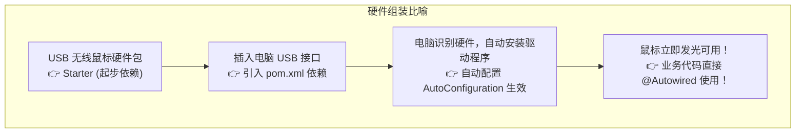
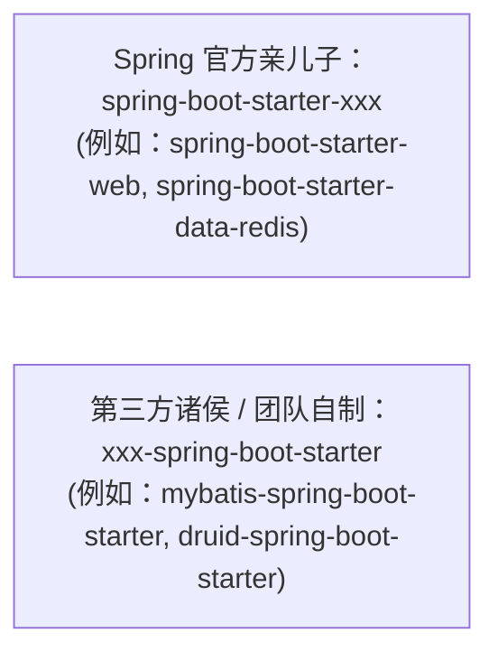
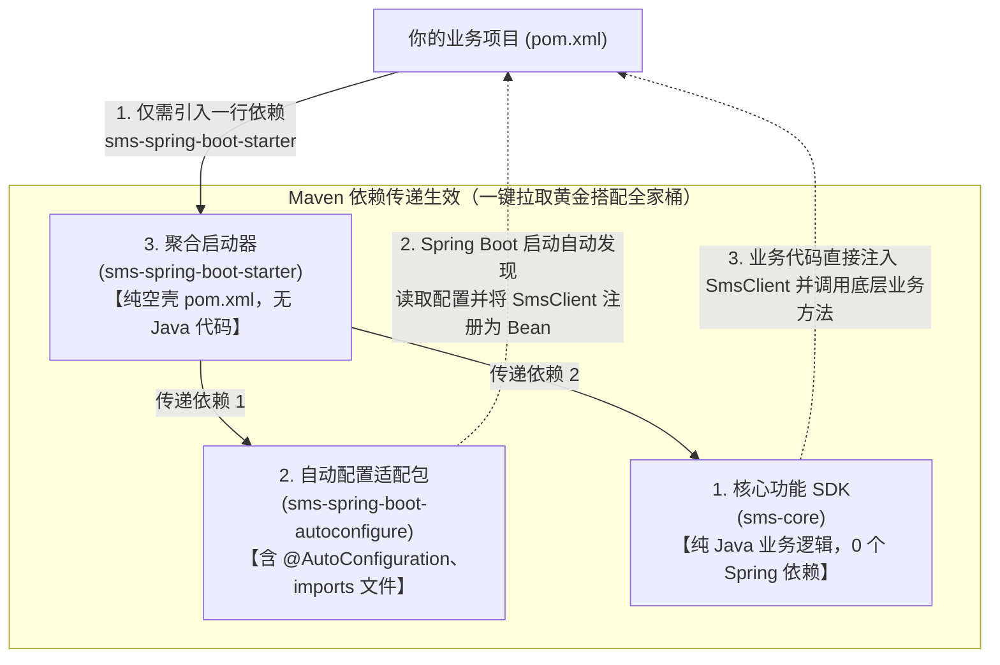

# 🔌 05 · SpringBoot Starter 机制（USB 即插即用外设与手写组件实战）

> **一句话导读**：为什么引入一个 `mybatis-spring-boot-starter` 就能直接开箱即用？Starter 本质就是一套**“即插即用的电脑 USB 设备”**。看懂官方命名潜规则，并手把手写一个属于自己团队的开箱即用组件，你就能在团队里输出硬核基础设施能力。

---

## 🔌 为什么需要 Starter 机制？（模块化与开箱即用）

很多初学者容易把 **Starter** 和 **自动配置（AutoConfiguration）** 混为一谈。用一个电脑硬件的比喻就能瞬间分清：



| 核心概念 | 架构本质与职责分工 | 场景类比说明（辅助理解） |
| :--- | :--- | :--- |
| **`Starter`** | **依赖聚合入口（Dependency Aggregator）**。本质上是一个依赖清单工程，负责将该功能模块所需的全部依赖 jar 包（SDK、驱动、自动配置模块）统一打包引入项目，避免手动声明和解决版本冲突。 | 类比为即插即用的一站式功能扩展包 |
| **`AutoConfiguration`** | **自动化配置实现（AutoConfiguration Module）**。具体的自动化装配代码。读取配置属性，通过 `@Conditional` 条件注解进行环境检查，最终向 Spring 容器安全注册就绪的 Bean。 | 类比为系统识别并自动加载的底层驱动模块 |

---

## 🏷️ 命名潜规则：官方嫡系 vs 第三方诸侯

在翻看公司的 `pom.xml` 时，你会发现有两种长相完全相反的 starter 名字：



> 🚨 **规范避坑**：
> 如果你们团队自己研发了一个统一日志或短信的组件，**千万不要命名为 `spring-boot-starter-xxx`**！这是 Spring 官方保留的专属命名空间，必须命名为 **`mycompany-spring-boot-starter`**！

---

## 🛠️ 手把手实战：手写一个属于你自己的短信发送 Starter

让我们以各大公司最常用的**“统一短信发送服务（SmsStarter）”**为例，体验一次从零打造企业级开箱即用组件的全过程：

### 1. 第一步：定义配置属性映射类（`SmsProperties.java`）
把 `application.yml` 里的配置项绑定到 Java 对象上，让使用方享受 IDE 代码提示：

```java
import org.springframework.boot.context.properties.ConfigurationProperties;

// 绑定 application.yml 里以 sms 开头的配置
@ConfigurationProperties(prefix = "sms")
public class SmsProperties {
    private String signName = "默认官方签名";
    private String appKey;
    private String secretKey;

    // Getter & Setter 略
    public String getSignName() { return signName; }
    public void setSignName(String signName) { this.signName = signName; }
    public String getAppKey() { return appKey; }
    public void setAppKey(String appKey) { this.appKey = appKey; }
    public String getSecretKey() { return secretKey; }
    public void setSecretKey(String secretKey) { this.secretKey = secretKey; }
}
```

### 2. 第二步：定义核心业务工具类（`SmsSender.java`）
提供真正给业务调用的服务对象：

```java
public class SmsSender {
    private final SmsProperties properties;

    public SmsSender(SmsProperties properties) {
        this.properties = properties;
    }

    public boolean send(String phone, String message) {
        System.out.println("📱 [短信通道] 正在使用签名【" + properties.getSignName() + "】向手机 " 
                + phone + " 发送验证码内容: " + message);
        return true;
    }
}
```

### 3. 第三步：编写自动配置核心类（`SmsAutoConfiguration.java`）
把属性类和工具类粘合在一起，并挂上条件注解：

```java
import org.springframework.boot.autoconfigure.AutoConfiguration;
import org.springframework.boot.autoconfigure.condition.ConditionalOnClass;
import org.springframework.boot.autoconfigure.condition.ConditionalOnMissingBean;
import org.springframework.boot.autoconfigure.condition.ConditionalOnProperty;
import org.springframework.boot.context.properties.EnableConfigurationProperties;
import org.springframework.context.annotation.Bean;

@AutoConfiguration
// 激活属性绑定
@EnableConfigurationProperties(SmsProperties.class)
// 只有在配置了 sms.enabled=true 时才加载（默认开启）
@ConditionalOnProperty(prefix = "sms", name = "enabled", havingValue = "true", matchIfMissing = true)
public class SmsAutoConfiguration {

    @Bean
    // 允许使用方自定义自己的 SmsSender 替换默认实现
    @ConditionalOnMissingBean(SmsSender.class)
    public SmsSender smsSender(SmsProperties properties) {
        return new SmsSender(properties);
    }
}
```

### 4. 第四步：对外宣告你的存在（配置 imports 文件）
在项目的 `src/main/resources` 目录下创建文件：
`META-INF/spring/org.springframework.boot.autoconfigure.AutoConfiguration.imports`

在文件内写入刚才自动配置类的全类名：
```text
com.example.sms.SmsAutoConfiguration
```

---

## 🎁 业务方使用有多爽？（体验见证）

一旦你的 Starter 打包发布到团队 Maven 仓库，其他业务项目的同事使用起来简直爽到飞起：

### 1. 业务同事在 `pom.xml` 里加依赖：
```xml
<dependency>
    <groupId>com.example</groupId>
    <artifactId>sms-spring-boot-starter</artifactId>
    <version>1.0.0</version>
</dependency>
```

### 2. 在 `application.yml` 里选配参数（享有 IDE 自动补全）：
```yaml
sms:
  enabled: true
  sign-name: "淘宝官方商城"
  app-key: "ak_888888"
  secret-key: "sk_999999"
```

### 3. 在 Service 代码里直接注入使用！零 XML，零配置类！
```java
@Service
public class LoginService {
    @Autowired
    private SmsSender smsSender; // 直接注入，开箱即用！

    public void sendVerifyCode(String phone) {
        smsSender.send(phone, "您的验证码是 6688");
    }
}
```

---

## 🏗️ 架构进阶：工业级三层解耦标准（Core + AutoConfigure + Starter）

很多初学者看到这里会产生一个巨大的困惑：
> *“既然 AutoConfigure 里包含了所有的 Java 配置代码和 `imports` 文件，那真正的业务功能代码写在哪？那个里面连一行代码都没有的 Starter 到底要它有什么用？”*

在正规的工业级开源生态（如 MyBatis、Redisson、PageHelper）中，**一个成熟的 Starter 体系实际上由 3 个独立分工的模块组成**：

### 1. 工业级三模块职责分工架构图



1. **`xxx-core`（核心功能 SDK / 纯业务工具包）**：
   - **代码内容**：纯 Java 代码（如 `SmsClient`、`mybatis.jar`、`redisson.jar`）。负责底层真正发短信、解析 SQL、连接 Redis 的功能。
   - **核心特征**：**代码里绝对不能出现任何 Spring 的注解或依赖（如 `@Component`、`@Autowired`、`@Configuration`）**。
   - **核心价值**：非 Spring 项目（哪怕是普通的控制台 `main` 方法、古老 Servlet 遗留系统、或其他微服务框架）也可以单独引入该包，直接 `new SmsClient(...)` 即可跑通，绝不受 Spring 框架依赖污染。
2. **`xxx-spring-boot-autoconfigure`（自动配置适配包 / 框架红娘）**：
   - **代码内容**：只包含与 Spring Boot 绑定的装配代码，如 `SmsProperties`、`SmsAutoConfiguration` 以及 `AutoConfiguration.imports` 文件。
   - **核心特征**：它**不实现**发短信的核心底层逻辑，它的唯一工作就是**充当红娘**——读取业务项目的 `application.yml`，并在容器启动时自动帮你在 Spring 里 `new` 一个 `SmsClient` 注册为容器 Bean。
   - **核心价值**：将“核心功能”与“Spring 框架适配”彻底解耦。哪怕 Spring Boot 以后大版本升级（如 Boot 2 升 Boot 3，底层包名从 `javax` 变为 `jakarta`），核心的 `xxx-core` 一行代码都不用变，只需重写本适配模块即可。
3. **`xxx-spring-boot-starter`（聚合包装盒 / 一键开箱大礼包）**：
   - **代码内容**：**里面连一行 Java 代码都没有！** 只有一个 `pom.xml`。
   - **核心特征**：在 `pom.xml` 里同时将上面的 `xxx-core` 和 `xxx-spring-boot-autoconfigure` 声明为依赖。
   - **核心价值**：充当“一键开箱门面（Facade）”。业务方不需要知道背后到底由哪些散装包组成、也不需要操心版本兼不兼容，只需在 `pom.xml` 里引入这一个 Starter，Maven 的依赖传递机制就会自动将全套配套包拉取齐备。

---

### 2. 核心疑问深度解答

#### 疑问 A：既然 Starter 里一行代码都没有，为什么不直接让业务方依赖 `autoconfigure`？
- **防拼图式报错**：如果让业务方直接依赖 `autoconfigure`，业务方必须自己手动再去寻找并引入 `sms-core`。一旦业务方少引了、或者引入了不兼容的 `core` 核心版本，一启动就会直接抛出 `ClassNotFoundException` 惨剧。
- **一站式门面**：Starter 是一套契约，它打包了经过官方严苛集成测试的“黄金组合版本”。

#### 疑问 B：为什么开源社区常把这种模式称为“双模块设计”？
- 像 MyBatis 官方的整合仓库叫 `mybatis-spring-boot`，它的仓库里确实只有两个子模块：`mybatis-spring-boot-autoconfigure` 和 `mybatis-spring-boot-starter`。
- **原因在于**：底层的核心功能库 `mybatis`（即 `mybatis-3.5.x.jar`）是一个历史更早、完全独立的顶级开源项目！所以 Spring 整合仓库自身只需维护“自动配置模块”和“Starter 聚合模块”即可。
- **认知拨正**：不管是叫“三模块分层”还是“双模块工程”，**【核心功能包】、【自动配置包】、【Starter 聚合包】这三者的逻辑边界是绝对分明、各司其职的**。

---

### 3. 生产选型：标准三层架构 vs 团队偷懒单模块

在实际企业研发中，到底该拆分还是合在一起？遵循以下选型准则：

1. **公司级通用中间件 / 开源基础组件（必须严格采用标准分层）**：
   - **形态**：`xxx-core` + `xxx-spring-boot-autoconfigure` + `xxx-spring-boot-starter`。
   - **适用**：供全公司几十个团队复用，未来可能支持多种异构技术栈，或作为开源项目发布。
2. **业务团队内部小型开箱即用组件（推荐偷懒单模块，符合 KISS 原则）**：
   - **形态**：直接在一个 `xxx-spring-boot-starter` 模块里，把属性类、工具类、AutoConfiguration 类、`imports` 文件全塞在一起。
   - **适用**：小团队内部 3~5 个微服务自用，团队 100% 绑定 Spring Boot 生态，追求开发极简与极速迭代，无需承担过度工程化的多模块维护成本。

---

## 🧠 一分钟复盘核心记忆卡

1. **Starter 本质**：**“依赖清单 + 自动配置入口”**，解决版本冲突与手动配置难题。
2. **命名守则**：官方以 `spring-boot-starter-` 开头，第三方必须以 `-spring-boot-starter` 结尾。
3. **四大件套路**：**Properties（属性） + Service（功能） + AutoConfiguration（装配） + imports 文件（发现）**。

---

## 🧭 下一步

不管是 Spring 自己的核心容器，还是自动配置与 Starter 带来的各种组件，它们都是在什么时候被一步步加载初始化的？
Spring Boot 著名的 `SpringApplication.run(Application.class, args)` 到底唱响了一曲怎样的生命赞歌？
请进入下一篇：[[10-SpringBoot启动流程]]！
