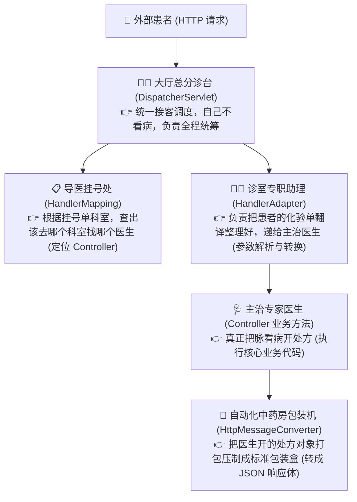
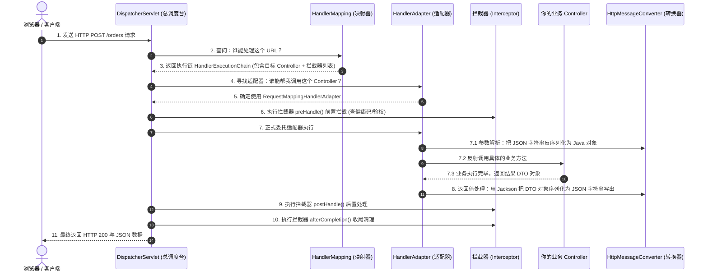
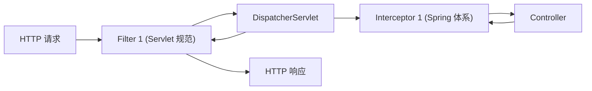

# 🏥 06 · SpringMVC 请求处理流程（三甲医院分诊台与 11 步大链路）

> **一句话导读**：浏览器发来的一个 JSON 请求，是怎么变成 Controller 里的 Java 对象，又是怎么把结果格式化为标准响应返回的？用“大型三甲医院门诊就医”模型，带你轻松秒杀面试官最爱考察的 MVC 执行全链路。

---

## 🏛️ SpringMVC 请求处理核心架构与组件划分

如果把整个 SpringMVC 架构比作一家**现代化的三甲综合医院**，各个组件的分工立刻一目了然：



---

## 🏃 经典 11 步完整就诊大链路时序图

SpringMVC 处理一个 HTTP 请求的**标准 11 步闭环**（面试背诵黄金标准）：



---

## 🔍 核心四大组件职责与协作机制

### 1. 前端控制器：`DispatcherServlet`
- 继承自标准 `HttpServlet`，配置拦截根路径 `/`。
- **所有进出 SpringMVC 的 HTTP 请求均由其统一调度、分发与收尾**，遵循典型的 Front Controller 架构模式。

### 2. 处理器映射器：`HandlerMapping`
- 负责建立并维护 **“URL 请求路径 ⇄ 具体的 Controller 及其 Method 执行链（HandlerExecutionChain）”** 的映射索引。
- 生产中最常用的实现是 `RequestMappingHandlerMapping`（扫描并解析 `@RequestMapping`、`@PostMapping` 等注解建立元数据映射）。

### 3. 处理器适配器：`HandlerAdapter`
- **为什么不直接调用 Controller，而需要适配器？**
  - SpringMVC 支持多种异构的 Handler 实现（注解式 `@Controller`、老版本的 `Controller` 接口、底层 `HttpRequestHandler` 等）。
  - 通过**适配器模式（Adapter Pattern）**抹平不同 Handler 接口的调用差异；
  - 核心职责还包含绑定并调用 **`HandlerMethodArgumentResolver`（参数解析器）**，自动完成 `@PathVariable`、`@RequestParam`、`@RequestBody` 等参数的校验与类型绑定。

### 4. HTTP 消息转换器：`HttpMessageConverter`
- 基于 HTTP 请求头部的 `Content-Type` 与响应头部的 `Accept`，负责在“HTTP 底层网络字节流”和“Java 内存对象”之间完成双向序列化与反序列化。
- 最核心的实现为 **`MappingJackson2HttpMessageConverter`**，全权负责将前端 JSON 字节流反序列化为 Java DTO，以及将方法返回值序列化为 JSON 字符串。

---

## ⚖️ 面试大热点：Filter（过滤器）vs Interceptor（拦截器）

这是 99% 的面试必考题：“它们都是做拦截的，到底有什么区别？分别用在什么场景？”



| 对比维度 | Filter（过滤器） | Interceptor（拦截器） |
| :--- | :--- | :--- |
| **出身与规范** | **Servlet 规范自带的标准组件**（依赖 Tomcat/Jetty 容器） | **SpringMVC 框架自己的专属组件**（依赖 Spring 容器） |
| **拦截范围** | 拦截所有经过 Servlet 容器的请求（包括静态资源 HTML、CSS、图片） | **只拦截经过 `DispatcherServlet` 映射成功的 Controller 请求** |
| **执行时机** | 在进入 `DispatcherServlet` **之前和之后** | 在经过 `HandlerMapping` 找到 Controller **之后，方法执行前后** |
| **能拿到什么信息？** | 只能拿到原始的 `HttpServletRequest` 和 `HttpServletResponse` | **能直接拿到目标方法（`HandlerMethod`）的元数据、反射注解等** |
| **典型应用场景** | 字符编码转换（`CharacterEncodingFilter`）、跨域 CORS 配置、敏感词通用过滤 | **用户登录会话检查、接口防刷限流、接口粒度的鉴权签名、操作日志记录** |

---

## 🛡️ 工业级生产实战：全局异常处理器（急救中心）

在生产开发中，**严禁在每个 Controller 里写恶心的 `try-catch`**！
必须使用 `@RestControllerAdvice` 搭配 `@ExceptionHandler`，打造企业级的统一全局异常急诊中心：

```java
import org.springframework.http.HttpStatus;
import org.springframework.validation.BindException;
import org.springframework.web.bind.annotation.ExceptionHandler;
import org.springframework.web.bind.annotation.ResponseStatus;
import org.springframework.web.bind.annotation.RestControllerAdvice;

@RestControllerAdvice
public class GlobalExceptionHandler {

    // 1. 拦截参数校验异常 (@Valid 校验失败)
    @ExceptionHandler(BindException.class)
    @ResponseStatus(HttpStatus.BAD_REQUEST)
    public Result<Void> handleValidationException(BindException e) {
        String errorMsg = e.getBindingResult().getAllErrors().get(0).getDefaultMessage();
        return Result.fail(400, "参数校验失败: " + errorMsg);
    }

    // 2. 拦截自定义业务异常 (比如库存不足、余额不够)
    @ExceptionHandler(BizException.class)
    public Result<Void> handleBizException(BizException e) {
        return Result.fail(e.getCode(), e.getMessage());
    }

    // 3. 兜底未知异常 (代码空指针、数据库宕机)
    @ExceptionHandler(Throwable.class)
    @ResponseStatus(HttpStatus.INTERNAL_SERVER_ERROR)
    public Result<Void> handleUnexpectedException(Throwable e) {
        // 打印详细堆栈日志用于排查，但对前端隐藏内部报错细节，保证安全
        log.error("💥 系统未知崩溃异常: ", e);
        return Result.fail(500, "网络开小差了，请稍后重试");
    }
}
```

---

## 🧠 一分钟复盘核心记忆卡

1. **总调度室**：`DispatcherServlet` 负责接客统筹；
2. **三部曲**：`HandlerMapping` 定位诊室，`HandlerAdapter` 助理翻译参数，`HttpMessageConverter` 打包 JSON；
3. **拦截分工**：外层通用粗粒度用 `Filter`，内层业务细粒度用 `Interceptor`；全局报错统一交给 `@RestControllerAdvice`。

---

## 🧭 下一步

在 Controller 里把请求参数解析完成后，我们通常需要去数据库查存数据。
在 Java 后端领域，最主流、最灵活的持久层王者毫无疑问就是 **`MyBatis`**。
为什么写个接口连实现类都没有，它就能隔空去查数据库并返回对象？底层四大处理器是怎么运转的？
请进入下一篇：[[07-MyBatis原理]]！
