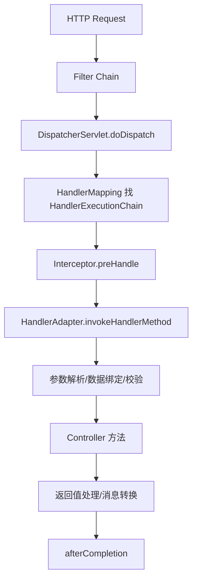

# SpringMVC请求处理流程

> [!abstract] 一句话总结
> Spring MVC 把 HTTP 请求映射到 HandlerMethod，再经参数解析、校验、返回值处理、消息转换和异常解析生成响应；主线是 DispatcherServlet#doDispatch。

## 📌 精准定位

- 负责 Web 层路由、参数绑定、校验、异常处理和响应输出。
- 不负责承载复杂业务事务，controller 应保持薄。
- 关键边界：Filter 在 Servlet 层，Interceptor 在 MVC handler 层，AOP 在 Bean 方法层。

## 🧩 核心概念

| 概念 | 具体含义 | 精通要点 |
| ---- | -------- | -------- |
| DispatcherServlet | 前端控制器，MVC 调度入口。 | 熟悉 doDispatch 主流程。 |
| HandlerMapping | 根据请求找到 handler 和拦截器链。 | 常用 RequestMappingHandlerMapping。 |
| HandlerAdapter | 适配并调用 handler。 | RequestMappingHandlerAdapter 调用注解方法。 |
| HttpMessageConverter | 请求体/响应体与 Java 对象转换。 | JSON 常用 Jackson converter。 |

## ⚙️ 工作原理 / 主流程



1. 容器先执行 Filter，如认证、日志、CORS。
2. DispatcherServlet 找 multipart、handler、adapter。
3. InvocableHandlerMethod 使用 ArgumentResolver 解析参数。
4. RequestBody 由 HttpMessageConverter 读取 body，Valid 触发校验。
5. 异常交给 HandlerExceptionResolver。

## 💻 代码 / 配置 / 伪代码

```java
@RestController
@RequestMapping("/orders")
class OrderController {
  @PostMapping
  OrderVO create(@Valid @RequestBody CreateOrderReq req) {
    return orderService.create(req);
  }
}
```

## 🔍 源码入口 / 关键组件

- DispatcherServlet#doDispatch
- RequestMappingHandlerMapping#getHandlerInternal
- RequestMappingHandlerAdapter#invokeHandlerMethod
- HandlerMethodArgumentResolverComposite
- ExceptionHandlerExceptionResolver

## ⚠️ 生产坑与注意事项

- RequestBody 的 body 只能被消费一次。
- 全局异常吞掉细节时日志必须保留 requestId 和 cause。
- Interceptor 不能替代 Filter 处理原始 body 和容器级安全。
- 大 JSON 会占内存，上传下载要流式处理。
- 异步请求要关注超时、线程池和 trace 传递。

## 🧭 排查路径

- 404 看 RequestMappingHandlerMapping 是否注册路径。
- 415/406 检查 Content-Type、Accept 和 converter。
- 参数为 null 检查注解、字段名、getter/setter、Jackson。
- 接口慢拆 Filter、Interceptor、controller、序列化耗时。

## 🎯 面试问题

> [!question] 高频问题
> - Q: Spring MVC 主流程？
>   - A: Filter 后进入 doDispatch，找 handler，执行拦截器，调用 adapter，处理返回和异常。
> - Q: Filter 和 Interceptor 区别？
>   - A: Filter 属于 Servlet 规范，Interceptor 属于 Spring MVC。
> - Q: RequestBody 怎么转对象？
>   - A: RequestResponseBodyMethodProcessor 调用 HttpMessageConverter。
> - Q: 全局异常如何生效？
>   - A: ControllerAdvice + ExceptionHandler 由异常解析器调用。
> - Q: 如何自定义参数解析？
>   - A: 实现 HandlerMethodArgumentResolver 并注册。

## ✅ 精通检查清单

- 能画出主流程，并标出最容易失败的节点。
- 能说出至少 3 个源码入口或关键组件。
- 能写出最小配置、SQL、伪代码或状态机。
- 能结合生产故障说明监控指标、排查命令和修复动作。
- 能和相邻方案做取舍对比，而不是只背定义。

## 🔗 关联笔记

- [[_index]]
- [[20-Java后端/00-总览/学习仪表盘]]

## 📚 参考资料

- Spring Framework Reference: Web MVC
- Spring 源码 org.springframework.web.servlet
