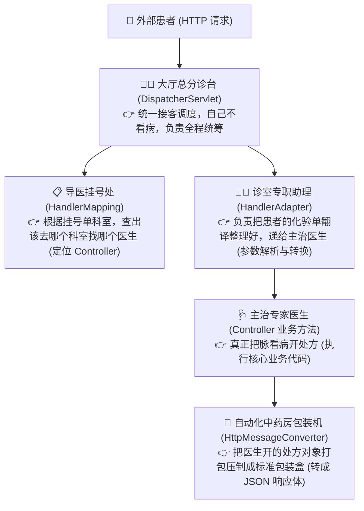
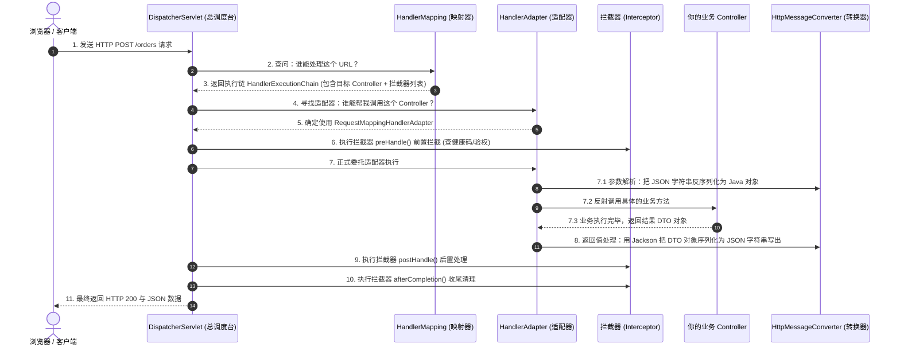
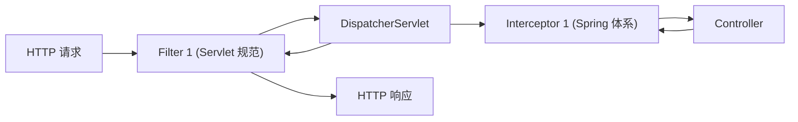

# 🏥 06 · SpringMVC 请求处理流程（三甲医院分诊台与 11 步大链路）

> **一句话导读**：浏览器发来的一个 JSON 请求，是怎么变成 Controller 里的 Java 对象，又是怎么把结果格式化为标准响应返回的？用“大型三甲医院门诊就医”模型，带你轻松秒杀面试官最爱考察的 MVC 执行全链路。

---

## 🏛️ SpringMVC 请求处理核心架构与组件划分

如果把整个 SpringMVC 架构比作一家**现代化的三甲综合医院**，各个组件的分工立刻一目了然：



---

## 🏃 经典 11 步完整就诊大链路时序图

SpringMVC 处理一个 HTTP 请求的**标准 11 步闭环**（面试背诵黄金标准）：



---

## 🔍 核心四大组件职责与协作机制

### 1. 前端控制器：`DispatcherServlet`
- 继承自标准 `HttpServlet`，配置拦截根路径 `/`。
- **所有进出 SpringMVC 的 HTTP 请求均由其统一调度、分发与收尾**，遵循典型的 Front Controller 架构模式。

### 2. 处理器映射器：`HandlerMapping`
- 负责建立并维护 **“URL 请求路径 ⇄ 具体的 Controller 及其 Method 执行链（HandlerExecutionChain）”** 的映射索引。
- 生产中最常用的实现是 `RequestMappingHandlerMapping`（扫描并解析 `@RequestMapping`、`@PostMapping` 等注解建立元数据映射）。

### 3. 处理器适配器：`HandlerAdapter`
- **为什么不直接调用 Controller，而需要适配器？**
  - SpringMVC 支持多种异构的 Handler 实现（注解式 `@Controller`、老版本的 `Controller` 接口、底层 `HttpRequestHandler` 等）。
  - 通过**适配器模式（Adapter Pattern）**抹平不同 Handler 接口的调用差异；
  - 核心职责还包含绑定并调用 **`HandlerMethodArgumentResolver`（参数解析器）**，自动完成 `@PathVariable`、`@RequestParam`、`@RequestBody` 等参数的校验与类型绑定。

### 4. HTTP 消息转换器：`HttpMessageConverter`
- 基于 HTTP 请求头部的 `Content-Type` 与响应头部的 `Accept`，负责在“HTTP 底层网络字节流”和“Java 内存对象”之间完成双向序列化与反序列化。
- 最核心的实现为 **`MappingJackson2HttpMessageConverter`**，全权负责将前端 JSON 字节流反序列化为 Java DTO，以及将方法返回值序列化为 JSON 字符串。

### 5. 入参解析与返回值处理的底层“双引擎”
在 `HandlerAdapter` 真正执行目标 Controller 方法的底层，依托两个极其关键的顶层策略接口协同运转：
- **参数解析器（`HandlerMethodArgumentResolver`）**：
  - **`supportsParameter()`**：判断当前解析器是否支持处理该方法形参；
  - **`resolveArgument()`**：从底层 HTTP 请求中提取数据并转换为目标形参对象。
  - 典型实现：`RequestParamMethodArgumentResolver`（处理 `@RequestParam`）、`PathVariableMethodArgumentResolver`（处理 `@PathVariable`）。
- **返回值处理器（`HandlerMethodReturnValueHandler`）**：
  - **`supportsReturnType()`**：判断是否支持处理当前方法的返回值类型；
  - **`handleReturnValue()`**：将返回值写入响应或绑定到模型。
- **身兼两职的王牌组件：`RequestResponseBodyMethodProcessor`**：
  - 它**同时实现了上述两个接口**！当遇到 `@RequestBody` 时充当参数解析器，当遇到 `@ResponseBody`（或 `@RestController`）时充当返回值处理器，底层委托 `HttpMessageConverter` 完成 JSON 编解码。

---

## 🔀 架构分水岭：传统 MVC vs 现代 RESTful（为什么不需要 ViewResolver？）

在传统的 SpringMVC 面试题中，往往都会提到 **`ViewResolver`（视图解析器）**。但在现代前后端分离架构下，为什么很多系统根本不配置视图解析器也能正常跑？

1. **传统 MVC 模式（服务端模板渲染）**：
   - Controller 方法返回视图名（如 `"user/list"`）或 `ModelAndView` 对象；
   - `HandlerAdapter` 将模型数据与逻辑视图名打包交给 `DispatcherServlet`；
   - `DispatcherServlet` 遍历调用 **`ViewResolver`**，将逻辑视图名解析为物理路径（如 `/WEB-INF/jsp/user/list.jsp` 或 Thymeleaf HTML）；
   - 视图对象（`View`）负责将 Model 数据与 HTML 模板结合渲染，输出完整的 HTML 页面到浏览器。

2. **现代 RESTful 模式（前后端纯 JSON 交互）**：
   - 标记了 **`@ResponseBody`** 或 **`@RestController`**；
   - `HandlerAdapter` 在调用 Controller 方法后，命中王牌处理器 **`RequestResponseBodyMethodProcessor`**；
   - 处理器直接调用 `HttpMessageConverter`（Jackson）将 Java 对象序列化为 JSON 字符串，**直接写入 `HttpServletResponse` 的输出流（OutputStream）**；
   - 紧接着，底层关键的一步：**将 `ModelAndViewContainer.setRequestHandled(true)` 标记为已处理完成**！
   - `DispatcherServlet` 检测到 `requestHandled == true`，**直接跳过后续的 ViewResolver 解析与页面渲染链路**，瞬间完成闭环！

---

## ⚖️ 面试大热点：Filter（过滤器）vs Interceptor（拦截器）

这是 99% 的面试必考题：“它们都是做拦截的，到底有什么区别？分别用在什么场景？”



| 对比维度 | Filter（过滤器） | Interceptor（拦截器） |
| :--- | :--- | :--- |
| **出身与规范** | **Servlet 规范自带的标准组件**（依赖 Tomcat/Jetty 容器） | **SpringMVC 框架自己的专属组件**（依赖 Spring 容器） |
| **拦截范围** | 拦截所有经过 Servlet 容器的请求（包括静态资源 HTML、CSS、图片） | **只拦截经过 `DispatcherServlet` 映射成功的 Controller 请求** |
| **执行时机** | 在进入 `DispatcherServlet` **之前和之后** | 在经过 `HandlerMapping` 找到 Controller **之后，方法执行前后** |
| **能拿到什么信息？** | 只能拿到原始的 `HttpServletRequest` 和 `HttpServletResponse` | **能直接拿到目标方法（`HandlerMethod`）的元数据、反射注解等** |
| **典型应用场景** | 字符编码转换（`CharacterEncodingFilter`）、跨域 CORS 配置、敏感词通用过滤 | **用户登录会话检查、接口防刷限流、接口粒度的鉴权签名、操作日志记录** |

---

## 🛡️ 工业级生产实战：全局异常处理器（急救中心）

在生产开发中，**严禁在每个 Controller 里写恶心的 `try-catch`**！
必须使用 `@RestControllerAdvice` 搭配 `@ExceptionHandler`，打造企业级的统一全局异常急诊中心：

```java
import org.springframework.http.HttpStatus;
import org.springframework.validation.BindException;
import org.springframework.web.bind.annotation.ExceptionHandler;
import org.springframework.web.bind.annotation.ResponseStatus;
import org.springframework.web.bind.annotation.RestControllerAdvice;

@RestControllerAdvice
public class GlobalExceptionHandler {

    // 1. 拦截参数校验异常 (@Valid 校验失败)
    @ExceptionHandler(BindException.class)
    @ResponseStatus(HttpStatus.BAD_REQUEST)
    public Result<Void> handleValidationException(BindException e) {
        String errorMsg = e.getBindingResult().getAllErrors().get(0).getDefaultMessage();
        return Result.fail(400, "参数校验失败: " + errorMsg);
    }

    // 2. 拦截自定义业务异常 (比如库存不足、余额不够)
    @ExceptionHandler(BizException.class)
    public Result<Void> handleBizException(BizException e) {
        return Result.fail(e.getCode(), e.getMessage());
    }

    // 3. 兜底未知异常 (代码空指针、数据库宕机)
    @ExceptionHandler(Throwable.class)
    @ResponseStatus(HttpStatus.INTERNAL_SERVER_ERROR)
    public Result<Void> handleUnexpectedException(Throwable e) {
        // 打印详细堆栈日志用于排查，但对前端隐藏内部报错细节，保证安全
        log.error("💥 系统未知崩溃异常: ", e);
        return Result.fail(500, "网络开小差了，请稍后重试");
    }
}
```

### 核心深度解惑：为什么既要 `@ResponseStatus(500)`，又要在 `Result` 里写 500？

这是许多开发者在第一次编写全局异常处理器时的极大困惑：**“既然我都声明了 `@ResponseStatus(HttpStatus.INTERNAL_SERVER_ERROR)`，为什么返回体里还要写 `Result.fail(500, ...)`？它俩到底有什么区别？”**

问题的本质在于区分 **【HTTP 传输协议层】** 与 **【业务应用层（JSON 载荷）】** 的物理边界：

- **`@ResponseStatus` 管的是【最外层的 HTTP 协议响应头】**：
  - 底层等价于调用了 Servlet 容器的 `response.setStatus(500)`；
  - 它的受众是 **Nginx、微服务网关（Spring Cloud Gateway）、微服务 RPC 调用方（OpenFeign）、以及运维 APM 监控系统（Prometheus / SkyWalking / ELK）**。
  - 在浏览器的 Network 调试面板中，该请求会直接标红显示为 `500 Internal Server Error`。
- **`Result.fail(500)` 管的是【最内层的 JSON 业务数据体（Body）】**：
  - 它只是你返回给客户端的普通 Java 对象中的一个属性字段（如 `code`、`message`）；
  - 它的受众是 **前端业务代码（如 Axios 响应拦截器、Vue/React 的弹窗提示组件）**。
  - SpringMVC 不知道也不可能去篡改你自定义 Java 对象的字段值，因此业务状态码必须由开发者显式指定。

> [!WARNING] 生产级避坑军规：为什么严禁接口“全 200 党”？
> 国内部分团队为了前端省事，不加 `@ResponseStatus`，无论后台抛出什么严重异常，HTTP 状态码一律返回 `200 OK`，仅在 JSON 里放 `{"code": 500}`。这种做法在分布式架构中存在**致命缺陷**：
> 1. **微服务 RPC / OpenFeign 熔断彻底失效**：OpenFeign 客户端默认只根据 HTTP 状态码是否为 `2xx` 来判定调用成败。如果后台崩了却返回 `HTTP 200`，Feign 会强行尝试反序列化，**根本不会触发 Resilience4j / Sentinel 的熔断降级逻辑**，极易引发服务雪崩；
> 2. **监控告警与 SLA 统计完全失真**：Nginx 访问日志与云原生监控通过 HTTP 状态码统计服务可用率（SLA）。如果全返回 200，监控大屏会显示“系统可用率 100%”，但实际上用户可能早已由于业务报错无法下单，运维告警完全形同虚设！

---

### 拓展实战：RESTful 规范下无返回值（`void`）Controller 方法的最佳实践

在实际生产开发中，并非所有接口都需要向客户端回传复杂的 JSON 业务数据体。在严谨的 RESTful API 设计与高并发写场景中，大量接口（如资源创建、数据删除、状态切换）**只负责执行业务动作，无需冗余的数据载荷**。使用 `public void` 搭配 `@ResponseStatus` 是最正统、最高性能的写法：

```java
@RestController
@RequestMapping("/api/v1/users")
public class UserController {

    @Autowired
    private UserService userService;

    /**
     * 1. 资源创建成功：标准返回 201 Created (无需冗余 JSON)
     */
    @PostMapping
    @ResponseStatus(HttpStatus.CREATED) // HTTP 协议响应码显式设为 201
    public void createUser(@RequestBody @Valid UserDTO dto) {
        userService.create(dto);
        // 方法为 void 无返回值，SpringMVC 不会向 Body 写入任何数据，直接返回纯净的 201 响应头
    }

    /**
     * 2. 资源删除成功：标准返回 204 No Content
     */
    @DeleteMapping("/{id}")
    @ResponseStatus(HttpStatus.NO_CONTENT) // HTTP 协议响应码显式设为 204
    public void deleteUser(@PathVariable Long id) {
        userService.deleteById(id);
        // 204 明确告知客户端：服务器已成功处理了请求，但协议上没有返回任何实体内容
    }
}
```

#### 底层执行机理与工程收益剖析：
1. **默认执行机制**：若一个 Controller 方法返回值声明为 `void`，且**未添加** `@ResponseStatus` 注解，SpringMVC 默认会在协议头返回 `200 OK`，并将响应体置空；
2. **`@ResponseStatus` 介入链路**：当添加了 `@ResponseStatus(HttpStatus.CREATED)`（或 `NO_CONTENT`）后，底层负责无返回值处理的适配器组件会检测到该注解，通过 `response.setStatus(...)` 显式覆盖默认的 200 状态码，并标记 `mavContainer.setRequestHandled(true)` 宣告当前请求处理完成；
3. **三大硬核工程收益**：
   - **0 堆内存分配**：无需在年轻代反复实例化 `new Result<Void>()` 这一类空包装对象，降低高并发下的 GC 频次；
   - **0 序列化 CPU 开销**：彻底跳过 Jackson `HttpMessageConverter` 对空对象的序列化流程；
   - **极小网络传输报文**：TCP 报文内只包含几十字节的 HTTP Header，无任何 Body 载荷，极大节省了内网微服务 RPC 与公网网关的带宽吞吐。

---

### 全局异常处理底层路由链路：`HandlerExceptionResolver`

当业务 Controller 或拦截器在执行过程中抛出未捕获异常时，SpringMVC 是如何精准找到 `@RestControllerAdvice` 对应的 `@ExceptionHandler` 方法的？

1. **`doDispatch()` 全局捕获**：在 `DispatcherServlet.doDispatch()` 的 `try-catch` 结构中，捕获任何执行期间抛出的 `Exception` 或 `Throwable`；
2. **委托给异常解析器链**：进入 `processDispatchResult()` 方法，依次遍历 Spring 容器中注册的 **`HandlerExceptionResolver`**（处理器异常解析器）组件链；
3. **核心实现 `ExceptionHandlerExceptionResolver`**：
   - 它是处理注解式异常的核心引擎；
   - 在容器启动时，它已经扫描并缓存了所有带有 `@ControllerAdvice` / `@RestControllerAdvice` 注解的 Bean 中声明的 `@ExceptionHandler` 方法元数据；
   - 运行时根据抛出的异常对象类型（`Throwable` 及其派生体系），按照“继承树最近原则”匹配到最契合的异常处理方法；
4. **返回值处理并写回响应**：匹配成功后，通过反射调用该异常处理方法，再次走 `HandlerMethodReturnValueHandler` 将 `Result` 序列化为 JSON，并根据方法上的 `@ResponseStatus` 修改底层 HTTP 状态码，最终输出给客户端。

---

## 🧠 一分钟复盘核心记忆卡

1. **总调度室**：`DispatcherServlet` 负责统一调度请求生命周期与组件协作；
2. **执行铁三角**：`HandlerMapping` 寻址路由，`HandlerAdapter` 适配调用，`HttpMessageConverter`（Jackson）双向序列化；
3. **双引擎与王牌**：入参靠 `ArgumentResolver`，出参靠 `ReturnValueHandler`，王牌组件 `RequestResponseBodyMethodProcessor` 同时身兼两职；
4. **架构分水岭**：`@RestController` 通过标记 `requestHandled=true` 直接将 JSON 写入输出流，**彻底跳过 ViewResolver 视图渲染**；
5. **拦截与异常分工**：`Filter` 管 Servlet 容器外层协议，`Interceptor` 管 Spring 内部业务切面；`@ResponseStatus` 给网关和监控看（HTTP 协议层），`Result.fail()` 给前端看（业务载荷层），由 `HandlerExceptionResolver` 统一分发兜底。

---

## 🧭 下一步

在 Controller 里把请求参数解析完成后，我们通常需要去数据库查存数据。
在 Java 后端领域，最主流、最灵活的持久层王者毫无疑问就是 **`MyBatis`**。
为什么写个接口连实现类都没有，它就能隔空去查数据库并返回对象？底层四大处理器是怎么运转的？
请进入下一篇：[[07-MyBatis原理]]！
