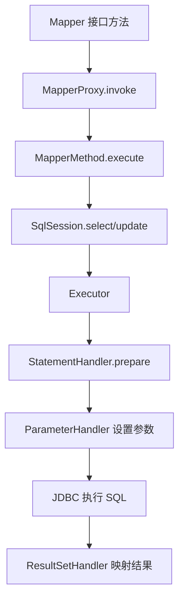

# MyBatis原理

> [!abstract] 一句话总结
> MyBatis 把 mapper 接口方法映射为 MappedStatement，通过 Executor、StatementHandler、ParameterHandler、ResultSetHandler 执行 SQL 并映射结果。

## 📌 精准定位

- 负责 SQL 映射、参数绑定、结果集映射、缓存和插件扩展。
- 不负责自动生成最优 SQL，索引和执行计划仍要开发者负责。
- 关键边界：一级缓存是 SqlSession 级别，Spring 中通常一个事务一个 SqlSession。

## 🧩 核心概念

| 概念 | 具体含义 | 精通要点 |
| ---- | -------- | -------- |
| SqlSessionFactory | 根据配置创建 SqlSession。 | Spring 中由 SqlSessionFactoryBean 构造。 |
| MapperProxy | mapper 接口动态代理。 | 方法调用转成 MapperMethod#execute。 |
| MappedStatement | 一条 SQL 的完整元数据。 | 包含 SQL、参数映射、结果映射、缓存。 |
| Executor | 执行器，负责查询、更新、缓存。 | Simple、Reuse、Batch 差异要清楚。 |

## ⚙️ 工作原理 / 主流程



1. 启动时解析 XML/注解为 MappedStatement。
2. Mapper 接口由 MapperProxyFactory 生成 JDK 动态代理。
3. 调用方法时用 namespace + methodName 找 MappedStatement。
4. 动态 SQL 由 SqlSource 生成 BoundSql。
5. 插件可拦截 Executor、StatementHandler、ParameterHandler、ResultSetHandler。

## 💻 代码 / 配置 / 伪代码

```xml
<select id="selectPage" resultType="Order">
  SELECT id, user_id, status, created_at
  FROM t_order
  WHERE user_id = #{userId}
  <if test="status != null">AND status = #{status}</if>
  ORDER BY id DESC LIMIT #{limit}
</select>
```

## 🔍 源码入口 / 关键组件

- MapperProxy#invoke
- MapperMethod#execute
- DefaultSqlSession
- BaseExecutor#query
- RoutingStatementHandler
- DefaultResultSetHandler

## ⚠️ 生产坑与注意事项

- ${} 是字符串拼接，有 SQL 注入风险。
- 分页插件改写 count SQL 后可能很慢。
- 循环单条 insert 会放大网络往返。
- resultMap 嵌套 select 容易 N+1。
- 二级缓存跨 SqlSession，生产使用要克制。

## 🧭 排查路径

- SQL 不对打开 MyBatis SQL 日志查看 BoundSql。
- 结果为 null 检查列别名、驼峰映射、resultMap。
- 事务不生效确认 mapper 由 Spring 管理且同一数据源。
- 性能差拿最终 SQL 去 EXPLAIN ANALYZE。

## 🎯 面试问题

> [!question] 高频问题
> - Q: Mapper 为什么不用实现类？
>   - A: JDK 动态代理把接口方法映射到 MappedStatement。
> - Q: 一级缓存什么时候生效？
>   - A: 同一 SqlSession 内相同 statement 和参数，更新会清空。
> - Q: 插件能拦截哪些对象？
>   - A: Executor、StatementHandler、ParameterHandler、ResultSetHandler。
> - Q: #{} 和 ${} 区别？
>   - A: #{} 走参数绑定，${} 直接拼 SQL。
> - Q: MyBatis 和 JPA 怎么选？
>   - A: MyBatis SQL 可控，JPA 领域模型强但 SQL 透明度低。

## ✅ 精通检查清单

- 能画出主流程，并标出最容易失败的节点。
- 能说出至少 3 个源码入口或关键组件。
- 能写出最小配置、SQL、伪代码或状态机。
- 能结合生产故障说明监控指标、排查命令和修复动作。
- 能和相邻方案做取舍对比，而不是只背定义。

## 🔗 关联笔记

- [[_index]]
- [[20-Java后端/00-总览/学习仪表盘]]

## 📚 参考资料

- MyBatis 3 User Guide
- MyBatis-Spring Reference
