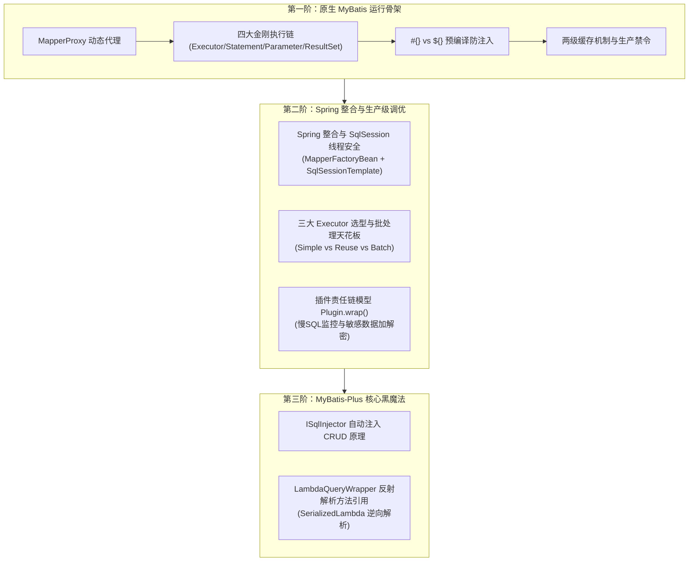
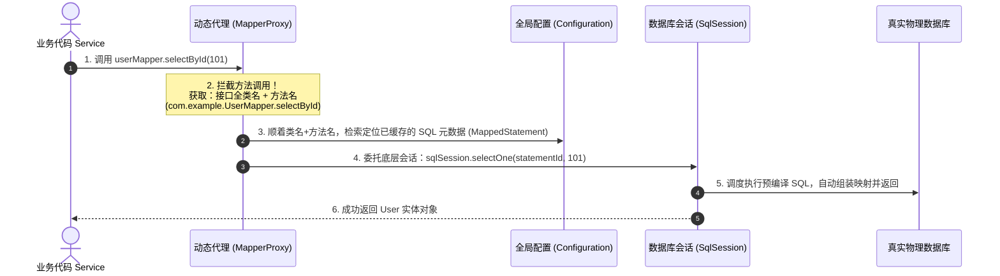
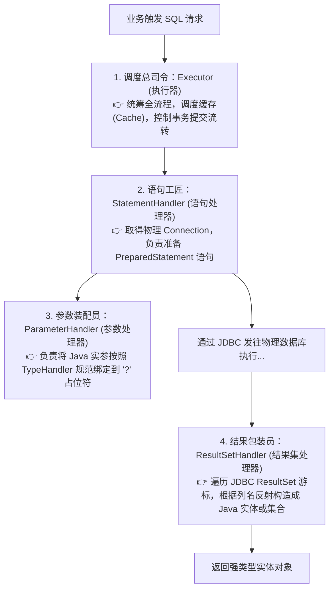
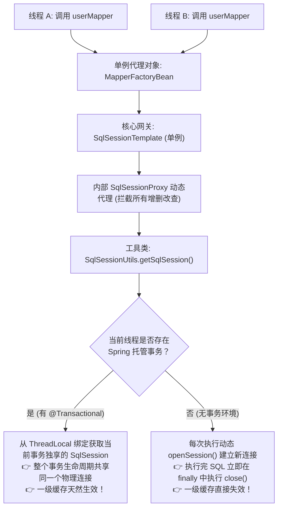
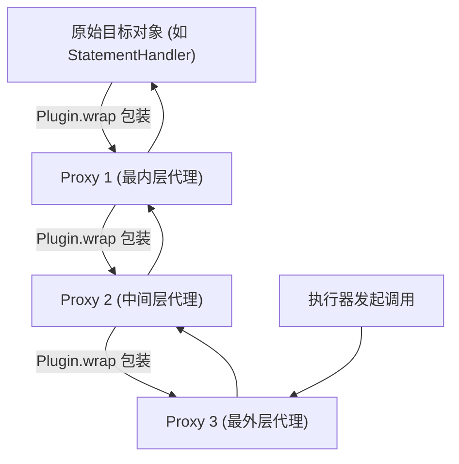
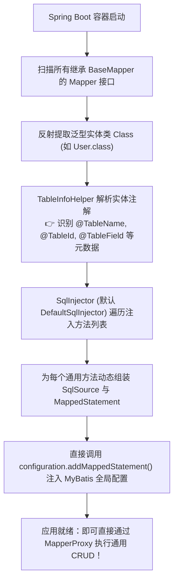
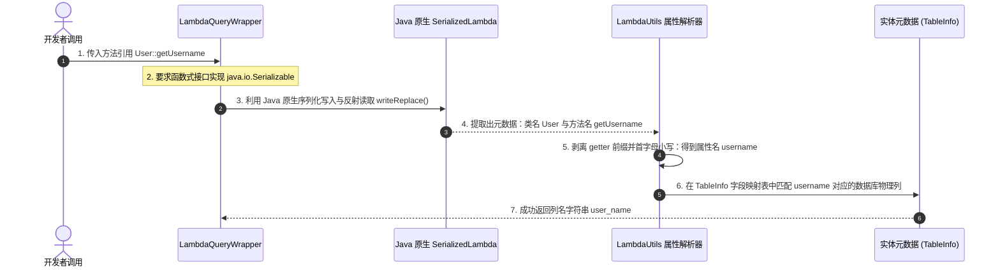

# 📜 07 · MyBatis 原理与企业级进阶（从动态代理到底层黑魔法）

> **一句话导读**：为什么没有任何实现类的 `Mapper` 接口可以直接与数据库对话？Spring 事务中 `SqlSession` 是如何做到线程安全与一级缓存共享的？为什么生产中写 `<foreach>` 批量插入会被架构师打回？MyBatis-Plus 的 `User::getName` 又隐藏着怎样的反编译骚操作？本篇带你从四大核心组件穿透到现代企业级生产天花板。

---

## 🧭 知识全景图



---

## 🏛️ 第一阶：原生 MyBatis 运行骨架与四大核心对象

### 1. Mapper 动态代理核心机制：无实现类执行 SQL 的本质

我们在业务代码中只需通过 `@Autowired private UserMapper userMapper;`，就能直接调用 `userMapper.selectById(101)`。接口没有任何实现类，它到底是如何触发 SQL 执行的？



1. **接口代理替身生成**：
   - Spring 容器启动并加载 Mapper 接口时，通过 `MapperProxyFactory` 调用 JDK 动态代理 `Proxy.newProxyInstance()` 生成代理类；
   - 所有的接口方法调用均被统一分发至 `MapperProxy.invoke()`。
2. **全局寻址与方法分发**：
   - `MapperProxy` 提取被调用方法的所属接口全限定名与方法名（例如 `com.example.mapper.UserMapper.selectById`）；
   - 以该字符串作为全局唯一标识键，在全局配置 `Configuration` 中精确检索对应的 `MappedStatement` 对象（内部包含解析好的 SQL 模板、入参规则与结果集映射规则）；
   - 根据 SQL 类型（SELECT / INSERT / UPDATE / DELETE），分发调用底层 `SqlSession` 的对应 API。

---

### 2. 底层支柱：四大核心工匠（四大对象）执行链

在 `SqlSession` 内部，具体的 SQL 编译、参数传递与结果映射工作由四大核心组件协作完成：



1. **Executor（执行器总指挥）**：
   - 负责整体调度，维护一级缓存（本地 `PerpetualCache`）与二级缓存（若开启则通过 `CachingExecutor` 装饰）；
   - 管理事务的提交、回滚以及批处理的刷盘。
2. **StatementHandler（语句工匠）**：
   - 负责与 JDBC 的底层 `Statement` / `PreparedStatement` 直接交互；
   - 包含设置数据库超时时间、预编译 SQL 字符串以及设置 FetchSize。
3. **ParameterHandler（参数装配员）**：
   - 负责将业务传递的 Java 实体或 Map 参数，通过注册的 `TypeHandler` 转换为对应 JDBC 驱动支持的类型，并依次绑定到 PreparedStatement 的 `?` 占位符上。
4. **ResultSetHandler（结果包装员）**：
   - 负责将 JDBC 返回的游标数据 `ResultSet` 逐行读取；
   - 依靠反射和属性类型转换，将关系型数据库的扁平二维列数据自动映射并封装为 Java POJO 实体对象或集合。

---

### 3. 面试高频必考：`#{}` 与 `${}` 的天壤之别

在编写 XML 或注解 SQL 时，参数占位符的选择直接决定了系统的安全性与性能：

1. **底层物理差异**：
   - **`#{}`（预编译占位符 - 🌟 强推首选）**：
     - MyBatis 会将其解析为 JDBC 的 **`?`** 占位符；
     - 底层使用 `PreparedStatement` 进行参数设定，参数值不会作为 SQL 语法的一部分被解析，而是作为纯数据文本传递。
   - **`${}`（字符串拼接 - ⚠️ 极度高危）**：
     - MyBatis 在动态 SQL 解析阶段，直接将变量值以纯字符串形式原样替换拼接进 SQL 文本中；
     - 底层直接作为静态 SQL 执行，改变了原有的 SQL 抽象语法树（AST）。
2. **安全性对比**：
   - **`#{}`**：天然 **100% 免疫 SQL 注入**；
   - **`${}`**：极易遭受 SQL 注入攻击。例如 `password = '${pwd}'`，当攻击者传入 `' OR '1'='1` 时，SQL 语义直接被篡改，导致鉴权被彻底绕过。
3. **性能开销对比**：
   - **`#{}`**：生成的带 `?` 的 SQL 文本在数据库端保持不变，能充分命中数据库的 SQL 执行计划缓存（软解析），极大降低数据库 CPU 开销；
   - **`${}`**：不同参数会导致 SQL 字符串完全不同，数据库每次都必须重新进行硬解析（词法、语法解析与生成执行计划）。
4. **合理使用场景准则**：
   - 绝大多数业务数据传参，**一律无脑使用 `#{}`**；
   - 仅当传递数据库表名、分表后缀（`orders_${tableIndex}`）或动态排序列名（`ORDER BY ${sortColumn} ${sortOrder}`）等**无法使用预编译 `?` 的语法元素**时才允许使用 `${}`，且此类参数**必须在后端代码中使用白名单做严格正则或枚举校验**，严禁直接透传前端输入。

---

### 4. MyBatis 两级缓存机制与生产避坑

1. **一级缓存（SqlSession 级别，默认强制开启）**：
   - **作用域**：以 `SqlSession` 为边界，内部维护一个线程私有的 `HashMap`；
   - **工作机制**：在同一个会话内连续执行两次相同 SQL 及参数的查询，第二次直接从缓存取出，不走物理数据库；
   - **自动失效**：只要该会话内发生了任何 `insert/update/delete` 操作，或显式调用了 `commit()`、`rollback()`、`close()`，一级缓存将被清空。
2. **二级缓存（Namespace 级别，默认关闭）**：
   - **作用域**：跨 `SqlSession` 共享，以同一个 Mapper 的 Namespace 为物理隔离边界；
   - **生产致命缺陷（架构避坑）**：
     - **多表联查脏读问题**：二级缓存针对单 Mapper 缓存。如果 `OrderMapper` 联合查询了 `user` 表与 `order` 表，当其他请求在 `UserMapper` 中更新了用户信息并清空了 `UserMapper` 的二级缓存时，`OrderMapper` 的二级缓存完全不知情，依然返回陈旧的脏数据；
     - **分布式集群不同步**：二级缓存存放在各节点单机 JVM 堆内存中。在集群微服务多实例部署下，A 节点修改了数据并清空了本地缓存，B 节点的二级缓存依然持有老数据，导致分布式数据不一致。
   - **生产铁律**：**在现代企业级分布式微服务架构中，坚决禁用 MyBatis 二级缓存！** 所有高并发读缓存统一采用外部独立中心化缓存（如 Redis + Caffeine 两级架构）。

---

## ⚡ 第二阶：Spring 整合与生产级调优天花板

### 1. Spring 整合与 SqlSession 线程安全本质（面试极高频）

在纯原生 MyBatis 中，`SqlSession` 是**非线程安全**的，官方文档明确要求其生命周期只能局限于单个方法或单个 HTTP 请求内部，用完必须立即 `close()`。
那么问题来了：**在 Spring Boot 生产环境中，Mapper 是单例 Bean，多个线程并发调用同一个 Mapper，为什么不会发生线程安全冲突？**



1. **`@MapperScan` 的底层注入机制**：
   - 启动时通过 `ClassPathMapperScanner` 扫描指定包下的接口；
   - 在向 Spring 注册 `BeanDefinition` 时，动态将 BeanClass 篡改替换为 **`MapperFactoryBean`**；
   - `MapperFactoryBean` 实现了 `FactoryBean` 接口，在 `getObject()` 时为接口生成动态代理对象，并将核心依赖 **`SqlSessionTemplate`** 注入其中。
2. **`SqlSessionTemplate` 的线程隔离魔法**：
   - `SqlSessionTemplate` 实现了 `SqlSession` 接口，但它自身不执行具体的 SQL 操作；
   - 其构造方法中创建了一个 `SqlSessionProxy`（基于 JDK 动态代理）；
   - 当调用任何增删改查方法时，动态代理拦截器通过 **`SqlSessionUtils.getSqlSession()`** 来决定当前使用哪个真实会话。
3. **有无事务时的一级缓存差异（核心考点）**：
   - **有 `@Transactional` 事务**：
     - `SqlSessionUtils` 从 `TransactionSynchronizationManager` 的 `ThreadLocal` 变量中获取当前事务已绑定的 `SqlSessionHolder`；
     - 多个 Mapper 调用共用同一个 `SqlSession` 与物理连接，事务提交后统一释放，**此时一级缓存完全生效**。
   - **无事务（普通查询）**：
     - 每次执行 SQL，MyBatis 都会新建一个 `SqlSession`，执行完毕后在 `finally` 块中立即关闭连接并销毁会话；
     - **在没有事务包裹的场景下，同一方法内连续调用两次相同的查询，每次都是全新的 SqlSession，一级缓存根本不生效！**

---

### 2. 三大执行器（Executor）选型与万级批量写入性能极限

MyBatis 在底层创建 `Executor` 时，提供了三种基础实现：

1. **三大执行器对比**：
   - **`SimpleExecutor`（默认执行器）**：
     - 每次执行 SQL 都会向连接池索取 `Connection`，并创建全新的 `PreparedStatement`；
     - 执行完毕后立即关闭 Statement，适用于普通的点查与单条增删改。
   - **`ReuseExecutor`（语句复用执行器）**：
     - 内部使用 `Map<String, Statement>` 缓存预编译语句；
     - 如果连续执行相同的 SQL 模板，直接复用已编译好的 `Statement` 对象，只更新参数，减少预编译开销。
   - **`BatchExecutor`（批量执行器）**：
     - 执行 `insert/update/delete` 时，底层通过 JDBC 的 `ps.addBatch()` 将多条参数操作追加到同一个 Statement 中；
     - 不会立即发给数据库执行，直到调用 `flushStatements()` 或提交事务时，才一次性通过 `ps.executeBatch()` 发送到底层数据库批量执行。

2. **生产避坑：为什么千万不要滥用 XML `<foreach>` 批量插入？**
   很多开发者喜欢手写 XML 的 `<foreach>` 来拼接海量数据：
   ```xml
   <!-- ⚠️ 生产高危写法：海量数据拼接 INSERT -->
   INSERT INTO t_order (order_no, user_id, amount) VALUES
   <foreach collection="list" item="item" separator=",">
       (#{item.orderNo}, #{item.userId}, #{item.amount})
   </foreach>
   ```
   - **大坑一：超长 SQL 击穿 MySQL 限制**：当一次插入上千条记录时，拼接出的 SQL 长度可达数十兆，直接打爆 MySQL 服务端的 `max_allowed_packet` 参数（抛出 `PacketTooBigException`）；
   - **大坑二：数据库端词法解析爆炸**：MySQL 在接收到超大 SQL 后，必须耗费海量 CPU 去构建极其庞大的抽象语法树（AST），极易引发数据库 CPU 100%；
   - **大坑三：Java 端内存爆满与 OOM**：MyBatis 解析带有几千个 `?` 占位符的 DynamicContext 会产生数以万计的内部临时对象，极易引发堆内存抖动与 Full GC。

3. **真正的高吞吐批量写入方案（生产标准范式）**：
   - **第一步：配置 JDBC 批处理驱动参数**：在数据库连接 URL 中追加 `rewriteBatchedStatements=true`（针对 MySQL 驱动，该参数会将原本一条条发送的 Batch 改写为高效的合并发送）。
   - **第二步：采用 `SqlSession` 的 `ExecutorType.BATCH` 模式并分批提交**：
   ```java
   @Service
   @RequiredArgsConstructor
   public class BatchInsertService {
       private final SqlSessionFactory sqlSessionFactory;

       @Transactional(rollbackFor = Exception.class)
       public void batchInsertOrders(List<OrderDO> orderList) {
           // 1. 开启 BATCH 执行模式的会话
           try (SqlSession sqlSession = sqlSessionFactory.openSession(ExecutorType.BATCH, false)) {
               OrderMapper mapper = sqlSession.getMapper(OrderMapper.class);
               int batchSize = 1000;
               for (int i = 0; i < orderList.size(); i++) {
                   mapper.insert(orderList.get(i)); // 仅追加到本地 batch，未刷盘
                   
                   // 2. 每达到批次阈值，显式触发一次刷新并提交事务
                   if ((i + 1) % batchSize == 0 || i == orderList.size() - 1) {
                       sqlSession.flushStatements();
                   }
               }
               sqlSession.commit();
           }
       }
   }
   ```

---

### 3. 自定义插件（Interceptor）实战与底层责任链模型

MyBatis 的插件机制是其拓展性极强的关键，其底层采用了经典的 **责任链模式 + 动态代理洋葱模型**。



1. **底层洋葱包装原理**：
   - 在四大核心对象（`Executor`, `StatementHandler`, `ParameterHandler`, `ResultSetHandler`）被实例化时，全局配置 `Configuration` 会调用 `interceptorChain.pluginAll(target)`；
   - 内部遍历所有已注册的 `Interceptor`，依次调用其 `plugin.wrap(target, this)`；
   - 每次包装都生成一个 `Plugin` 代理实例，多个拦截器层层嵌套形成类似洋葱的调用链路。

2. **拦截器核心注解语法**：
   - `@Intercepts`：声明这是一个拦截器；
   - `@Signature`：精准指定拦截的目标接口类、拦截的方法名称、以及该方法的形参列表类型。

3. **生产级实战一：全链路慢 SQL 监控与告警插件**：
   ```java
   @Component
   @Intercepts({
       @Signature(type = StatementHandler.class, method = "query", args = {Statement.class, ResultHandler.class}),
       @Signature(type = StatementHandler.class, method = "update", args = {Statement.class})
   })
   @Slf4j
   public class SlowSqlMonitorInterceptor implements Interceptor {
       private static final long SLOW_SQL_THRESHOLD_MS = 1000L; // 慢 SQL 阈值 1 秒

       @Override
       public Object intercept(Invocation invocation) throws Throwable {
           long startTime = System.currentTimeMillis();
           try {
               return invocation.proceed(); // 放行调用目标方法
           } finally {
               long costTime = System.currentTimeMillis() - startTime;
               if (costTime >= SLOW_SQL_THRESHOLD_MS) {
                   StatementHandler statementHandler = (StatementHandler) PluginUtils.realTarget(invocation.getTarget());
                   BoundSql boundSql = statementHandler.getBoundSql();
                   String sql = boundSql.getSql().replaceAll("\\s+", " ");
                   log.warn("🚨【检测到生产慢 SQL】耗时: {} ms | 执行 SQL: {}", costTime, sql);
               }
           }
       }
   }
   ```

4. **生产级实战二：敏感字段自动加解密插件**：
   - **入库加密**：拦截 `ParameterHandler.setParameters`，扫描实体中带自定义 `@EncryptField` 注解的属性，在存入数据库前使用 AES/SM4 进行对称加密；
   - **出库解密**：拦截 `ResultSetHandler.handleResultSets`，对从数据库取出的密文自动解密为明文回填给实体，使业务层开发人员完全感知不到加解密细节。

---

## 🚀 第三阶：现代商业标配 MyBatis-Plus 核心黑魔法

在企业级实际开发中，MyBatis-Plus（简称 MP）已经成为主流事实标准。理解它的底层机制能让你在面试中脱颖而出。

### 1. 通用 CRUD 自动注入原理（`ISqlInjector`）

**核心谜题**：在业务中，我们只要让 `UserMapper` 继承 `BaseMapper<User>`，在没有编写任何 XML 和 SQL 的情况下，就能直接调用 `insert`、`selectById`、`updateById` 等通用方法，这到底是如何做到的？



1. **泛型实体类信息提取**：
   - MyBatis-Plus 启动初始化时，会扫描所有继承了 `BaseMapper<T>` 的接口；
   - 借助反射获取泛型参数的具体实体类型（如 `User`）；
   - 使用 `TableInfoHelper` 解析实体的类注解（`@TableName`）与字段注解（`@TableId`、`@TableField`），在内存中构建出表名、主键列、逻辑删除列、常规列等元数据模型。
2. **动态构造与注入 `MappedStatement`**：
   - MP 内置的 `ISqlInjector`（SQL 注入器，默认实现为 `DefaultSqlInjector`）包含一组 `AbstractMethod` 实现（如 `Insert`, `DeleteById`, `SelectById`, `UpdateById` 等）；
   - 每一个方法根据前面解析出的表结构元信息，动态拼接对应的 SQL 模板字符串（包括动态 `<if test="...">` 判空标签）；
   - 将拼接好的 SQL 封装为 `SqlSource`，构建成一个原生的 `MappedStatement` 对象；
   - 以 `接口全限定名 + 方法名`（例如 `com.example.UserMapper.selectById`）作为唯一标识，通过 `configuration.addMappedStatement()` 强制塞入 MyBatis 的全局配置池中；
   - 之后所有的调用就完全回到了 MyBatis 原生执行链路，性能与手写 XML 毫无二致。

---

### 2. `LambdaQueryWrapper` 方法引用的逆向解析原理

在条件构造器中，我们常常这样写代码：
```java
LambdaQueryWrapper<User> wrapper = new LambdaQueryWrapper<>();
wrapper.eq(User::getUsername, "zhangsan")
       .ge(User::getAge, 18);
```
**深度拷问**：传入的明明是一个 Java 8 方法引用 `User::getUsername`，MyBatis-Plus 是怎么隔空知道这个方法对应数据库里的 `user_name` 字段的？



1. **可序列化的函数式接口 `SFunction`**：
   - MP 定义了核心函数式接口：
     ```java
     @FunctionalInterface
     public interface SFunction<T, R> extends Function<T, R>, Serializable {
     }
     ```
   - 注意：它继承了 `java.io.Serializable`！这是整个黑魔法的基石。
2. **Java 编译器的底层约定**：
   - 当一个 Lambda 表达式或方法引用被赋值给一个继承了 `Serializable` 的接口时，Java 编译器会在其底层生成一个特殊的私有方法：**`writeReplace()`**；
   - 这个方法在序列化时会被自动触发，并返回一个特殊的 JDK 内部类：**`java.lang.invoke.SerializedLambda`**。
3. **反射解析方法签名**：
   - MP 通过反射调用该 Lambda 对象的 `writeReplace()` 方法，直接获取到 `SerializedLambda` 实例；
   - 从 `SerializedLambda` 中可以毫无保留地获取到底层信息：
     - `getImplClass()`：获取方法所属的目标实体类（如 `com/example/entity/User`）；
     - `getImplMethodName()`：获取实际调用的方法名称字符串（如 `"getUsername"`）。
4. **属性名与列名的双向映射**：
   - MP 获取到方法名 `"getUsername"` 后，通过工具类自动去除 `get` 或 `is` 前缀，并将首字母转小写，推导得到属性名 `"username"`；
   - 顺着属性名，去之前 `TableInfoHelper` 缓存的元数据表中查找，如果标记了 `@TableField("user_name")` 则直接取其值，若未显式指定则根据全局驼峰下划线转换规则自动映射为数据库物理字段 `"user_name"`；
   - 解析得到的结果会被放入缓存 Map 中，避免高频并发下的反射性能开销。

---

## 🧠 一分钟核心记忆卡

1. **无实现类接口的秘密**：
   - Spring 启动借助 `MapperFactoryBean` 生成 JDK 动态代理 `MapperProxy`，以接口名+方法名定位 `MappedStatement`。
2. **四大执行金刚**：
   - `Executor`（总司令管缓存与事务） -> `StatementHandler`（建语句） -> `ParameterHandler`（绑预编译参数） -> `ResultSetHandler`（反射组装实体）。
3. **Spring 整合与线程安全**：
   - `SqlSessionTemplate` 代理会话；有事务时在 `ThreadLocal` 共享连接且一级缓存生效；无事务时每次新建并销毁连接，一级缓存直接失效。
4. **高并发批量避坑**：
   - 严禁滥用 `<foreach>` 拼接数千条数据，极易触发 SQL 长度超标和 OOM；应采用 `rewriteBatchedStatements=true` 配合 `ExecutorType.BATCH` 分批刷盘。
5. **插件机制与责任链**：
   - 基于 `Plugin.wrap()` 洋葱模型逐层包裹，精准拦截四大对象的执行方法，常用于慢 SQL 监控、多租户隔离与数据加解密。
6. **MyBatis-Plus 黑魔法**：
   - 通用 CRUD 基于 `ISqlInjector` 启动时反射实体注解动态构建 `MappedStatement`；
   - `User::getName` 基于 `SerializedLambda` 逆向解析方法引用，推导属性名并映射为数据库物理列。

---

## 🧭 下一步

在掌握了持久层 MyBatis 与 MyBatis-Plus 的底层奥秘后，单靠优化 SQL 和连接池依然无法承受数十万 QPS 的极端并发读流量。
如何在业务与持久层之间架构起高防大堤？如何使用 Spring 统一抽象 **`Spring Cache`**？如何构建 **Caffeine 本地堆内 + Redis 分布式网络** 的两级缓存防护体系？
请进入下一篇核心利器：[[16-SpringCache与分布式缓存实战]]！

