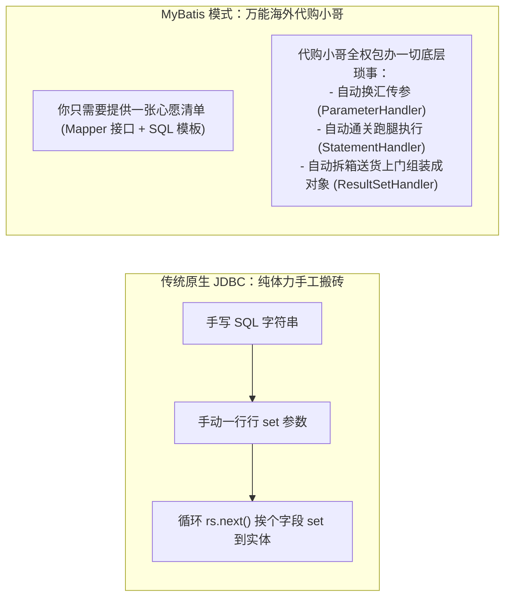
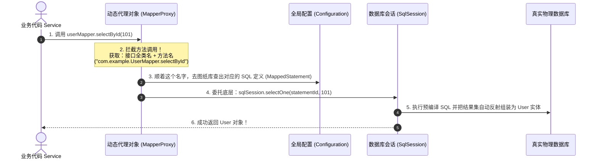
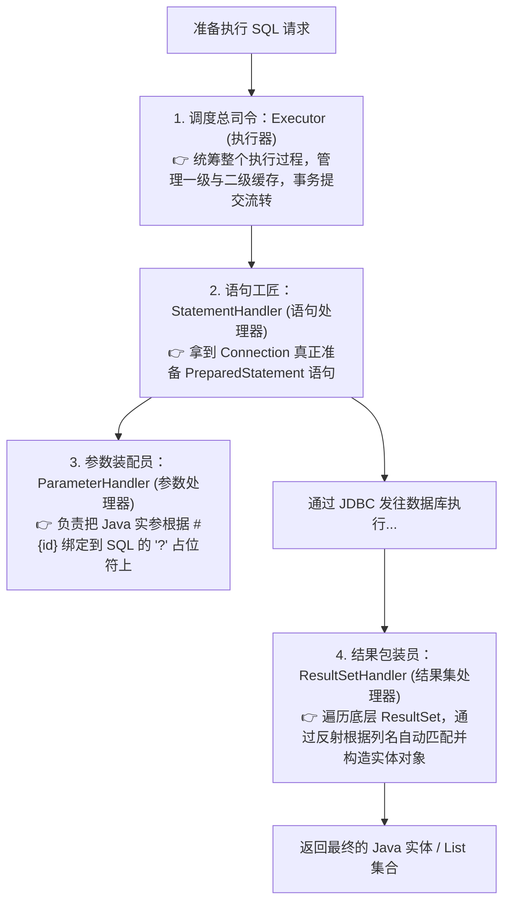

# 📜 07 · MyBatis 原理（万能代购代理与四大金刚底层拆解）

> **一句话导读**：为什么写了个没有任何实现类的 `Mapper` 接口，它就能隔空去查数据库并把数据自动装配成 Java 对象？搞懂 `MapperProxy` 动态代理与四大核心执行器，你就彻底拨开了持久层的神秘面纱。

---

## 🛒 核心心智模型：万能海外代购小哥

回顾一下原始的 JDBC 写法，每个老程序员都有一段搬砖血泪史：
1. 手动加载 Driver 驱动；
2. 打开 Connection 物理连接；
3. 手写带有无数占位符的 SQL；
4. 挨个设置参数（`ps.setString(1, name); ps.setLong(2, id);`）；
5. 执行查询获取 `ResultSet` 游标；
6. 逐行 `while(rs.next())`，通过几十行 `user.setAge(rs.getInt("age"))` 纯手工组装对象；
7. 繁琐的 `finally` 资源关闭。



---

## 🕵️ 核心谜题：没有实现类的接口，到底是怎样被执行的？

我们在 Service 里只要 `@Autowired private UserMapper userMapper;`，就能直接调用 `userMapper.selectById(101)`。
**接口本身根本没有方法体，它到底是怎么运行的？**

### 答案揭晓：JDK 动态代理（MapperProxy）！



> 💡 **底层硬核机制**：
> 1. Spring 启动扫描到 `@Mapper` 接口时，通过 **`MapperFactoryBean`** 偷偷调用了 Java 原生的 `Proxy.newProxyInstance()`；
> 2. 为每个接口动态生成了一个代理实例，其核心调用处理器是 **`MapperProxy`**；
> 3. 你在代码里拿到的 `userMapper`，根本不是什么未知实现类，而是一个**顶着接口面具的代理替身**！

---

## 🏛️ 底层支柱：MyBatis 四大核心金刚（四大对象）

一旦进入底层的 `SqlSession`，具体的脏活累活全被分配给了 **四大核心工匠对象**：



> 🌟 **大厂必考：MyBatis 插件（Interceptor）的原理是什么？**
> 无论是分页插件 `PageHelper`，还是租户隔离插件、性能监控耗时统计插件，**它们全都是利用动态代理，精准拦截以上“四大金刚”中的某一个方法来实现的！**
> （最常拦截的是 `Executor.query/update` 或 `StatementHandler.prepare`）。

---

## 💥 面试高频必考：`#{}` 与 `${}` 的天壤之别（防 SQL 注入）

很多初级程序员随心所欲乱用，直接把系统推向了被脱库的深渊：

| 对比维度 | `#{}`（参数占位符 - 🌟 强推首选） | `${}`（字符串拼接 - ⚠️ 极度危险） |
| :--- | :--- | :--- |
| **底层实现** | 预编译处理。在 SQL 中翻译为 **`?`** 占位符，通过 JDBC 的 `PreparedStatement.setObject()` 设值 | 纯字符串生硬替换。在 SQL 解析阶段直接把变量原样拼接到 SQL 文本中 |
| **安全性** | **✅ 100% 免疫 SQL 注入攻击** | **❌ 极易引发致命的 SQL 注入攻击** |
| **性能** | 高。数据库可以复用预编译好的执行计划（软解析） | 低。每次不同参数都是全新的 SQL 字符串，数据库必须重新硬解析 |
| **适用场景** | 绝大多数业务参数传递（WHERE 条件查询、INSERT 赋值等） | **极少数动态表名、动态排序字段（ORDER BY ${column}）** |

### 🚨 现场翻车实验：黑客如何利用 `${}` 删库脱库？
```sql
-- 危险代码：
SELECT * FROM users WHERE username = '${name}' AND password = '${pwd}'

-- 黑客在密码框输入： ' OR '1'='1
-- 最终被拼装成的恶魔 SQL：
SELECT * FROM users WHERE username = 'admin' AND password = '' OR '1'='1'
```
**后果**：密码校验直接被绕过，黑客直接无密码登录管理员账号！
而如果使用 `#{pwd}`，不管黑客输入什么，都会被当作一整串纯字符文本对待，绝不可能改变 SQL 的语法树结构！

---

## 🗄️ MyBatis 的两级缓存：到底能不能在生产中用？

### 1. 一级缓存（SqlSession 级别，默认开启）
- **范围**：同一个 `SqlSession`（在 Spring 体系下通常指**同一个事务内部**）。
- **机制**：在同一个事务中连续执行两次完全相同的查询，第二次不会查数据库，直接从内存 Map 缓存返回。
- **失效**：只要期间执行了任何一次 `insert/update/delete`，或者事务提交/回滚，一级缓存自动全清。

### 2. 二级缓存（Namespace 命名空间级别，默认关闭）
- **范围**：跨会话共享，以一个 Mapper 为边界。
- **🚨 生产避坑致命陷阱**：
  - 二级缓存是基于单个 Mapper 缓存的。如果在多表联合查询（如关联了 `user` 和 `order` 两个表），在另一个 Mapper 里修改了 `user` 表的数据，**`order` 表对应的二级缓存根本不知道，依然会返回旧脏数据！**
  - 在现代微服务分布式集群环境下，应用部署了多台机器，MyBatis 的二级缓存只存在于单机 JVM 内存中，**必定导致各机器之间数据不一致！**
- **生产军规**：**在现代企业级分布式微服务架构中，坚决禁用 MyBatis 二级缓存！** 所有缓存需求统一交由外部集中式 **Redis** 处理！

---

## 🧠 一分钟复盘核心记忆卡

1. **接口调用的秘密**：基于 **JDK 动态代理 `MapperProxy`**，根据接口类名 + 方法名定位 `MappedStatement`。
2. **四大金刚执行链**：`Executor` 统筹 -> `StatementHandler` 建语句 -> `ParameterHandler` 绑参数 -> `ResultSetHandler` 封实体。
3. **安全防线**：永远无脑首选 **`#{}`** 预编译；二级缓存是单机鸡肋，生产果断拥抱 Redis。

---

## 🧭 下一步

搞定了 Web 层的 SpringMVC 与持久层的 MyBatis，系统已经能顺畅跑通业务。
但还有一个至关重要的门神在守护着系统的安全防线——**`Spring Security`**。
它是如何通过多道安检门对用户进行身份认证（你是谁）和权限把控（你能干什么）的？
请进入下一篇：[[12-Spring-Security]]！
