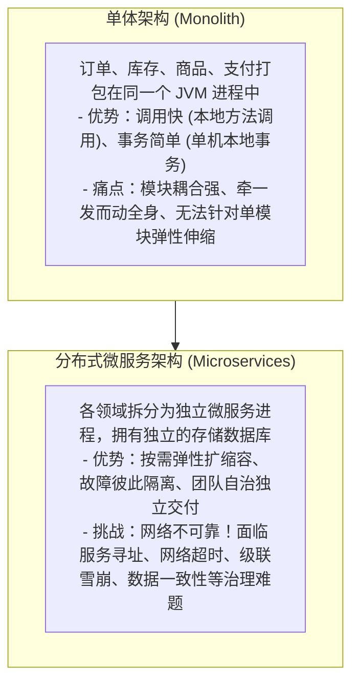
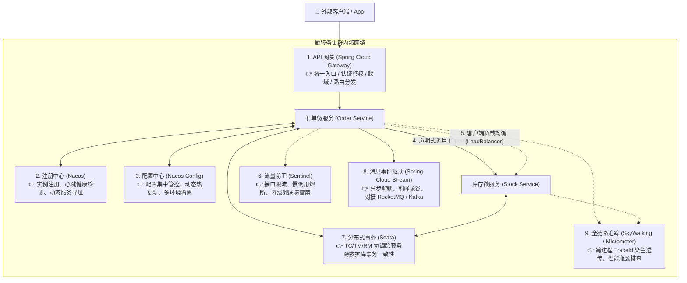
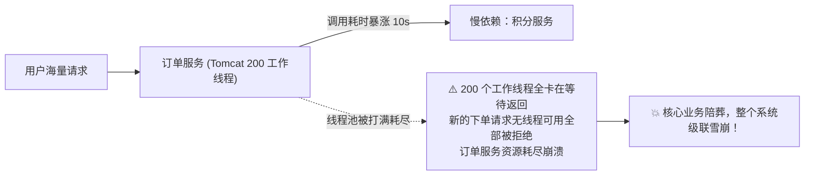
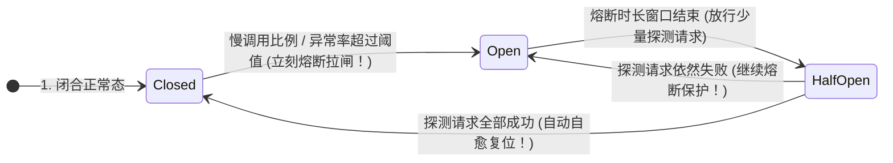

# 🌐 08 · Spring Cloud 组件概览与技术选型演进

> **一句话导读**：单体系统拆分为分布式微服务后，服务发现、负载均衡、熔断容错、分布式事务与全链路追踪等治理挑战接踵而至。理解 Spring Cloud 技术生态的演进脉络与九大核心治理支柱，是构建健壮微服务架构的基石。

---

## 🏛️ 微服务架构演进与 Spring Cloud 本质定位

当业务复杂度膨胀到单体应用无法支撑时，架构演进是必然选择：



> 💡 **Spring Cloud 的本质**：
> 它并不是某一个具体的单一中间件，而是**一套微服务治理的“规范、抽象与全家桶生态”**。它通过统一的抽象接口，屏蔽底层不同具体实现的差异，为分布式系统提供开箱即用的治理能力。

---

## 🔄 两代微服务技术选型演进史（大厂面试必考）

微服务生态经历了从早期 **Netflix 全家桶（一代）**，到 **Spring 官方自研与重构（二代）**，再到目前国内工业界主流首选 **Spring Cloud Alibaba 体系** 的深刻演进：

| 核心职能 | 第一代（Netflix 早期，多已停更） | 第二代（Spring 官方自研重构） | 现代主流（Spring Cloud Alibaba 推荐） | 关键演进动因与考量 |
| :--- | :--- | :--- | :--- | :--- |
| **服务注册与发现** | **Eureka**（闭源/维护模式） | Consul / Zookeeper | **Nacos**（主流推荐） | Eureka 仅支持 AP，Nacos 原生支持 AP/CP 双模切换，且通过 gRPC 长连接实现毫秒级实例变更推送。 |
| **分布式配置中心** | Spring Cloud Config（需配合 Bus） | Spring Cloud Config | **Nacos Config**（主流推荐） | 原生支持多环境命名空间隔离、秒级动态热更新与历史版本回滚，无需额外依赖 RabbitMQ/Kafka Bus。 |
| **客户端负载均衡** | **Ribbon**（已停止维护） | **Spring Cloud LoadBalancer** | **Spring Cloud LoadBalancer** | 彻底移除了对 Netflix 遗留代码的依赖，基于响应式 Reactive 抽象重构，性能更高且更轻量。 |
| **声明式远程调用** | Feign（原始 Netflix 版本） | **OpenFeign** | **OpenFeign** / Dubbo 3 | 官方承接并深度整合 Spring MVC 注解标准（如 `@GetMapping`），支持可拔插 HTTP 客户端与拦截器。 |
| **熔断限流与降级** | **Hystrix**（已停止维护） | **Resilience4j** | **Sentinel**（国内主流推荐） | Hystrix 线程池隔离资源开销大；Sentinel 支持流量整形、系统自适应保护、热点参数限流及丰富的控制台。 |
| **统一 API 网关** | **Zuul 1.x**（基于 Servlet 同步阻塞） | **Spring Cloud Gateway** | **Spring Cloud Gateway** | 基于 Project Reactor 与 Netty 异步非阻塞模型重构，吞吐量和长连接并发能力比 Zuul 1 提升数倍。 |
| **分布式事务** | 无成熟内置方案（多用 LCN / 自研） | 无官方实现（依赖外部框架） | **Seata**（事实工业标准） | 首创 AT 自动补偿模式（前后镜像生成与 Undo Log），兼顾 TCC、Saga 与 XA 模式，解决跨库跨服务强一致难题。 |
| **全链路追踪** | **Spring Cloud Sleuth**（Spring Boot 3 废弃） | **Micrometer Tracing** | **SkyWalking**（字节码无侵入插桩） | Spring Boot 3+ 统一使用 Micrometer Tracing 规范；生产常搭配 Apache SkyWalking 实现性能指标与链路两用。 |
| **事件驱动与消息总线** | Spring Cloud Bus | **Spring Cloud Stream** | **Spring Cloud Stream** | 提供高层消息编程抽象（Binder / Binding），一份代码无缝切换适配 RocketMQ、Kafka 与 RabbitMQ。 |

---

## 🏛️ 微服务全景协作时序大图

在一个标准的工业级 Spring Cloud 微服务系统中，九大核心组件的分工与协同流转如下：



---

## 🔍 九大核心组件职责与解决痛点深度对照

| 核心组件 | 推荐技术实现 | 核心职责与攻坚痛点 |
| :--- | :--- | :--- |
| **1. API 网关** | **Spring Cloud Gateway** | **流量第一道安全防线**。统一外部请求入口，执行路径重写、安全鉴权、跨域 CORS 处理、网关级限流防刷与全链路 TraceId 初始染色。 |
| **2. 服务注册与发现** | **Nacos** / Consul | **告别硬编码 IP**。服务启动自动向注册中心报备元数据与心跳；调用方拉取服务健康实例列表并缓存本地；实例宕机毫秒级剔除并推送事件。 |
| **3. 分布式配置中心** | **Nacos Config** | **配置动态化与中心化**。将配置与应用包解耦，支持多环境命名空间隔离，支持在运行时无需重启热更新参数（基于 Long Polling / gRPC 监听）。 |
| **4. 声明式 RPC 调用** | **OpenFeign** | **降低跨服务调用成本**。基于 JDK 动态代理将 HTTP 远程调用伪装成调用本地接口方法，自动处理 URL 拼接、参数绑定与 JSON 序列化。 |
| **5. 客户端负载均衡** | **Spring Cloud LoadBalancer** | **请求流量均匀分散**。在客户端拉取可用节点列表后，按照轮询（Round-Robin）、加权随机或自定义规则选择目标节点分发请求。 |
| **6. 容错与熔断降级** | **Sentinel** / Resilience4j | **防止微服务级联雪崩**。实时统计接口错误率与慢调用比例，达到阈值立刻阻断调用走降级托底逻辑，守护整个系统可用性。 |
| **7. 分布式事务** | **Seata** | **跨服务数据强一致/最终一致**。解决微服务按业务分库后本地 ACID 事务失效的问题，基于 AT 模式自动生成 Undo Log 镜像实现平滑回滚。 |
| **8. 全链路可观测性** | **SkyWalking** / Micrometer Tracing | **复杂调用链路诊断**。为每一个入口请求生成唯一 `TraceId`，并在跨服务 RPC、线程池与异步 MQ 中透传，绘制调用拓扑图与性能火焰图。 |
| **9. 消息驱动总线** | **Spring Cloud Stream** | **统一异步事件抽象**。通过 Binder（绑定器）与 Binding 抽象，屏蔽不同底座 MQ 的 API 细节差异，用统一模型实现消息发布与监听。 |

---

## 💻 生产实战深水区：OpenFeign 核心原理与三大血泪坑

在所有 Spring Cloud 组件中，开发者日常编写频次最高的是 **OpenFeign**。以下梳理其底层运行机理与高频踩坑点：

### 1. 声明式调用极简代码

```java
import org.springframework.cloud.openfeign.FeignClient;
import org.springframework.web.bind.annotation.GetMapping;
import org.springframework.web.bind.annotation.RequestParam;
import org.springframework.stereotype.Component;

// name 对应注册中心中的服务实例名，fallback 指定降级类
@FeignClient(name = "stock-service", fallback = StockClientFallback.class)
public interface StockClient {

    @GetMapping("/api/stock/deduct")
    Boolean deductStock(@RequestParam("skuId") Long skuId, @RequestParam("count") Integer count);
}

// 降级兜底方案：下游超时或崩溃时自动触发
@Component
class StockClientFallback implements StockClient {
    @Override
    public Boolean deductStock(Long skuId, Integer count) {
        System.err.println("⚠️ 库存服务响应超时或不可用，执行降级逻辑！");
        return false;
    }
}
```

### 2. OpenFeign 生产避坑三大铁律

#### 🚨 坑点一：默认使用的 HttpURLConnection 性能低下（必须替换为连接池）
- **现象**：高并发压测下，Feign 吞吐量极低，TCP 握手开销极大甚至出现 `SocketTimeout`。
- **根因**：OpenFeign 默认使用的是 JDK 原生的 `HttpURLConnection`，该客户端**不支持 HTTP 连接池**，每次调用都重新经历 TCP 三次握手与四次挥手！
- **解法**：生产环境必须引入 **Apache HttpClient 5** 或 **OkHttp** 开启连接池复用：
  ```xml
  <dependency>
      <groupId>io.github.openfeign</groupId>
      <artifactId>feign-hc5</artifactId>
  </dependency>
  ```
  ```yaml
  feign:
    httpclient:
      hc5:
        enabled: true
      max-connections: 500          # 线程池最大连接数
      max-connections-per-route: 50 # 单目标路由最大连接数
  ```

#### 🚨 坑点二：跨微服务调用导致请求头（Token / UserContext）静默丢失
- **现象**：用户在网关已鉴权登录，微服务 A 调用微服务 B 时，服务 B 却报 `401 Unauthorized`（找不到登录 Token）。
- **根因**：OpenFeign 每次发起新调用都会构建全新的 HTTP 请求对象，**不会自动透传上游的 Request Header**。
- **解法**：编写全局 `RequestInterceptor` 拦截器透传上下文：
  ```java
  @Component
  public class FeignHeaderInterceptor implements RequestInterceptor {
      @Override
      public void apply(RequestTemplate template) {
          ServletRequestAttributes attributes = (ServletRequestAttributes) RequestContextHolder.getRequestAttributes();
          if (attributes != null) {
              HttpServletRequest request = attributes.getRequest();
              String token = request.getHeader("Authorization");
              if (token != null) {
                  // 将当前请求中的 Token 自动透传给下游 Feign 请求
                  template.header("Authorization", token);
              }
          }
      }
  }
  ```

#### 🚨 坑点三：两级超时时间配置混淆（连接超时 vs 读超时）
- **规范配置**：
  ```yaml
  feign:
    client:
      config:
        default:
          connectTimeout: 2000 # 建立 TCP 连接超时（推荐 1~3 秒）
          readTimeout: 5000    # 获取响应数据超时（视业务复杂程度设定）
  ```

---

## 💥 为什么微服务最怕“雪崩效应”？（熔断器救命机制）

在微服务拓扑中，如果下游某个非核心接口（如积分计算）由于慢 SQL 耗时突增到 10 秒：



### 🛡️ 熔断器的三态状态机转移：



1. **Closed（闭合正常态）**：所有请求正常放行通过。
2. **Open（断开熔断态）**：统计窗口内错误率或慢调用比例超标，**熔断器直接拉闸！后续请求不再经过网络访问下游，毫秒级直接就地执行 Fallback 降级逻辑**，瞬间释放线程池资源。
3. **Half-Open（半开探测态）**：熔断时限过后，放行极少量探针请求；若下游已恢复健康则自动闭合恢复；若依旧失败则退回熔断态。

---

## 🔗 纵深关联与高并发微服务专题导航

微服务生态中许多重磅组件在生产中往往承担着**高并发流量防护与分布式数据治理**的重任。本章建立全局骨架后，建议深入以下专题篇目深度攻坚：

- **注册中心与配置底层原理解析**：详见 [[../06-中间件/04-注册中心-Nacos|04 · 注册中心 Nacos（Distro 与 Raft 协议及长连接通信）]]
- **网关底层 Netty 反应式架构**：详见 [[../06-中间件/06-API网关|06 · API 网关（Spring Cloud Gateway 与分布式限流）]]
- **高并发系统七道流量防线与熔断实战**：详见 [[../10-知识串联与专题/05-高并发系统的流量保护链路|05 · 高并发系统的流量保护链路（Sentinel 规则与舱壁隔离）]]
- **微服务分布式事务 Seata 深度拆解**：详见 [[../07-分布式与微服务/03-分布式事务-2PC-TCC-Saga|03 · 分布式事务（Seata AT 模式与 Undo Log 机制）]]
- **全链路调用链追踪与灰度染色**：详见 [[../07-分布式与微服务/08-链路追踪|08 · 链路追踪（SkyWalking 字节码插桩与上下文传递）]]

---

## 🧠 一分钟复盘核心记忆卡

1. **微服务全家桶演进**：
   - 注册/配置中心：Eureka ➔ **Nacos**；
   - 负载均衡：Ribbon ➔ **Spring Cloud LoadBalancer**；
   - 熔断降级：Hystrix ➔ **Sentinel / Resilience4j**；
   - API 网关：Zuul ➔ **Spring Cloud Gateway**；
   - 分布式事务：**Seata**；
   - 全链路追踪：Sleuth ➔ **Micrometer Tracing / SkyWalking**；
   - 消息驱动：**Spring Cloud Stream**。
2. **OpenFeign 避坑三大件**：必须换用 **HttpClient5 / OkHttp 连接池**、异步跨线程需配置 **RequestInterceptor** 透传 Header、严控 Connect/Read 超时。
3. **防雪崩核心招数**：**熔断降级（快速失败释放线程） + 舱壁隔离（线程池/信号量配额）**。

---

## 🧭 下一步

在处理千万级高并发请求时，除了传统的 Servlet 多线程阻塞模型，还有一种基于事件循环的高性能非阻塞范式——**响应式编程（Reactive Programming）与 WebFlux**。
它与 Java 21 虚拟线程各自适用什么场景？
请进入下一篇：[[09-WebFlux与响应式编程]]！
