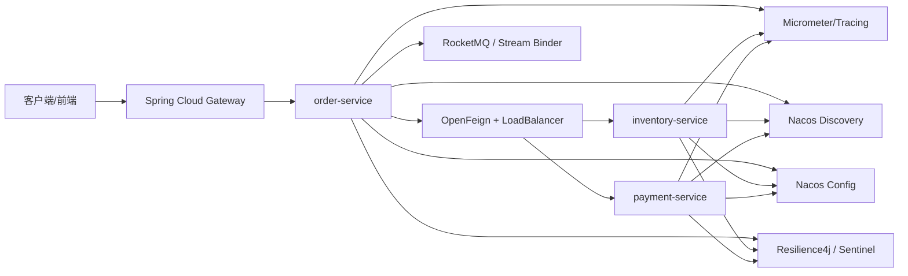
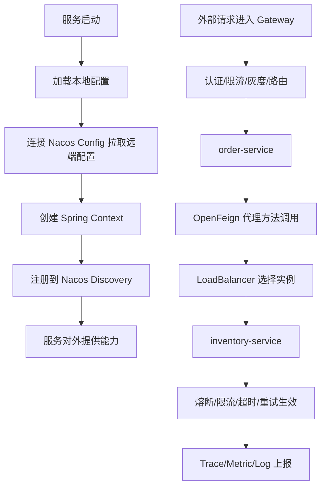
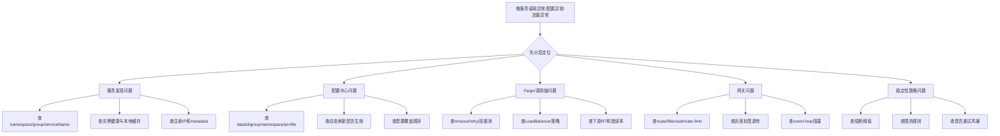

# SpringCloud组件概览

> [!abstract] 一句话总结
> Spring Cloud 不是单个中间件，而是一套把注册发现、配置管理、服务调用、负载均衡、网关、熔断限流和链路观测接成统一微服务基础设施的工程化体系；面试真正拉开差距的点，在于你能否讲清组件边界、替代关系、版本约束和生产落地方式。

## 📌 精准定位

- Spring Cloud 负责把常见微服务基础设施能力以 Spring 生态方式接起来，降低接入成本。
- 它解决的是“基础设施集成和治理方式”，不替代服务拆分、领域建模、数据库设计和容量规划。
- 组件选择并非越多越好，很多系统只需要注册发现、配置中心、Feign/LoadBalancer、Gateway、Tracing 就能跑起来。
- 关键边界：Spring Cloud、Spring Boot、Spring Cloud Alibaba、底层中间件版本必须匹配，否则兼容性问题非常多。
- 面试重点：不只要会背组件名，更要能说清 Spring Cloud Alibaba 组件边界、何时选 Sentinel、何时只是用 Resilience4j、Nacos Config 和 Discovery 是什么关系，以及常见故障图谱。

## 🧩 核心概念

| 概念 | 具体含义 | 工程要点 |
| ---- | -------- | -------- |
| Discovery | 注册发现，维护实例列表与健康状态。 | 解决“服务在哪”，不解决“是否要打”。 |
| Config | 配置中心，统一管理动态配置。 | 解决“配置从哪来”，不保证所有配置都能热更新。 |
| OpenFeign | 声明式 HTTP 客户端。 | 只是调用方式，不自带完整治理策略。 |
| LoadBalancer | 客户端实例选择。 | 轮询、权重、同机房优先等策略在此体现。 |
| Gateway | 统一入口，做认证、限流、灰度、路由。 | 解决南北向治理，不替代服务间治理。 |
| CircuitBreaker | 失败快速保护机制。 | 解决“下游不稳时如何止损”。 |
| Tracing | 链路观测。 | 没有观测，治理策略很难调优。 |
| Release Train / BOM | Spring Cloud 版本列车与依赖管理。 | 版本错配是生产接入的高频坑。 |

## 🏗️ 组件全景图



如何理解这张图：

- Gateway 是入口治理层。
- Discovery 和 Config 是基础设施底座。
- OpenFeign + LoadBalancer 是服务间调用主链路。
- Sentinel/Resilience4j 提供稳定性保护。
- Tracing/Metric/Log 提供可观测性闭环。
- RocketMQ Binder、Seata 这类组件不是每个系统都必须有，属于按场景补充。

## ⚙️ 工作原理 / 主流程



主流程说明：

1. 服务先从配置中心拉配置，再初始化 Spring 容器。
2. 启动成功后注册到注册中心，供其他服务发现。
3. 外部请求先过 Gateway，再进入具体业务服务。
4. 服务内部用 Feign 发起 HTTP 调用，LoadBalancer 负责选实例。
5. 稳定性组件在调用周围做超时、重试、熔断、限流、隔离。
6. 全链路通过 trace 和 metrics 做观测与回放。

## 🧱 Spring Cloud 常见组件职责边界

| 能力 | 常见组件 | 解决什么 | 不解决什么 |
| ---- | -------- | -------- | ---------- |
| 注册发现 | Nacos Discovery、Eureka、Consul | 服务注册、心跳、实例发现 | 失败熔断、限流、灰度全链路策略 |
| 配置中心 | Nacos Config、Apollo、Spring Cloud Config | 集中配置、动态推送、版本回滚 | 任意资源无风险热更新 |
| 服务调用 | OpenFeign、RestTemplate、WebClient | 接口化调用、编码简化 | 自动选好超时、重试和连接池 |
| 负载均衡 | Spring Cloud LoadBalancer | 候选实例选择 | 入口层统一流量治理 |
| API 网关 | Spring Cloud Gateway | 路由、认证、限流、灰度、统一入口 | 复杂业务编排、服务内细权限 |
| 稳定性 | Resilience4j、Sentinel | 限流、熔断、降级、隔离 | 根因修复、容量凭空提升 |
| 分布式事务 | Seata | 多服务事务协调 | 高性能强一致万能解 |
| 消息集成 | Spring Cloud Stream / RocketMQ Binder | 统一消息编程模型 | 消息中间件本身的治理运维 |
| 可观测性 | Micrometer、OpenTelemetry | 指标、Trace、日志关联 | 自动修复故障 |

## 🌐 Spring Cloud Alibaba 组件边界

这是面试高频点，必须讲清“它们分别做什么，不做什么”。

### 1. Nacos Discovery

- 负责服务注册与发现。
- 提供实例列表、健康状态、metadata、权重等信息。
- 不负责熔断、限流和调用失败快速止损。
- 典型误用：把“能发现实例”误当成“服务就稳定可用”。

### 2. Nacos Config

- 负责配置托管、版本发布、动态推送。
- 常见维度是 `namespace + group + dataId`。
- 不保证所有 Bean 都能安全热刷新，连接池、线程池、客户端对象常常要重建。
- 典型误用：把数据库连接数、线程池参数、灰度开关都当成同一类热更新配置。

### 3. Sentinel

- 提供流量控制、熔断降级、系统自适应保护、热点参数限流等能力。
- 常用接入点包括 Web、Gateway、Feign、RestTemplate、Dubbo。
- 更偏“实时流量治理和规则管理”。
- 典型误用：只配规则不压测，不理解阈值来自哪里。

### 4. Seata

- 解决跨服务分布式事务协调问题。
- 常见模式 AT、TCC、SAGA、XA，各有代价。
- 不适合滥用在所有链路，尤其高并发核心链路要谨慎评估性能与锁影响。
- 典型误用：把本来可以用最终一致和消息补偿解决的问题，强行套成分布式事务。

### 5. RocketMQ Binder

- 让 Spring Cloud Stream 能以统一编程模型接 RocketMQ。
- 适合做消息收发的应用层集成。
- 不替代 RocketMQ 的 Topic 规划、重试策略、死信队列、顺序消息治理。
- 典型误用：以为引入 Binder 就等于把消息治理问题都解决了。

## 🆚 Sentinel 与 Resilience4j 怎么看

| 维度 | Sentinel | Resilience4j |
| ---- | -------- | ------------ |
| 核心优势 | 流量治理能力强，规则体系丰富，热点参数、系统保护、控制台能力突出 | 与 Spring/Java 集成轻量，组合灵活，超时/重试/熔断/Bulkhead 清晰 |
| 常见场景 | 网关限流、接口流控、系统保护、规则动态治理 | 服务内调用保护、Feign/WebClient 包装、精细化超时重试熔断 |
| 控制台/规则 | 更强调规则配置和可视化治理 | 更偏代码和配置式集成 |
| 面试表达 | 偏“流量调度与保护体系” | 偏“调用级容错组件” |

回答建议：

- 如果公司是 Spring Cloud Alibaba 体系，Sentinel 很常见。
- 如果只需要轻量的调用保护，Resilience4j 往往更简洁。
- 两者不是完全互斥，但要避免重复治理、重复统计、重复拦截。

## 💻 代码 / 配置 / 伪代码

```yaml
spring:
  cloud:
    nacos:
      discovery:
        server-addr: nacos:8848
      config:
        server-addr: nacos:8848
    openfeign:
      client:
        config:
          default:
            connectTimeout: 100
            readTimeout: 500
```

```java
@FeignClient(name = "inventory-service")
public interface InventoryClient {

    @GetMapping("/inventory/stock")
    StockDTO query(@RequestParam("skuId") String skuId);
}
```

```text
一次典型链路：
Gateway -> order-service -> Feign -> LoadBalancer -> inventory-service
                       -> Resilience4j/Sentinel -> Trace/Metric/Log
```

## 🛠️ 工程案例：订单系统微服务基础设施组合

一个典型订单系统可能会这样选型：

- Nacos Discovery：服务注册发现。
- Nacos Config：多环境配置、开关、灰度参数。
- Spring Cloud Gateway：统一入口、JWT 校验、限流、灰度。
- OpenFeign + LoadBalancer：订单调库存、支付、用户。
- Resilience4j：对库存、支付调用做 timeout/retry/circuit breaker/bulkhead。
- Sentinel：如果需要更强的流量控制和规则治理，可放在网关或核心接口前。
- RocketMQ Binder：对接订单创建、支付成功、发货通知等异步消息。
- Micrometer + OpenTelemetry：做指标和链路追踪。

为什么这样组合：

- Discovery/Config 是底座。
- Gateway 管入口，Feign/LoadBalancer 管服务间调用。
- Sentinel/Resilience4j 管稳定性，Tracing 管观测。
- 事务和消息是按业务复杂度追加，不是默认全开。

## 🧨 常见故障图谱



## ⚠️ 生产坑与注意事项

- Spring Boot、Spring Cloud、Spring Cloud Alibaba 版本不匹配，启动或运行期兼容问题频发。
- 以为 OpenFeign 引进来就有完善治理，结果 timeout、retry、连接池都没显式配置。
- 注册中心和配置中心都用 Nacos，就误以为两者完全等价；实际上 Naming 和 Config 是两套职责。
- 只做注册发现，不做超时、熔断、限流，服务仍会在故障时相互拖垮。
- Gateway 过滤器里做阻塞 IO，入口层延迟飙升。
- 多层重试叠加，最终形成重试风暴。
- 配置热刷新误改线程池、连接池等资源参数，引发实例抖动。
- Sentinel 和 Resilience4j 同时包裹同一调用，但没人说清楚顺序和边界，导致观测混乱。

## 🧭 排查路径

### 1. 服务为什么调不通

- 查注册中心是否有实例，namespace/group/serviceName 是否一致。
- 查客户端本地缓存是否还持有旧实例。
- 查 Feign timeout、DNS、连接池和下游 RT。
- 看是否被网关、限流或熔断策略拦截。

### 2. 配置为什么不生效

- 查 `namespace/group/dataId/profile` 是否对应正确环境。
- 查配置优先级，是否被本地配置或环境变量覆盖。
- 查该配置是否支持热更新，是否只是值变了但 Bean 没重建。
- 查变更是否只在部分实例生效。

### 3. 流量为什么异常

- 查 Gateway 路由、鉴权、限流、灰度标签。
- 查 LoadBalancer 策略是否导致倾斜。
- 查 Sentinel/Resilience4j 阈值是否过严或重复保护。
- 查是否有重试风暴或热点 key。

### 4. 为什么故障扩散这么快

- 看有没有超时预算和隔离。
- 看重试是否多层叠加。
- 看熔断是否打开太晚。
- 看是否缺少 trace 和指标，导致问题发现太迟。

## 🎯 面试问题

> [!question] 高频问题
> - Q: Spring Cloud 解决什么问题？
>   - A: 它把注册发现、配置管理、服务调用、网关、稳定性和可观测性这些微服务基础设施能力整合成统一的工程接入方式。
> - Q: Nacos Config 和 Nacos Discovery 有什么区别？
>   - A: Discovery 管实例和健康状态，解决“服务在哪”；Config 管配置发布和动态推送，解决“配置从哪来”。
> - Q: OpenFeign 本质是什么？
>   - A: 是声明式 HTTP 客户端，把接口方法调用转成 HTTP 请求，本身不等于完整治理方案。
> - Q: Sentinel 和 Resilience4j 怎么选？
>   - A: Sentinel 更强在流量治理和规则体系，Resilience4j 更轻量、偏调用级容错；看团队生态和场景选择。
> - Q: Spring Cloud Alibaba 里哪些组件不是必选？
>   - A: Seata、RocketMQ Binder、Sentinel 都是按场景选；很多系统只用 Nacos + Gateway + Feign/LoadBalancer + 观测也够。

## 🎤 面试 3 层回答

### 30 秒版

Spring Cloud 是微服务基础设施集成层，把注册发现、配置中心、服务调用、网关、限流熔断和观测串起来。真正要讲好的不是组件名，而是各组件职责边界和生产如何组合。

### 2 分钟版

一个典型 Spring Cloud 体系里，服务启动先从配置中心拉配置，再注册到注册中心；请求从 Gateway 进入，服务内部通过 OpenFeign 发起调用，LoadBalancer 选实例，Resilience4j 或 Sentinel 做超时、重试、熔断、限流，最后通过 Trace 和 Metrics 建立观测闭环。Spring Cloud Alibaba 常见的是 Nacos、Sentinel、Seata、RocketMQ Binder，但它们边界要讲清：Nacos Discovery 和 Config 不同，Sentinel 是流量治理，不是根因修复；Seata 是事务协调，不是所有链路都该用。生产最常见的问题则是版本错配、超时重试没配好和重复治理。

### 项目版

在订单系统里，我一般会用 Nacos Discovery 做注册发现，Nacos Config 管配置，Gateway 承接 JWT、限流和灰度，OpenFeign + LoadBalancer 做服务间调用，核心下游用 Resilience4j 包 timeout/retry/circuit breaker。如果有网关级流控和热点参数保护需求，再加 Sentinel。排障时我会按层拆：先看 Gateway，再看 Feign/LoadBalancer，再看注册配置层，最后看稳定性组件阈值和 trace。这样能快速判断问题是基础设施层、下游服务层，还是治理规则本身。

## ✅ 精通检查清单

- 能画出 Spring Cloud 典型调用链和组件全景图。
- 能区分 Discovery、Config、Feign、LoadBalancer、Gateway、CircuitBreaker 各自职责。
- 能说清 Spring Cloud Alibaba 里 Nacos、Sentinel、Seata、RocketMQ Binder 的边界。
- 能解释 Sentinel 与 Resilience4j 的差异和组合风险。
- 能从版本、配置、发现、调用、治理五层拆解故障。

## 🔗 关联笔记

- [[_index]]
- [[20-Java后端/00-总览/学习仪表盘]]
- [[../06-中间件/04-注册中心-Nacos]]
- [[../06-中间件/05-配置中心]]
- [[../06-中间件/06-API网关]]
- [[../07-分布式与微服务/07-服务治理与负载均衡]]
- [[../07-分布式与微服务/06-限流-熔断-降级]]
- [[../07-分布式与微服务/08-链路追踪]]

## 📚 参考资料

- Spring Cloud Reference
- Spring Cloud OpenFeign Reference
- Spring Cloud Gateway Reference
- Spring Cloud CircuitBreaker Reference
- Spring Cloud Alibaba Reference
