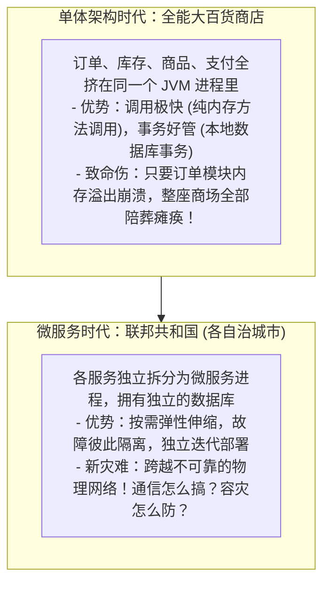
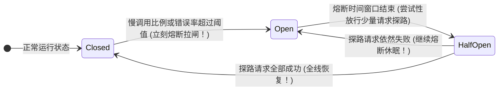

# 🌐 08 · SpringCloud 组件概览（微服务联邦共和国的治理艺术）

> **一句话导读**：单体系统拆成上百个独立服务后，服务去哪找？流量怎么分？网络崩了怎么自救？Spring Cloud 就像一套**“现代联邦共和国的中央行政机构”**。看懂 6 大核心支柱的分工协作，分布式微服务的全景地图便一览无余。

---

## 🏛️ 核心心智模型：从单体商铺到联邦共和国

很多初学者容易盲目崇拜微服务。用一个商业演进的故事就能看清本质：



> 💡 **Spring Cloud 的本质使命**：
> 它不是某一个具体的软件，而是一套**微服务架构治理的全套规范与标准全家桶**。

---

## 🏛️ 微服务联邦共和国的六大中央机构

在由上百个微服务组成的分布式网络中，每个组件都承担着不可替代的国家职能：

```mermaid
flowchart TD
    Client["📱 外部公网用户请求"] --> GW["1. 海关边防大闸：API 网关 (Spring Cloud Gateway)<br/>👉 统一入口，安全鉴权，流量调度，路径路由"]
    
    subgraph Internal["微服务联邦内部网络"]
        GW --> Order["订单微服务 (Order Service)"]
        
        Order <--> Reg["2. 户籍登记处：注册中心 (Nacos / Eureka)<br/>👉 登记服务实例 IP 端口，实时心跳健康检测"]
        
        Order -->|3. 外交信使：远程声明式调用 (OpenFeign)| Stock["库存微服务 (Stock Service)"]
        
        Order -.->|4. 交通交警：客户端负载均衡 (LoadBalancer)| Stock
        
        Order & Stock <--> Config["5. 政策下发中心：分布式配置中心 (Nacos Config)<br/>👉 统一配置发布，无需重启动态热更新"]
        
        Order -.-> Protect["6. 应急防卫军：熔断限流防护 (Sentinel / Resilience4j)<br/>👉 接口慢了立刻熔断降级，防止系统发生雪崩！"]
    end
```

---

## 🔍 六大核心组件人话大白话速查

| 核心职能 | 核心技术选型 | 现实生活比喻 | 核心解决什么痛点？ |
| :--- | :--- | :--- | :--- |
| **服务注册与发现** | **Nacos** *(当前主流首选)* / Eureka | **全国统一户籍与通讯录** | 以前写死 IP 地址，服务扩容缩容每次都要手动改配置文件；现在服务一启动自动去 Nacos 报到登记，下线自动注销！ |
| **声明式远程调用** | **OpenFeign** | **万能外交信使公文** | 告别手动拼接 HTTP URL 和解析 JSON 的恶梦；只要写一个 Java 接口，Feign 自动把方法调用变成 HTTP 请求发给对方！ |
| **客户端负载均衡** | **Spring Cloud LoadBalancer** | **路口交通警察** | 当库存服务有 3 台服务器提供服务时，交警负责按**轮询（Round Robin）**或**随机权重**把流量平摊到各个节点。 |
| **服务容错与熔断降级** | **Sentinel** / Resilience4j | **电路总闸保险丝** | 当库存服务宕机或变慢时，**立刻熔断切断调用**，秒级返回兜底降级数据，**防止把订单服务的线程池活活拖死引发全站雪崩**！ |
| **统一 API 网关** | **Spring Cloud Gateway** | **国家海关边检总关闸** | 外部流量统一入口；集中式处理 **跨域 CORS、JWT 登录验真、全链路日志 TraceId 染色、API 防刷黑白名单**。 |
| **分布式配置中心** | **Nacos Config** | **中央政策无线电广播** | 数十台微服务的参数全部集中管理；在控制台点一下“发布”，所有机器**秒级热更新，无需重新打包重启**！ |

---

## 💥 为什么微服务最怕“雪崩效应”？（熔断器的救命哲学）

面试高频必问：“什么是服务雪崩？Sentinel / Hystrix 的工作机制是什么？”

### 😱 恐怖的雪崩连锁反应：

```mermaid
flowchart LR
    A["用户大量请求"] --> B["订单服务 (tomcat 200 线程)"]
    B -->|远程调用| C["积分服务 (突然慢到 10 秒返回)"]
    
    Note over B: 订单服务的 200 个线程全卡在等待积分服务返回上！<br/>此时新来的创建订单请求再也进不来了！<br/>订单服务内存打爆，彻底宕机！
    
    D["前端所有业务全部卡死瘫痪！<br/>💥 全站雪崩！"]
```

### 🛡️ 熔断器（Circuit Breaker）的救命三态：



1. **Closed（闭合正常态）**：所有请求正常放行通过。
2. **Open（断开熔断态）**：监控到下游接口错误率超过 50% 或平均耗时超过 2 秒，**保险丝瞬间熔断！后续所有请求不再发往远程网络，直接就地返回降级托底数据（Fallback）！**
3. **Half-Open（半开试探态）**：熔断一段时间（比如 5 秒）后，小心翼翼放行 2 个请求试探；如果下游已经修好了，熔断器自动复位闭合！

---

## 💻 极简体验：OpenFeign 声明式调用有多优雅？

在订单服务里调用远程库存微服务，代码就像在本地调用一样自然：

```java
import org.springframework.cloud.openfeign.FeignClient;
import org.springframework.web.bind.annotation.GetMapping;
import org.springframework.web.bind.annotation.RequestParam;

// 声明调用的微服务名称 (与 Nacos 注册的名字一致)
@FeignClient(name = "stock-service", fallback = StockClientFallback.class)
public interface StockClient {

    @GetMapping("/api/stock/deduct")
    Boolean deductStock(@RequestParam("skuId") Long skuId, @RequestParam("count") Integer count);
}

// 降级兜底方案：当下游库存服务挂了或者超时，自动执行这里的备用逻辑！
@Component
class StockClientFallback implements StockClient {
    @Override
    public Boolean deductStock(Long skuId, Integer count) {
        System.err.println("⚠️ 库存服务目前不可用，触发降级兜底！");
        return false;
    }
}
```

---

## 🧠 一分钟复盘核心记忆卡

1. **微服务核心痛点**：跨网络调用不可靠、服务定位难、故障容易雪崩。
2. **黄金三角**：**Nacos（注册+配置） + OpenFeign（RPC 声明调用） + Gateway（网关入口）**。
3. **安全防线**：必须为每一个远程接口配置严格的**连接超时（ConnectTimeout）**与**读取超时（ReadTimeout）**，配合 **Sentinel 熔断降级** 守住系统可用性底线。

---

## 🧭 下一步

在处理千万级高并发请求时，除了传统的 Servlet 多线程阻塞模型，还有一种基于事件循环的高性能非阻塞范式——**响应式编程（Reactive Programming）与 WebFlux**。
它与 Java 21 虚拟线程各自适用什么场景？
请进入下一篇：[[09-WebFlux与响应式编程]]！
