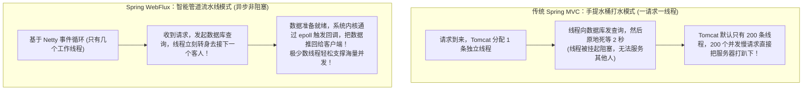
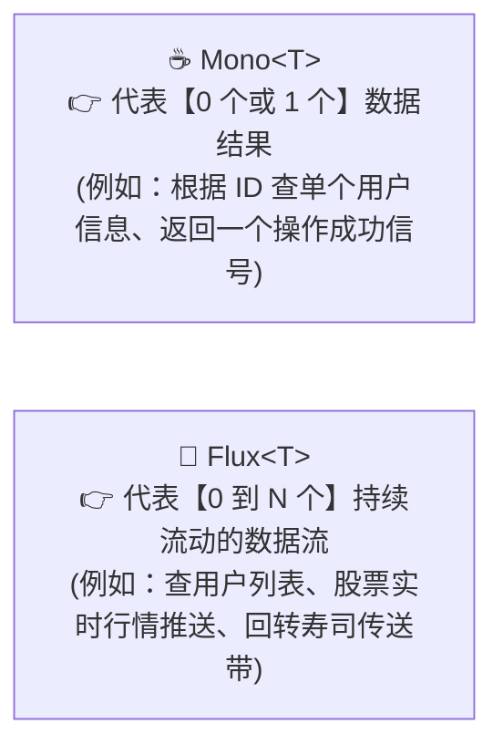
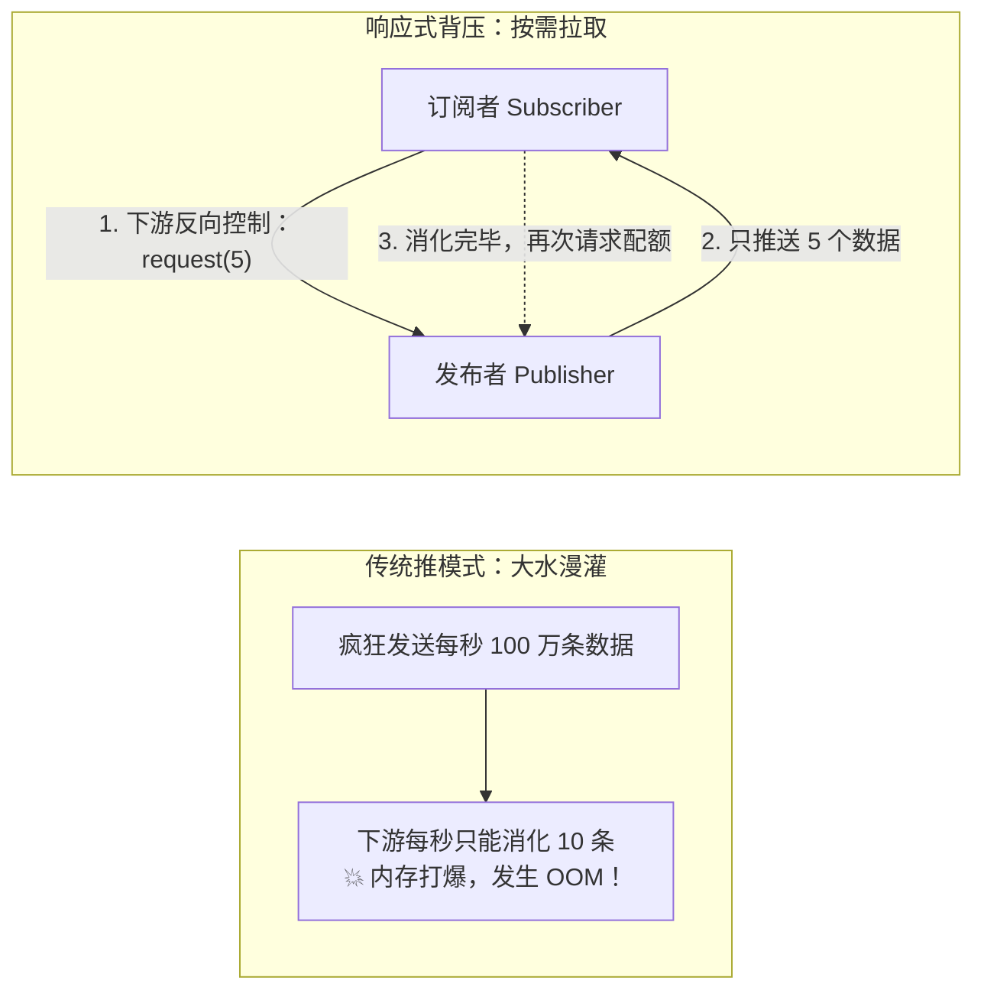

# 🌊 09 · WebFlux 与响应式编程（智能水龙头、背压与虚拟线程决战）

> **一句话导读**：为什么仅仅靠几个 CPU 核心，WebFlux 就能扛住数十万并发？响应式流规范到底解决了什么？看懂 `Mono`、`Flux`、背压机制（Backpressure）以及与 Java 21 虚拟线程的终极技术选型抉择，你就能掌握下一代高吞吐编程思维。

---

## 🚰 响应式编程与传统阻塞式编程的本质区别

对比传统的 Spring MVC 与响应式 WebFlux 的本质运行模式差异：



---

## 🥤 响应式两大基石：Mono 与 Flux

在 Reactor 框架中，所有的数据都被抽象为**“时间轴上流动的数据流”**：



### 🚨 核心铁律：不订阅，就什么都不会发生！（Nothing Happens Until You Subscribe）
响应式流是**纯惰性求值（Lazy）**的：
- 你写了 `Mono.just("Hello").map(...)`，这只是在铺设水管管道；
- **只要没人打开水龙头（没人调用 `.subscribe()`），水管里连一滴水都不会流动！**
- 在 WebFlux 中，Spring 会自动在最底层的 HTTP 输出端替你订阅，驱动整个流水线运转。

---

## 💻 极简体验代码：Mono 与 Flux 怎么写？

保存为 `ReactiveDemo.java`：

```java
import reactor.core.publisher.Flux;
import reactor.core.publisher.Mono;

public class ReactiveDemo {
    public static void main(String[] args) {
        // 1. Mono：发布单个元素
        Mono.just("Alice")
                .map(String::toUpperCase)
                .subscribe(name -> System.out.println("Mono 收到: " + name));

        // 2. Flux：发布多个元素的数据流
        Flux.just("Apple", "Banana", "Orange")
                .filter(fruit -> fruit.length() > 5)
                .subscribe(
                        fruit -> System.out.println("Flux 收到水果: " + fruit), // 消费每个元素
                        error -> System.err.println("出错啦: " + error),       // 异常处理
                        () -> System.out.println("🎉 所有水果传输完毕！")      // 完成信号
                );
    }
}
```

---

## 🛑 响应式精髓：什么是“背压”（Backpressure）？

在传统生产者-消费者模型中，最常见的问题是：**上游生产速度极快，下游消费慢，导致中间缓冲区直接爆满引发 OOM！**



> 💡 **背压的意义**：
> **将“纯推送”转变为“下游根据自身处理能力反向调控的拉取流”**，无论网络流量洪峰多猛烈，系统绝不发生内存撑爆崩溃。

---

## 🚨 致命禁忌：响应式编程适合跑 CPU 密集型任务吗？

👉 **结论：绝对不适合！如果在 Netty Event Loop 里直接跑 CPU 密集型计算，全站会瞬间瘫痪！**

### 1. 惨案根因：阻塞事件循环（Block the Event Loop）
- **Netty 的极简线程模型**：一个 8 核 CPU 服务器，WebFlux 默认只会创建 **8 个 Worker 线程（Event Loop）**，指望它们只处理纯非阻塞 I/O 事件；
- **雪崩爆发**：如果某个请求在里面跑复杂加解密、质数计算或大图像渲染，霸占了某个 Worker 线程 500ms：
  - 分配在这个 Worker 上的**其他上万个正常用户的 HTTP 连接在这 500ms 内全部被直接冻结**；
  - 只要并发涌入 8 个 CPU 密集型请求，**全站所有接口 100% 彻底死机，心跳停跳，网关大面积报 504 Gateway Timeout**！

### 2. 生产正统解法：切线程池做舱壁隔离（Bulkhead）
在响应式编程中，一旦必须进行 CPU 密集型或阻塞操作，**必须用 `publishOn` 强制切到专用的平台计算线程池中**，绝不能污染 Event Loop：

```java
// 独立建立一个大小等于物理 CPU 核数的传统计算线程池
Scheduler cpuScheduler = Schedulers.fromExecutor(
    Executors.newFixedThreadPool(Runtime.getRuntime().availableProcessors())
);

// 通过 publishOn 切出 Netty 工作线程
public Mono<String> encryptData(String data) {
    return Mono.just(data)
        .publishOn(cpuScheduler) // 🚀 切换线程上下文，拯救 Netty 线程！
        .map(this::doHeavyCpuEncryption);
}
```

---

## ⚔️ 世纪大对决：虚拟线程 vs 响应式编程

这是现代 Java 高并发架构中最核心的灵魂拷问：“既然 Java 21 虚拟线程用传统的同步代码就能做到几十万高并发，极其反人类的 WebFlux 还有存在的必要吗？”

### 1. 第一性原理：两者的本质目标 100% 一致！
无论是**响应式编程（WebFlux）**还是**虚拟线程（Java 21 Virtual Thread）**，其诞生的终极使命完全相同：
👉 **彻底消灭“操作系统物理线程在等待网卡、数据库、磁盘 I/O 阻塞时，傻傻停留在原地带来的 CPU 算力与内存浪费”！**

两者的根本分歧在于**实现路线的截然不同**：
- **响应式编程（WebFlux）：【改造程序员】**
  - 逼迫开发者放弃熟悉的线性代码，全量重构为基于事件驱动的响应式数据流（Mono / Flux）；
  - 换取了极高吞吐，但带来了割裂的调用栈与极高的调试维护成本。
- **虚拟线程（Virtual Thread）：【改造 JVM 运行时】**
  - 放过开发者，允许继续编写最符合人类直觉的同步顺序代码（`User u = db.query()`）；
  - 由 JVM 底层自动在 I/O 阻塞瞬间卸载（Unmount）虚拟线程、让出 Carrier 物理线程，在数据就绪时重新挂载（Mount）。

### 2. 客观全景对照表

| 选型维度 | 传统 Spring MVC (BIO) | Spring Boot 3 + 虚拟线程 (Virtual Threads) | Spring Boot 3 + WebFlux (响应式编程) |
| :--- | :--- | :--- | :--- |
| **编程模型** | 同步阻塞（最自然） | **最自然、最符合直觉的同步顺序代码** | 异步响应式流管道（`mono.flatMap(...)`） |
| **I/O 并发极限** | 较低（受限于 200~500 个物理线程） | **极高（单机数十万 I/O 并发）** | **极高（单机数十万 I/O 并发）** |
| **CPU 密集型表现** | 表现稳定（取决于物理核数） | **无额外提速**（受限于物理 CPU 核心上限） | **极度危险**（若未用 `publishOn` 切走，会当场卡死 Event Loop） |
| **Debug 与排错** | 简单清晰 | **完美！报错堆栈清晰直白，断点调试顺畅** | **痛苦！调用栈切得支离破碎，排障成本极高** |
| **生态兼容性** | 完美兼容全部历史库 | **极高！无需重构，兼容绝大部分原有 JDBC/MyBatis** | 极窄！**必须全链路全是非阻塞驱动**（必须换用 R2DBC 等） |
| **流式与背压控制** | 较弱 | 需借助阻塞队列或特定流控制 | **天生王者！天然原生支持背压流控、SSE 与实时长流** |

### 3. 架构选型最终结论：
1. **95% 的传统企业级业务系统（CRUD、微服务 RPC、电商、后台管理）**：
   - **坚决首选：Spring Boot 3 + 虚拟线程！**
   - 用最舒适的人性化代码，直接享受高并发红利，零重构心智负担。
2. **5% 的特定领域**：
   - **微服务统一 API 网关（如 Spring Cloud Gateway）**；
   - **大模型 AI 聊天流式打字输出（SSE / OpenAI 流式长链接）**；
   - **物联网 IoT 海量长连接遥测与严格背压流控**；
   - **依然坚定选择 WebFlux！**

---

## 🧠 一分钟复盘核心记忆卡

1. **核心底座**：基于 **Netty 事件循环** + **Reactive Streams 规范**，用极少物理线程撑起海量 I/O 并发。
2. **流对象**：`Mono` 对应单个结果，`Flux` 对应多个序列，不订阅绝不执行。
3. **架构选型**：常规业务全面拥抱虚拟线程；网关与 AI 实时打字流式推送坚守 WebFlux。

---

## 🧭 下一步

恭喜你！到这里，整个 Spring 生态的所有核心技术关卡你已经全线通关！
最后，让我们把 Spring 全家桶的核心框架、经典设计模式与大厂面试高频杀招，汇总收拢成一张终极通关总地图！
请进入终章：[[99-本章总结与复习]]！
