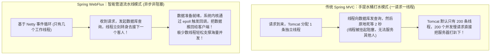
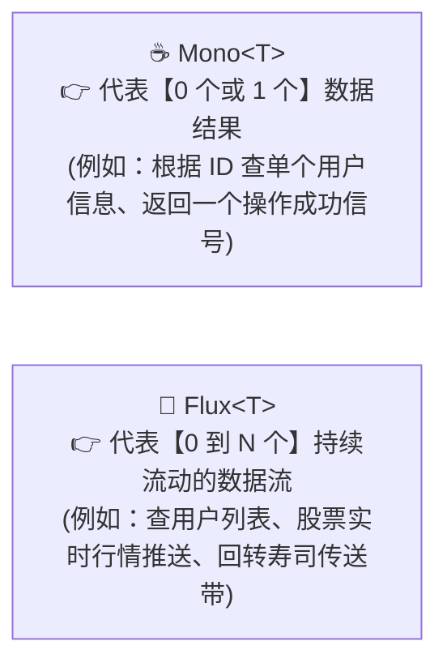

# 🌊 09 · WebFlux 与响应式编程（智能水龙头、背压与虚拟线程决战）

> **一句话导读**：为什么仅仅靠几个 CPU 核心，WebFlux 就能扛住数十万并发？响应式流规范到底解决了什么？看懂 `Mono`、`Flux`、背压机制（Backpressure）以及与 Java 21 虚拟线程的终极技术选型抉择，你就能掌握下一代高吞吐编程思维。

---

## 🚰 核心心智模型：手提水桶打水 vs 智能自来水管道

对比传统的 Spring MVC 与响应式 WebFlux 的本质运行模式差异：



---

## 🥤 响应式两大基石：Mono 与 Flux

在 Reactor 框架中，所有的数据都被抽象为**“时间轴上流动的数据流”**：



### 🚨 核心铁律：不订阅，就什么都不会发生！（Nothing Happens Until You Subscribe）
响应式流是**纯惰性求值（Lazy）**的：
- 你写了 `Mono.just("Hello").map(...)`，这只是在铺设水管管道；
- **只要没人打开水龙头（没人调用 `.subscribe()`），水管里连一滴水都不会流动！**
- 在 WebFlux 中，Spring 会自动在最底层的 HTTP 输出端替你订阅，驱动整个流水线运转。

---

## 💻 极简体验代码：Mono 与 Flux 怎么写？

保存为 `ReactiveDemo.java`：

```java
import reactor.core.publisher.Flux;
import reactor.core.publisher.Mono;

public class ReactiveDemo {
    public static void main(String[] args) {
        // 1. Mono：发布单个元素
        Mono.just("Alice")
                .map(String::toUpperCase)
                .subscribe(name -> System.out.println("Mono 收到: " + name));

        // 2. Flux：发布多个元素的数据流
        Flux.just("Apple", "Banana", "Orange")
                .filter(fruit -> fruit.length() > 5)
                .subscribe(
                        fruit -> System.out.println("Flux 收到水果: " + fruit), // 消费每个元素
                        error -> System.err.println("出错啦: " + error),       // 异常处理
                        () -> System.out.println("🎉 所有水果传输完毕！")      // 完成信号
                );
    }
}
```

---

## 🛑 响应式精髓：什么是“背压”（Backpressure）？

在传统生产者-消费者模型中，最常见的问题是：**上游生产速度极快，下游消费慢，导致中间缓冲区直接爆满引发 OOM！**

```mermaid
flowchart LR
    subgraph Bad["传统推模式：大水漫灌"]
        P1["疯狂发送每秒 100 万条数据"] ==> C1["下游每秒只能消化 10 条<br/>💥 内存打爆，当场暴毙！"]
    end

    subgraph Good["响应式背压：按需拉取"]
        P2["发布者 Publisher"] <==|1. 下游反向控制：'请先给我 5 个数据！' (request(5))| C2["订阅者 Subscriber"]
        P2 -->|2. 只推送 5 个数据| C2
        C2 -.->|3. 消化完毕，再次请求后续配额| P2
    end
```

> 💡 **背压的意义**：
> **将“纯推送”转变为“下游根据自身处理能力反向调控的拉取流”**，无论网络流量洪峰多猛烈，系统绝不发生内存撑爆崩溃。

---

## ⚔️ 世纪大对决：有了 Java 21 虚拟线程，WebFlux 还有存在的必要吗？

这是目前国内外 Java 技术界最火热的讨论：“既然 Java 21 虚拟线程用传统的同步代码就能做到几十万高并发，极其反人类的 WebFlux 是不是该被扫进历史垃圾堆了？”

### 客观深度剖析对照表：

| 选型维度 | Spring Boot 3 + 虚拟线程 (Virtual Threads) | Spring Boot 3 + WebFlux (响应式) |
| :--- | :--- | :--- |
| **编程模型** | **最简单直白、最符合人类直觉的同步代码**（`order = service.get()`） | 异步响应式流链式函数编程（`mono.flatMap(...)`） |
| **Debug 与排错** | **完美！** 报错堆栈清晰直白，断点调试顺畅无阻 | **痛苦！** 线程不断切换，异常堆栈被切得支离破碎 |
| **生态兼容性** | **极高！** 完美兼容过去 20 年所有的 JDBC、MyBatis、Spring 生态 | 较窄。**必须要求全链路全是非阻塞驱动**（必须用 R2DBC 替代 JDBC，否则只要有一处阻塞，整个 Netty 事件循环全部报废） |
| **性能极限** | 极高（单机数十万 I/O 并发） | 极高（单机数十万 I/O 并发，内存占用略小一丁点） |
| **流式数据推送** | 需结合特定长连接框架 | **天生王者！天然原生支持 SSE（Server-Sent Events）与实时流媒体** |

### 🏆 终极选型架构指南：
1. **95% 的传统企业级业务系统（CRUD、电商、后台管理）**：
   - **坚决首选：Spring Boot 3 + 虚拟线程！**
   - 用最自然的人性化代码，白捡高并发的红利，没有任何重构心智负担。
2. **5% 的特殊特定场景**：
   - **微服务统一 API 网关（如 Spring Cloud Gateway）**；
   - **大模型 AI 聊天打字机流式输出（SSE / OpenAI 流式接口）**；
   - **实时物联网 IoT 海量高频遥测上报**；
   - **依然坚定选择 WebFlux！**

---

## 🧠 一分钟复盘核心记忆卡

1. **核心底座**：基于 **Netty 事件循环** + **Reactive Streams 规范**，用极少物理线程撑起海量 I/O 并发。
2. **流对象**：`Mono` 对应单个结果，`Flux` 对应多个序列，不订阅绝不执行。
3. **架构选型**：常规业务全面拥抱虚拟线程；网关与 AI 实时打字流式推送坚守 WebFlux。

---

## 🧭 下一步

恭喜你！到这里，整个 Spring 生态的所有核心技术关卡你已经全线通关！
最后，让我们把 Spring 全家桶的核心框架、经典设计模式与大厂面试高频杀招，汇总收拢成一张终极通关总地图！
请进入终章：[[99-本章总结与复习]]！
