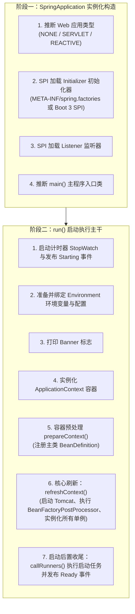
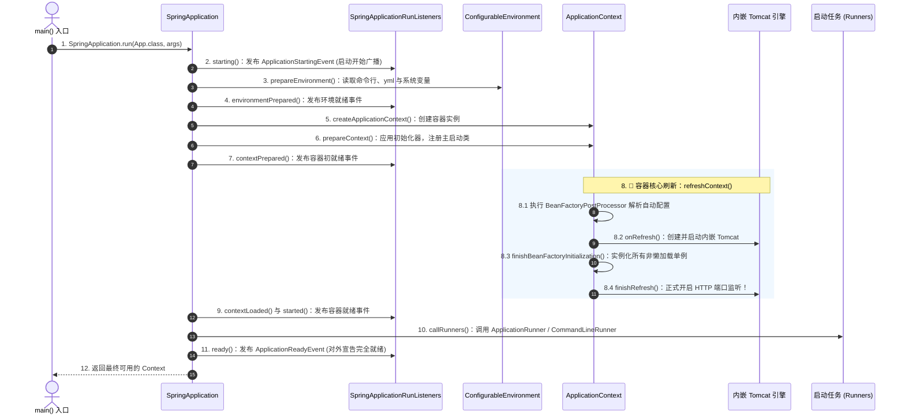
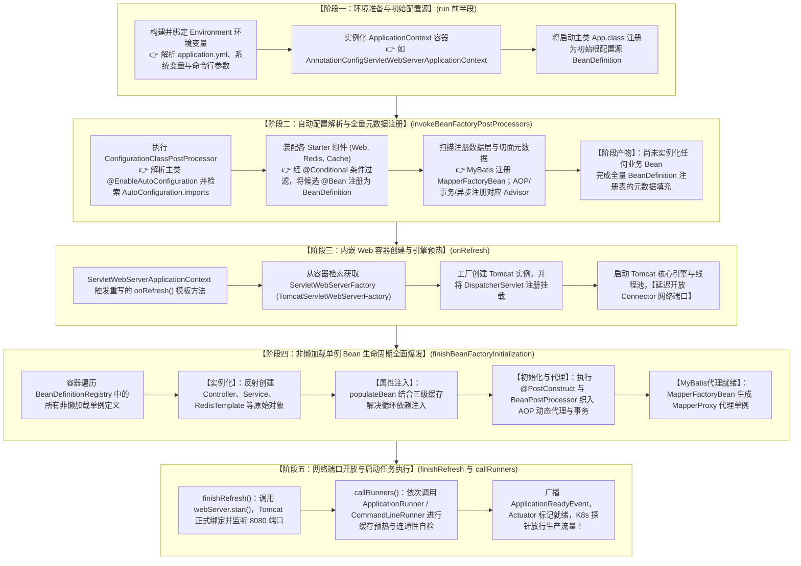
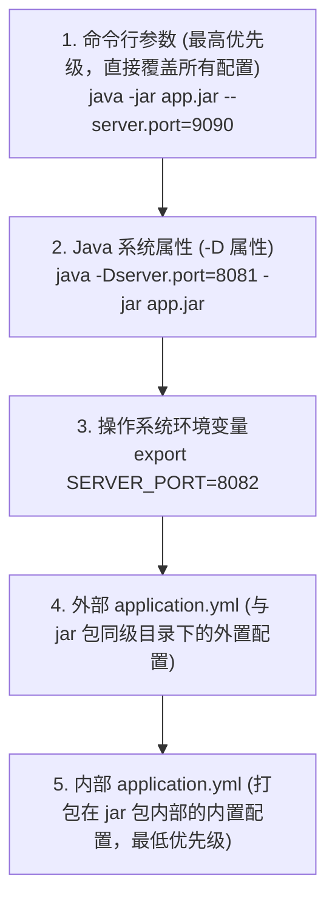

# 🚀 10 · SpringBoot 启动流程与生命周期扩展（启动时序与核心机制）

> **一句话导读**：看似普普通通的一行 `SpringApplication.run(App.class, args)`，背后经历了一套精密严谨的生命周期驱动流程：从环境变量与配置解析、容器实例化、自动配置与 BeanDefinition 注册，到内嵌 Web 容器创建、单例 Bean 生命周期执行，直至网络端口正式开放。为什么 Tomcat 会延迟到最后才开放端口？为什么有些事件监听器无法注入 `@Autowired`？搞懂这 7 大核心阶段与生命周期扩展点，你就能在底层全面掌控 Spring Boot 应用的生命周期。

---

## 🧭 知识全景：Spring Boot 启动两大阶段与七大事件



---

## 🏃 启动主干全景时序：三大步与两大阶段

Spring Boot 的启动严格划分为两大物理阶段：**实例化阶段（Constructor）** 和 **运行阶段（`run()`）**。

### 1. 阶段一：`new SpringApplication(primarySources)` 构造阶段

在执行 `run()` 之前，首先会在内存中构造 `SpringApplication` 实例，完成四件关键自检：
1. **推断 Web 运行环境类型（`WebApplicationType`）**：
   - 通过 `ClassUtils.isPresent()` 探测类路径下的特征类：
     - 若类路径下存在 `DispatcherHandler` 且不存在 `DispatcherServlet`，推断为 **`REACTIVE`**（WebFlux 环境）；
     - 若不存在 `Servlet` 或 `ConfigurableWebApplicationContext`，推断为 **`NONE`**（纯后台非 Web 应用，如离线批处理任务）；
     - 否则默认推断为 **`SERVLET`**（传统的 Spring MVC / Tomcat 阻塞环境）。
2. **加载 `ApplicationContextInitializer`（容器初始化器）**：
   - 通过 Spring SPI 机制检索类路径下所有候选初始化器并实例化，用于在容器刷新的早期执行自定义回调。
3. **加载 `ApplicationListener`（全局事件监听器）**：
   - 检索并缓存所有监听器实例，为后续在启动生命周期各个节点发布广播事件做好准备。
4. **推断 `main()` 入口类**：
   - 分析当前线程的调用栈 `new RuntimeException().getStackTrace()`，逆向寻找包含 `main` 方法的顶层执行类。

---

### 2. 阶段二：`run(args)` 核心运行阶段逐帧拆解



1. **准备运行监听器（`SpringApplicationRunListeners`）**：
   - 它是整个启动事件广播的统一调度器，聚合了所有注册的监听器，负责在启动的各个节点发出标准事件广播。
2. **构建并配置 Environment（环境变量）**：
   - 提取并整合命令行参数（`CommandLinePropertySource`）、系统环境变量、`application.yml` / `application.properties` 配置；
   - 对外广播 `ApplicationEnvironmentPreparedEvent`。
3. **创建容器实例（`createApplicationContext`）**：
   - 根据之前推断的 Web 类型，通过反射实例化对应的容器：
     - `SERVLET` 环境：实例化 `AnnotationConfigServletWebServerApplicationContext`；
     - `REACTIVE` 环境：实例化 `AnnotationConfigReactiveWebServerApplicationContext`；
     - `NONE` 环境：实例化标准的 `AnnotationConfigApplicationContext`。
4. **容器预处理（`prepareContext`）**：
   - 为容器设置 `Environment`；
   - 依次调用先前加载的所有的 `ApplicationContextInitializer` 的 `initialize()` 方法；
   - 将主启动类（如 `App.class`）作为最初始的 `BeanDefinition` 注入容器，作为后续 `@ComponentScan` 和 `@EnableAutoConfiguration` 的配置源根节点。
5. **容器核心刷新（`refreshContext`）**：
   - 委托底层执行 `AbstractApplicationContext.refresh()`，完成 Spring 体系最繁重的解析、初始化、AOP 织入以及 Tomcat 启动。
6. **执行启动任务（`callRunners`）**：
   - 检索并依次执行容器中注册的所有 `ApplicationRunner` 和 `CommandLineRunner` 实现类，用于执行缓存预热、RPC 连通性自检等预加载任务。
7. **发布完全就绪事件**：
   - 广播 `ApplicationReadyEvent`，对外宣告服务已完全就绪，开始接收外部网络请求。

---

## ⚙️ 核心大一统：Spring 全家桶在启动中的五大齿轮咬合与因果时序

很多开发者在分别学完 IoC、AOP、事务、MVC、MyBatis、Starter 与缓存后，脑海中依然是零散的孤岛。
**实际上，Spring Boot 的启动核心 `refreshContext()` 就是一条前后紧密咬合的“超级流水线”，全家桶的每个组件都在各自特定的时钟节拍上进场：**

### 1. Spring 生态核心机制时序全景图



---

### 2. 五大执行阶段深度穿透剖析

#### 阶段一：环境准备与初始配置源确定
- **关联章节**：[[10-SpringBoot启动流程#📜 生产高频避坑：配置属性覆盖优先级法则]]
- **执行过程**：
  1. `run()` 方法启动，通过 `EnvironmentPostProcessor` 整合命令行参数、操作系统变量、`application.yml`，封装为统一的 **`ConfigurableEnvironment`**；
  2. 反射创建对应的容器实例（如 Web 环境下的 `AnnotationConfigServletWebServerApplicationContext`）；
  3. 将启动引导类（如 `App.class`）作为最初始的 `BeanDefinition` 注册到容器注册表中。
- **当前状态**：**Spring 容器仅为空壳，除环境配置与 SPI 监听器外，无任何组件就绪**。

#### 阶段二：自动配置解析与全量元数据注册
- **触发时机**：容器刷新之 **`invokeBeanFactoryPostProcessors()`**。
- **关联章节**：[[04-SpringBoot自动配置原理]]、[[05-SpringBoot Starter机制]]、[[07-MyBatis原理]]、[[02-AOP原理与应用]]、[[03-Spring事务管理]]
- **底层穿透**：
  1. **Starter 自动配置生效**：核心后置处理器 **`ConfigurationClassPostProcessor`** 解析 `@EnableAutoConfiguration`，读取类路径下 `META-INF/spring/org.springframework.boot.autoconfigure.AutoConfiguration.imports` 文件，经过 `@ConditionalOnClass` 等条件过滤后，将各类 Starter 的配置类解析为 `BeanDefinition`；
  2. **MyBatis 接口扫描**：MyBatis-Plus 的 `MapperScannerConfigurer` 在该阶段被激活，扫描全项目标注了 `@Mapper` 的接口，将其作为 **`MapperFactoryBean`** 的 `BeanDefinition` 批量注册入库；
  3. **切面与事务基础设施**：解析 `@EnableTransactionManagement` 与 `@EnableAspectJAutoProxy`，将事务切面 Advisor（`BeanFactoryTransactionAttributeSourceAdvisor`）和 AOP 自动代理创建器（`AnnotationAwareAspectJAutoProxyCreator`）的 `BeanDefinition` 登记进容器。
- **阶段产物**：**全量组件图纸登记完毕，但内存中尚未实例化任何业务 Bean**。

#### 阶段三：内嵌 Web 容器创建与引擎预热
- **触发时机**：容器刷新之 **`onRefresh()`**。
- **关联章节**：[[06-SpringMVC请求处理流程]]
- **底层穿透**：
  1. **多态触发**：父类 `AbstractApplicationContext.refresh()` 执行到 `onRefresh()` 模板钩子。由于早先构造阶段已确定为 Web 环境并创建了对应子类，此处直接触发 `ServletWebServerApplicationContext` 重写的 `onRefresh()`，内部调用 `createWebServer()`；
  2. **检索 Web 工厂**：从容器中检索阶段二由 Starter 注册的 `TomcatServletWebServerFactory`；
  3. **构建 Tomcat 实例**：工厂通过原生 API 创建内嵌 Tomcat 实例，并初始化 Connector、Engine、Host 与 Context，生成底层的 **`ServletContext`**；
  4. **MVC 调度器挂载**：将同由容器托管的 **`DispatcherServlet`** 注册挂载进 Tomcat 的 ServletContext 中；
  5. **延迟监听端口机制（高可用防护）**：Tomcat 启动核心引擎与线程池，但**死死保持 Connector 处于非监听状态，绝不对外开放 8080 端口**。

> 💡 **架构深拷问：为什么必须在阶段四之前创建 Tomcat，而不是推迟到最后与端口开放合并执行？**
> 
> 初学者常有疑问：*“阶段四只是在实例化业务 Service，看起来纯粹是 Java 堆内对象的事，跟 Tomcat 有什么关系？为什么不把 Tomcat 的创建和端口开放一起放到最后？”*
> 
> **根本原因在于：阶段四里的很多 Bean，底层强依赖 Tomcat 在阶段三提供的“Web 环境基础设施”：**
> 1. **`ServletContext` 的依赖注入与 Aware 回调**：
>    - 业务 Service 或三方工具类中常有 `@Autowired private ServletContext servletContext` 或实现 `ServletContextAware` 接口（例如获取文件上传路径、加载模板引擎、配置静态资源）；
>    - `ServletContext` 必须由 Tomcat 启动创建。若颠倒顺序，阶段四实例化这些 Bean 时将因找不到 `ServletContext` 注入 `null` 或抛出致命异常导致启动中断。
> 2. **Web 专属作用域的注册（`@RequestScope` / `@SessionScope`）**：
>    - `request` 和 `session` 作用域并非 Spring 核心容器原生具备，必须由 Tomcat 建立 Web 上下文时向 `BeanFactory` 注册；
>    - 若阶段四先跑，当扫描到标注了 `@RequestScope` 的组件时，将当场抛出 `IllegalStateException: No Scope registered for scope name 'request'`。
> 3. **原生 Web 组件（Filter / Servlet / Listener）的标准管线挂载**：
>    - 开发者声明的 `FilterRegistrationBean` 等拦截组件，需要由 `ServletContextInitializer` 统一挂载到 Tomcat 的 `StandardContext` 管道中，必须先有宿主引擎底座。
> 4. **Servlet 规范的历史生态兼容**：
>    - 传统 war 包外置 Tomcat 部署时代，永远是“先有 ServletContext，后有 Spring 业务 Bean”；内嵌模式虽然反转了主导者，但依然必须遵循这一依赖顺序。
> 
> **两段式解耦的架构真谛**：
> - **上半场（阶段三 `onRefresh`：建环境底座）**：生成 `ServletContext`、注册 Web 作用域、挂载 `DispatcherServlet`，为阶段四业务 Bean 提供运行依托；
> - **下半场（阶段五 `finishRefresh`：通网络放行）**：等阶段四的所有单例与 AOP 代理全部就绪后，调用 `webServer.start()` 开放 8080 端口，确保外部请求安全接入。

#### 阶段四：非懒加载单例 Bean 生命周期全面爆发
- **触发时机**：容器刷新之 **`finishBeanFactoryInitialization()`**。
- **关联章节**：[[01-IoC容器与Bean生命周期]]、[[13-Spring循环依赖与三级缓存]]、[[02-AOP原理与应用]]、[[03-Spring事务管理]]、[[07-MyBatis原理]]
- **底层穿透**：
  1. **反射实例化**：容器遍历阶段二登记的所有单例 `BeanDefinition`，执行 `createBeanInstance` 反射创建原始对象；
  2. **三级缓存与依赖注入**：执行 `populateBean` 解析 `@Autowired` 依赖。若遇循环依赖，借助三级缓存 `singletonFactories` 提前暴露半成品工厂对象破解循环闭环；
  3. **AOP 代理与事务织入**：在 `initializeBean` 初始化阶段，触发 `BeanPostProcessor`（`AnnotationAwareAspectJAutoProxyCreator`），在 `postProcessAfterInitialization` 中检测 `@Transactional` 或切面注解，**为目标 Bean 创建并返回 CGLIB 或 JDK 动态代理对象**；
  4. **MyBatis 代理就绪**：`MapperFactoryBean` 执行 `getObject()`，内部调用 `SqlSession.getMapper()`，将各数据接口正式生成为 **`MapperProxy`** 动态代理单例。
- **阶段产物**：**全应用所有的 Controller、Service、Dao、中间件 Client 及其代理对象全部就绪成熟**。

#### 阶段五：网络端口开放与启动任务执行
- **触发时机**：容器刷新之 **`finishRefresh()`** 与随后的 **`callRunners()`**。
- **关联章节**：[[14-SpringBoot生产运维与Actuator]]、[[16-SpringCache与分布式缓存实战]]
- **底层穿透**：
  1. **Tomcat 正式开闸**：全量单例 Bean 与 AOP 代理完全就绪后，`finishRefresh()` 调用 `webServer.start()`，Tomcat **正式绑定并开始监听物理网络端口（如 8080）**；
  2. **执行启动任务**：检索并依次调用 `ApplicationRunner` 与 `CommandLineRunner`，开发者可在此安全调用成熟的 `RedisTemplate` 执行热点数据预热，或建立外部 RPC 长连接；
  3. **K8s 就绪探针放行**：广播 `ApplicationReadyEvent`，Spring Boot Actuator 的健康指标状态 `ReadinessState` 流转为 `ACCEPTING_TRAFFIC`，Kubernetes 就绪探针探测通过，负载均衡器正式切入生产网络流量！

---

### 3. Spring 全生态模块启动时序穿透矩阵

下表将整个 `04-Spring生态` 知识库的所有核心模块，与 Spring Boot 启动时序建立精准映射：

| 核心生态模块 | 对应知识库章节 | 介入的具体启动时序节点 | 底层核心动作与系统贡献 |
| :--- | :--- | :--- | :--- |
| **Starter 自动配置** | [[05-SpringBoot Starter机制]] | 阶段二：`invokeBeanFactoryPostProcessors` | 读取 `AutoConfiguration.imports`，按条件注解批量注册 `BeanDefinition`。 |
| **MyBatis 接口扫描** | [[07-MyBatis原理]] | 阶段二：`invokeBeanFactoryPostProcessors` | `MapperScannerConfigurer` 扫描 Mapper 接口，登记为 `MapperFactoryBean` 图纸。 |
| **AOP 与事务切面注册** | [[02-AOP原理与应用]]、[[03-Spring事务管理]] | 阶段二：`invokeBeanFactoryPostProcessors` | 注册事务 Advisor 和 `AnnotationAwareAspectJAutoProxyCreator` 元数据。 |
| **内嵌 Tomcat 引擎** | [[10-SpringBoot启动流程]] | 阶段三：`onRefresh()` | 依据 Web 工厂创建 Tomcat 引擎并挂载 Servlet，延迟开放物理端口。 |
| **SpringMVC 核心挂载** | [[06-SpringMVC请求处理流程]] | 阶段三：`onRefresh()` | 将 `DispatcherServlet` 作为核心前置控制器注册到内嵌 Tomcat 容器中。 |
| **IoC 实例化与三级缓存** | [[01-IoC容器与Bean生命周期]]、[[13-Spring循环依赖与三级缓存]] | 阶段四：`finishBeanFactoryInitialization` | 反射实例化 Bean，利用三级缓存解决 `@Autowired` 循环依赖。 |
| **AOP 代理与事务织入** | [[02-AOP原理与应用]]、[[03-Spring事务管理]] | 阶段四：`finishBeanFactoryInitialization` | 初始化后置拦截，为带有 `@Transactional` 或切面的 Bean 生成动态代理。 |
| **MyBatis 代理生成** | [[07-MyBatis原理]] | 阶段四：`finishBeanFactoryInitialization` | `MapperFactoryBean` 产生 `MapperProxy` 代理实例，注入各 Service。 |
| **Web 端口开放** | [[10-SpringBoot启动流程]] | 阶段五：`finishRefresh()` | 所有 Bean 均已就绪，调用 `webServer.start()` 开启 8080 端口接收流量。 |
| **分布式缓存预热** | [[16-SpringCache与分布式缓存实战]] | 阶段五：`callRunners()` | 执行 Runner 回调，安全使用 `RedisTemplate` 预热业务缓存。 |
| **生产运维与 K8s 探针** | [[14-SpringBoot生产运维与Actuator]] | 阶段五：发布 `ReadyEvent` 后 | Actuator 就绪状态置为就绪，K8s 探针探测成功并接入生产流量。 |

---

---

## 🔄 SPI 机制的代际演进：Spring Boot 2.x vs 3.x

在组件自动发现（SPI）的机制上，Spring Boot 经历了一次关键的架构解耦演进：

### 1. 代际分工对比：从“大一统杂烩”到“动静分流”

1. **Spring Boot 2.x：`META-INF/spring.factories` 大一统**：
   - 所有的初始化器、监听器、环境处理器以及成百上千个自动配置类，全部塞在同一个 `spring.factories` 键值对文件中；
   - **痛点**：启动时 `SpringFactoriesLoader` 必须全量解析这个庞大的 Properties 文件；随着生态膨胀，单文件解析极慢，且对 GraalVM 原生镜像（AOT）编译极不友好。
2. **Spring Boot 3.x：动静专职分流（各司其职）**：
   - **自动配置类（90% 大头）独立搬家**：
     - 剥离至：`META-INF/spring/org.springframework.boot.autoconfigure.AutoConfiguration.imports`；
     - 每行一个全限定类名，专供 `@EnableAutoConfiguration` 底层的 `ImportCandidates` 极速索引，天然适配 GraalVM 静态分析。
   - **初始化器与监听器（底层系统级 Hook）保留在 `spring.factories`**：
     - **`spring.factories` 并没有被废除，而是大幅瘦身**！
     - `ApplicationContextInitializer`（容器初始化器）、`SpringApplicationRunListener`（运行过程监听器）、`ApplicationListener`（系统监听器）以及 `EnvironmentPostProcessor`（环境后置处理器）等极早期组件，**依然保留在 `META-INF/spring.factories` 中**；
     - **底层原因**：这些组件在 Spring 容器还没创建的极早期阶段就需要被 `SpringFactoriesLoader` 加载，数量少（通常仅几个到十几个），保留原机制能确保底层引导时序绝对稳定。

### 2. 生产实战：初始化器与监听器的 3 种注册姿势

如果你在自研 Starter 或业务中需要使用 `ApplicationContextInitializer` 或 `ApplicationListener`，有以下标准途径：

1. **SPI 文件注册（Starter 推荐，零侵入）**：
   - 在 `src/main/resources/META-INF/spring.factories` 中按需声明：
     ```properties
     # 注册容器初始化器
     org.springframework.context.ApplicationContextInitializer=com.example.MyContextInitializer
     # 注册系统监听器
     org.springframework.context.ApplicationListener=com.example.MyApplicationListener
     ```
2. **配置文件声明（业务项目极简推荐）**：
   - 在 `application.yml` 里直接指定，无需创建 SPI 目录：
     ```yaml
     context:
       initializer:
         classes: com.example.MyContextInitializer
       listener:
         classes: com.example.MyApplicationListener
     ```
3. **启动类编程式注册（动态或硬编码注入）**：
   - 在 `main` 方法中显式添加：
     ```java
     SpringApplication app = new SpringApplication(MyApplication.class);
     app.addInitializers(new MyContextInitializer());
     app.addListeners(new MyApplicationListener());
     app.run(args);
     ```
   - *(注：若仅监听容器刷新后的晚期事件如 `ContextRefreshedEvent`、`ApplicationReadyEvent`，也可以直接在类上标注 `@Component` 或使用 `@EventListener`)*。

---

## ⚡ 企业级微服务启动提速实战策略

随着企业微服务业务不断膨胀，工程的启动时间往往会从 10 秒恶化到数分钟。以下是生产级的优化手段：

1. **开启全局按需懒加载（`Lazy Initialization`）**：
   - 在 `application.yml` 中配置：
     ```yaml
     spring:
       main:
         lazy-initialization: true # 开启单例 Bean 全局懒加载
     ```
   - **原理**：启动时不预先实例化所有单例 Bean，而是推迟到首次通过 HTTP 请求调用该 Bean 时才动态加载。
   - **收益与权衡**：
     - **优点**：本地开发调试和单元测试启动速度提升 50%~80%；
     - **生产警告**：生产环境核心交易服务慎用！因为这会导致第一次请求因现场实例化 Bean 而出现明显的响应毛刺（P99 延迟暴增），甚至由于某些配置错误直到运行时才暴露。
2. **排除非必要自动配置项**：
   - 检查并排除未使用的出厂配置：
     ```java
     @SpringBootApplication(exclude = {
         DataSourceAutoConfiguration.class,
         RabbitAutoConfiguration.class
     })
     ```
3. **定位慢 Bean 启动排查工具（Spring Startup Actuator）**：
   - 引入 `org.springframework.boot:spring-boot-starter-actuator` 并开启 `startup` 端点；
   - 使用 `BufferingApplicationStartup` 收集启动耗时并输出火焰图，精准定位初始化耗时过长的性能瓶颈 Bean。

---

## 📜 生产高频避坑：配置属性覆盖优先级法则

面试和运维最容易遇到的排查问题：“为什么我在 `application.yml` 里改了端口，启动后它依然读的是旧端口？”
因为 Spring Boot 有一套严格的配置覆盖金字塔：



> [!TIP]
> **线上运维救急策略**：
> 生产环境临时修改某个配置，**完全不需要重新打 jar 包上传**！直接在启动命令的最后加上 `--配置项名=新值`，就可以以最高优先级瞬间覆盖配置文件里的默认值！

---

## 🧠 一分钟复盘核心记忆卡

1. **两大阶段**：
   - 构造阶段推断 Web 类型与加载 SPI 监听器；`run()` 阶段建环境、造容器、刷容器、调 Runner。
2. **事件与时序边界**：
   - `ApplicationStartingEvent` 与 `EnvironmentPreparedEvent` 发生时**容器尚未创建**，绝不能依赖注入 Bean。
3. **Tomcat 启动机制**：
   - `onRefresh()` 搭建内嵌 Web 引擎，`finishRefresh()` 延迟开放端口，防止未完全初始化和代理增强的 Bean 引发空指针或调用异常。
4. **启动提速利器**：
   - 本地调试启用 `lazy-initialization`，生产结合 Actuator Startup 端点精确定位耗时瓶颈。

---

## 🧭 下一步

搞懂了应用是如何从零启动、加载环境与初始化容器后，高并发系统面对耗时操作（如导出、外部调用、日志审计）时，绝不能长时间阻塞 Tomcat 工作线程，必须引入异步化并发调度。
Spring 提供的 `@Async` 声明式异步底层原理是什么？为什么直接使用 `@Async` 会暗藏 `SimpleAsyncTaskExecutor` 无界创建线程把内存打爆的致命陷阱？跨线程时 MDC 日志追踪链路（TraceId）丢失如何解决？
请继续攻克第三关核心进阶：[[15-Spring异步与线程池体系]]！
