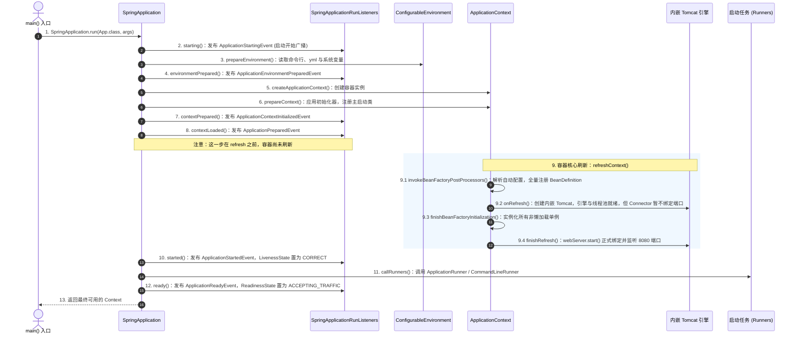
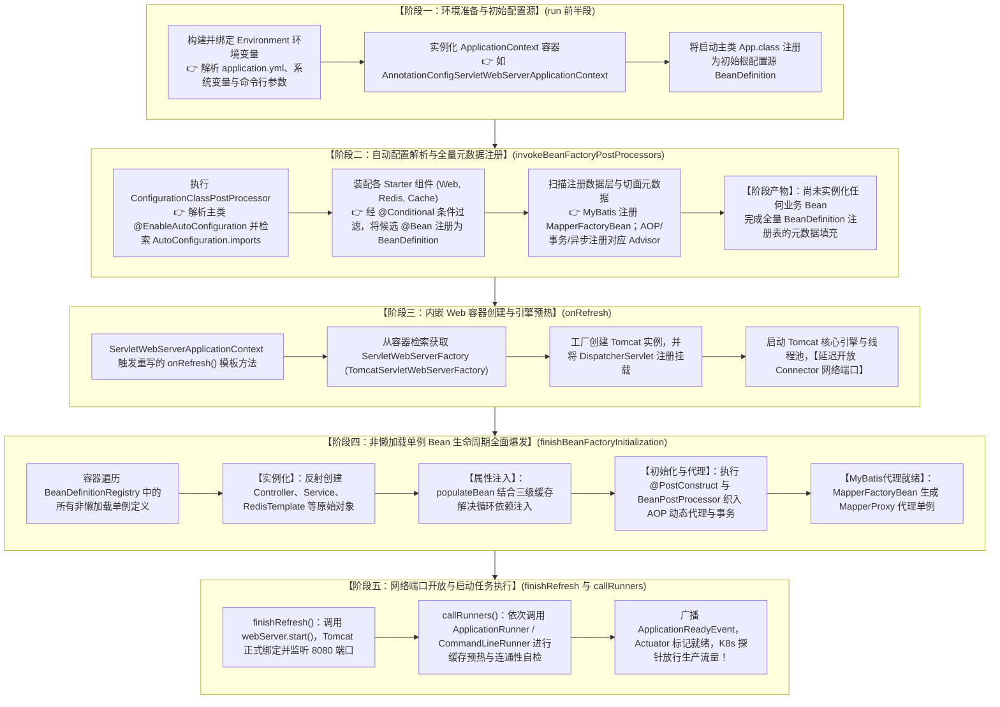
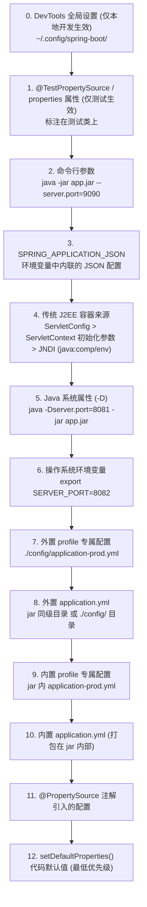

# 🚀 10 · SpringBoot 启动流程与生命周期扩展（启动时序与核心机制）

> **一句话导读**：看似普普通通的一行 `SpringApplication.run(App.class, args)`，背后经历了一套精密严谨的生命周期驱动流程：从环境变量与配置解析、容器实例化、自动配置与 BeanDefinition 注册，到内嵌 Web 容器创建、单例 Bean 生命周期执行，直至网络端口正式开放。为什么 Tomcat 会延迟到最后才开放端口？为什么有些事件监听器无法注入 `@Autowired`？搞懂这 7 大启动事件与全流程生命周期扩展点，你就能在底层全面掌控 Spring Boot 应用的生命周期。

---

## 🧭 七大启动事件总表（严格按时序）

启动在物理上分为**构造阶段**（`new SpringApplication()`：推断 Web 类型、SPI 加载 Initializer / Listener、推断 main 类）与 **`run()` 执行阶段**（建环境 → 造容器 → `refresh` → 调 Runner）两段，逐帧时序见下一章。

无论哪一段，全程共广播 **7 个 `Application*` 事件**，由 `SpringApplicationRunListener` 在每个节拍上发出。**记住「容器刷新了没有」，就记住了能不能注入 Bean**：

| # | 事件 | 发布回调 | 触发时机 | 容器状态 | 能否 `@Autowired` 业务 Bean |
| :--- | :--- | :--- | :--- | :--- | :--- |
| 1 | `ApplicationStartingEvent` | `starting()` | `run()` 的第一行 | ❌ 尚未创建 | ❌ 绝对不行 |
| 2 | `ApplicationEnvironmentPreparedEvent` | `environmentPrepared()` | `Environment` 构建完成后 | ❌ 尚未创建 | ❌ 绝对不行 |
| 3 | `ApplicationContextInitializedEvent` | `contextPrepared()` | 容器已建、Initializer 已执行 | ⚠️ 空壳，**零 BeanDefinition** | ❌ 取不到业务 Bean |
| 4 | `ApplicationPreparedEvent` | `contextLoaded()` | 主类 BeanDefinition 注册完、**`refresh()` 之前** | ⚠️ 未刷新 | ❌ 仅能拿到主类定义 |
| — | *`ContextRefreshedEvent`* | *`refresh()` 内部* | *`finishRefresh()` 中，**端口尚未开放*** | *✅ 已刷新* | *✅ 可以（注意：非 `Application*` 事件）* |
| 5 | `ApplicationStartedEvent` | `started()` | 端口已开放、Runner 执行之前 | ✅ 已刷新完毕 | ✅ 可以 |
| 6 | `ApplicationReadyEvent` | `ready()` | Runner 执行完毕 | ✅ 完全就绪 | ✅ 可以 |
| 7 | `ApplicationFailedEvent` | `failed()` | 启动过程中抛出异常 | ⚠️ 状态不确定 | ❌ 不可依赖 |

> [!important] 一条判据吃透全部 7 个事件
> **前 4 个事件全部发生在 `refreshContext()` 之前**——容器要么根本不存在、要么是个没有 `BeanDefinition` 的空壳，**一律不能注入业务 Bean**。
> 从 `ApplicationStartedEvent` 起容器才刷新完毕，注入才安全；而 `ApplicationFailedEvent` 属于异常分支，容器状态不可预测，同样不要写依赖注入逻辑。
>
> 这就是导读里那个问题的答案：**“有些监听器注入不了 `@Autowired`”，不是配置错了，而是它在容器诞生之前就被触发了。**

---

## 🏃 启动主干全景时序：三大步与两大阶段

Spring Boot 的启动严格划分为两大物理阶段：**实例化阶段（Constructor）** 和 **运行阶段（`run()`）**。

### 1. 阶段一：`new SpringApplication(primarySources)` 构造阶段

在执行 `run()` 之前，首先会在内存中构造 `SpringApplication` 实例，完成四件关键自检：
1. **推断 Web 运行环境类型（`WebApplicationType`）**：
   - 通过 `ClassUtils.isPresent()` 探测类路径下的特征类：
     - 若类路径下存在 `DispatcherHandler`，**且**不存在 `DispatcherServlet` **且**不存在 Jersey 的 `ServletContainer`，推断为 **`REACTIVE`**（WebFlux 环境）；
     - 若不存在 `Servlet` 或 `ConfigurableWebApplicationContext`，推断为 **`NONE`**（纯后台非 Web 应用，如离线批处理任务）；
     - 否则默认推断为 **`SERVLET`**（传统的 Spring MVC / Tomcat 阻塞环境）。
   - **易错点**：`REACTIVE` 的判定是「**与**」关系，不是「有 WebFlux 就行」。若同时引入 `spring-boot-starter-web` 与 `spring-boot-starter-webflux`，最终会落到 `SERVLET`——这正是「明明引了 WebFlux，启动日志里跑起来的却是 Tomcat」的根因。
2. **加载 `ApplicationContextInitializer`（容器初始化器）**：
   - 通过 Spring SPI 机制检索类路径下所有候选初始化器并实例化，用于在容器刷新的早期执行自定义回调。
3. **加载 `ApplicationListener`（全局事件监听器）**：
   - 检索并缓存所有监听器实例，为后续在启动生命周期各个节点发布广播事件做好准备。
4. **推断 `main()` 入口类**：
   - 分析当前线程的调用栈 `new RuntimeException().getStackTrace()`，逆向寻找包含 `main` 方法的顶层执行类。

---

### 2. 阶段二：`run(args)` 核心运行阶段逐帧拆解



1. **准备运行监听器（`SpringApplicationRunListeners`）**：
   - 它是整个启动事件广播的统一调度器，聚合了所有注册的监听器，负责在启动的各个节点发出标准事件广播。
2. **构建并配置 Environment（环境变量）**：
   - 提取并整合命令行参数（`CommandLinePropertySource`）、系统环境变量、`application.yml` / `application.properties` 配置；
   - 对外广播 `ApplicationEnvironmentPreparedEvent`。
3. **创建容器实例（`createApplicationContext`）**：
   - 根据之前推断的 Web 类型，通过反射实例化对应的容器：
     - `SERVLET` 环境：实例化 `AnnotationConfigServletWebServerApplicationContext`；
     - `REACTIVE` 环境：实例化 `AnnotationConfigReactiveWebServerApplicationContext`；
     - `NONE` 环境：实例化标准的 `AnnotationConfigApplicationContext`。
4. **容器预处理（`prepareContext`）**：
   - 为容器设置 `Environment`；
   - 依次调用先前加载的所有的 `ApplicationContextInitializer` 的 `initialize()` 方法；
   - 将主启动类（如 `App.class`）作为最初始的 `BeanDefinition` 注入容器，作为后续 `@ComponentScan` 和 `@EnableAutoConfiguration` 的配置源根节点；
   - 广播 `ApplicationContextInitializedEvent`（此时容器刚建好，但**尚未加载任何业务 BeanDefinition**）。
5. **容器加载完成（`contextLoaded`）—— 最容易被画错位置的一步**：
   - 把此前加载的 `ApplicationListener` 注册进容器（实现了 `ApplicationContextAware` 的监听器在此获得容器引用）；
   - 广播 `ApplicationPreparedEvent`；
   - **⚠️ 此时 `refresh()` 尚未执行**：容器里只有主类的 `BeanDefinition`，业务 Bean 一个都没实例化。`contextLoaded()` 必须在 `refreshContext()` **之前**，不少时序图把这一步画到了刷新之后，会导致对“此阶段能否取 Bean”的误判。
6. **容器核心刷新（`refreshContext`）**：
   - 委托底层执行 `AbstractApplicationContext.refresh()`，完成 Spring 体系最繁重的解析、初始化、AOP 织入以及 Tomcat 启动（十二步全展开见下一节）。
7. **广播已启动事件（`started`）**：
   - 发布 `ApplicationStartedEvent`，同时把健康状态 `LivenessState` 置为 `CORRECT`（K8s **存活**探针开始放行）。
8. **执行启动任务（`callRunners`）**：
   - 检索并依次执行容器中注册的所有 `ApplicationRunner` 和 `CommandLineRunner` 实现类，用于执行缓存预热、RPC 连通性自检等预加载任务。
9. **发布完全就绪事件（`ready`）**：
   - 广播 `ApplicationReadyEvent`，同时把 `ReadinessState` 置为 `ACCEPTING_TRAFFIC`（K8s **就绪**探针放行，负载均衡开始切生产流量）。

---

### 3. `AbstractApplicationContext.refresh()` 十二步全展开

上面第 6 步的 `refreshContext()` 是一口“黑盒”，这里把它彻底拆开。**本文后续所有时序讨论都以这 12 步为坐标**：

| 步 | 方法 | 关键动作 | 关注度 |
| :--- | :--- | :--- | :--- |
| 1 | `prepareRefresh()` | 记录启动时间、置 `active=true`、初始化属性占位符解析器 | |
| 2 | `obtainFreshBeanFactory()` | 创建 `DefaultListableBeanFactory`，加载配置源中的 `BeanDefinition` | |
| 3 | `prepareBeanFactory()` | 装配 ClassLoader、SpEL 解析器、`ApplicationContextAwareProcessor` | |
| 4 | `postProcessBeanFactory()` | 子类钩子：Web 容器在此注册 `request` / `session` 作用域 | |
| 5 | **`invokeBeanFactoryPostProcessors()`** | ★ **自动配置解析**：`ConfigurationClassPostProcessor` 读取 `AutoConfiguration.imports`，全量注册 `BeanDefinition` | 🔥 阶段二 |
| 6 | `registerBeanPostProcessors()` | 注册全部 `BeanPostProcessor`，含 AOP 的 `AnnotationAwareAspectJAutoProxyCreator` | |
| 7 | `initMessageSource()` | 初始化国际化资源 | |
| 8 | `initApplicationEventMulticaster()` | 初始化事件广播器 | |
| 9 | **`onRefresh()`** | ★ 子类钩子：**创建内嵌 Tomcat**，引擎与线程池就绪但 Connector 不绑端口 | 🔥 阶段三 |
| 10 | `registerListeners()` | 把监听器注册进事件广播器 | |
| 11 | **`finishBeanFactoryInitialization()`** | ★ **实例化所有非懒加载单例**，AOP 代理与事务织入在此完成 | 🔥 阶段四 |
| 12 | **`finishRefresh()`** | ★ 发布 `ContextRefreshedEvent` → 调用 `webServer.start()` **才真正绑定端口** | 🔥 阶段五 |

> [!warning] 一个反直觉但极重要的细节：`ContextRefreshedEvent` 早于端口开放
> `ServletWebServerApplicationContext` 对第 12 步做了重写，顺序是这样的：
>
> ```java
> @Override
> protected void finishRefresh() {
>     super.finishRefresh();                    // ← 这里发布 ContextRefreshedEvent
>     WebServer webServer = startWebServer();   // ← 到这里才真正绑定端口
>     if (webServer != null) {
>         publishEvent(new ServletWebServerInitializedEvent(webServer, this));
>     }
> }
> ```
>
> 所以**监听 `ContextRefreshedEvent` 并不代表端口已经开放**——此刻 `webServer.start()` 还没调用。若你的逻辑是“容器刷新后去调本服务的 HTTP 接口”，写在这里会直接连接被拒。
>
> 想精确感知“端口已开始监听”，应该监听 **`WebServerInitializedEvent`**（Servlet 环境下为其子类 `ServletWebServerInitializedEvent`），它自带实际绑定的 `port`，`server.port=0` 随机端口场景下尤其有用。

---

### 4. 启动失败链路：第 7 个事件

前面 1~12 步讲的是“顺利启动”的主干。而 `SpringApplication.run()` 的真正骨架是一个 `try-catch`——**`ApplicationFailedEvent` 专属于 `catch` 分支**，由 `handleRunFailure()` 统一处理。

#### 4.1 失败发生在不同阶段，后果完全不同

| 失败位置 | 容器状态 | 处理方式 |
| :--- | :--- | :--- |
| `refreshContext()` 之前 | 未创建或仅空壳 | 无资源可关，广播事件后直接抛出 |
| `refreshContext()` 之中 | 部分 Bean 已实例化 | 广播事件 → 打印诊断报告 → `context.close()` 释放已建资源 |
| `callRunners()` 之中 | 已完全就绪、**端口已开放过** | 同上，但端口已对外暴露过，客户端可能已经收到过连接 |

> [!warning] 事件先于关闭：`ApplicationFailedEvent` 触发时容器**还活着**
> `handleRunFailure()` 的顺序固定为：`算退出码 → 广播 ApplicationFailedEvent → 打印诊断报告 → context.close()`。
> 所以监听器里**仍可访问 `ApplicationContext`**——这是做失败现场快照（dump 已加载配置、连接池状态、半成品 Bean）的最后机会。回调一返回，容器随即关闭。

#### 4.2 两个可以接管的失败扩展点

- **`FailureAnalyzer`**：控制台那段 `*** APPLICATION FAILED TO START ***` 的友好报错就来自它（内置数十个，覆盖端口占用、Bean 缺失、配置绑定失败等高频场景）。自研 Starter 可实现 `AbstractFailureAnalyzer<T>` 返回 `FailureAnalysis`，注册到 `spring.factories` 的 `org.springframework.boot.diagnostics.FailureAnalyzer` 键。
- **退出码**：默认失败一律是 `1`，无法区分死因。声明 `ExitCodeExceptionMapper`（异常 → 退出码）或 `ExitCodeGenerator`（业务自定），配合 `System.exit(SpringApplication.exit(ctx, gen))`，即可让 K8s 区分“配置错误退 2 / 依赖不可用退 3”，而不是笼统的一个 `1`。

---

## ⚙️ 核心大一统：Spring 全家桶在启动中的五大齿轮咬合与因果时序

很多开发者在分别学完 IoC、AOP、事务、MVC、MyBatis、Starter 与缓存后，脑海中依然是零散的孤岛。
**实际上，Spring Boot 的启动核心 `refreshContext()` 就是一条前后紧密咬合的“超级流水线”，全家桶的每个组件都在各自特定的时钟节拍上进场：**

### 1. Spring 生态核心机制时序全景图



---

### 2. 五大执行阶段深度穿透剖析

#### 阶段一：环境准备与初始配置源确定
- **关联章节**：[[10-SpringBoot启动流程#📜 生产高频避坑：配置属性覆盖优先级法则]]
- **执行过程**：
  1. `run()` 方法启动，通过 `EnvironmentPostProcessor` 整合命令行参数、操作系统变量、`application.yml`，封装为统一的 **`ConfigurableEnvironment`**；
  2. 反射创建对应的容器实例（如 Web 环境下的 `AnnotationConfigServletWebServerApplicationContext`）；
  3. 将启动引导类（如 `App.class`）作为最初始的 `BeanDefinition` 注册到容器注册表中。
- **当前状态**：**Spring 容器仅为空壳，除环境配置与 SPI 监听器外，无任何组件就绪**。

#### 阶段二：自动配置解析与全量元数据注册
- **触发时机**：容器刷新之 **`invokeBeanFactoryPostProcessors()`**。
- **关联章节**：[[04-SpringBoot自动配置原理]]、[[05-SpringBoot Starter机制]]、[[07-MyBatis原理]]、[[02-AOP原理与应用]]、[[03-Spring事务管理]]
- **底层穿透**：
  1. **Starter 自动配置生效**：核心后置处理器 **`ConfigurationClassPostProcessor`** 解析 `@EnableAutoConfiguration`，读取类路径下 `META-INF/spring/org.springframework.boot.autoconfigure.AutoConfiguration.imports` 文件，经过 `@ConditionalOnClass` 等条件过滤后，将各类 Starter 的配置类解析为 `BeanDefinition`；
  2. **MyBatis 接口扫描**：MyBatis-Plus 的 `MapperScannerConfigurer` 在该阶段被激活，扫描全项目标注了 `@Mapper` 的接口，将其作为 **`MapperFactoryBean`** 的 `BeanDefinition` 批量注册入库；
  3. **切面与事务基础设施**：解析 `@EnableTransactionManagement` 与 `@EnableAspectJAutoProxy`，将事务切面 Advisor（`BeanFactoryTransactionAttributeSourceAdvisor`）和 AOP 自动代理创建器（`AnnotationAwareAspectJAutoProxyCreator`）的 `BeanDefinition` 登记进容器。
- **阶段产物**：**全量组件图纸登记完毕，但内存中尚未实例化任何业务 Bean**。

#### 阶段三：内嵌 Web 容器创建与引擎预热
- **触发时机**：容器刷新之 **`onRefresh()`**。
- **关联章节**：[[06-SpringMVC请求处理流程]]
- **底层穿透**：
  1. **多态触发**：父类 `AbstractApplicationContext.refresh()` 执行到 `onRefresh()` 模板钩子。由于构造阶段已确定 Web 环境，此处直接触发子类 `ServletWebServerApplicationContext` 重写的 `onRefresh()`，内部调用 `createWebServer()`；
  2. **先行建立 Web 基础设施底座（前置必要性）**：从容器检索 `TomcatServletWebServerFactory` 并创建 Tomcat 实例，生成核心的 **`ServletContext`** 并注册 Web 专属作用域（`request` / `session`）。
     - *为何必须先于阶段四*：后续业务 Bean 若依赖注入 `ServletContext`、实现 `ServletContextAware` 或声明 `@RequestScope`，若无此底座将在阶段四直接因缺失上下文而报错崩溃；
  3. **MVC 调度器与组件挂载**：将同由容器托管的 **`DispatcherServlet`** 以及各类自定义 `Filter` 注册挂载进 Tomcat 的 ServletContext 管道中；
  4. **延迟监听端口机制（后置必要性）**：Tomcat 启动核心引擎与工作线程池，但**保持 Connector 处于非监听状态，暂不开放 8080 端口**。
     - *为何必须推迟到阶段五*：此时阶段四的业务 Bean 尚未完成实例化、依赖注入与 AOP 事务代理，提前接入流量会引发大面积 `NullPointerException` 或未代理的裸调用，必须等全部 Bean 就绪后才开门接客。

#### 阶段四：非懒加载单例 Bean 生命周期全面爆发
- **触发时机**：容器刷新之 **`finishBeanFactoryInitialization()`**。
- **关联章节**：[[01-IoC容器与Bean生命周期]]、[[13-Spring循环依赖与三级缓存]]、[[02-AOP原理与应用]]、[[03-Spring事务管理]]、[[07-MyBatis原理]]
- **底层穿透**：
  1. **反射实例化**：容器遍历阶段二登记的所有单例 `BeanDefinition`，执行 `createBeanInstance` 反射创建原始对象；
  2. **三级缓存与依赖注入**：执行 `populateBean` 解析 `@Autowired` 依赖。若遇循环依赖，借助三级缓存 `singletonFactories` 提前暴露半成品工厂对象破解循环闭环；
  3. **AOP 代理与事务织入**：在 `initializeBean` 初始化阶段，触发 `BeanPostProcessor`（`AnnotationAwareAspectJAutoProxyCreator`），在 `postProcessAfterInitialization` 中检测 `@Transactional` 或切面注解，**为目标 Bean 创建并返回 CGLIB 或 JDK 动态代理对象**；
  4. **MyBatis 代理就绪**：`MapperFactoryBean` 执行 `getObject()`，内部调用 `SqlSession.getMapper()`，将各数据接口正式生成为 **`MapperProxy`** 动态代理单例。
- **阶段产物**：**全应用所有的 Controller、Service、Dao、中间件 Client 及其代理对象全部就绪成熟**。

#### 阶段五：网络端口开放与启动任务执行
- **触发时机**：容器刷新之 **`finishRefresh()`** 与随后的 **`callRunners()`**。
- **关联章节**：[[14-SpringBoot生产运维与Actuator]]、[[16-SpringCache与分布式缓存实战]]
- **底层穿透**：
  1. **Tomcat 正式开闸**：全量单例 Bean 与 AOP 代理完全就绪后，`finishRefresh()` 调用 `webServer.start()`，Tomcat **正式绑定并开始监听物理网络端口（如 8080）**；
  2. **执行启动任务**：检索并依次调用 `ApplicationRunner` 与 `CommandLineRunner`，开发者可在此安全调用成熟的 `RedisTemplate` 执行热点数据预热，或建立外部 RPC 长连接；
  3. **K8s 就绪探针放行**：广播 `ApplicationReadyEvent`，Spring Boot Actuator 的健康指标状态 `ReadinessState` 流转为 `ACCEPTING_TRAFFIC`，Kubernetes 就绪探针探测通过，负载均衡器正式切入生产网络流量！
  4. **⚠️ 一个必须知道的「危险窗口」**：注意第 1 步与第 3 步之间存在时间差——**端口在第 1 步就已经开放，但就绪状态要到第 3 步才置为 `ACCEPTING_TRAFFIC`**。如果 Runner 里做了耗时的全量缓存预热（比如跑 30 秒），就会出现「TCP 能连通、业务却还没准备好」的窗口期：K8s 认为它未就绪因而不切流量，但**直连 Pod IP 的健康检查、服务网格探针、以及 K8s 之外的负载均衡仍可能打进来**。
     - **对策**：Runner 保持轻量；重活改为异步执行或挂到 `ApplicationReadyEvent` 之后；流量门禁一律基于 `ReadinessState` 而非 `LivenessState`（后者只用于决定是否重启容器，误用会导致启动期间被反复 kill）。

---

### 3. Spring 全生态模块启动时序穿透矩阵

下表将整个 `04-Spring生态` 知识库的所有核心模块，与 Spring Boot 启动时序建立精准映射：

| 核心生态模块 | 对应知识库章节 | 介入的具体启动时序节点 | 底层核心动作与系统贡献 |
| :--- | :--- | :--- | :--- |
| **Starter 自动配置** | [[05-SpringBoot Starter机制]] | 阶段二：`invokeBeanFactoryPostProcessors` | 读取 `AutoConfiguration.imports`，按条件注解批量注册 `BeanDefinition`。 |
| **MyBatis 接口扫描** | [[07-MyBatis原理]] | 阶段二：`invokeBeanFactoryPostProcessors` | `MapperScannerConfigurer` 扫描 Mapper 接口，登记为 `MapperFactoryBean` 图纸。 |
| **AOP 与事务切面注册** | [[02-AOP原理与应用]]、[[03-Spring事务管理]] | 阶段二：`invokeBeanFactoryPostProcessors` | 注册事务 Advisor 和 `AnnotationAwareAspectJAutoProxyCreator` 元数据。 |
| **内嵌 Tomcat 引擎** | [[10-SpringBoot启动流程#阶段三：内嵌 Web 容器创建与引擎预热]] | 阶段三：`onRefresh()` | 依据 Web 工厂创建 Tomcat 引擎并挂载 Servlet，延迟开放物理端口。 |
| **SpringMVC 核心挂载** | [[06-SpringMVC请求处理流程]] | 阶段三：`onRefresh()` | 将 `DispatcherServlet` 作为核心前置控制器注册到内嵌 Tomcat 容器中。 |
| **IoC 实例化与三级缓存** | [[01-IoC容器与Bean生命周期]]、[[13-Spring循环依赖与三级缓存]] | 阶段四：`finishBeanFactoryInitialization` | 反射实例化 Bean，利用三级缓存解决 `@Autowired` 循环依赖。 |
| **AOP 代理与事务织入** | [[02-AOP原理与应用]]、[[03-Spring事务管理]] | 阶段四：`finishBeanFactoryInitialization` | 初始化后置拦截，为带有 `@Transactional` 或切面的 Bean 生成动态代理。 |
| **MyBatis 代理生成** | [[07-MyBatis原理]] | 阶段四：`finishBeanFactoryInitialization` | `MapperFactoryBean` 产生 `MapperProxy` 代理实例，注入各 Service。 |
| **Web 端口开放** | [[10-SpringBoot启动流程#阶段五：网络端口开放与启动任务执行]] | 阶段五：`finishRefresh()` | 所有 Bean 均已就绪，调用 `webServer.start()` 开启 8080 端口接收流量。 |
| **分布式缓存预热** | [[16-SpringCache与分布式缓存实战]] | 阶段五：`callRunners()` | 执行 Runner 回调，安全使用 `RedisTemplate` 预热业务缓存。 |
| **生产运维与 K8s 探针** | [[14-SpringBoot生产运维与Actuator]] | 阶段五：发布 `ApplicationReadyEvent` 后 | `ReadinessState` 流转为 `ACCEPTING_TRAFFIC`，K8s 就绪探针探测成功并接入生产流量。 |

---

## 🔄 SPI 机制的代际演进：Spring Boot 2.x vs 3.x

在组件自动发现（SPI）的机制上，Spring Boot 经历了一次关键的架构解耦演进：

### 1. 代际分工对比：从“大一统杂烩”到“动静分流”

1. **Spring Boot 2.x：`META-INF/spring.factories` 大一统**：
   - 所有的初始化器、监听器、环境处理器以及成百上千个自动配置类，全部塞在同一个 `spring.factories` 键值对文件中；
   - **痛点**：① **职责混杂**——框架级 Hook 与成百上千个自动配置类挤在同一文件里；② 任何一方调用 `SpringFactoriesLoader.loadFactoryNames()` 都会**全量读取并解析整个文件**，无法按需加载；③ **对 GraalVM 原生镜像（AOT）最不友好**——AOT 引擎需要静态定位全部自动配置类，而旧格式把两类性质完全不同的东西混在了一起。
2. **Spring Boot 3.x：动静专职分流（各司其职）**：
   - **自动配置类（90% 大头）独立搬家**：
     - 剥离至：`META-INF/spring/org.springframework.boot.autoconfigure.AutoConfiguration.imports`；
     - 每行一个全限定类名，专供 `@EnableAutoConfiguration` 底层的 `ImportCandidates` 极速索引，天然适配 GraalVM 静态分析。
   - **初始化器与监听器（底层系统级 Hook）保留在 `spring.factories`**：
     - **`spring.factories` 并没有被废除，而是大幅瘦身**！
     - `ApplicationContextInitializer`（容器初始化器）、`SpringApplicationRunListener`（运行过程监听器）、`ApplicationListener`（系统监听器）以及 `EnvironmentPostProcessor`（环境后置处理器）等极早期组件，**依然保留在 `META-INF/spring.factories` 中**；
     - **底层原因**：这些组件在 Spring 容器还没创建的极早期阶段就需要被 `SpringFactoriesLoader` 加载，数量少（通常仅几个到十几个），保留原机制能确保底层引导时序绝对稳定。

### 2. 生产实战：初始化器与监听器的 3 种注册姿势

如果你在自研 Starter 或业务中需要使用 `ApplicationContextInitializer` 或 `ApplicationListener`，有以下标准途径：

1. **SPI 文件注册（Starter 推荐，零侵入）**：
   - 在 `src/main/resources/META-INF/spring.factories` 中按需声明：
     ```properties
     # 注册容器初始化器
     org.springframework.context.ApplicationContextInitializer=com.example.MyContextInitializer
     # 注册系统监听器
     org.springframework.context.ApplicationListener=com.example.MyApplicationListener
     ```
2. **配置文件声明（业务项目极简推荐）**：
   - 在 `application.yml` 里直接指定，无需创建 SPI 目录：
     ```yaml
     context:
       initializer:
         classes: com.example.MyContextInitializer
       listener:
         classes: com.example.MyApplicationListener
     ```
3. **启动类编程式注册（动态或硬编码注入）**：
   - 在 `main` 方法中显式添加：
     ```java
     SpringApplication app = new SpringApplication(MyApplication.class);
     app.addInitializers(new MyContextInitializer());
     app.addListeners(new MyApplicationListener());
     app.run(args);
     ```
   - *(注：若仅监听容器刷新后的晚期事件如 `ContextRefreshedEvent`、`ApplicationReadyEvent`，也可以直接在类上标注 `@Component` 或使用 `@EventListener`)*。

### 3. 两个“正统扩展点”：接管启动流程本身

前面三种姿势解决的都是“**注册**”问题，而下面两个接口解决的是“**接管**”问题。它们**只能通过 `spring.factories` 注册**——因为运行时机太早，此时配置文件尚未解析完，更谈不上 `@Component` 扫描。

#### 3.1 `EnvironmentPostProcessor`：在配置解析的最早期改写 Environment

**典型用途**：从配置中心（Nacos / Apollo）拉取远端配置、注入自定义属性源、按机器特征动态改写配置。

```java
public class MyEnvironmentPostProcessor implements EnvironmentPostProcessor, Ordered {
    @Override
    public void postProcessEnvironment(ConfigurableEnvironment env, SpringApplication app) {
        // 此时 application.yml 已解析，但 IoC 容器尚未创建
        env.getPropertySources().addLast(new MapPropertySource("myEnv", Map.of("app.region", "cn-hangzhou")));
    }
    @Override
    public int getOrder() { return Ordered.LOWEST_PRECEDENCE; }  // 数值越大越晚执行
}
```

```properties
# src/main/resources/META-INF/spring.factories
org.springframework.boot.env.EnvironmentPostProcessor=com.example.MyEnvironmentPostProcessor
```

> [!warning] `addFirst` 还是 `addLast`？方向搞反会引发最难的排查
> - **`addLast`**：**最低**优先级。同名 key 会被 `application.yml` 覆盖——适合“提供默认值”
> - **`addFirst`**：**最高**优先级。你会覆盖 `application.yml`，甚至覆盖命令行参数——适合“强制下发”
>
> 方向用错，就会变成“配置中心下发的值怎么都盖不住本地 yml”这类无从下手的排查噩梦。

#### 3.2 `SpringApplicationRunListener`：钩住启动主干的每一个节拍

这是与 `SpringApplication.run()` 主流程**一一对应**的扩展点——前面七大事件表里的每个节拍，这里都有一个同名回调，而且能拿到 `Duration` 耗时。

```java
public class MyRunListener implements SpringApplicationRunListener {

    // ⚠️ 必须是这个构造函数签名，SpringFactoriesLoader 依赖它反射实例化
    public MyRunListener(SpringApplication application, String[] args) {
    }

    @Override
    public void started(ConfigurableApplicationContext context, Duration timeTaken) {
        // 端口已开放、Runner 未跑 —— 埋点统计"到端口可用为止"的耗时
        metrics.record("startup.toPortOpen", timeTaken.toMillis());
    }

    @Override
    public void failed(ConfigurableApplicationContext context, Throwable exception) {
        alert.report(exception);   // 唯一能在容器崩溃时仍被触发的钩子
    }
}
```

其余 5 个回调（`starting` / `environmentPrepared` / `contextPrepared` / `contextLoaded` / `ready`）按需覆写——**签名与上方七大事件表的「发布回调」列一一对应**，不再赘述。

```properties
# src/main/resources/META-INF/spring.factories
org.springframework.boot.SpringApplicationRunListener=com.example.MyRunListener
```

> [!tip] 什么时候必须用它，而不是 `ApplicationListener`？
> `ApplicationListener` 只能“听”事件，且回调里拿不到启动上下文；而 `SpringApplicationRunListener` 的每个回调都能拿到 `SpringApplication`、`Environment`、`ApplicationContext` **以及阶段耗时 `Duration`**。
> 因此这三个场景它是唯一解：**① 分阶段启动耗时埋点与监控上报；② 启动失败时做兜底上报（`failed()` 是唯一能在容器崩溃时仍被触发的钩子）；③ 多环境启动审计。**

---

## ⚡ 企业级微服务启动提速实战策略

随着企业微服务业务不断膨胀，工程的启动时间往往会从 10 秒恶化到数分钟。以下是生产级的优化手段：

1. **开启全局按需懒加载（`Lazy Initialization`）**：
   - 在 `application.yml` 中配置：
     ```yaml
     spring:
       main:
         lazy-initialization: true # 开启单例 Bean 全局懒加载
     ```
   - **原理**：启动时不预先实例化所有单例 Bean，而是推迟到首次通过 HTTP 请求调用该 Bean 时才动态加载。
   - **收益与权衡**：
     - **优点**：本地开发调试与单元测试的启动速度有明显提升，Bean 越多收益越大；
     - **生产警告**：生产环境核心交易服务慎用！因为这会导致第一次请求因现场实例化 Bean 而出现明显的响应毛刺（P99 延迟暴增），甚至由于某些配置错误直到运行时才暴露。
2. **排除非必要自动配置项**：
   - 检查并排除未使用的出厂配置：
     ```java
     @SpringBootApplication(exclude = {
         DataSourceAutoConfiguration.class,
         RabbitAutoConfiguration.class
     })
     ```
3. **定位慢 Bean 启动排查工具（Spring Startup Actuator）**：
   - 引入 `org.springframework.boot:spring-boot-starter-actuator` 并开启 `startup` 端点；
   - 使用 `BufferingApplicationStartup` 收集启动耗时并输出火焰图，精准定位初始化耗时过长的性能瓶颈 Bean。

---

## 📜 生产高频避坑：配置属性覆盖优先级法则

面试和运维最容易遇到的排查问题：“为什么我在 `application.yml` 里改了端口，启动后它依然读的是旧端口？”
因为 Spring Boot 有一套严格的配置覆盖金字塔：



> [!note] 关于 profile 与位置的四条硬规则
> 配置数据（Config data）内部**还有一层自己的排序**，从低到高是：
> `内置 application.yml` → `内置 application-{profile}.yml` → `外置 application.yml` → `外置 application-{profile}.yml`
>
> 由此得到四条必须记住的规则：
> 1. **profile 专属文件永远赢过同位置的通用文件**——`application-prod.yml` 覆盖 `application.yml`
> 2. **外置永远赢过内置**——改 jar 包里的配置可能毫无效果
> 3. **外置目录内部还有优先级**：`file:./config/*/` > `file:./config/` > `file:./`（jar 所在目录）
> 4. 还有个 `RandomValuePropertySource`（`${random.*}`），它夹在「配置数据」与「环境变量」之间，日常排查用不到，但看到配置里写 `${random.int}` 时要明白它不是从 yml 来的
>
> 另外，`spring.config.import`（Boot 2.4+）导入的配置**优先于导入它的那个文件**，这是接入配置中心（Nacos / Apollo）的常用姿势。

### 三个最常踩的坑与解法

| 现象 | 真实原因 | 解法 |
| :--- | :--- | :--- |
| 改了 `application.yml` 却不生效 | 同目录存在 `application-{profile}.yml`，**profile 专属文件把它盖住了** | 改 profile 文件；或用命令行参数强行覆盖 |
| 改了 jar 内的配置却不生效 | 外置 `./config/application.yml` 或 jar 同级目录的配置把它盖住了 | 用 `--spring.config.location` 显式指定唯一配置来源 |
| `SERVER_PORT` 环境变量没盖住 `-Dserver.port` | **Java 系统属性优先级高于操作系统环境变量** | 改用命令行参数；或统一只保留一种配置来源 |

> [!tip]
> **线上运维救急策略**：
> 生产环境临时修改某个配置，**完全不需要重新打 jar 包上传**！直接在启动命令最后追加 `--配置项名=新值`，即可用最高优先级瞬间覆盖配置文件里的默认值：
>
> ```bash
> java -jar app.jar --server.port=9090 --spring.profiles.active=prod
> ```
>
> ⚠️ 唯一例外：**仅测试类上的 `@TestPropertySource` 与本地启用的 DevTools 会盖过它**。生产环境两者都不存在，所以站在运维视角，命令行参数就是最高优先级——注意这与上面第 0、1 层并不矛盾，它们是“开发/测试期”的来源。

---

## 🧠 一分钟复盘核心记忆卡

1. **主干与事件边界**：
   - 构造阶段推断 Web 类型、加载 SPI 监听器；`run()` 阶段建环境、造容器、刷容器、调 Runner。
   - **前 4 个事件全部发生在 `refreshContext()` 之前**，容器要么不存在要么是空壳，绝不能注入业务 Bean；要到 `ApplicationStartedEvent` 之后才安全。
2. **Tomcat 时序与两个反直觉点**：
   - `onRefresh()` 搭建引擎但**不绑端口**，直到 `finishRefresh()` 才 `webServer.start()`——防止未完成实例化与 AOP 增强的 Bean 被提前涌入的流量打到。
   - `ContextRefreshedEvent` 发布时**端口还没开**；要感知端口已监听，请用 `WebServerInitializedEvent`。
   - **端口开放早于就绪状态**：`webServer.start()` 在 Runner 之前，`ReadinessState=ACCEPTING_TRAFFIC` 在 Runner 之后——Runner 越慢，危险窗口越长。
3. **失败分支（第 7 个事件）**：
   - `ApplicationFailedEvent` 触发时**容器尚未关闭**，是抓失败现场的最后机会；自研 Starter 可用 `FailureAnalyzer` 自定义报错，用 `ExitCodeExceptionMapper` 让 K8s 区分死因。
4. **两类扩展点别搞混**：
   - `ApplicationContextInitializer` / `ApplicationListener` / `EnvironmentPostProcessor` / `SpringApplicationRunListener` / `FailureAnalyzer` **一律注册在 `META-INF/spring.factories`**；走 `AutoConfiguration.imports` 的只有自动配置类。
5. **启动提速利器**：
   - 本地调试启用 `lazy-initialization`，生产结合 Actuator Startup 端点精确定位耗时瓶颈。

---

## 🧭 下一步

搞懂了应用是如何从零启动、加载环境与初始化容器后，高并发系统面对耗时操作（如导出、外部调用、日志审计）时，绝不能长时间阻塞 Tomcat 工作线程，必须引入异步化并发调度。
Spring 提供的 `@Async` 声明式异步底层原理是什么？为什么直接使用 `@Async` 会暗藏 `SimpleAsyncTaskExecutor` 无界创建线程把内存打爆的致命陷阱？跨线程时 MDC 日志追踪链路（TraceId）丢失如何解决？
请继续攻克本关（第三关）的下一站：[[15-Spring异步与线程池体系]]！
