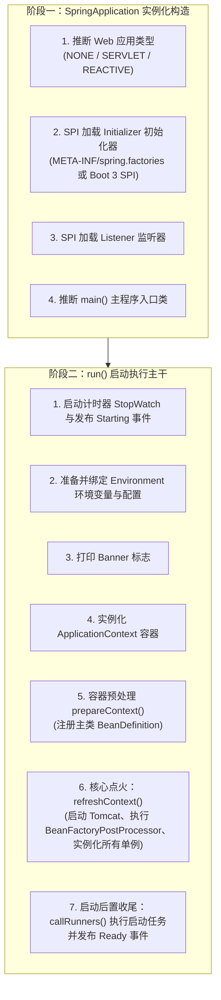
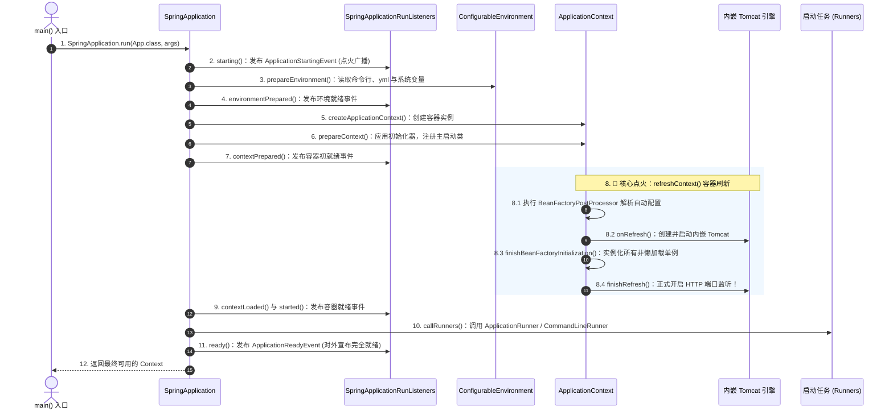
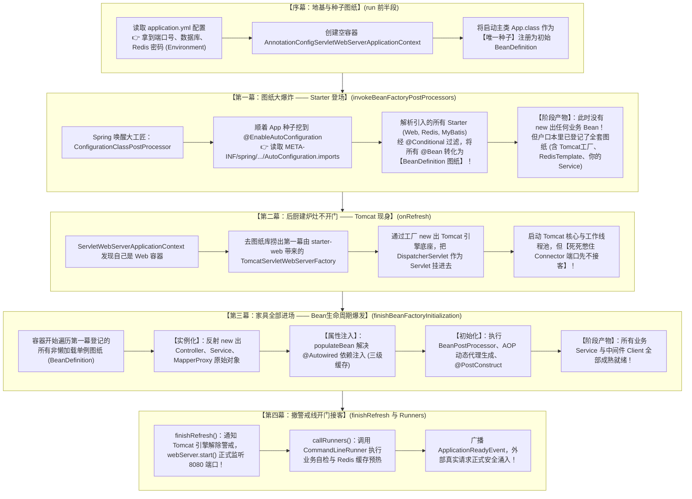
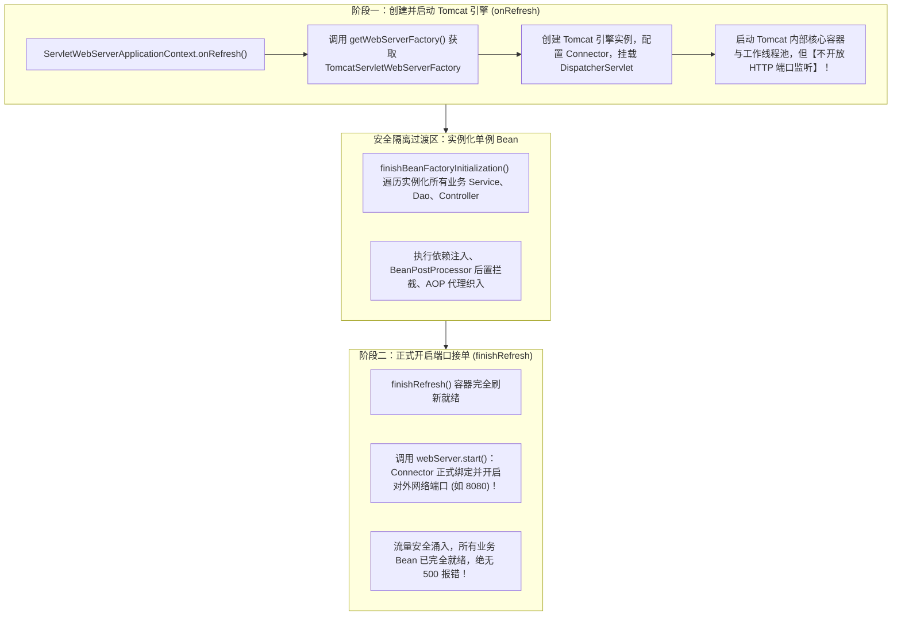
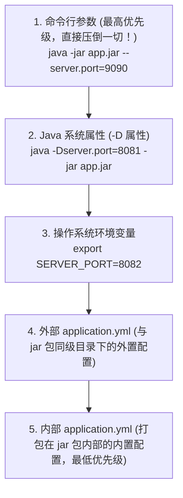

# 🚀 10 · SpringBoot 启动流程与生命周期扩展（从火箭点火到底层时序）

> **一句话导读**：看似普普通通的一行 `SpringApplication.run(App.class, args)`，背后却经历了一场精密绝伦的“重型火箭自检、燃料加注与点火升空”。为什么 Tomcat 会延迟到最后才开放端口？为什么有些事件监听器无法注入 `@Autowired`？搞懂这 7 大核心阶段与生命周期扩展点，你就能在底层全面掌控 Spring Boot 应用的生命搏动。

---

## 🧭 知识全景：Spring Boot 启动两大阶段与七大事件



---

## 🏃 启动主干全景时序：三大步与两大阶段

Spring Boot 的启动严格划分为两大物理阶段：**实例化阶段（Constructor）** 和 **运行阶段（`run()`）**。

### 1. 阶段一：`new SpringApplication(primarySources)` 构造阶段

在执行 `run()` 之前，首先会在内存中构造 `SpringApplication` 实例，完成四件关键自检：
1. **推断 Web 运行环境类型（`WebApplicationType`）**：
   - 通过 `ClassUtils.isPresent()` 探测类路径下的特征类：
     - 若类路径下存在 `DispatcherHandler` 且不存在 `DispatcherServlet`，推断为 **`REACTIVE`**（WebFlux 环境）；
     - 若不存在 `Servlet` 或 `ConfigurableWebApplicationContext`，推断为 **`NONE`**（纯后台非 Web 应用，如离线批处理任务）；
     - 否则默认推断为 **`SERVLET`**（传统的 Spring MVC / Tomcat 阻塞环境）。
2. **加载 `ApplicationContextInitializer`（容器初始化器）**：
   - 通过 Spring SPI 机制检索类路径下所有候选初始化器并实例化，用于在容器刷新的早期执行自定义回调。
3. **加载 `ApplicationListener`（全局事件监听器）**：
   - 检索并缓存所有监听器实例，为后续在启动生命周期各个节点发布广播事件做好准备。
4. **推断 `main()` 入口类**：
   - 分析当前线程的调用栈 `new RuntimeException().getStackTrace()`，逆向寻找包含 `main` 方法的顶层执行类。

---

### 2. 阶段二：`run(args)` 核心运行阶段逐帧拆解



1. **准备运行监听器（`SpringApplicationRunListeners`）**：
   - 它是整个启动事件广播的指挥官，聚合了所有注册的监听器，负责在启动的各个节点发出标准事件广播。
2. **构建并配置 Environment（环境变量）**：
   - 提取并整合命令行参数（`CommandLinePropertySource`）、系统环境变量、`application.yml` / `application.properties` 配置；
   - 对外广播 `ApplicationEnvironmentPreparedEvent`。
3. **创建容器实例（`createApplicationContext`）**：
   - 根据之前推断的 Web 类型，通过反射实例化对应的容器：
     - `SERVLET` 环境：实例化 `AnnotationConfigServletWebServerApplicationContext`；
     - `REACTIVE` 环境：实例化 `AnnotationConfigReactiveWebServerApplicationContext`；
     - `NONE` 环境：实例化标准的 `AnnotationConfigApplicationContext`。
4. **容器预处理（`prepareContext`）**：
   - 为容器设置 `Environment`；
   - 依次调用先前加载的所有的 `ApplicationContextInitializer` 的 `initialize()` 方法；
   - 将主启动类（如 `App.class`）作为最初始的 `BeanDefinition` 注入容器，为后续的 `@ComponentScan` 和 `@EnableAutoConfiguration` 埋下解析根基。
5. **容器核心刷新（`refreshContext`）**：
   - 委托底层执行 `AbstractApplicationContext.refresh()`，完成 Spring 体系最繁重的解析、初始化、AOP 织入以及 Tomcat 启动。
6. **执行启动任务（`callRunners`）**：
   - 检索并依次执行容器中注册的所有 `ApplicationRunner` 和 `CommandLineRunner` 实现类，用于执行缓存预热、RPC 连通性自检等预加载任务。
7. **发布完全就绪事件**：
   - 广播 `ApplicationReadyEvent`，对外宣告服务正式接单。

---

## ⚙️ 核心大一统：Starter 加载、Tomcat 启动与 Bean 生命周期是如何齿轮咬合的？

初学者在学完前面章节后，往往觉得各个知识点是孤立的碎片：Starter 讲 `imports` 文件，IoC 讲生命周期四步曲，Tomcat 讲 `onRefresh`。
**实际上，Spring Boot 的启动核心 `refreshContext()` 就是一条环环相扣的精密生产流水线，前一步的输出，恰恰是后一步的原材料：**

### 1. 三大核心技术的齿轮咬合图



### 2. 四幕大戏逐层深度剖析

#### 序幕：准备好地基与一张“种子图纸”
- `run()` 一跑起来，先将 `application.yml` 解析并存入 **`Environment`**（没有端口号和数据库密码，后续一切都无法配置）；
- 反射创建空容器实例（如 `AnnotationConfigServletWebServerApplicationContext`）；
- 将主类 `App.class` 注册为第一张 `BeanDefinition`。

#### 第一幕：Starter 到底是在什么时候、怎么加载的？
- **触发时机**：容器刷新之 **`invokeBeanFactoryPostProcessors()`**。
- **咬合过程**：
  1. Spring 激活核心处理器 **`ConfigurationClassPostProcessor`**（它本身是一个 `BeanDefinitionRegistryPostProcessor`）；
  2. 它从种子图纸 `App.class` 上解析出 `@SpringBootApplication` 包含的 `@EnableAutoConfiguration`；
  3. 顺藤摸瓜检索类路径下的 `AutoConfiguration.imports` 文件（我们在【05-Starter 机制】学到的核心文件）；
  4. 遍历所有候选自动配置类，利用 `@ConditionalOnClass` 等条件注解进行过滤；
  5. 将符合条件的自动配置类及其内部的所有 `@Bean` 方法，**全部转化为 `BeanDefinition`（Bean 定义图纸）注册到容器中**！
- **关键心智**：在这一幕结束时，**容器里连一个业务对象都还没有 new 出来**！它仅仅是将 Starter 里的图纸和你自己写的 `@Service` 图纸全部收集齐全，整齐登记在册。

#### 第二幕：Tomcat 到底是谁造出来的？什么时候诞生的？
- **触发时机**：容器刷新之 **`onRefresh()`**。
- **咬合过程**：
  1. 在第一幕中，`spring-boot-starter-web` 已经将 `ServletWebServerFactoryConfiguration` 里的 **`TomcatServletWebServerFactory`** 作为图纸登记在册；
  2. 主线走到 `onRefresh()` 模板方法，Spring 发现自己是 Web 容器，必须搭建底层 Web 引擎；
  3. 于是从容器中获取该工厂 Bean，**通过工厂 `new` 出了底层的内嵌 Tomcat 对象**；
  4. 创建 Tomcat 引擎、挂载虚拟主机，并将同样是 Spring Bean 的 **`DispatcherServlet`** 注册为 Servlet；
  5. **安全隔离防线**：启动 Tomcat 核心容器与线程池，但**死死憋住 Connector 网络端口，绝不对外开放监听**！

#### 第三幕：你学过的“Bean 生命周期四步曲”，在哪个齿轮里转动？
- **触发时机**：容器刷新之 **`finishBeanFactoryInitialization()`**。
- **咬合过程**：
  1. 此时底层 Tomcat 引擎已搭建完毕，Spring 终于腾出手来处理业务对象；
  2. 容器循环遍历第一幕登记的所有非懒加载单例 `BeanDefinition`；
  3. **实例化（Instantiation）**：通过反射把你的 `UserService`、`OrderController`、以及 Starter 带来的 `RedisTemplate` **真正 `new` 出堆内内存对象**；
  4. **属性填充（PopulateBean）**：解决 `@Autowired` 依赖注入（若存在相互引用，通过我们在【13-三级缓存】学到的半成品暴露来破解循环依赖）；
  5. **初始化（Initialization）**：
     - 调用 `@PostConstruct` 与 `afterPropertiesSet()`；
     - 触发在【02-AOP 原理】学到的 **`BeanPostProcessor`**（如 `AnnotationAwareAspectJAutoProxyCreator`），在这一瞬间将目标 Bean 掉包替换为 **CGLIB / JDK 动态代理对象**！
- **核心顿悟**：**这就是为什么第二幕的 Tomcat 绝不能提前开门接客！** 此时所有的 Service、Controller 正在紧锣密鼓地经历生命周期四步曲，一旦外界请求提前进来，由于依赖注入和代理尚未完成，必将遭遇大面积 `NullPointerException`！

#### 第四幕：开门迎客与业务自检
- **触发时机**：容器刷新之 **`finishRefresh()`** 与后续 **`callRunners()`**。
- **咬合过程**：
  1. **Tomcat 延迟开门**：所有单例 Bean 与 AOP 代理全部就绪，Spring 正式调用 Tomcat 的 `webServer.start()`，**物理端口（如 8080）正式开闸对外监听**；
  2. **执行业务 Runner**：调用开发者实现的 `CommandLineRunner` / `ApplicationRunner`，此时数据库连接池、Redis 客户端全已成熟，可以安全执行缓存预热或 RPC 注册；
  3. **广播就绪事件**：发布 `ApplicationReadyEvent`，K8s 就绪探针检测通过，流量平滑涌入。

### 3. 四大核心概念因果闭环矩阵

| 核心模块 | 它在启动中的具体环节 | 它的上游输入是什么？（因） | 它给下游的产物是什么？（果） |
| :--- | :--- | :--- | :--- |
| **Starter 自动配置** | 第一幕：`invokeBeanFactoryPostProcessors` | 读取 `application.yml` 与 `imports` 配置文件 | 解析出大量 `@Bean`，转化为 **`BeanDefinition` 图纸** 存入注册表。 |
| **内嵌 Tomcat 引擎** | 第二幕：`onRefresh()` | 依据 Starter 带来的 Web 工厂图纸进行构建 | 搭建好 Web 底座并挂载 `DispatcherServlet`，但先不开放网络端口。 |
| **Bean 生命周期 (四步曲)** | 第三幕：`finishBeanFactoryInitialization` | 遍历第一幕产生的所有 `BeanDefinition` 图纸 | 反射 `new`、`@Autowired` 属性填充、AOP 动态代理织入，产生成熟单例。 |
| **端口开放与业务预热** | 第四幕：`finishRefresh()` 与 `callRunners()` | 所有成熟的单例 Bean 与就绪的 Tomcat 底座 | Tomcat 正式开启 8080 端口，执行 Runner 业务预热，对外接单。 |

---

## 📢 深入大厂必考：7 大启动生命周期事件时序与分界线

在整个启动链路中，Spring Boot 会按严格的时序对外广播 7 个核心生命周期事件：

1. **`ApplicationStartingEvent`（火箭刚点火）**：
   - 触发时机：`run()` 方法刚开始执行，此时除了监听器之外，环境（Environment）和容器（Context）都**尚未建立**。
2. **`ApplicationEnvironmentPreparedEvent`（环境已就绪）**：
   - 触发时机：配置属性和环境变量加载完毕，但**容器仍未创建**。
   - 典型用途：在最早期拦截或动态解密 `application.yml` 中的敏感数据库密码。
3. **`ApplicationContextInitializedEvent`（容器刚诞生）**：
   - 触发时机：容器对象实例化完成，并在调用完 `ApplicationContextInitializer` 之后触发，此时 Bean 尚未加载。
4. **`ApplicationPreparedEvent`（施工图纸就位）**：
   - 触发时机：主类的 `BeanDefinition` 刚刚注册进容器，但**尚未执行 `refresh()` 刷新，业务 Bean 尚未被实例化**。
5. **`ApplicationStartedEvent`（容器刷新完毕）**：
   - 触发时机：`refreshContext()` 顺利完成，所有单例 Bean 实例化完毕，内嵌 Tomcat 已经启动。
6. **`ApplicationReadyEvent`（完全就绪）**：
   - 触发时机：所有的 `ApplicationRunner` 运行完毕，应用处于可以对外接收业务流量的最成熟状态。
7. **`ApplicationFailedEvent`（启动异常坠毁）**：
   - 触发时机：启动期间发生任何未捕获的异常时触发，可在此捕获异常并向监控平台发送紧急告警。

> 🚨 **高频翻车陷阱：为什么在某些监听器里无法 `@Autowired` 注入 Service？**
> - **根本原因**：`ApplicationStartingEvent` 和 `ApplicationEnvironmentPreparedEvent` 触发时，**Spring 容器根本还没创建**，更不用说单例 Bean 了！
> - 如果监听这两个早期事件，监听器只能作为纯原生类通过 `SpringFactoriesLoader` 注册加载，绝对无法依赖注入任何 Spring 托管组件！

---

## 🔬 终极硬核揭秘：内嵌 Tomcat 是如何分阶段启动与延迟开放端口的？

很多人以为 Tomcat 是在 `refreshContext()` 中一次性直接跑起来并对外开放的，其实不然。
**Spring Boot 在这里设计了一个极其精密的高可用“两阶段启动防火墙”：**



1. **为什么不在 `onRefresh()` 阶段就开放端口？**
   - 如果在 `onRefresh()` 阶段就绑定并监听 8080 端口，外部流量（或者前端请求、探针探测）可能会在下一毫秒立即涌入；
   - 但此时容器的 `finishBeanFactoryInitialization()` **根本还没执行**！所有的业务 Service、Dao 都是 `null`；
   - 导致最先到达的一批用户请求由于找不到对应 Bean 直接发生 `NullPointerException` 或大面积报 `500 / 503`！
2. **Spring Boot 的解法（延迟开门）**：
   - 在 `onRefresh()` 中完成底座的初始化与装配；
   - 只有当全部单例 Bean 都实例化完毕、AOP 动态代理织入全部就绪、容器顺利进入 `finishRefresh()` 时，才正式命令 Connector 监听物理网络端口！

---

## 🔄 SPI 机制的代际演进：Spring Boot 2.x vs 3.x

在组件自动发现（SPI）的机制上，Spring Boot 经历了一次关键的架构解耦演进：

### 1. 代际分工对比：从“大一统杂烩”到“动静分流”

1. **Spring Boot 2.x：`META-INF/spring.factories` 大一统**：
   - 所有的初始化器、监听器、环境处理器以及成百上千个自动配置类，全部塞在同一个 `spring.factories` 键值对文件中；
   - **痛点**：启动时 `SpringFactoriesLoader` 必须全量解析这个庞大的 Properties 文件；随着生态膨胀，单文件解析极慢，且对 GraalVM 原生镜像（AOT）编译极不友好。
2. **Spring Boot 3.x：动静专职分流（各司其职）**：
   - **自动配置类（90% 大头）独立搬家**：
     - 剥离至：`META-INF/spring/org.springframework.boot.autoconfigure.AutoConfiguration.imports`；
     - 每行一个全限定类名，专供 `@EnableAutoConfiguration` 底层的 `ImportCandidates` 极速索引，天然适配 GraalVM 静态分析。
   - **初始化器与监听器（底层系统级 Hook）保留在 `spring.factories`**：
     - **`spring.factories` 并没有被废除，而是大幅瘦身**！
     - `ApplicationContextInitializer`（容器初始化器）、`SpringApplicationRunListener`（运行过程监听器）、`ApplicationListener`（系统监听器）以及 `EnvironmentPostProcessor`（环境后置处理器）等极早期组件，**依然保留在 `META-INF/spring.factories` 中**；
     - **底层原因**：这些组件在 Spring 容器还没创建的极早期阶段就需要被 `SpringFactoriesLoader` 加载，数量少（通常仅几个到十几个），保留原机制能确保底层引导时序绝对稳定。

### 2. 生产实战：初始化器与监听器的 3 种注册姿势

如果你在自研 Starter 或业务中需要使用 `ApplicationContextInitializer` 或 `ApplicationListener`，有以下标准途径：

1. **SPI 文件注册（Starter 推荐，零侵入）**：
   - 在 `src/main/resources/META-INF/spring.factories` 中按需声明：
     ```properties
     # 注册容器初始化器
     org.springframework.context.ApplicationContextInitializer=com.example.MyContextInitializer
     # 注册系统监听器
     org.springframework.context.ApplicationListener=com.example.MyApplicationListener
     ```
2. **配置文件声明（业务项目极简推荐）**：
   - 在 `application.yml` 里直接指定，无需创建 SPI 目录：
     ```yaml
     context:
       initializer:
         classes: com.example.MyContextInitializer
       listener:
         classes: com.example.MyApplicationListener
     ```
3. **启动类编程式注册（动态或硬编码注入）**：
   - 在 `main` 方法中显式添加：
     ```java
     SpringApplication app = new SpringApplication(MyApplication.class);
     app.addInitializers(new MyContextInitializer());
     app.addListeners(new MyApplicationListener());
     app.run(args);
     ```
   - *(注：若仅监听容器刷新后的晚期事件如 `ContextRefreshedEvent`、`ApplicationReadyEvent`，也可以直接在类上标注 `@Component` 或使用 `@EventListener`)*。

---

## ⚡ 企业级微服务启动提速实战策略

随着企业微服务业务不断膨胀，工程的启动时间往往会从 10 秒恶化到数分钟。以下是生产级的优化手段：

1. **开启全局按需懒加载（`Lazy Initialization`）**：
   - 在 `application.yml` 中配置：
     ```yaml
     spring:
       main:
         lazy-initialization: true # 开启单例 Bean 全局懒加载
     ```
   - **原理**：启动时不预先实例化所有单例 Bean，而是推迟到首次通过 HTTP 请求调用该 Bean 时才动态加载。
   - **收益与权衡**：
     - **优点**：本地开发调试和单元测试启动速度提升 50%~80%；
     - **生产警告**：生产环境核心交易服务慎用！因为这会导致第一次请求因现场实例化 Bean 而出现明显的响应毛刺（P99 延迟暴增），甚至由于某些配置错误直到运行时才暴露。
2. **排除非必要自动配置项**：
   - 检查并排除未使用的出厂配置：
     ```java
     @SpringBootApplication(exclude = {
         DataSourceAutoConfiguration.class,
         RabbitAutoConfiguration.class
     })
     ```
3. **定位慢 Bean 启动排查工具（Spring Startup Actuator）**：
   - 引入 `org.springframework.boot:spring-boot-starter-actuator` 并开启 `startup` 端点；
   - 使用 `BufferingApplicationStartup` 收集启动耗时并输出火焰图，精准揪出初始化耗时超过 2 秒的毒瘤 Bean。

---

## 📜 生产高频避坑：配置属性覆盖优先级法则

面试和运维最容易遇到的抓狂问题：“为什么我在 `application.yml` 里改了端口，启动后它依然读的是旧端口？”
因为 Spring Boot 有一套严格的配置覆盖金字塔：



> [!TIP]
> **线上运维救急神技**：
> 生产环境临时修改某个配置，**完全不需要重新打 jar 包上传**！直接在启动命令的最后加上 `--配置项名=新值`，就可以以最高优先级瞬间覆盖配置文件里的默认值！

---

## 🧠 一分钟复盘核心记忆卡

1. **两大阶段**：
   - 构造阶段推断 Web 类型与加载 SPI 监听器；`run()` 阶段建环境、造容器、刷容器、调 Runner。
2. **事件与时序边界**：
   - `ApplicationStartingEvent` 与 `EnvironmentPreparedEvent` 发生时**容器尚未创建**，绝不能依赖注入 Bean。
3. **Tomcat 启动玄机**：
   - `onRefresh()` 搭建引擎，`finishRefresh()` 延迟开放端口，防止未熟 Bean 引发流量穿透报错。
4. **启动提速利器**：
   - 本地调试启用 `lazy-initialization`，生产结合 Actuator Startup 端点精确定位耗时瓶颈。

---

## 🧭 下一步

搞懂了应用是如何从零启动、加载环境与初始化容器后，高并发系统面对耗时操作（如导出、外部调用、日志审计）时，绝不能长时间阻塞 Tomcat 工作线程，必须引入异步化并发调度。
Spring 提供的 `@Async` 声明式异步底层原理是什么？为什么直接使用 `@Async` 会暗藏 `SimpleAsyncTaskExecutor` 无界创建线程把内存打爆的致命陷阱？跨线程时 MDC 日志追踪链路（TraceId）丢失如何解决？
请继续攻克第三关核心进阶：[[15-Spring异步与线程池体系]]！
