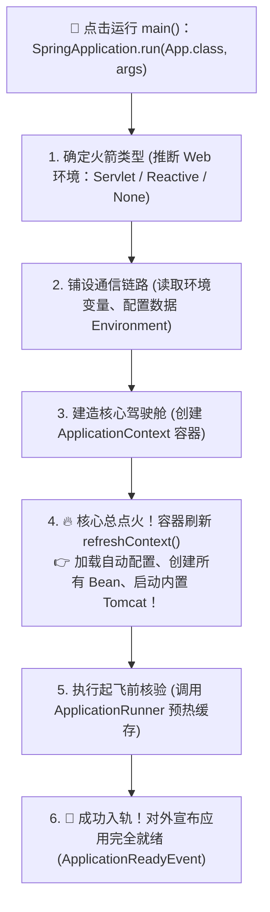
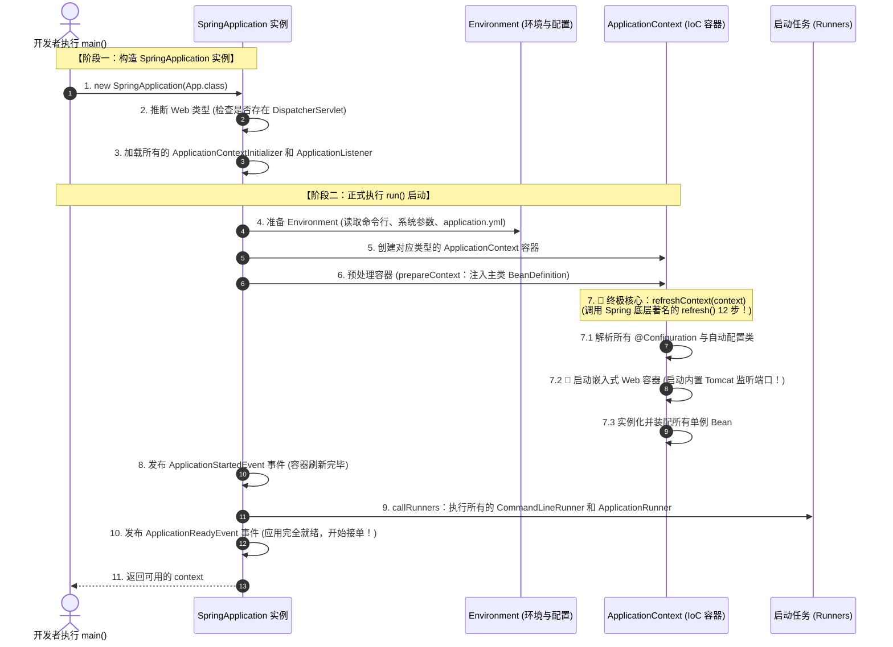
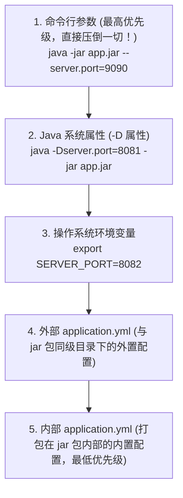

# 🚀 10 · SpringBoot 启动流程（火箭点火升空与 run() 核心拆解）

> **一句话导读**：看似普普通通的一行 `SpringApplication.run(App.class, args)`，背后却经历了一场精密绝伦的**“重型火箭自检与点火升空”**。搞懂这 12 步启动时序，Spring Boot 的底层生命节拍与扩展点你便能了然于胸。

---

## 🏛️ SpringApplication.run() 核心启动流程宏观全景

你在 `main` 方法中敲下的那一行代码，就像发射基地指挥长按下了**总点火按钮**：



---

## 🏃 启动核心生命节拍（大厂面试满分链路）

整个启动过程严密划分为 **两大阶段、六大步骤**：



---

## 🔬 终极核心拆解：refresh() 里到底干了啥惊天动地的事？

在第 7 步 `refreshContext()` 中，Spring Boot 委托调用了 Spring 底层最著名的 **`AbstractApplicationContext.refresh()`** 方法。
这是 Spring 整个框架中最繁重、最核心的“心脏搏动点”：

1. **`invokeBeanFactoryPostProcessors`**：
   - 执行工厂后置处理器。我们在前面学到的 **`@ComponentScan` 扫描、`@EnableAutoConfiguration` 自动配置类解析**，全都在这一步彻底执行完成！所有的施工图纸（BeanDefinition）在这一刻全部就位！
2. **`registerBeanPostProcessors`**：
   - 注册所有的 `BeanPostProcessor`（也就是后面负责为 Bean 生成 AOP 动态代理的监理们全部就位！）。
3. **`onRefresh()`（🌟 Spring Boot 的神来之笔！）**：
   - 传统的 Spring 这里是空的；
   - **Spring Boot 在这里直接启动了内置的 Tomcat / Netty 服务器！**
   - 不再需要把 war 包放到外部的 Tomcat 目录下，项目直接内嵌服务器化身独立自包含进程！
4. **`finishBeanFactoryInitialization`**：
   - 将容器中所有的非懒加载单例 Bean 真正实例化（调用构造方法、属性填充、初始化方法、AOP 代理织入）。

---

## 🏃 启动扩展点：ApplicationRunner 与 CommandLineRunner

很多时候，我们希望在**项目完全启动好的一瞬间，自动执行一些预处理工作**（比如：把热点字典数据提前加载进 Redis 缓存、建立 MQ 消费者长连接）。

Spring Boot 提供了两个开箱即用的“起飞核验”接口：

```java
import org.springframework.boot.ApplicationArguments;
import org.springframework.boot.ApplicationRunner;
import org.springframework.boot.CommandLineRunner;
import org.springframework.core.annotation.Order;
import org.springframework.stereotype.Component;

// 方式一：CommandLineRunner (入参是原始 String[] 数组)
@Component
@Order(1) // 控制执行顺序，数字越小越先执行
public class WarmUpCacheRunner implements CommandLineRunner {
    @Override
    public void run(String... args) {
        System.out.println("🔥 [Runner 1] 项目启动完成，开始预热 Redis 基础缓存...");
    }
}

// 方式二：ApplicationRunner (入参是封装好的高级 ApplicationArguments 对象，推荐！)
@Component
@Order(2)
public class InitSystemCheckRunner implements ApplicationRunner {
    @Override
    public void run(ApplicationArguments args) {
        System.out.println("🔍 [Runner 2] 检查远程微服务与数据库连通性...");
    }
}
```

> 💡 **两者的唯一区别**：
> 功能完全一致，区别仅在于**入参解析方式**：
> `CommandLineRunner` 只能拿到原汁原味的原始参数数组 `String[] args`；
> `ApplicationRunner` 帮你把参数智能解析成了诸如 `--server.port=8080` 的 `OptionValues`，更易于提取键值对。

---

## 📜 生产高频避坑：配置属性覆盖优先级法则

面试和运维最容易遇到的抓狂问题：“为什么我在 `application.yml` 里改了端口，启动后它依然读的是旧端口？”
**因为 Spring Boot 有一套严格的配置覆盖金字塔：**



> [!TIP]
> **线上运维救急神技**：
> 生产环境临时修改某个配置，**完全不需要重新打 jar 包上传**！直接在启动命令的最后加上 `--配置项名=新值`，就可以以最高优先级瞬间覆盖配置文件里的默认值！

---

## 🧠 一分钟复盘核心记忆卡

1. **两大阶段**：构造阶段（推断 Web 类型、加载监听器） + `run()` 阶段（准备环境、建容器、刷新容器、调 Runner）。
2. **核心脉搏**：`refreshContext()` 内部启动内嵌 Tomcat，完成自动配置解析与单例 Bean 实例化。
3. **启动钩子**：预热缓存与业务初始化，使用 `@Order` 排序的 `ApplicationRunner`。

---

## 🧭 下一步

掌握了现代单体 Spring Boot 的全套魔法，当业务飞速扩张，单体应用拆分为成百上千个微服务时，服务间如何互相发现？流量如何负载均衡？网络故障如何熔断？
请进入第四关：[[08-SpringCloud组件概览]]！
