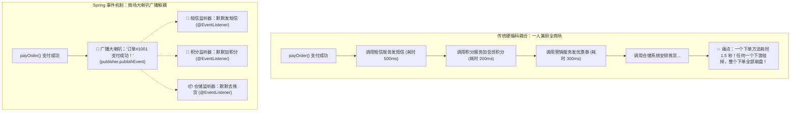
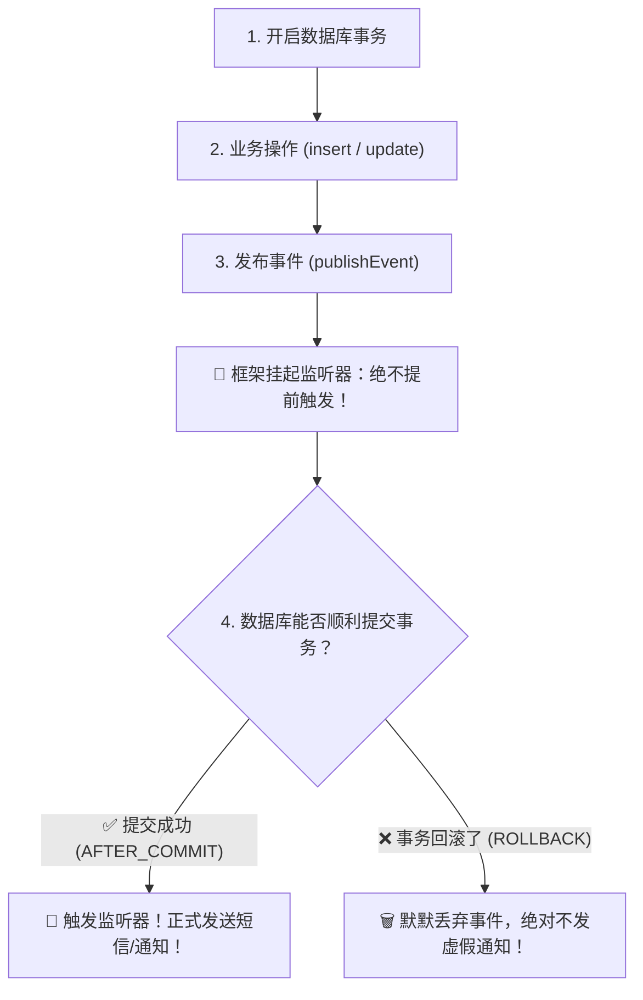

# 📢 11 · Spring 事件机制（商场大喇叭广播与事务后监听）

> **一句话导读**：不想让订单服务被发短信、送积分、通知物流等杂事拖慢？Spring 事件机制就像商场里的**“全楼层广播大喇叭”**。掌握同步/异步监听与事务提交后监听（`AFTER_COMMIT`），你就能轻松实现优雅的高内聚低耦合架构。

---

## 🏛️ 为什么需要事件机制？（解耦与异步监听）

在电商系统里，用户“支付成功”后通常会引发一系列连锁反应：



> 💡 **核心优势**：
> 核心交易业务只负责发布事实（“发生了什么”），下游各辅助系统自主订阅，互不干扰！符合软件架构的**开闭原则（对扩展开放，对修改关闭）**。

---

## 💻 极简三步法：实现进程内事件发布与订阅

在现代 Spring 框架中，使用事件机制极其清爽，甚至**不需要继承任何特殊的基类接口**！

### 1. 第一步：定义一个普通的 POJO 事件对象
```java
// 纯普通的 Java Record 或 Class，代表事件载荷（Payload）
public record OrderPaidEvent(long orderId, String username, double amount) {}
```

### 2. 第二步：在业务方发布事件
```java
import org.springframework.context.ApplicationEventPublisher;
import org.springframework.stereotype.Service;

@Service
public class PaymentService {
    // 注入 Spring 自带的事件发布器
    private final ApplicationEventPublisher eventPublisher;

    public PaymentService(ApplicationEventPublisher eventPublisher) {
        this.eventPublisher = eventPublisher;
    }

    public void pay(long orderId) {
        System.out.println("1. 核心支付业务成功，修改数据库状态...");
        
        // 📢 向整个 Spring 容器广播事件！
        eventPublisher.publishEvent(new OrderPaidEvent(orderId, "张三", 99.9));
        
        System.out.println("2. 支付主流程继续...");
    }
}
```

### 3. 第三步：监听器接收事件
```java
import org.springframework.context.event.EventListener;
import org.springframework.stereotype.Component;

@Component
public class NotificationListener {

    @EventListener
    public void sendSms(OrderPaidEvent event) {
        System.out.println("📩 短信服务：已成功向用户 [" + event.username() + "] 发送支付成功通知！");
    }

    @EventListener
    public void addPoints(OrderPaidEvent event) {
        System.out.println("🎁 积分服务：为订单 [" + event.orderId() + "] 成功累加积分！");
    }
}
```

---

## ⚡ 默认是同步执行！想要异步提速怎么办？

很多新手以为发布了事件就会像 MQ 一样自动异步跑。
**🚨 警惕：Spring 的 `publishEvent()` 默认是 100% 同步执行的！**
- 也就是说：发布事件的当前主线程，会挨个把所有 `@EventListener` 方法都跑完了，才会从 `publishEvent` 往下走！
- 如果发短信方法睡了 3 秒，主业务也会在这里生生卡住 3 秒！

### 🚀 异步改造解药：配合 `@Async`
只要在监听器方法上加上 `@Async`（并在主配置类上开启 `@EnableAsync`），该监听器就会自动被丢进指定的线程池中**异步并发执行**，主业务丝毫不受拖累：

```java
@Component
public class AsyncNotificationListener {

    @Async("bizThreadPool") // 使用自定义的业务专属线程池
    @EventListener
    public void sendSmsAsync(OrderPaidEvent event) {
        // 耗时的远程发短信操作，完全不会卡住主线程！
        callExternalSmsGateway(event.username());
    }
}
```

---

## 💣 生产翻车大案：事务还没提交，短信先飞出去了！

在真实业务中，最让人吐血的 Bug 往往发生在**事务与事件的结合处**：

```java
@Service
public class OrderService {
    @Transactional
    public void createOrder(long orderId) {
        // 1. 插入订单记录
        orderDao.insert(orderId);
        
        // 2. 在事务内部广播了事件！
        eventPublisher.publishEvent(new OrderPaidEvent(orderId, ...));
        
        // 3. 模拟后续执行报错（比如扣库存失败抛出异常）
        if (true) {
            throw new RuntimeException("库存不足，下单失败！");
        }
    }
}
```

### 😱 事故复盘：
1. 步骤 2 广播了事件，异步监听器立刻把短信发给了用户：“**恭喜您，订单#1001 支付成功！**”；
2. 结果步骤 3 抛出异常，整个方法触发事务回滚，数据库里的订单**彻底被撤销了**！
3. **严重后果**：用户兴高采烈收到了扣款成功的短信，打开 APP 一看却根本没有订单！客诉直接打爆，面临虚假宣传甚至赔偿风险！

---

## 🛡️ 终极解药：`@TransactionalEventListener`（事务提交后再发通知）

Spring 为这种场景量身定制了**事务专属事件监听器**：



### 💻 完美避坑实战代码

```java
import org.springframework.stereotype.Component;
import org.springframework.transaction.event.TransactionPhase;
import org.springframework.transaction.event.TransactionalEventListener;

@Component
public class SafeOrderListener {

    // 🌟 生产王牌配置：只有在事务完全提交成功之后，才触发此监听器！
    @TransactionalEventListener(phase = TransactionPhase.AFTER_COMMIT)
    public void onOrderCommitted(OrderPaidEvent event) {
        System.out.println("✅ 数据库事务确认成功提交！开始向用户发短信: " + event.orderId());
    }
}
```

### 4 大事务监听阶段（TransactionPhase）：
- **`AFTER_COMMIT`（默认且最常用）**：事务成功提交后触发（发通知、清理缓存的最佳时机）。
- **`AFTER_ROLLBACK`**：事务回滚后触发（记录失败补偿日志）。
- **`BEFORE_COMMIT`**：事务准备提交前触发（做最后的校验）。
- **`AFTER_COMPLETION`**：无论提交还是回滚，事务结束后都触发。

---

## 🚨 生产高危暗礁：在 AFTER_COMMIT 里写数据库为什么会静默失效？

这是许多即使有多年开发经验的工程师也经常翻车的**致命隐蔽坑**：

```java
@Component
public class SafeOrderListener {

    @TransactionalEventListener(phase = TransactionPhase.AFTER_COMMIT)
    public void onOrderCommitted(OrderPaidEvent event) {
        // 🚨 翻车！这里的写操作根本不会被保存进数据库！甚至完全不报错！
        orderLogDao.insertLog(new OrderLog(event.orderId(), "支付成功"));
    }
}
```

> 🔬 **逐帧死因解剖**：
> 1. `AFTER_COMMIT` 的触发时机是：**主事务的数据库连接刚刚执行完了 `conn.commit()`！**
> 2. 此时，当前线程绑定的数据库连接已经关闭或处于“事务已完成态”；
> 3. 如果监听器方法没有加事务，或者使用了默认的 `@Transactional(propagation = Propagation.REQUIRED)`，Spring 认为当前已经存在事务，**但这个事务早就已经 commit 关闭了，根本无法再执行新的 commit！**
> 4. 导致你在监听器里执行的 `INSERT` 语句**默默变成了无主孤魂，数据永远无法持久化落盘！**
> 
> 🛡️ **两大工业级解药**：
> 1. **开辟全新独立事务**：显式加上新事务传播级别：
>    ```java
>    @Transactional(propagation = Propagation.REQUIRES_NEW)
>    @TransactionalEventListener(phase = TransactionPhase.AFTER_COMMIT)
>    public void onOrderCommitted(OrderPaidEvent event) { ... }
>    ```
> 2. **异步新线程执行（强推）**：加上 `@Async`，让监听器在全新的线程栈中拥有干净独立的连接与事务上下文：
>    ```java
>    @Async
>    @TransactionalEventListener(phase = TransactionPhase.AFTER_COMMIT)
>    public void onOrderCommitted(OrderPaidEvent event) { ... }
>    ```

---

## ⚖️ 架构选型：Spring 事件机制 vs 外部专业 MQ

很多同学问：“既然 Spring 事件这么好用，那我们为什么还要费劲搭建 RocketMQ / Kafka / RabbitMQ 呢？”

| 选型对比 | Spring 内置事件机制 | 外部专业消息队列（MQ） |
| :--- | :--- | :--- |
| **部署成本** | **零成本**（无需搭建任何中间件，进程内即用） | 需要搭建独立的集群与运维监控 |
| **应用边界** | **仅限单体 JVM 进程内部** | **跨微服务、跨系统、跨网络解耦** |
| **消息持久化** | ❌ **无持久化**（应用宕机或重启，内存中的事件全部丢失） | ✅ **高可靠落盘**（支持百万级消息堆积与持久化） |
| **重试与死信** | 不自带重试，异常直接抛出 | 支持指数退避重试、死信队列（DLQ）、定时消息 |
| **适用场景** | 模块内解耦、缓存局部更新、单体服务轻量级通知 | 核心交易削峰填谷、分布式系统最终一致性、跨团队通信 |

---

## 🧠 一分钟复盘核心记忆卡

1. **核心定位**：进程内的轻量级发布-订阅模式，彻底解放高耦合的业务代码。
2. **执行模型**：默认同步，配合 `@Async` 走向异步多线程。
3. **事务结合**：**强推 `@TransactionalEventListener(AFTER_COMMIT)`**，确保数据库真正落盘后再发外界通知，杜绝虚假消息事故。

---

## 🧭 下一步

第一关的底层基石（IoC、Bean 生命周期、三级缓存、AOP、事务、事件）我们已经全部攻破！
接下来，我们将进入第二关——**Web 与持久层工业利器**。
第一站，就是处理千万级 HTTP 请求的大门枢纽——**`SpringMVC` 的 11 步就医调度链路**！
请进入下一篇：[[06-SpringMVC请求处理流程]]！
