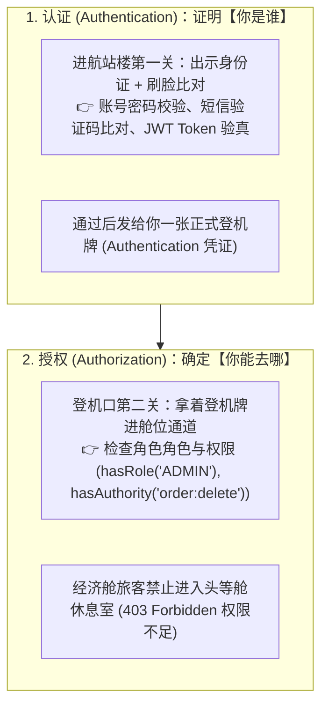
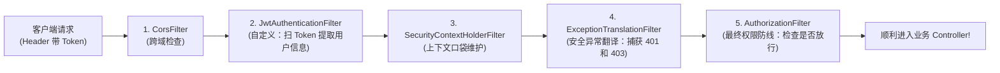

# 🛂 12 · Spring Security（机场多道安检门与无状态 JWT 实战）

> **一句话导读**：觉得 Spring Security 像天书般复杂？那是因为你被几十个长相相似的英文单词吓退了。它的本质就是一套**“国际机场的多道安检过滤流水线”**。搞懂“认证（你是谁）”与“授权（你能干什么）”，现代前后端分离安全架构便可手到擒来。

---

## ✈️ 核心心智模型：国际机场登机全流程

所有的系统安全，剥离到最底层其实就解决两个灵魂拷问：



- **认证（Authentication）**：你是谁？（如果查无此人，或者密码错了 -> 报 **`401 Unauthorized 未登录`**）。
- **授权（Authorization）**：虽然确认了你的身份，但你有没有资格碰这个接口？（没权限 -> 报 **`403 Forbidden 拒绝访问`**）。

---

## ⛓️ 核心骨架：SecurityFilterChain（多道安全过滤器流水线）

Spring Security 的所有拦截，完全是构建在 Servlet 的 **`Filter` 过滤器链** 之上的：



### 登机牌放在哪里？（`SecurityContextHolder`）
- 认证一旦通过，Spring Security 会把包含了用户身份、角色列表的 **`Authentication` 登机牌**，塞进 **`SecurityContextHolder`**。
- 底层用的正是我们在并发编程第 10 篇学到的 **`ThreadLocal`**！
- 这意味着在当前线程的任何 Service 或 Controller 里，随时都能一句代码拿到当前登录人：
  ```java
  Authentication auth = SecurityContextHolder.getContext().getAuthentication();
  String username = auth.getName(); // 拿到当前用户名
  ```

---

## 🔐 核心三剑客大白话对照表

| 核心组件 | 现实生活比喻 | 职责与功能 |
| :--- | :--- | :--- |
| **`UserDetailsService`** | **公安部全国户籍数据库** | 只有一个核心方法 `loadUserByUsername(String)`，负责根据用户名去数据库查出真实的密码密文和权限列表。 |
| **`UserDetails`** | **你的户籍档案卡** | 封装了用户的核心信息（用户名、加密后的密码、角色权限列表、账号是否被冻结）。 |
| **`PasswordEncoder`** | **高科技指纹/虹膜验真机** | 负责密码的加盐哈希加密与比对（**`BCryptPasswordEncoder`**），绝不存明文！ |
| **`AuthenticationManager`** | **机场安检大队长** | 统筹整个认证过程，委派具体的 Provider 进行密码核验。 |

---

## 🔒 为什么严禁用 MD5？认识强大的 BCryptPasswordEncoder

很多人以为用 `MD5(password)` 就很安全，其实早就有上百 GB 的“彩虹表”可以秒级反向破解！

现代工业界统一使用 **`BCrypt`** 算法：
1. **自带随机盐（Salt）**：同一个密码 `123456`，哪怕同一个用户连续加密两次，**生成的密文字符串完全不同**！彩虹表彻底失效！
2. **慢哈希防暴力穷举**：故意设计了 CPU 耗时计算（可配置迭代轮数），让黑客用显卡强行每秒试算上亿次密码的企图彻底破产。
3. **比对时**：通过 `passwordEncoder.matches(rawPassword, encodedPassword)`，从密文头部提取盐值再计算比对，安全可靠。

---

## 💻 现代前后端分离：Spring Boot 3 + JWT 无状态标准架构实战

在现代移动端和前后端分离开发中，我们**坚决废弃传统的 Cookie / Session 模式**，全面拥抱基于 **JWT Token** 的无状态架构：

### 1. 配置安全过滤链（`SecurityConfig.java`）

```java
import org.springframework.context.annotation.Bean;
import org.springframework.context.annotation.Configuration;
import org.springframework.security.authentication.AuthenticationManager;
import org.springframework.security.config.annotation.authentication.configuration.AuthenticationConfiguration;
import org.springframework.security.config.annotation.method.configuration.EnableMethodSecurity;
import org.springframework.security.config.annotation.web.builders.HttpSecurity;
import org.springframework.security.config.annotation.web.configurers.AbstractHttpConfigurer;
import org.springframework.security.config.http.SessionCreationPolicy;
import org.springframework.security.crypto.bcrypt.BCryptPasswordEncoder;
import org.springframework.security.crypto.password.PasswordEncoder;
import org.springframework.security.web.SecurityFilterChain;
import org.springframework.security.web.authentication.UsernamePasswordAuthenticationFilter;

@Configuration
@EnableMethodSecurity // 开启方法级别的精细化权限注解 (如 @PreAuthorize)
public class SecurityConfig {

    @Bean
    public PasswordEncoder passwordEncoder() {
        return new BCryptPasswordEncoder(); // 强推 BCrypt
    }

    @Bean
    public AuthenticationManager authenticationManager(AuthenticationConfiguration config) throws Exception {
        return config.getAuthenticationManager();
    }

    @Bean
    public SecurityFilterChain filterChain(HttpSecurity http, JwtAuthenticationTokenFilter jwtFilter) throws Exception {
        return http
                // 1. 前后端分离禁用 CSRF 保护 (因为我们不用 Cookie 传认证信息，不怕跨站伪造请求)
                .csrf(AbstractHttpConfigurer::disable)
                // 2. 彻底禁用默认 Session，开启纯正无状态模式！
                .sessionManagement(s -> s.sessionCreationPolicy(SessionCreationPolicy.STATELESS))
                // 3. 配置请求放行白名单
                .authorizeHttpRequests(auth -> auth
                        .requestMatchers("/api/auth/login", "/api/auth/register", "/public/**").permitAll() // 登录注册公开
                        .requestMatchers("/api/admin/**").hasRole("ADMIN") // 管理员专属接口
                        .anyRequest().authenticated() // 其他所有接口全部必须登录！
                )
                // 4. 把我们自定义的 JWT 过滤器插到账密过滤器之前！
                .addFilterBefore(jwtFilter, UsernamePasswordAuthenticationFilter.class)
                .build();
    }
}
```

### 2. 自定义 JWT 登机牌校验过滤器

```java
import jakarta.servlet.FilterChain;
import jakarta.servlet.ServletException;
import jakarta.servlet.http.HttpServletRequest;
import jakarta.servlet.http.HttpServletResponse;
import org.springframework.security.authentication.UsernamePasswordAuthenticationToken;
import org.springframework.security.core.context.SecurityContextHolder;
import org.springframework.stereotype.Component;
import org.springframework.web.filter.OncePerRequestFilter;
import java.io.IOException;

@Component
public class JwtAuthenticationTokenFilter extends OncePerRequestFilter {

    @Override
    protected void doFilterInternal(HttpServletRequest request, HttpServletResponse response, FilterChain chain)
            throws ServletException, IOException {
        
        // 1. 从 HTTP 请求头中提取 Authorization: Bearer <token>
        String token = request.getHeader("Authorization");
        if (token != null && token.startsWith("Bearer ")) {
            String jwt = token.substring(7);
            
            // 2. 校验 JWT 合法性并解析出用户名和权限 (模拟)
            if (JwtUtil.validate(jwt)) {
                String username = JwtUtil.getUsername(jwt);
                var authorities = JwtUtil.getAuthorities(jwt);

                // 3. 构造认证凭据，塞进当前线程的随身口袋！
                var authentication = new UsernamePasswordAuthenticationToken(username, null, authorities);
                SecurityContextHolder.getContext().setAuthentication(authentication);
            }
        }

        // 4. 无论有没有 Token，都要放行给后面的过滤器处理 (后面的 AuthorizationFilter 会统一卡关)
        chain.doFilter(request, response);
    }
}
```

### 3. 在 Controller 中享受极简注解授权

```java
@RestController
@RequestMapping("/api/orders")
public class OrderController {

    // 只要登录就能访问
    @GetMapping("/my-orders")
    public Result<List<Order>> getMyOrders() { ... }

    // 细粒度权限控制：必须拥有 'order:delete' 按钮权限才能调用！
    @PreAuthorize("hasAuthority('order:delete')")
    @DeleteMapping("/{id}")
    public Result<Void> deleteOrder(@PathVariable Long id) { ... }
}
```

---

## 🧠 一分钟复盘核心记忆卡

1. **两大核心**：认证解决“你是谁”（401），授权解决“你能去哪”（403）。
2. **底层本质**：基于 **Servlet 过滤器链（SecurityFilterChain）** + **`ThreadLocal`（SecurityContextHolder）**。
3. **现代最佳落地**：关闭 Session 改为 `STATELESS`，配合自定义 JWT Filter 校验请求头，开启 `@EnableMethodSecurity` 进行注解授权。

---

## 🧭 下一步

学完了底座与 Web 持久层，我们进入现代企业级 Java 开发中最具魔力的篇章——**Spring Boot 魔法引擎**！
为什么你只要往 `pom.xml` 里加一个依赖，写两行 `application.yml`，一个复杂的组件就能自动配好直接开箱即用？
请进入第三关第一站：[[04-SpringBoot自动配置原理]]！
