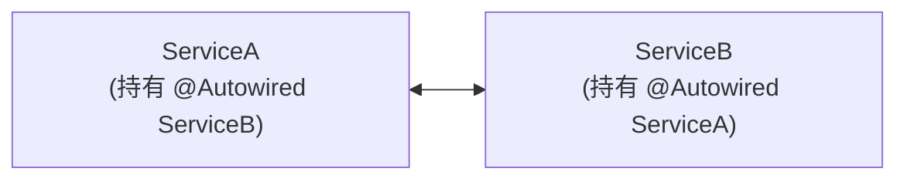
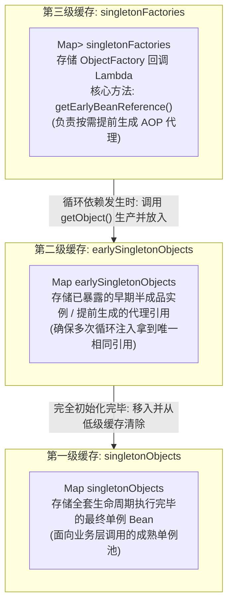
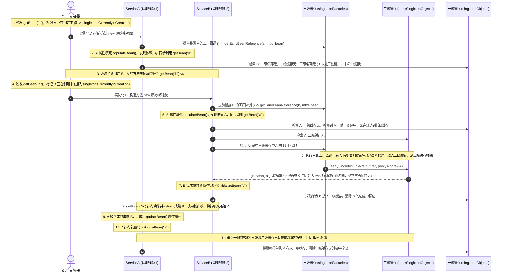

# 13 · Spring 循环依赖与三级缓存底层架构剖析

> **导读**：循环依赖（Circular Dependency）是指两个或多个 Bean 之间存在相互引用的依赖闭环（如 A 依赖 B，同时 B 也依赖 A）。若处理不当，将在对象创建阶段引发无限递归与内存溢出。Spring 巧妙地将对象的“实例化”与“属性填充/初始化”阶段解耦，并通过三级缓存机制实现了对单例 Bean 循环引用的优雅解析，同时完备兼容了 AOP 动态代理机制。本文深入剖析三级缓存的底层源码数据结构、时序流转、为什么不能退化为二级缓存，以及 `@Async` 导致循环依赖崩溃的深水区死因。

---

## 一、循环依赖的形态与核心破局思维

### 1. 循环依赖的技术形态

若按传统单步对象创建模型：
- 创建 A 需先完全装配 B；创建 B 需先完全装配 A；
- 两者互相等待对方完全就绪，形成类似于死锁的资源依赖环。

### 2. 破局关键：解耦“实例化”与“初始化”
Spring 能够解决循环依赖的核心前提是：**Java 对象的内存分配（实例化）与属性赋值（初始化）在物理上是分阶段完成的**。
1. **实例化（Instantiation）**：通过反射调用构造函数在堆内存中为对象开辟空间，生成原始裸对象引用（指针已确定，即使字段全部为 `null`）；
2. **提前暴露（Early Exposure）**：将尚未填充属性的裸对象引用提前公开；
3. **属性填充与初始化（Populate & Initialize）**：依赖方先拿到裸对象引用完成自身的装配与初始化；随后被依赖方再完成后续装配。最终双方引用指向同一个成熟单例。

---

## 二、三级缓存数据结构与职责划分

在 Spring 的核心抽象类 `DefaultSingletonBeanRegistry` 中，维护了三层并发安全的 Map 缓存：

```java
public class DefaultSingletonBeanRegistry extends SimpleAliasRegistry implements SingletonBeanRegistry {
    // 第一级缓存：存放已完成全部生命周期的完全就绪单例 Bean (成熟成品)
    private final Map<String, Object> singletonObjects = new ConcurrentHashMap<>(256);

    // 第二级缓存：存放已实例化、但尚未完成依赖注入与初始化的早期单例对象 (半成品裸对象/提前代理)
    private final Map<String, Object> earlySingletonObjects = new ConcurrentHashMap<>(16);

    // 第三级缓存：存放用于生成早期对象引用的工厂回调接口 (ObjectFactory)
    private final Map<String, ObjectFactory<?>> singletonFactories = new HashMap<>(16);
    
    // 标记当前正在创建中的单例 Bean 名称集合 (用于循环依赖死循环检测)
    private final Set<String> singletonsCurrentlyInCreation =
            Collections.newSetFromMap(new ConcurrentHashMap<>(16));
}
```



### 1. 三级缓存核心检索流程：`getSingleton` 源码

```java
protected Object getSingleton(String beanName, boolean allowEarlyReference) {
    // 1. 先尝试从一级缓存（成品池）获取
    Object singletonObject = this.singletonObjects.get(beanName);
    
    // 2. 一级缓存不存在，且该 Bean 正处于创建流程中（说明检测到循环依赖！）
    if (singletonObject == null && isSingletonCurrentlyInCreation(beanName)) {
        // 尝试从二级缓存（早期半成品池）获取
        singletonObject = this.earlySingletonObjects.get(beanName);
        
        // 3. 二级缓存也不存在，且允许早期引用
        if (singletonObject == null && allowEarlyReference) {
            synchronized (this.singletonObjects) {
                // 双重检查加锁
                singletonObject = this.singletonObjects.get(beanName);
                if (singletonObject == null) {
                    singletonObject = this.earlySingletonObjects.get(beanName);
                    if (singletonObject == null) {
                        // 4. 从三级缓存获取工厂回调
                        ObjectFactory<?> singletonFactory = this.singletonFactories.get(beanName);
                        if (singletonFactory != null) {
                            // 执行工厂的 getEarlyBeanReference()，按需触发 AOP 提前代理
                            singletonObject = singletonFactory.getObject();
                            // 升级至二级缓存，并从三级缓存中移除
                            this.earlySingletonObjects.put(beanName, singletonObject);
                            this.singletonFactories.remove(beanName);
                        }
                    }
                }
            }
        }
    }
    return singletonObject;
}
```

---

## 三、三级缓存完整流转时序（以 A、B 循环依赖为例）



### 深度剖析：破解循环依赖的三大底层疑问

#### 疑问 1：A 找 B 时，为什么没有直接查三级缓存命中，而是转而去执行 B 的生命周期？
**真相：A 和 B 检索依赖走的底层方法完全相同（都是 `getBean()`），A 同样查了三级缓存！**
1. A 在执行 `populateBean` 时，发现需要注入 B，于是调用 `getBean("b")` ➔ 触发 `getSingleton("b", true)`。
2. `getSingleton("b", true)` 依次检查一级、二级、三级缓存。但此时 **B 压根还没有开始创建**，各级缓存全为空，且 `singletonsCurrentlyInCreation.contains("b") == false`。
3. 既然缓存完全查不到，且 B 不是循环依赖中的对象，Spring 别无选择，只能走正规通道：调用 `createBean("b")` 从头启动 B 的生命周期！

#### 疑问 2：B 找 A 时，为什么不继续往下实例化 A？死循环到底被谁终结的？
**真相：被 `singletonsCurrentlyInCreation` 守门人与三级缓存联合终结！**
1. B 在执行 `populateBean` 时需要注入 A，同样调用 `getBean("a")` ➔ 触发 `getSingleton("a", true)`。
2. 此时检查一级缓存无 A，但检查关键标记：`isSingletonCurrentlyInCreation("a") == true`（因为 A 最开始已经登记了正在创建中！）。
3. 容器立刻意识到：**检测到循环依赖！允许穿透到二级与三级缓存**。
4. 于是查三级缓存，**精准命中 A 在步骤 1 暴露的工厂回调**，拿到 A 的早期引用并直接 `return`。
5. **核心关键**：既然 `getBean("a")` 已经成功返回了依赖对象，B 的属性赋值操作就宣告完成！**既然拿到了对象，根本就不会、也不可能再去调用 `createBean("a")`**！无限循环创建的套娃链条在这一步被硬生生切断！

#### 疑问 3：A 是如何“苏醒”并完整执行后续阶段的？
**真相：JVM 单线程的方法调用栈（Call Stack）天然出栈机制！**

这并不是什么多线程的异步挂起或唤醒，而是 Java 最基础的**同步方法嵌套调用**（从 A 启动并压栈等待 ➔ 转入 B 执行全套流程 ➔ 弹栈交还执行权 ➔ A 恢复执行后半段）：

```text
JVM 单线程方法调用栈（Call Stack 逐帧演进全景）：

┌──────────────────────────────────────────────────────────────────────────────────────────────────┐
│ 【阶段一：A 启动生命周期（执行前半段，创建原始对象并挂起等待 B）】                                   │
│  1. 容器触发 getBean("a")                                                                        │
│  2. 标记 A 正在创建中：singletonsCurrentlyInCreation.add("a")                                     │
│  3. 进入 doCreateBean("a")                                                                       │
│     ├─ ① 实例化 A: A rawA = new ServiceA(); (在 JVM 堆内存分配原始裸对象空间)                     │
│     ├─ ② 提前暴露三级缓存工厂:                                                                    │
│     │    singletonFactories.put("a", () -> getEarlyBeanReference("a", mbd, rawA));              │
│     └─ ③ 属性填充 populateBean("a"): 扫描依赖字段 @Autowired private ServiceB b;                  │
│            └─ 尝试从三级缓存检索 B (此时 B 从未创建，各级缓存为空，未命中)                           │
│            └─ 发起同步依赖检索：getBean("b") ──────────────────────────────────────────────┐     │
│               【🚨 关键点：此时 A 的生命周期暂停在第 ③ 步，调用栈帧 1 压入栈底，等待 getBean("b") 返回！】 │     │
└────────────────────────────────────────────────────────────────────────────────────┼─────┘
                                                                                     │ [方法压栈 Push]
                                                                                     ▼
┌──────────────────────────────────────────────────────────────────────────────────────────────────┐
│ 【阶段二：嵌套执行 B 的完整生命周期（入栈执行，打破循环依赖并成为成熟单例）】                         │
│  1. getBean("b") 触发创建 B                                                                      │
│  2. 标记 B 正在创建中：singletonsCurrentlyInCreation.add("b")                                     │
│  3. 进入 doCreateBean("b")                                                                       │
│     ├─ ① 实例化 B: B rawB = new ServiceB(); (在 JVM 堆内存分配原始裸对象空间)                     │
│     ├─ ② 提前暴露三级缓存工厂:                                                                    │
│     │    singletonFactories.put("b", () -> getEarlyBeanReference("b", mbd, rawB));              │
│     ├─ ③ 属性填充 populateBean("b"): 扫描依赖字段 @Autowired private ServiceA a;                  │
│     │      └─ 发起依赖检索：getBean("a") ➔ 进入 getSingleton("a", true)                            │
│     │           ├─ 查一级缓存 singletonObjects: 无成品 A                                          │
│     │           ├─ 检查正在创建状态: singletonsCurrentlyInCreation.contains("a") == true！       │
│     │           ├─ 查二级缓存 earlySingletonObjects: 无                                           │
│     │           └─ 查三级缓存 singletonFactories: 【🎯精准命中 A 在阶段一暴露的工厂回调！】        │
│     │                ├─ 执行工厂方法：getObject() -> getEarlyBeanReference()                      │
│     │                │   (按需判断：若 A 有 AOP 切面则提前创建代理 proxyA，无切面则返回原始 rawA)   │
│     │                ├─ 早期引用升级存入二级缓存: earlySingletonObjects.put("a", earlyA)          │
│     │                ├─ 从三级缓存移除工厂: singletonFactories.remove("a")                         │
│     │                └─ getBean("a") 成功返回 earlyA，直接赋给 B.a 字段！                          │
│     │                   【💥 关键阻断：依赖获取成功，B 绝不重新调用 createBean("a")，死循环彻底斩断！】 │
│     ├─ ④ 初始化 B: initializeBean("b") (执行 Aware 回调、@PostConstruct、init-method、AOP 等)      │
│     └─ ⑤ 注册成品池:                                                                              │
│            ├─ 成熟单例 B 存入一级缓存: singletonObjects.put("b", matureB)                          │
│            └─ 清除 B 创建中标记: singletonsCurrentlyInCreation.remove("b")                        │
│  4. return matureB; ───────────────────────────────────────────────────────────────┐     │
└────────────────────────────────────────────────────────────────────────────────────┼─────┘
                                                                                     │ [方法出栈 Pop]
                                                                                     ▼
┌──────────────────────────────────────────────────────────────────────────────────────────────────┐
│ 【阶段三：A 恢复执行生命周期（执行后半段，消费成熟 B，闭环完成全套初始化）】                          │
│  1. 【执行权弹回】栈帧 2 弹出，调用栈切回栈帧 1，A 的 populateBean("a") 收到 getBean("b") 返回的 matureB│
│  2. 将 matureB 赋给 A.b 字段，A 的属性填充 ③ 正式全部完成！                                      │
│  3. ④ 初始化 A: initializeBean("a") (依次执行 Aware 回调、@PostConstruct、业务自定义 init-method 等)│
│  4. ⑤ 最终一致性校验与单例注册:                                                                  │
│     ├─ 检查二级缓存 earlySingletonObjects.get("a")：                                              │
│     │    若存在 earlyA (曾发生循环依赖提前暴露代理)，则直接取回 earlyA 作为最终单例返回，防止对象分裂！│
│     ├─ 将最终单例存入一级缓存: singletonObjects.put("a", matureA / earlyA)                         │
│     ├─ 从二级缓存彻底移除: earlySingletonObjects.remove("a")                                      │
│     └─ 清除 A 创建中标记: singletonsCurrentlyInCreation.remove("a")                               │
│  5. return matureA;                                                                              │
│  6. 【全盘大圆满】：A、B 单例均已入驻一级缓存，且彼此正确持有对方的有效引用！                        │
└──────────────────────────────────────────────────────────────────────────────────────────────────┘
```

A 之所以能继续走完后续阶段，是因为在 JVM 单线程中，调用 B 的方法栈帧（`doCreateBean("b")`）执行完毕弹栈了，CPU 执行指针自然回到了 A 的代码行（`populateBean("a")`），A 从而能够顺理成章地继续执行 `initializeBean("a")` 并最终注册进一级缓存。

---

## 四、核心深度追问：为什么不能仅用两级缓存？

> [!question]- 核心深度追问：如果只是为了提前暴露引用，为什么不能仅保留两级缓存？
> 面试官常深度追问：“只保留一级和二级缓存，直接把实例化后的裸对象放入二级缓存，能不能跑通？”
> 
> **核心解答要点**：
> 1. **无 AOP 场景下：二级缓存完全足够**：如果没有任何动态代理（如 `@Transactional`、自定义切面），A 实例化后直接将其裸对象放入二级缓存，B 注入 A 的裸引用，完全能闭环跑通；
> 2. **AOP 代理场景下的致命冲突：打破标准生命周期设计**：Spring 核心架构规范要求**动态代理必须严格延迟到初始化后置处理阶段（`postProcessAfterInitialization`）生成**。若只有两级缓存，由于无法提前预知当前 Bean 是否会被后续循环引用，Spring 必须在每个单例刚实例化的瞬间无差别地提前生成 AOP 代理放入二级缓存，严重破坏生命周期设计原则；
> 3. **三级缓存的架构设计智慧：延迟满足（Lazy Proxy）**：三级缓存通过 `ObjectFactory` 实现了按需惰性代理。只有检测到循环依赖时才提前触发代理生成并升入二级缓存；常规非循环依赖下依然按既定标准生命周期正常创建；
> 4. **二级缓存的去重价值**：确保当被代理的 A 同时被 B、C、D 多个组件循环引用时，代理生成逻辑仅被执行一次，保证全局单例唯一。

---

## 五、Spring 无法解决的循环依赖边界与 @Async 深水陷阱

Spring 的三级缓存机制并非万能，以下三类循环依赖 Spring 默认无法处理：

### 1. 构造器注入循环依赖（无法实例化）
```java
@Service
public class ServiceA {
    public ServiceA(ServiceB serviceB) { ... } // 无法通过三级缓存解决
}
@Service
public class ServiceB {
    public ServiceB(ServiceA serviceA) { ... }
}
```
- **死因分析**：构造函数入参要求在调用构造方法前就必须拿到依赖对象的内存地址。此时双方连堆内存都未能分配（未实例化），三级缓存根本无从暴露早期引用。
- **解决方案**：在构造参数上标记 `@Lazy`（Spring 生成虚假 CGLIB 代理占位），或改为 Setter / 字段注入。

### 2. 多例（Prototype）作用域循环依赖
- Spring 明确不缓存 `prototype` 类型的 Bean。每次获取均触发全新实例化，无法依托缓存池识别创建状态，直接抛出 `BeanCurrentlyInCreationException`。

### 3. 带有 `@Async` 注解的循环依赖（极度隐蔽的崩溃点）

```java
@Service
public class ServiceA {
    @Autowired private ServiceB serviceB;

    @Async // 🚨 导致循环依赖当场崩溃的元凶！
    public void executeAsync() { ... }
}

@Service
public class ServiceB {
    @Autowired private ServiceA serviceA;
}
```

#### 逐帧源码级死因解剖：
1. **普通 AOP（如 `@Transactional`）的处理机制**：
   - 依赖的切面创建器 `AnnotationAwareAspectJAutoProxyCreator` 实现了 **`SmartInstantiationAwareBeanPostProcessor`** 接口。
   - 在循环依赖发生时，三级缓存能调用其 `getEarlyBeanReference()` **提前生成代理并记录在 `earlyProxyReferences` 集合中**；当该 Bean 走到后续常规初始化后置处理时，检测到该集合已有记录，便直接返回原始对象，不会重复创建代理。
2. **`@Async` 的处理机制**：
   - `@Async` 对应的代理创建器是 **`AsyncAnnotationBeanPostProcessor`**，它**未实现** `SmartInstantiationAwareBeanPostProcessor`。
   - 当 B 从三级缓存获取 A 时，由于异步处理器未介入，B 拿到并注入的依然是 **原始未代理的裸对象 A**；
   - 随后 A 继续走自己的生命周期，走到初始化最后一步时，`AsyncAnnotationBeanPostProcessor.postProcessAfterInitialization()` 介入，强制创建了一个全新的异步代理对象；
   - **最终一致性校验崩溃**：Spring 在 `doCreateBean()` 结尾进行一致性检查：
     发现早期暴露给 B 使用的对象（裸对象 A）与最终注册进容器的对象（异步代理对象 A）**内存引用不一致**！
     为了杜绝数据不一致风险，JVM 直接抛出：
     `BeanCurrentlyInCreationException: Bean with name 'serviceA' has been injected into other beans in its raw version, but has eventually been wrapped`。
3. **解决方案**：
   - 在注入点使用 `@Lazy`：`@Autowired @Lazy private ServiceA serviceA;`；
   - 将 `@Async` 异步逻辑剥离至独立的通用异步执行类中（推荐）。

---

### 场景演示：商品房预售网签与交付

- **浇筑混凝土骨架（实例化 Instantiation）**：反射 new 出裸对象，内存地址已定但内部为空；
- **房管局预售网签备案（第三级缓存 `singletonFactories`）**：放入 Lambda 工厂，只在发生闭环循环依赖时才延迟触发代理生成；
- **在建工程临时备案（第二级缓存 `earlySingletonObjects`）**：存放提前暴露的半成品裸对象或代理引用，确保多次循环注入拿到的是同一个实例；
- **精装验房交付产证（第一级缓存 `singletonObjects`）**：全套依赖填充完毕的成熟单例池，对外直接提供生产调用；
- **未打地基先装管道（构造器循环依赖）**：连物理对象内存都未分配即要求注入依赖，底层无法支持直接崩溃。
- **特装防弹加固（AOP 动态代理增强）**：在 Bean 外部包装代理拦截逻辑，并在最终替换裸对象。

---

## 🧭 下一步

在三级缓存的底层流转中，我们多次提到了 `getEarlyBeanReference` 与**“按需提前触发 AOP 代理”**。
那么在 Spring 框架中，AOP 究竟是如何通过 JDK 动态代理和 CGLIB 字节码增强包装对象的？切面拦截器链是如何按序执行的？为什么方法内部调用会导致事务和切面全部失效？
请进入第一关下一篇核心重头戏：[[02-AOP原理与应用]]！
