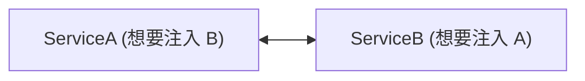
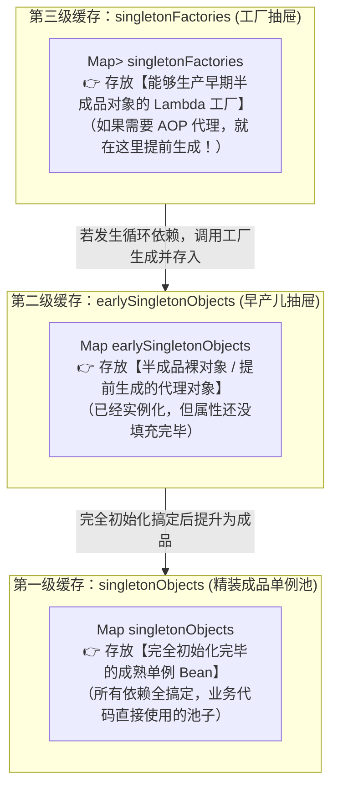
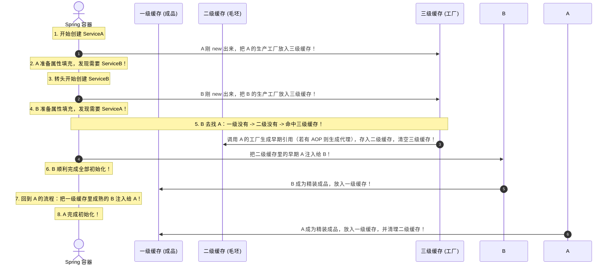

# 🌀 13 · Spring 循环依赖与三级缓存（死扣解法与 AOP 代理的秘密）

> **一句话导读**：A 依赖 B，B 又依赖 A，这个“先有鸡还是先有蛋”的死循环是怎么被解开的？为什么二级缓存解决不了 AOP？读完这篇，你就能在面试官面前行云流水地手绘三级缓存全景图。

---

## 🐣 核心心智模型：先领结婚证，再办婚礼（分步解耦）

什么是**循环依赖**？

```java
@Service
public class ServiceA {
    @Autowired
    private ServiceB serviceB; // A 依赖 B
}

@Service
public class ServiceB {
    @Autowired
    private ServiceA serviceA; // B 依赖 A
}
```



如果按照死板的思维：
> “A 必须完全装配好才能对外使用；但在装配 A 时发现需要 B；于是跑去创建 B；而 B 又非要等 A 完全装配好才肯妥协……”
> 这不就死锁卡死了吗？

### 💡 破局钥匙：把“实例化”与“初始化”拆成两半！
现实生活中两个人结婚：
- **第一步：先去民政局领结婚证（实例化 new 裸对象）**。
  - 哪怕新房还没装修、婚礼还没办，但法律上你们已经是夫妻了（内存地址引用已经存在了！）。
- **第二步：筹备婚礼与装修（初始化属性填充）**。

> **Spring 的解扣哲学**：
> 1. A 刚通过构造方法 `new` 出来（还是个**没有填充属性的毛坯早产儿**），Spring 就先把 A 的**引用指针**公开暴露出去；
> 2. B 在注入 A 的时候，**直接把这个毛坯早产儿 A 的指针先拿来用**！
> 3. B 顺利完成全部初始化，变成精装成品进入单例池；
> 4. A 再回头把这个精装成品 B 注入给自己，A 也顺利变成了精装成品！**死循环完美解开！**

---

## 🗄️ 彻底揭秘：Spring 的三级缓存到底存了什么？

在 `DefaultSingletonBeanRegistry` 源码中，Spring 安排了 **三只神奇的抽屉（三级缓存）**：



| 缓存级别 | 变量名 | 存放的内容 | 通俗比喻 |
| :--- | :--- | :--- | :--- |
| **第一级缓存** | `singletonObjects` | 完全初始化完毕的成熟 Bean | **已交付入住的精装房成品** |
| **第二级缓存** | `earlySingletonObjects` | 已经实例化、尚未填充属性的早期半成品 Bean | **刚封顶没通水电的毛坯房** |
| **第三级缓存** | `singletonFactories` | 生产早期 Bean 引用的工厂（`ObjectFactory`） | **房屋设计施工图纸与预制件工坊** |

---

## 🏃 顺藤摸瓜：三级缓存完整流转时序图

以 A 和 B 互相依赖为例，看 Spring 内部是如何走位的：



---

## 💥 灵魂拷问：为什么必须是三级缓存？二级缓存难道不够吗？

这是大厂面试的**终极必杀题**：“如果没有第三级缓存，只有二级缓存行不行？”

### 满分答题逻辑：

#### 1. 如果没有 AOP，二级缓存完全足够！
- 假如我们的项目里全都是普通的 Java 对象，根本不需要动态代理；
- 那么在 A 刚 `new` 出来的时候，直接把这个毛坯对象放入**二级缓存**；
- B 来的时候从二级缓存拿到毛坯 A 注入进去，也能顺畅跑通。

#### 2. 核心死穴在于：AOP 动态代理！
- 根据 Spring 的设计原则：**正常情况下，AOP 代理对象必须在 Bean 的最后一步（初始化后置处理阶段）才允许被创建！**
- 如果只有两级缓存，意味着 Spring 必须在 A 刚实例化完的一瞬间，**不管后面有没有发生循环依赖，强行无脑为所有 Bean 提前创建 AOP 代理并塞入二级缓存！**
- 这严重破坏了 Spring 的生命周期规范与灵活性。

#### 3. 三级缓存的精妙设计（延迟满足）：
- **如果没发生循环依赖**：三级缓存里的 `ObjectFactory` 根本不会被触发！A 会按规矩一步步走完属性填充和初始化，在最后的正常后置处理器里创建 AOP 代理。
- **只有在发生了循环依赖的紧急时刻**：B 才会去敲三级缓存的门，触发工厂里的 `getEarlyBeanReference()`，提前为 A 制造出代理对象并保存在二级缓存中（确保多次循环注入拿到的是同一个代理实例）！

> 🌟 **一句话总结**：
> **第三级缓存的存在，是为了在“遵循 AOP 代理正常生命周期”与“解决循环依赖不得不提前暴露代理”之间，做出的最优雅的架构妥协！**

---

## 🚫 哪些循环依赖是 Spring 无法拯救的？

很多初级程序员以为 Spring 能包办一切，结果线上直接启动崩溃。以下三种场景 Spring 也无能为力：

### 1. 基于构造器注入的循环依赖（死穴！）

```java
@Service
public class ServiceA {
    // ❌ 翻车！直接报 BeanCurrentlyInCreationException！
    public ServiceA(ServiceB serviceB) { ... }
}

@Service
public class ServiceB {
    public ServiceB(ServiceA serviceA) { ... }
}
```

> 🚨 **为什么救不了？**
> 构造器注入意味着：在调用 `new ServiceA(b)` 的这一刻，就必须传入一个已存在的 `ServiceB`！
> **此时连地基（实例化 new）都还没挖出来，根本没有对象的内存引用，三级缓存连个毛坯房都放不进去！**
> 
> 🛡️ **解药**：在构造器参数上加上 **`@Lazy` 注解**（让 Spring 先塞一个虚拟的 CGLIB 假代理，等真正调用方法时再去获取真对象）。

### 2. Prototype（多例模式）下的循环依赖（死穴！）
- Spring 的单例池只会缓存 `Scope = "singleton"` 的单例 Bean；
- 如果两个 Bean 的作用域是 `prototype`（多例），Spring 每次请求都会全新 `new` 一个，根本不进缓存，直接陷入无限创建对象的深渊，报错退出！

### 3. 带有 `@Async` 异步注解的循环依赖（面试与生产最高频深水坑！）
很多工程师纳闷：“既然三级缓存能搞定 `@Transactional` 的 AOP 代理，为什么我给 Service 加了一个 `@Async`，启动立刻暴毙报错？”

```java
@Service
public class ServiceA {
    @Autowired private ServiceB serviceB;

    @Async // 🚨 加了这个注解，循环依赖当场暴毙！
    public void asyncTask() { ... }
}

@Service
public class ServiceB {
    @Autowired private ServiceA serviceA;
}
```

> 🔬 **逐帧死因解剖（为什么普通 AOP 行，@Async 不行？）**：
> 1. 普通的事务 AOP 是由 `AnnotationAwareAspectJAutoProxyCreator` 创建的，它实现了 **`SmartInstantiationAwareBeanPostProcessor`** 接口。当三级缓存被调用时，它的 `getEarlyBeanReference()` 能**提前介入并制造出代理对象**存入二级缓存；
> 2. 但 `@Async` 的异步代理是由 **`AsyncAnnotationBeanPostProcessor`** 创建的，它**根本没有实现** `SmartInstantiationAwareBeanPostProcessor`，只实现了最普通的 `BeanPostProcessor`！
> 3. 这意味着：当 B 注入 A 时，从三级缓存拿出来的只是**毛坯裸对象 A**（没有被提前代理）；
> 4. 等 A 走到最后一步初始化后置处理时，`AsyncAnnotationBeanPostProcessor` 突然横插一杠，**为 A 创建了一个崭新的异步代理对象**！
> 5. 此时 Spring 在最终一致性检查时惊恐地发现：**早前借给 B 使用的 A 是个毛坯裸对象，而现在注册进容器的 A 是个异步代理对象！两者内存地址不一致！**
> 6. Spring 为防止数据错乱，当场抛出：`BeanCurrentlyInCreationException: Bean with name 'serviceA' has been injected into other beans in its raw version, but has eventually been wrapped`！
> 
> 🛡️ **解药**：
> - 在注入点加上 **`@Lazy`**：`@Autowired @Lazy private ServiceA serviceA;`，打破提前引用的僵局；
> - 或者将 `@Async` 异步方法拆分到独立的辅助 Service 类中（最佳架构实践）。

---

## ⚠️ 现代生产铁律：Spring Boot 2.6+ 默认关闭循环依赖！

这是每一位现代 Java 工程师必须知道的行业演进：

- **从 Spring Boot 2.6.0 开始，官方默认彻底禁用了循环依赖！**
- 如果你在 Spring Boot 2.6+ 或 3.x 项目中写了循环依赖（哪怕是标准的单例 Setter 注入），项目启动时也会直接报错退出：
  ```text
  APPLICATION FAILED TO START
  ***************************
  The dependencies of some of the beans in the application context form a cycle:
  ┌─────┐
  |  serviceA
  ↑     ↓
  |  serviceB
  └─────┘
  ```

> ❓ **为什么 Spring 官方要默认“自废武功”？**
> 官方认为：**循环依赖本质上是糟糕代码架构设计的遮羞布！** 它违反了单一职责原则，让模块之间产生严重的紧密耦合。
> 
> 🛠️ **如何应对？**
> 1. **临时过渡方案（不推荐）**：在 `application.yml` 中强制打开后门：
>    ```yaml
>    spring:
>      main:
>        allow-circular-references: true
>    ```
> 2. **工业级根治方案（强烈推荐）**：
>    - 使用 `@Lazy` 延迟加载；
>    - 抽取公共业务逻辑到第三方 `ServiceC`，变 `A <-> B` 为 `A -> C` 且 `B -> C`；
>    - 使用我们在 11 篇讲到的 **[[11-Spring事件机制|Spring 事件机制]]** 彻底解耦调用。

---

## 🧠 一分钟复盘核心记忆卡

1. **破局本质**：把**实例化（挖地基）**和**属性填充（装水电）**拆分为两步，提前暴露未成品的指针引用。
2. **三级缓存分工**：一级存**成熟单例**，二级存**半成品早产儿**，三级存**AOP 代理工厂**。
3. **为什么是三级**：为了保证 AOP 代理对象的延迟生成，不破坏 Spring 标准生命周期设计。
4. **无法解决的场景**：构造器循环依赖、多例 Prototype 循环依赖、以及带有 `@Async` 注解的循环依赖（用 `@Lazy` 破解）。
5. **现代规范**：Spring Boot 2.6+ 默认禁用循环依赖，应以重构解耦代替开启配置。

---

## 🧭 下一步

在 Bean 生命周期的最后一步，AOP 动态代理究竟是如何大显神威，把日志、事务等功能神不知鬼不觉地织入到业务代码中的？
请进入下一篇：[[02-AOP原理与应用]]！
