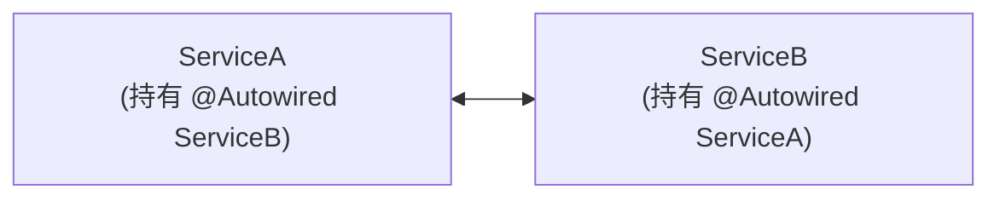
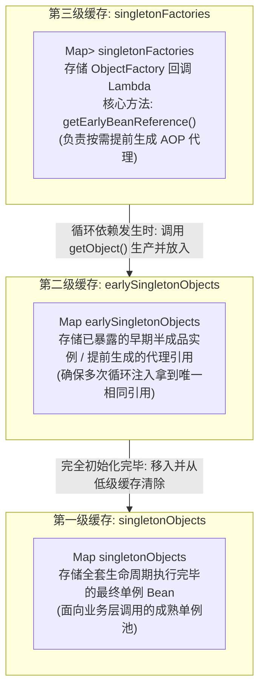
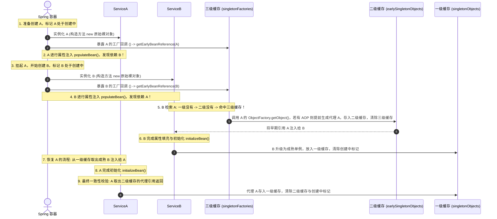

# 13 · Spring 循环依赖与三级缓存底层架构剖析

> **导读**：循环依赖（Circular Dependency）是指两个或多个 Bean 之间存在相互引用的依赖闭环（如 A 依赖 B，同时 B 也依赖 A）。若处理不当，将在对象创建阶段引发无限递归与内存溢出。Spring 巧妙地将对象的“实例化”与“属性填充/初始化”阶段解耦，并通过三级缓存机制实现了对单例 Bean 循环引用的优雅解析，同时完备兼容了 AOP 动态代理机制。本文深入剖析三级缓存的底层源码数据结构、时序流转、为什么不能退化为二级缓存，以及 `@Async` 导致循环依赖崩溃的深水区死因。

---

## 一、循环依赖的形态与核心破局思维

### 1. 循环依赖的技术形态

若按传统单步对象创建模型：
- 创建 A 需先完全装配 B；创建 B 需先完全装配 A；
- 两者互相等待对方完全就绪，形成类似于死锁的资源依赖环。

### 2. 破局关键：解耦“实例化”与“初始化”
Spring 能够解决循环依赖的核心前提是：**Java 对象的内存分配（实例化）与属性赋值（初始化）在物理上是分阶段完成的**。
1. **实例化（Instantiation）**：通过反射调用构造函数在堆内存中为对象开辟空间，生成原始裸对象引用（指针已确定，即使字段全部为 `null`）；
2. **提前暴露（Early Exposure）**：将尚未填充属性的裸对象引用提前公开；
3. **属性填充与初始化（Populate & Initialize）**：依赖方先拿到裸对象引用完成自身的装配与初始化；随后被依赖方再完成后续装配。最终双方引用指向同一个成熟单例。

---

## 二、三级缓存数据结构与职责划分

在 Spring 的核心抽象类 `DefaultSingletonBeanRegistry` 中，维护了三层并发安全的 Map 缓存：

```java
public class DefaultSingletonBeanRegistry extends SimpleAliasRegistry implements SingletonBeanRegistry {
    // 第一级缓存：存放已完成全部生命周期的完全就绪单例 Bean (成熟成品)
    private final Map<String, Object> singletonObjects = new ConcurrentHashMap<>(256);

    // 第二级缓存：存放已实例化、但尚未完成依赖注入与初始化的早期单例对象 (半成品裸对象/提前代理)
    private final Map<String, Object> earlySingletonObjects = new ConcurrentHashMap<>(16);

    // 第三级缓存：存放用于生成早期对象引用的工厂回调接口 (ObjectFactory)
    private final Map<String, ObjectFactory<?>> singletonFactories = new HashMap<>(16);
    
    // 标记当前正在创建中的单例 Bean 名称集合 (用于循环依赖死循环检测)
    private final Set<String> singletonsCurrentlyInCreation =
            Collections.newSetFromMap(new ConcurrentHashMap<>(16));
}
```



### 1. 三级缓存核心检索流程：`getSingleton` 源码

```java
protected Object getSingleton(String beanName, boolean allowEarlyReference) {
    // 1. 先尝试从一级缓存（成品池）获取
    Object singletonObject = this.singletonObjects.get(beanName);
    
    // 2. 一级缓存不存在，且该 Bean 正处于创建流程中（说明检测到循环依赖！）
    if (singletonObject == null && isSingletonCurrentlyInCreation(beanName)) {
        // 尝试从二级缓存（早期半成品池）获取
        singletonObject = this.earlySingletonObjects.get(beanName);
        
        // 3. 二级缓存也不存在，且允许早期引用
        if (singletonObject == null && allowEarlyReference) {
            synchronized (this.singletonObjects) {
                // 双重检查加锁
                singletonObject = this.singletonObjects.get(beanName);
                if (singletonObject == null) {
                    singletonObject = this.earlySingletonObjects.get(beanName);
                    if (singletonObject == null) {
                        // 4. 从三级缓存获取工厂回调
                        ObjectFactory<?> singletonFactory = this.singletonFactories.get(beanName);
                        if (singletonFactory != null) {
                            // 执行工厂的 getEarlyBeanReference()，按需触发 AOP 提前代理
                            singletonObject = singletonFactory.getObject();
                            // 升级至二级缓存，并从三级缓存中移除
                            this.earlySingletonObjects.put(beanName, singletonObject);
                            this.singletonFactories.remove(beanName);
                        }
                    }
                }
            }
        }
    }
    return singletonObject;
}
```

---

## 三、三级缓存完整流转时序（以 A、B 循环依赖为例）



---

## 四、核心深度追问：为什么不能仅用两级缓存？

在技术面试中，面试官常深度追问：“如果只是为了提前暴露引用，只保留一级缓存和二级缓存，直接把实例化后的裸对象放入二级缓存，能不能跑通？”

### 1. 无 AOP 场景下：二级缓存完全足够
如果整个应用没有使用任何动态代理（如 `@Transactional`、自定义切面），在 A 实例化完成后，直接将其裸对象放入二级缓存 `earlySingletonObjects`，当 B 需要时从二级缓存获取注入，完全能够满足闭环解析。

### 2. AOP 代理场景下的致命冲突：打破生命周期设计
根据 Spring 的核心架构规范：**AOP 动态代理对象的生成，必须严格推迟到 Bean 生命周期的最后阶段（即 `BeanPostProcessor.postProcessAfterInitialization` 初始化后置处理）执行**。
- **若退化为二级缓存**：由于无法预测当前 Bean 是否会被后续组件循环引用，Spring 必须在**每个单例 Bean 刚实例化的瞬间，无差别地为所有 Bean 提前强制创建 AOP 代理对象并塞入二级缓存**！
- 这严重违背了“让原始 Bean 走完完整初始化逻辑后再生成代理”的标准生命周期设计原则。

### 3. 三级缓存的架构设计智慧：延迟满足（Lazy Proxy）
- **常规非循环场景**：三级缓存中的 `ObjectFactory` 永远不会被调用。Bean 按照既定标准流程，在初始化完毕后由后置处理器正常生成代理。
- **循环依赖异常场景**：仅在外部 Bean 出现循环闭环、且各级缓存均未命中的特定时刻，才通过三级缓存的 `singletonFactory.getObject()` 被动触发 `SmartInstantiationAwareBeanPostProcessor.getEarlyBeanReference()`，提前生成代理对象并缓存至二级缓存。
- **二级缓存的核心价值**：当同一个被代理的 Bean A 同时被 B、C、D 多个 Bean 循环依赖时，二级缓存确保 `getEarlyBeanReference()` 仅被执行一次，避免多次调用生成多个不同内存地址的代理副本，保证单例性。

---

## 五、Spring 无法解决的循环依赖边界与 @Async 深水陷阱

Spring 的三级缓存机制并非万能，以下三类循环依赖 Spring 默认无法处理：

### 1. 构造器注入循环依赖（无法实例化）
```java
@Service
public class ServiceA {
    public ServiceA(ServiceB serviceB) { ... } // 无法通过三级缓存解决
}
@Service
public class ServiceB {
    public ServiceB(ServiceA serviceA) { ... }
}
```
- **死因分析**：构造函数入参要求在调用构造方法前就必须拿到依赖对象的内存地址。此时双方连堆内存都未能分配（未实例化），三级缓存根本无从暴露早期引用。
- **解决方案**：在构造参数上标记 `@Lazy`（Spring 生成虚假 CGLIB 代理占位），或改为 Setter / 字段注入。

### 2. 多例（Prototype）作用域循环依赖
- Spring 明确不缓存 `prototype` 类型的 Bean。每次获取均触发全新实例化，无法依托缓存池识别创建状态，直接抛出 `BeanCurrentlyInCreationException`。

### 3. 带有 `@Async` 注解的循环依赖（极度隐蔽的崩溃点）

```java
@Service
public class ServiceA {
    @Autowired private ServiceB serviceB;

    @Async // 🚨 导致循环依赖当场崩溃的元凶！
    public void executeAsync() { ... }
}

@Service
public class ServiceB {
    @Autowired private ServiceA serviceA;
}
```

#### 逐帧源码级死因解剖：
1. **普通 AOP（如 `@Transactional`）的处理机制**：
   - 依赖的切面创建器 `AnnotationAwareAspectJAutoProxyCreator` 实现了 **`SmartInstantiationAwareBeanPostProcessor`** 接口。
   - 在循环依赖发生时，三级缓存能调用其 `getEarlyBeanReference()` **提前生成代理并记录在 `earlyProxyReferences` 集合中**；当该 Bean 走到后续常规初始化后置处理时，检测到该集合已有记录，便直接返回原始对象，不会重复创建代理。
2. **`@Async` 的处理机制**：
   - `@Async` 对应的代理创建器是 **`AsyncAnnotationBeanPostProcessor`**，它**未实现** `SmartInstantiationAwareBeanPostProcessor`。
   - 当 B 从三级缓存获取 A 时，由于异步处理器未介入，B 拿到并注入的依然是 **原始未代理的裸对象 A**；
   - 随后 A 继续走自己的生命周期，走到初始化最后一步时，`AsyncAnnotationBeanPostProcessor.postProcessAfterInitialization()` 介入，强制创建了一个全新的异步代理对象；
   - **最终一致性校验崩溃**：Spring 在 `doCreateBean()` 结尾进行一致性检查：
     发现早期暴露给 B 使用的对象（裸对象 A）与最终注册进容器的对象（异步代理对象 A）**内存引用不一致**！
     为了杜绝数据不一致风险，JVM 直接抛出：
     `BeanCurrentlyInCreationException: Bean with name 'serviceA' has been injected into other beans in its raw version, but has eventually been wrapped`。
3. **解决方案**：
   - 在注入点使用 `@Lazy`：`@Autowired @Lazy private ServiceA serviceA;`；
   - 将 `@Async` 异步逻辑剥离至独立的通用异步执行类中（推荐）。

---

### 场景演示：商品房预售网签与交付

- **浇筑混凝土骨架（实例化 Instantiation）**：反射 new 出裸对象，内存地址已定但内部为空；
- **房管局预售网签备案（第三级缓存 `singletonFactories`）**：放入 Lambda 工厂，只在发生闭环循环依赖时才延迟触发代理生成；
- **在建工程临时备案（第二级缓存 `earlySingletonObjects`）**：存放提前暴露的半成品裸对象或代理引用，确保多次循环注入拿到的是同一个实例；
- **精装验房交付产证（第一级缓存 `singletonObjects`）**：全套依赖填充完毕的成熟单例池，对外直接提供生产调用；
- **未打地基先装管道（构造器循环依赖）**：连物理对象内存都未分配即要求注入依赖，底层无法支持直接崩溃。
- **特装防弹加固（AOP 动态代理增强）**：在 Bean 外部包装代理拦截逻辑，并在最终替换裸对象。

---

## 🧭 下一步

掌握了 Spring IoC、AOP、事务与三级缓存的核心机制后，后端应用的数据持久化与高并发吞吐底座将直接落在**数据库与存储引擎**上。
在关系型数据库中，保证并发事务隔离与数据一致性的核心引擎是 **MySQL InnoDB 的 MVCC（多版本并发控制）与锁机制**。
请进入第五阶段第一篇核心重头戏：[[../05-数据库与存储/02-事务与隔离级别]]！
