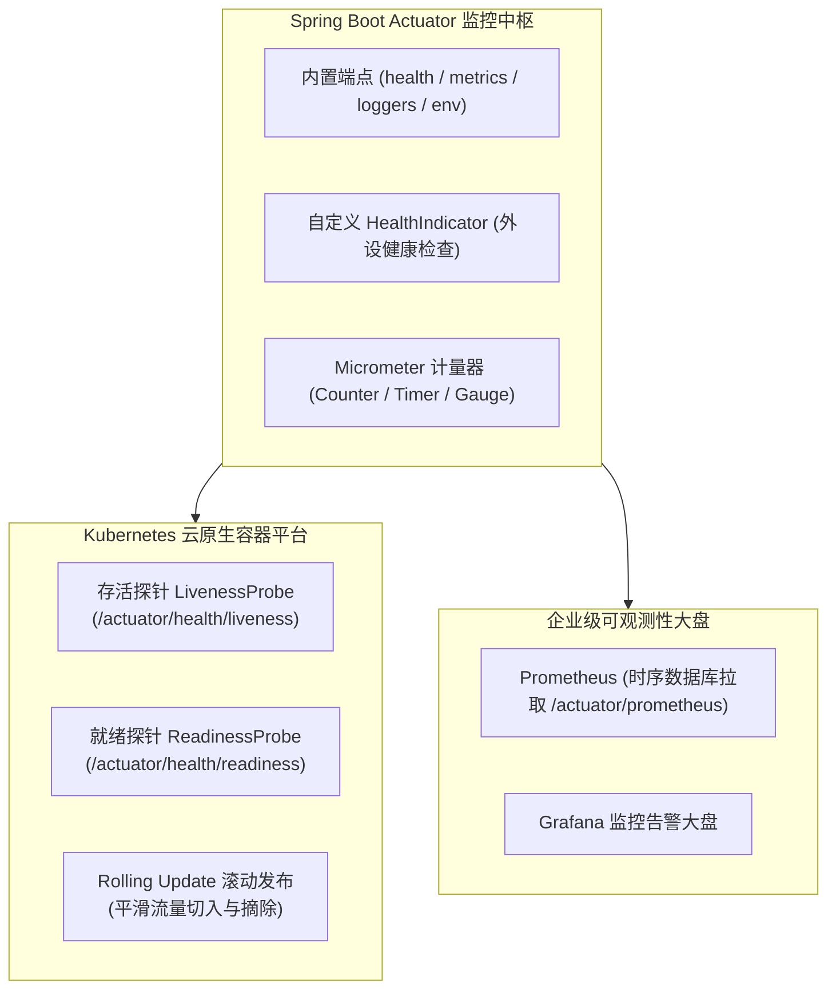
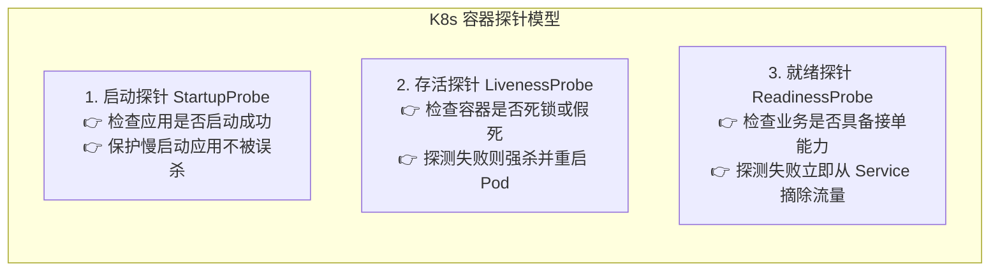
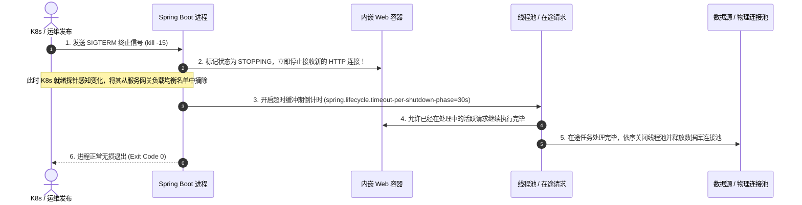

# 🩺 14 · Spring Boot 生产运维与 Actuator（云原生双探针与无损优雅停机）

> **一句话导读**：代码写完只是万里长征第一步，线上高可用运维才是真考场。Spring Boot Actuator 是微服务的“数字化体检中心”。掌握核心端点管控、K8s 存活/就绪双探针平滑流量摘除、无损优雅停机 5 步时序，以及基于 Micrometer 的自定义指标监控，是打造高可用生产系统的必修课。

---

## 🧭 生产运维全景架构图



---

## 🔍 核心端点规约与生产安全加固

引入依赖：
```xml
<dependency>
    <groupId>org.springframework.boot</groupId>
    <artifactId>spring-boot-starter-actuator</artifactId>
</dependency>
```

### 1. 生产高频核心端点职责

1. **`health`（`/actuator/health`）**：
   - **系统健康状态检查**：聚合数据库、Redis、RabbitMQ、磁盘等组件的运行状况，输出整体健康状态（`UP`、`DOWN`、`OUT_OF_SERVICE`）。
2. **`metrics`（`/actuator/metrics`）**：
   - **性能度量指标**：底层基于 Micrometer 框架，统计 JVM 堆内存、GC 停顿频次、Tomcat 活动线程数、HTTP 响应耗时分布。
3. **`prometheus`（`/actuator/prometheus`）**：
   - **Prometheus 标准采集格式端点**：将内存中的度量指标转换为 Prometheus 的文本规范格式，供外部时序数据库拉取。
4. **`loggers`（`/actuator/loggers`）**：
   - **动态调整日志级别**：无需重启服务进程，线上秒级调整指定包或类的日志级别（如从 `INFO` 动态调整为 `DEBUG`），排查完后还原。
5. **`threaddump`（`/actuator/threaddump`）**：
   - **导出 JVM 线程快照**：现场抓取所有活跃线程的调用栈，快速排查死锁与 CPU 飙高问题。

---

### 2. 生产安全防护铁律：防未授权数据泄漏

Actuator 端点直接暴露在公网极易引发严重安全事件（如通过 `/actuator/env` 获取未脱敏密钥，或被恶意触发 HeapDump 导致服务拒绝服务）。

1. **修改基础根路径并配置白名单**：
   ```yaml
   management:
     endpoints:
       web:
         base-path: /inner-actuator            # 生产环境混淆根路径，防自动化扫描
         exposure:
           # 🚨 严禁配置 include: "*" ！必须显式配置白名单
           include: health,metrics,prometheus,loggers
     endpoint:
       health:
         show-details: when-authorized         # 仅在具备认证权限时展示内部依赖明细
         probes:
           enabled: true                       # 开启 K8s 存活与就绪探针支持
   ```
2. **网关与网络层物理阻断**：
   - 在 API 网关（Spring Cloud Gateway / Nginx）层针对 `/inner-actuator/**` 路径配置直接拦截规则，禁止公网外部 IP 访问；
   - 监控系统通过容器内部集群网络（Pod IP / ClusterIP）直接拉取指标。

---

## ☸️ K8s 云原生探针与滚动发布零停机实战

在 Kubernetes 容器化部署环境下，Spring Boot 与 K8s 探针的精密配合是实现**零停机滚动更新（Zero-Downtime Rolling Update）**的核心所在。



### 1. 存活探针 vs 就绪探针的本质区别

1. **LivenessProbe（存活探针 - `/actuator/health/liveness`）**：
   - **探测目标**：应用内部是否处于死锁、内存枯竭等**无法自愈的致命死循环**；
   - **失败处理**：K8s 判定该容器已死，会立即执行 `kill` 并依据重启策略**重启该 Pod**；
   - **避坑警示**：千万不要在 Liveness 检查中去 Ping 外部数据库或 Redis！若外部数据库短暂网络抖动，K8s 会误以为是本应用崩溃而频繁重启本 Pod，引发大面积雪崩。
2. **ReadinessProbe（就绪探针 - `/actuator/health/readiness`）**：
   - **探测目标**：应用当前是否具备处理外部请求的业务能力（如本地缓存是否预热完成、线程池是否饱和）；
   - **失败处理**：K8s **不会重启容器**，而是立即将该 Pod 从 Service 的负载均衡 Endpoints 列表中**剔除**，停止向其转发任何流量；一旦指标恢复正常，再自动切回流量。

---

### 2. 生产实战：微服务滚动发布防流量击穿配置

在 K8s 发布新镜像时，常出现新 Pod 刚刚创建、Tomcat 端口刚开，流量瞬间涌入，而本地缓存尚未预热完成，导致最初几十个请求大面积报 502 / 504。

#### 生产标准 `deployment.yaml` 探针配置范式：
```yaml
spec:
  containers:
    - name: order-service
      image: order-service:v2.0
      readinessProbe:
        httpGet:
          path: /inner-actuator/health/readiness
          port: 8080
        initialDelaySeconds: 15     # 容器启动 15 秒后再开始第一次就绪探测
        periodSeconds: 5            # 每隔 5 秒探测一次
        failureThreshold: 3         # 连续 3 次失败则标记为未就绪并摘除流量
      livenessProbe:
        httpGet:
          path: /inner-actuator/health/liveness
          port: 8080
        initialDelaySeconds: 30     # 存活探测留出更充裕的初始化窗口
        periodSeconds: 10
        failureThreshold: 3
```

---

## 🛑 真正的无损优雅停机（Graceful Shutdown）底层 5 步时序

当 K8s 销毁一个旧 Pod 或运维执行滚动更新时，直接 `kill -9` 会导致正在处理中的订单请求被直接斩断，用户界面报网络中断或数据状态卡在中间态。
Spring Boot 原生内置了 **Graceful Shutdown（优雅停机）** 机制。



### 1. 开启生产优雅停机核心配置
```yaml
server:
  shutdown: graceful                             # 开启内嵌 Web 容器优雅停机支持

spring:
  lifecycle:
    timeout-per-shutdown-phase: 30s              # 优雅停机最大容忍缓冲期：30 秒
```

### 2. 优雅停机 5 步时序逐帧解剖
1. **捕获停机信号**：JVM 注册的 ShutdownHook 捕获到操作系统发来的 `SIGTERM`（即 `kill -15`，切勿使用 `kill -9`）；
2. **阻断新请求**：内嵌 Tomcat 停止监听端口，拒绝任何新的 TCP 连接握手与 HTTP 请求；
3. **保护在途任务**：给正在执行的活跃线程留出缓冲时间（最高等待 30 秒），保证已扣款的订单逻辑能平稳完成并写库；
4. **关闭生命周期资源**：依次调用各 `DisposableBean` 的 `destroy()` 方法，关闭异步线程池（`ThreadPoolTaskExecutor.shutdown()`）并归还所有数据源连接；
5. **安全退出进程**：所有资源安全回收后，JVM 进程平稳退出。

---

## 🛠️ 生产级自定义监控实战：HealthIndicator 与 Micrometer

Actuator 的真正强大之处，在于支持开发者极其轻松地扩展自定义健康度量与业务指标。

### 1. 实战一：自定义外部支付网关健康检查（`HealthIndicator`）

```java
@Component
public class PaymentGatewayHealthIndicator implements HealthIndicator {

    @Override
    public Health health() {
        // 模拟对外部三方支付网关进行毫秒级探测
        boolean isConnected = checkThirdPartyGateway();
        
        if (isConnected) {
            return Health.up()
                    .withDetail("gateway", "Alipay & WeChatPay")
                    .withDetail("latency", "12ms")
                    .build();
        } else {
            return Health.down()
                    .withDetail("error", "支付网关网络超时或鉴权失败！")
                    .build();
        }
    }

    private boolean checkThirdPartyGateway() {
        // 执行底层 HTTP ping 检测
        return true;
    }
}
```
- **效果**：访问 `/inner-actuator/health` 时，Spring Boot 会自动聚合该组件的返回值；若其返回 `DOWN`，整个应用的健康状态将联动变为 `DOWN`。

---

### 2. 实战二：基于 Micrometer 自定义业务度量指标（对接 Prometheus）

在电商系统中，我们往往希望实时监控“**每秒下单成功总数**”以及“**下单核心方法耗时分布**”：

```java
@Service
public class OrderBizService {

    private final Counter orderSuccessCounter;
    private final Timer orderProcessTimer;

    public OrderBizService(MeterRegistry registry) {
        // 1. 注册一个订单成功的计数器 (Counter)
        this.orderSuccessCounter = Counter.builder("biz.order.success.total")
                .description("业务订单创建成功累计计数")
                .tag("module", "trade")
                .register(registry);

        // 2. 注册一个下单方法耗时计时器 (Timer)
        this.orderProcessTimer = Timer.builder("biz.order.process.time")
                .description("下单业务核心链路处理耗时")
                .tag("module", "trade")
                .publishPercentiles(0.95, 0.99) // 统计 P95, P99 响应耗时
                .register(registry);
    }

    public void processOrder(OrderDTO dto) {
        // 使用 Timer 包裹耗时方法
        orderProcessTimer.record(() -> {
            // 执行核心下单逻辑...
            doCreateOrder(dto);
            
            // 下单成功，计数器 +1
            orderSuccessCounter.increment();
        });
    }

    private void doCreateOrder(OrderDTO dto) {
        try { Thread.sleep(50); } catch (InterruptedException ignored) {}
    }
}
```
- **Prometheus 采集效果**：
  - 访问 `/inner-actuator/prometheus`，即可看到暴露出的文本指标：
    ```text
    biz_order_success_total{module="trade"} 1052.0
    biz_order_process_time_seconds{module="trade",quantile="0.99"} 0.052
    ```
  - 运维可以直接在 Grafana 中配置 PromQL 查询语句 `rate(biz_order_success_total[1m])`，实时绘制每秒下单 TPS 走势图。

---

## 🧠 一分钟复盘核心记忆卡

1. **核心端点与安全**：
   - 生产环境严禁暴露全部端点；混淆基础路径并仅白名单暴露 `health`, `metrics`, `prometheus`；动态日志用 `loggers`。
2. **K8s 探针分工**：
   - **Liveness** 挂了杀容器（防死锁死循环）；**Readiness** 挂了摘流量（防慢启动与负载过载）；滚动发布必须配全。
3. **优雅停机 5 步时序**：
   - 开启 `server.shutdown=graceful`；收到 `SIGTERM` 立即拒收新请求，缓冲期等待在途请求完成后再关连接与进程。
4. **自定义监控实战**：
   - 实现 `HealthIndicator` 自定义外设健康探测；利用 `MeterRegistry` 注册业务 `Counter` / `Timer` 对接 Prometheus。

---

## 🧭 下一步

搞懂了生产环境如何监控、排查与实现无损停机后，当面对海量高并发业务时，如何将耗时任务抽离主线程异步并发执行？
Spring 提供的 `@Async` 声明式异步底层原理是什么？为什么直接使用 `@Async` 会暗藏 `SimpleAsyncTaskExecutor` 无界创建线程把内存打爆的致命陷阱？跨线程时 MDC 日志追踪链路（TraceId）丢失如何解决？
请继续攻克第三关核心进阶：[[15-Spring异步与线程池体系]]！

