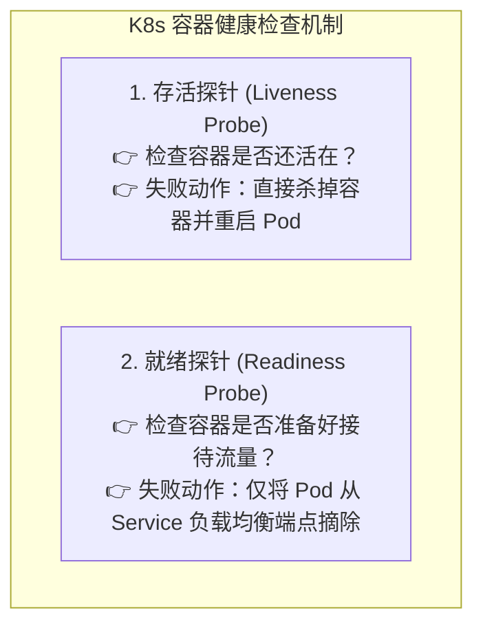
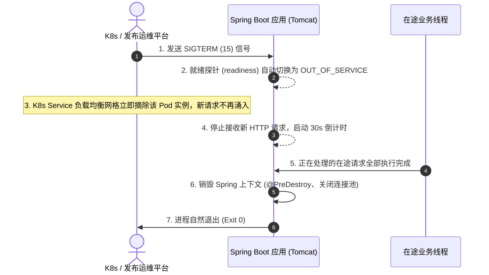

# 🩺 14 · Spring Boot 生产运维与 Actuator（云原生监控与优雅停机）

> **一句话导读**：应用写完不是终点，线上运维才是考验的开始。Spring Boot Actuator 是微服务的“数字化体检中心”，掌握核心端点管控、Prometheus 指标对接、K8s 双探针集成与无损优雅停机，是保障高可用线上服务的必修课。

---

## 🏛️ 为什么需要 Actuator？（从黑盒到白盒运维）

在单体应用时代，运维往往只能通过外部黑盒探测（如尝试发一个 HTTP ping 请求）。但在云原生微服务与容器化架构下，应用内部的运行状态必须对外透明可见：

- 数据库连接池还剩多少可用连接？
- JVM 堆内存与 GC 频率是否濒临警戒线？
- 接口响应延迟分布（P99 / P95）如何？
- 容器启动后，业务是否真的准备好接收外部流量了？

**Spring Boot Actuator** 提供了生产就绪型（Production-ready）的监控与管理功能，将应用内部的健康状态、性能指标、环境变量与审计日志通过标准的 REST API 暴露出来。

---

## 🔍 核心端点矩阵与安全暴露规约

引入起步依赖：
```xml
<dependency>
    <groupId>org.springframework.boot</groupId>
    <artifactId>spring-boot-starter-actuator</artifactId>
</dependency>
```

### 1. 生产常用高频端点矩阵

| 端点 ID | 访问路径 | 默认启用 | 核心职责与生产价值 |
| :--- | :--- | :---: | :--- |
| **`health`** | `/actuator/health` | 是 | **系统健康检查**。聚合数据库、Redis、磁盘与自定义健康指示器，输出整体健康状态（`UP`、`DOWN`、`OUT_OF_SERVICE`）。 |
| **`metrics`** | `/actuator/metrics` | 否 | **性能度量指标**。底层基于 Micrometer 框架，统计 JVM 内存/线程数、HTTP 请求吞吐与耗时，标准对接 Prometheus。 |
| **`loggers`** | `/actuator/loggers` | 否 | **动态修改日志级别**。无需重启进程，线上实时调整指定 Package 或 Class 的日志级别（如从 `INFO` 改为 `DEBUG`）。 |
| **`info`** | `/actuator/info` | 否 | **应用静态信息**。展示 Git 提交版本号、构建时间、自定义应用描述等元数据。 |
| **`env`** | `/actuator/env` | 否 | **环境变量与配置**。查看当前生效的 Spring Environment 属性源（注意敏感脱敏）。 |
| **`threaddump`** | `/actuator/threaddump` | 否 | **导出线程堆栈**。直接获取当前 JVM 线程快照，排查死锁与高负载线程。 |

---

### 2. 生产安全铁律：严禁裸奔暴露

Actuator 曾多次因配置不当引发高危安全漏洞（如通过 `/actuator/env` 泄露数据库密码或通过未授权端点执行代码执行）。

#### 🚨 生产标准安全配置：
```yaml
management:
  endpoints:
    web:
      base-path: /actuator                  # 建议生产修改为混淆路径，如 /inner-monitor
      exposure:
        # 严禁写 include: "*" ！只白名单暴露业务必需端点
        include: health,metrics,info,loggers
  endpoint:
    health:
      show-details: when-authorized         # 仅在认证通过后展示详细依赖组件状态
      probes:
        enabled: true                       # 开启 K8s 存活/就绪探针支持
```

> 🛡️ **内网防护策略**：
> 1. 在 API 网关（Spring Cloud Gateway / Nginx）层**直接拦截 `/actuator/**` 路径**，禁止外网公网直接访问；
> 2. 结合 **Spring Security** 对 `/actuator/**` 施加基于角色的 HTTP Basic 认证。

---

### 3. 生产神技：运行时动态修改日志级别（无需重启）

当生产环境突发偶发性 Bug，但当前日志级别为 `INFO` 无法捕获关键参数时，绝不能重新编译发版重启，可以通过 `/actuator/loggers` 动态调整：

```bash
# 1. 查询当前订单服务的日志级别
GET /actuator/loggers/com.example.order.service

# 2. 动态调整指定类为 DEBUG 级别（发送 POST 请求）
POST /actuator/loggers/com.example.order.service
Content-Type: application/json

{
  "configuredLevel": "DEBUG"
}
```
调整后下一秒即刻生效，定位完问题后可再次发请求改回 `INFO`，避免 DEBUG 日志刷爆磁盘。

---

## ☸️ 云原生 K8s 存活探针与就绪探针集成

在 Kubernetes 容器编排环境中，K8s 通过两类探针判定 Pod 状态：



### 1. Spring Boot 原生双探针端点
Spring Boot 2.3+ 原生内置了与 K8s 契合的双探针路径：
- **存活探针路径**：`GET /actuator/health/liveness`（检查内部关键组件是否 Deadlock、OOM）
- **就绪探针路径**：`GET /actuator/health/readiness`（检查缓存加载、预热是否完成，连接是否通畅）

### 2. K8s `deployment.yaml` 生产标准配置：
```yaml
spec:
  containers:
    - name: order-service
      image: order-service:v1.0.0
      livenessProbe:
        httpGet:
          path: /actuator/health/liveness
          port: 8080
        initialDelaySeconds: 45 # 启动后等待 45 秒再开始首次探测（给 JVM 预留启动时间）
        periodSeconds: 10       # 探测周期 10 秒
        failureThreshold: 3     # 连续 3 次失败触发重启
      readinessProbe:
        httpGet:
          path: /actuator/health/readiness
          port: 8080
        initialDelaySeconds: 20
        periodSeconds: 5
        failureThreshold: 2
```

---

## 🛑 微服务无损发布：优雅停机（Graceful Shutdown）

在持续集成与发布部署过程中，粗暴的 `kill -9` 会直接切断进程，导致正在执行中的 HTTP 请求当场报错、数据库分布式事务中断、MQ 消息丢失。

Spring Boot 2.3+ 原生支持**优雅停机（Graceful Shutdown）**：

### 1. 开启配置
```yaml
server:
  shutdown: graceful # 开启优雅停机（支持 Web 容器：Tomcat, Jetty, Netty）

spring:
  lifecycle:
    timeout-per-shutdown-phase: 30s # 停机最长宽限期：给在途请求 30 秒执行时间
```

### 2. 优雅停机完整生命周期时序：



> 💡 **核心注意点**：
> 如果 30 秒倒计时结束，在途请求仍未执行完毕，Spring Boot 会强行终止剩余线程以保护系统按时关机。因此对于长耗时异步任务，应配合线程池的 `setWaitForTasksToCompleteOnShutdown(true)` 使用。

---

## 📊 对接 Prometheus 构建微服务指标大盘

通过 Micrometer 抽象，仅需一条依赖即可无缝对接 Prometheus：
```xml
<dependency>
    <groupId>io.github.mweirauch</groupId>
    <artifactId>micrometer-registry-prometheus</artifactId>
</dependency>
```
访问 `GET /actuator/prometheus`，即可输出标准时序数据，配置 Prometheus 自动定时拉取（Pull 模式），在 Grafana 导入 JVM 官方仪表盘模板（如 Dashboard ID `4701`），即可实现：
- JVM 堆/堆外/元空间使用率折线图；
- GC 停顿耗时与频率实时曲线；
- Tomcat 活跃线程数与连接队列积压监控；
- HTTP 接口 QPS、P95/P99 延迟热力图。

---

## 🧠 一分钟复盘核心记忆卡

1. **核心定位**：Actuator 是生产级微服务白盒化可观测体系底座。
2. **安全防线**：生产严禁 `include: "*"` 全量裸奔暴露；敏感环境关闭公网访问。
3. **K8s 双探针**：存活探针（`/liveness` 失败重启 Pod） + 就绪探针（`/readiness` 失败摘除流量）。
4. **动态排障**：通过 `/actuator/loggers` 线上秒级动态热更新日志级别，无需发版重启。
5. **优雅停机**：`server.shutdown: graceful` + `timeout-per-shutdown-phase: 30s`，配合 K8s 摘流量消化在途请求。

---

## 🧭 下一步

完成了 Spring 生态的核心机制、组件全景与生产运维之后，我们将对整个模块的核心脉络进行宏观收拢。
请进入终章：[[99-本章总结与复习]]！
