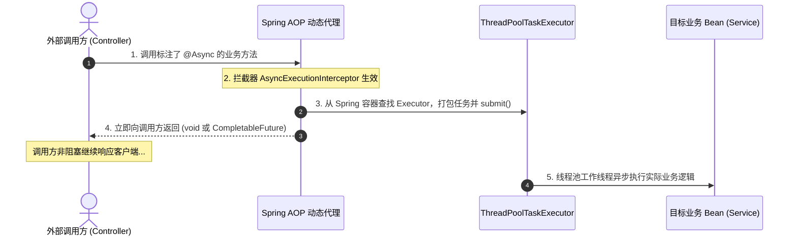
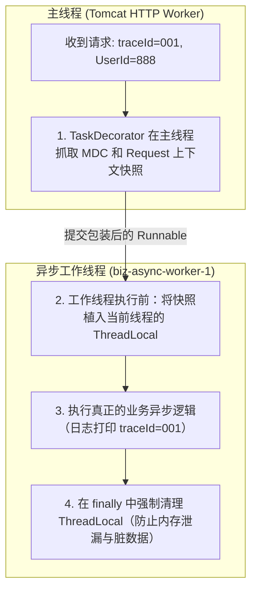

# ⚡ 15 · Spring 异步与线程池体系（ThreadPoolTaskExecutor 与上下文透传）

> **一句话导读**：在 Spring 容器中，如何优雅、安全地执行异步并发任务？从 `@Async` 底层 AOP 拦截原理与失效避坑，到官方封装的 `ThreadPoolTaskExecutor` 核心配置，再到攻坚高并发生产痛点——利用 `TaskDecorator` 跨线程透传 MDC TraceId 与鉴权上下文。

---

## 🚨 警惕生产陷阱：Spring 默认的异步机制

在 Spring Boot 中，很多开发者直接在方法上标注 `@Async`，却未曾配置自定义线程池。此时 Spring 会采用什么样的底层机制？

### 1. 默认的 `SimpleAsyncTaskExecutor`：生产级灾难
当没有为 `@Async` 显式配置 `Executor` Bean 时，Spring 默认使用 **`SimpleAsyncTaskExecutor`**：
- **致命机制**：它**根本不是一个线程池**！它**不会复用任何线程**！
- 每次接收到异步任务时，它都会**直接调用 `new Thread(task).start()`** 创建一个全新的操作系统物理线程；
- 任务执行完毕后，该线程随即销毁。

> ⚠️ **生产事故警告**：
> 在高并发流量突发涌入时，`SimpleAsyncTaskExecutor` 会瞬间并发创建成千上万个平台线程，直接引发 `OutOfMemoryError: unable to create native thread`，导致整个 JVM 进程当场崩溃！

---

## ⚙️ 生产级配置：`ThreadPoolTaskExecutor`

Spring 官方提供了 **`ThreadPoolTaskExecutor`**，它是对 Java 原生 JUC `ThreadPoolExecutor` 的面向 Spring 容器的优雅封装（实现了 `InitializingBean`、`DisposableBean` 以及 Spring 的 `TaskExecutor` 接口）。

### 1. 生产标准配置代码（Spring Boot 3 / Java 21）

```java
package com.example.config;

import org.slf4j.MDC;
import org.springframework.context.annotation.Bean;
import org.springframework.context.annotation.Configuration;
import org.springframework.core.task.TaskDecorator;
import org.springframework.scheduling.annotation.EnableAsync;
import org.springframework.scheduling.concurrent.ThreadPoolTaskExecutor;
import org.springframework.web.context.request.RequestAttributes;
import org.springframework.web.context.request.RequestContextHolder;

import java.util.Map;
import java.util.concurrent.Executor;
import java.util.concurrent.ThreadPoolExecutor;

@Configuration
@EnableAsync // 开启 Spring 异步注解支持
public class AsyncThreadPoolConfig {

    public static final String BIZ_ASYNC_EXECUTOR = "bizAsyncExecutor";

    @Bean(name = BIZ_ASYNC_EXECUTOR)
    public Executor bizAsyncExecutor() {
        ThreadPoolTaskExecutor executor = new ThreadPoolTaskExecutor();
        
        // 1. 核心线程数与最大线程数（根据硬件核数与任务 I/O 阻塞比设定）
        int cpuCores = Runtime.getRuntime().availableProcessors();
        executor.setCorePoolSize(cpuCores * 2);
        executor.setMaxPoolSize(cpuCores * 4);
        
        // 2. 阻塞队列容量（严禁 Integer.MAX_VALUE 无界队列，必须显式有界）
        executor.setQueueCapacity(1000);
        
        // 3. 空闲线程保活时间
        executor.setKeepAliveSeconds(60);
        
        // 4. 线程名称前缀（生产排查日志救命属性！）
        executor.setThreadNamePrefix("biz-async-worker-");
        
        // 5. 饱和拒绝策略（推荐 CallerRunsPolicy 对调用端施加背压）
        executor.setRejectedExecutionHandler(new ThreadPoolExecutor.CallerRunsPolicy());
        
        // 6. 跨线程上下文传递装饰器（解决 MDC TraceId 丢失）
        executor.setTaskDecorator(new ContextCopyingTaskDecorator());
        
        // 7. 优雅停机配置：等待在途任务执行完成
        executor.setWaitForTasksToCompleteOnShutdown(true);
        executor.setAwaitTerminationSeconds(30); // 最多等待 30 秒
        
        executor.initialize();
        return executor;
    }
}
```

---

## 🔍 `@Async` 声明式异步原理与失效避坑

`@Async` 的底层原理是基于 **Spring AOP 动态代理** 机制，由 `AsyncAnnotationBeanPostProcessor` 在 Bean 初始化阶段后置生成代理对象。

### 1. 底层调用拦截时序



---

### 2. 生产高频 `@Async` 4 大失效场景与破解

| 失效场景 | 根本原因（第一性原理） | 解决方案 |
| :--- | :--- | :--- |
| **1. 类内部自调用** | `this.asyncMethod()` 直接调用原生内部对象，绕过了 AOP 代理对象，拦截器未触发。 | 注入自身代理、或者将异步方法抽离到独立的 Service 类中。 |
| **2. 未加 `@EnableAsync`** | Spring 未注册 `AsyncAnnotationBeanPostProcessor` 后置处理器，注解不被识别。 | 在主配置类或启动类上标注 `@EnableAsync`。 |
| **3. 方法修饰符非 `public`** | Spring 默认的代理机制（尤其是基于 JDK 动态代理或常规 AOP 代理拦截规约）无法拦截非 public 方法。 | 异步方法必须声明为 `public`。 |
| **4. 返回值类型不兼容** | 异步方法由线程池异步触发，无法直接同步返回常规类型（如 `String`、`User`）。 | 返回值仅支持 **`void`** 或 **`CompletableFuture<T>`**。 |

#### 异步返回值标准写法：
```java
@Service
public class OrderAsyncService {

    // 推荐模式：返回 CompletableFuture，调用端可按需进行链式编排或异步等待
    @Async(AsyncThreadPoolConfig.BIZ_ASYNC_EXECUTOR)
    public CompletableFuture<String> processPaymentAsync(Long orderId) {
        // 模拟耗时支付校验
        try { Thread.sleep(500); } catch (InterruptedException e) {}
        return CompletableFuture.completedFuture("SUCCESS for " + orderId);
    }
}
```

---

## 💥 核心痛点攻坚：跨线程上下文丢失与 `TaskDecorator`

这是多线程高并发生产环境中最隐蔽、也是大厂面试中区分度极高的一道“深水区”考题。

### 1. 痛点：为什么子线程取不到 TraceId 和用户信息？
在 Web 请求生命周期中，主流框架通过 **`ThreadLocal`** 绑定请求上下文：
- **日志全链路追踪**：SLF4J `MDC` 将 `traceId` 存放在 `ThreadLocal<Map<String, String>>` 中；
- **用户安全上下文**：Spring Security 将认证主体保存在 `SecurityContextHolder`（底层是 `ThreadLocal`）；
- **HTTP 请求上下文**：Spring MVC 将当前 Request 属性保存在 `RequestContextHolder` 中。

**当调用 `@Async` 或向线程池提交任务时：**
- 任务脱离了主线程（Tomcat HTTP Worker 线程），转入自定义线程池的工作线程中执行；
- **子线程的 `ThreadLocal` 是一片空白！** 
- **直接后果**：异步日志中没有 `traceId`，全链路排障断链；在异步方法中调用 `SecurityContextHolder.getContext()` 抛出空指针异常！

### 2. 为什么 `InheritableThreadLocal` 无法解决？
很多初学者以为换成 `InheritableThreadLocal` 就能解决父子线程传递，但**在线程池复用模型下是完全失效的**：
- `InheritableThreadLocal` 仅在**新创建线程（`new Thread()`）的瞬间**把父线程的值拷贝一份给子线程；
- 线程池的工作线程是**预先创建并长期复用**的！当第二次、第三次复用同一个工作线程时，它**根本不会重新拷贝**后续新主线程的上下文，反而会残留上一个请求的历史脏数据！

---

### 3. Spring 官方终极解法：`TaskDecorator`

Spring 在 4.3 引入了 **`TaskDecorator`** 接口：
> 在任务从主线程提交给线程池、即将被工作线程执行的前夕，允许开发者对 `Runnable` 进行装饰与包裹，从而实现“**在主线程捕获上下文 -> 在子线程设置上下文 -> 执行任务 -> 在子线程 finally 中清理上下文**”的完整闭环。



#### 生产落地代码：
```java
package com.example.config;

import org.slf4j.MDC;
import org.springframework.core.task.TaskDecorator;
import org.springframework.web.context.request.RequestAttributes;
import org.springframework.web.context.request.RequestContextHolder;

import java.util.Map;

/**
 * 跨线程上下文复制装饰器
 */
public class ContextCopyingTaskDecorator implements TaskDecorator {

    @Override
    public Runnable decorate(Runnable runnable) {
        // 1. 【在主线程执行】：抓取父线程当前的上下文快照
        Map<String, String> contextMap = MDC.getCopyOfContextMap();
        RequestAttributes requestAttributes = RequestContextHolder.getRequestAttributes();

        // 2. 返回包装后的 Runnable，其 run() 方法将在子线程中执行
        return () -> {
            try {
                // 3. 【在子线程执行】：将父线程上下文恢复到子线程的 ThreadLocal 中
                if (contextMap != null) {
                    MDC.setContextMap(contextMap);
                }
                if (requestAttributes != null) {
                    RequestContextHolder.setRequestAttributes(requestAttributes);
                }

                // 4. 执行真正的业务逻辑
                runnable.run();
            } finally {
                // 5. 【在子线程执行】：执行完毕后强制清空，避免线程复用造成数据污染或内存泄漏！
                MDC.clear();
                RequestContextHolder.resetRequestAttributes();
            }
        };
    }
}
```

---

## 🛑 线程池优雅关闭与无损停机

结合微服务的优雅停机（Graceful Shutdown），线程池必须支持**等待在途任务消纳完成**：

```java
// 告诉线程池：当容器销毁时，等待所有已经排队和正在执行的任务执行完，再关闭线程池
executor.setWaitForTasksToCompleteOnShutdown(true);

// 设定最长等待宽限期：超时仍未完成则强制中断（如 30 秒）
executor.setAwaitTerminationSeconds(30);
```
当 Spring 容器触发 `refresh()` 的对立面 `close()` 时，`ThreadPoolTaskExecutor.destroy()` 会调用底层 `executor.shutdown()` 并等待 30 秒，确保在途异步任务不会因服务发版而被粗暴掐断。

---

## 🧠 一分钟复盘核心记忆卡

1. **默认陷阱**：未配置线程池时，`@Async` 默认使用 `SimpleAsyncTaskExecutor`，每次任务均新建线程，高并发下引发 OOM。
2. **生产标准**：显式注入 `ThreadPoolTaskExecutor`，配置明确有界队列、合理的核心与最大线程数、带业务前缀的线程名以及 `CallerRunsPolicy`。
3. **失效 4 大坑**：类内自调用（绕过代理）、未加 `@EnableAsync`、方法非 `public`、返回值类型不合法。
4. **上下文丢失**：线程池复用破坏了 `ThreadLocal` 传递；`InheritableThreadLocal` 在池化场景失效。
5. **终极武器**：使用 `TaskDecorator` 包装任务，在任务提交前捕获 MDC / Security 快照，在子线程执行前设值并在 `finally` 中严格清空。

---

## 🧭 下一步

在掌握了 Spring Boot 的自动配置机制、启动流程与异步线程池体系后，应用上线绝不能是一个“两眼一抹黑”的黑盒系统。
Spring Boot 是如何通过 **Actuator** 将应用的运行状态（健康检查、Prometheus 指标、配置属性、线程堆栈）全方位白盒化暴露出来的？在现代云原生 K8s 环境中，如何对接存活探针（Liveness）与就绪探针（Readiness）？服务发版时如何实现流量无损的优雅停机（Graceful Shutdown）？
请进入第三关生产运维收官专题：[[14-SpringBoot生产运维与Actuator]]！
