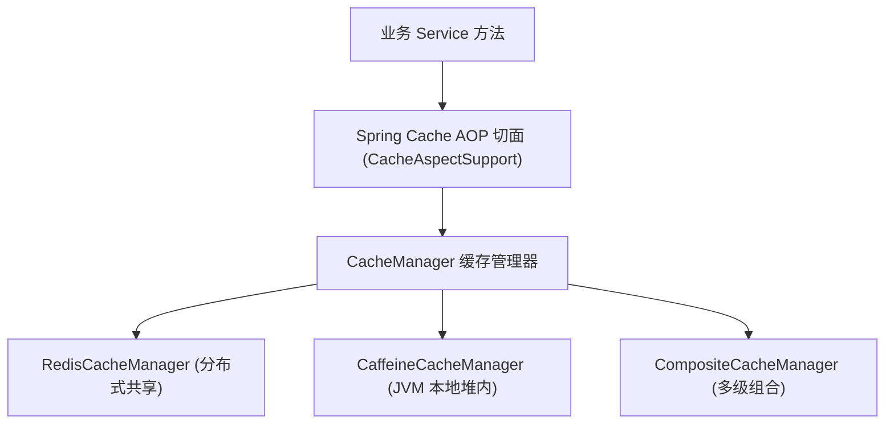
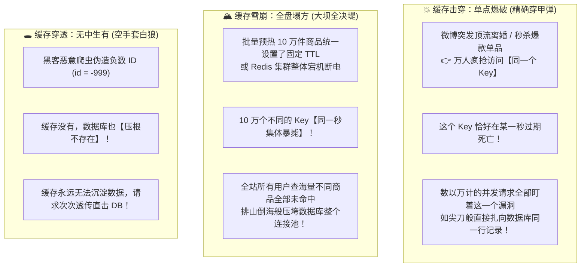
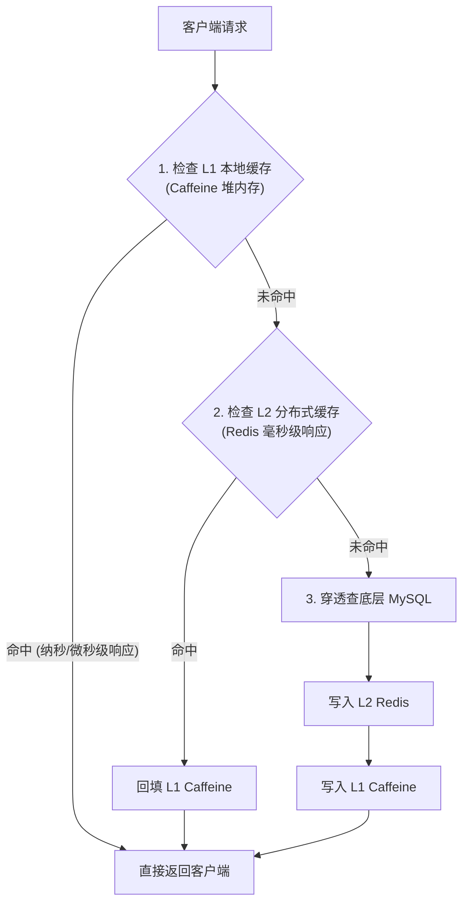

# 🛡️ 16 · Spring Cache 与分布式缓存实战（高并发击穿/穿透/雪崩防线）

> **一句话导读**：高并发系统的第一道护城河是缓存。Spring Cache 提供了优雅的声明式缓存抽象，但高并发生产落地绝非加几个注解那么简单。从注解底层执行流程，到攻坚高并发三大灾难（击穿、穿透、雪崩）的 Spring 防御策略，再到本地 Caffeine 与分布式 Redis 两级缓存架构，构建高可用缓存护城河。

---

## 🏛️ 为什么需要 Spring Cache？（统一抽象与业务解耦）

在传统的业务代码中，使用缓存往往需要硬编码操作 Redis 客户端（如 `redisTemplate.opsForValue().get(...)`），导致业务逻辑充斥着大量样板代码，且难以平滑切换缓存介质。

**Spring Cache** 通过 **AOP 声明式切面** 统一了缓存访问规范：
- **`CacheManager`**：缓存管理器，负责创建、配置和生命周期管理各种 `Cache` 实例；
- **`Cache`**：底层缓存组件接口，提供 `get(key)`、`put(key, value)`、`evict(key)` 等标准原子操作；
- **声明式无侵入**：仅需在业务方法上添加注解，即可自动完成“查缓存 -> 查库 -> 写缓存”的标准链路。



---

## 🔍 核心注解与 SpEL 表达式实战

### 1. 常用核心注解语义

| 注解 | 执行时机与核心行为 | 经典业务场景 |
| :--- | :--- | :--- |
| **`@Cacheable`** | **先查缓存**：若缓存命中则直接返回，方法体不执行；若缓存未命中则执行方法体，并将返回值写入缓存。 | 读操作（如查询用户信息、商品详情）。 |
| **`@CachePut`** | **无论命中与否，必执行方法体**，并将最新返回值刷新同步到缓存中。 | 写操作（如更新用户信息、编辑商品）。 |
| **`@CacheEvict`** | **驱逐与失效缓存**：从指定缓存中移除指定的 Key 或清空整个分区。 | 删操作（如删除用户、下架商品）。 |
| **`@Caching`** | **复杂注解组合**：允许在同一个方法上组合配置多个 `@Cacheable`、`@CachePut` 或 `@CacheEvict`。 | 联动更新多个不同 Key 或清理多个维度的缓存。 |

---

### 2. 生产实战代码与 SpEL 动态 Key 设定

```java
@Service
public class ProductService {

    /**
     * 查询商品详情：
     * 1. 缓存分区为 "product"
     * 2. Key 为 "info:{id}"
     * 3. condition: 仅当 id > 0 时才启用缓存
     * 4. unless: 仅当返回的商品状态为正常(status==1)时才存入缓存
     */
    @Cacheable(
        value = "product", 
        key = "'info:' + #id", 
        condition = "#id > 0", 
        unless = "#result == null || #result.status != 1"
    )
    public Product getProductById(Long id) {
        // 模拟复杂数据库联合查询
        return productMapper.selectById(id);
    }

    /**
     * 更新商品信息：
     * 无论如何都更新数据库，并将最新返回的商品对象同步刷新回缓存
     */
    @CachePut(value = "product", key = "'info:' + #product.id")
    public Product updateProduct(Product product) {
        productMapper.updateById(product);
        return product;
    }

    /**
     * 下架商品：
     * 删除数据库，并从缓存中驱逐该商品
     * beforeInvocation = false: 事务提交成功后再清除缓存（默认行为）
     */
    @CacheEvict(value = "product", key = "'info:' + #id")
    public void deleteProduct(Long id) {
        productMapper.deleteById(id);
    }
}
```

---

## 💥 高并发三大灾难在 Spring Cache 中的防御落地

在高并发场景下，直接裸用缓存极易引发缓存击穿、穿透与雪崩。初学者常把它们混为一谈，其实从第一性原理来看，它们有着**「点、面、空」**的本质界限：



### 极速辨析矩阵：点 vs 面 vs 空

1. **缓存击穿（单点打穿）**：
   - **数据是否存在**：数据库里**有**该数据。
   - **影响范围**：**仅 1 个（或极少数几个）超级大热点 Key**。
   - **核心特征**：点防御被破。全站其他几百万个缓存都好好的，唯独这一个天王级热点 Key 刚到期，瞬时并发把数据库该行记录打爆。
   - **核心解药**：**互斥锁（`sync = true`）**或热点数据物理永不过期。
2. **缓存雪崩（全线溃堤）**：
   - **数据是否存在**：数据库里**全都有**这些数据。
   - **影响范围**：**成千上万个不同的 Key 同时失效，或 Redis 整机瘫痪**。
   - **核心特征**：面防御全线失守。全站所有业务线、成千上万种不同的商品请求全部穿透到数据库。
   - **核心解药**：**TTL 随机扰动打散（Jitter）** + Redis 哨兵/集群高可用 + 本地二级缓存。
   - **🚨 为什么互斥锁防不了雪崩？** 因为雪崩是 10 万个用户在查 10 万个**不同的数据**，每个数据各持有一把不同的锁，互斥锁根本起不到排队合并的效果，10 万并发依然并行把数据库打死！
3. **缓存穿透（空手套白狼）**：
   - **数据是否存在**：数据库里**压根没有**这条数据。
   - **影响范围**：通常由恶意爬虫或攻击者发起的大量非法参数查询。
   - **核心特征**：无中生有。
   - **核心解药**：**缓存空对象（Null Value）** + 布隆过滤器（Bloom Filter）。

---

### 1. 防缓存击穿：`@Cacheable(sync = true)` 互斥锁机制

#### 🚨 痛点（单点高危）：
当突发热点 Key（如秒杀爆款的那一款 iPhone 16）在某一秒恰好过期时，瞬间涌入的数万个并发线程全部盯着这个相同的 Key。发现缓存为空后，同时发起数据库 SQL 查询，导致数据库该表产生激烈的行锁争抢与连接耗尽（俗称 Dogpile / 惊群效应）。

#### 🛡️ Spring 官方解法：
在 `@Cacheable` 注解中开启 **`sync = true`** 属性：

```java
@Cacheable(value = "seckill_sku", key = "'sku:' + #skuId", sync = true)
public SkuInfo getSeckillSku(Long skuId) {
    return skuMapper.selectById(skuId);
}
```

#### ⚙️ 底层运行机制：
- 当指定了 `sync = true` 时，Spring Cache 底层不再采用普通的无锁并发查询；
- 它会在当前 JVM 进程内部为该 Key 加**本地互斥锁**（基于 `ConcurrentHashMap` 的锁对象）；
- **同一时刻仅允许一个线程穿透去查询底层数据库**；
- 剩下的并发请求线程在原地排队等待锁释放；当第一个线程完成查库并成功回写缓存后，释放互斥锁，其余排队线程被唤醒，**直接从缓存读取刚回写的数据**，精准保住数据库！

---

### 2. 防缓存穿透：配置允许缓存 Null 值 + 短暂 TTL

#### 🚨 痛点（无中生有）：
黑客通过爬虫伪造大量不存在的负数 ID（如 `id = -9999`）频繁请求，因为数据库根本没有这条记录，默认情况下方法返回 `null`，Spring Cache 不会将其写入缓存，导致每一次非法请求都直击数据库。

#### 🛡️ Spring 官方解法：
通过 `RedisCacheConfiguration` 开启**允许缓存空值（默认即开启）**，并对空值缓存分配极短的 TTL（如 1~2 分钟）：

```java
@Bean
public RedisCacheManager cacheManager(RedisConnectionFactory connectionFactory) {
    RedisCacheConfiguration config = RedisCacheConfiguration.defaultCacheConfig()
            // 允许缓存 null 值，防止缓存穿透！
            // 首次查库为 null 时，向 Redis 写入特定的脱敏标记（如 org.springframework.cache.support.NullValue）
            .disableCachingNullValues() // 生产切勿调用此方法禁用 null！默认是允许 null 缓存的
            .entryTtl(Duration.ofMinutes(30)) // 正常数据缓存 30 分钟
            .serializeValuesWith(RedisSerializationContext.SerializationPair.fromSerializer(new GenericJackson2JsonRedisSerializer()));

    return RedisCacheManager.builder(connectionFactory)
            .cacheDefaults(config)
            .build();
}
```
结合业务网关前置的 **布隆过滤器（Bloom Filter）**，在请求进入 Spring MVC 之前提前拦截 99% 的不存在 ID，构建双重穿透防线。

---

### 3. 防缓存雪崩：自定义 TTL 随机偏移抖动（Jitter）

#### 🚨 痛点（大面积决堤）：
如果在配置中设置了统一的缓存过期时间（如 `entryTtl(Duration.ofHours(2))`），由于系统启动初始化或定时任务批量预热，导致海量商品缓存的过期时间完全一致。两小时后，数万个 Key 在同一秒集体失效；或者 Redis 实例故障宕机，全站缓存瞬间全军覆没，数据库瞬间承受毁灭性雪崩冲击。

#### 🛡️ 生产解法：
继承 `RedisCacheManager` 或定制 `RedisCacheWriter`，在写入缓存时，**动态注入随机时间抖动（Random Jitter）**，将过期时间均匀打散到 `30 ~ 45` 分钟区间，杜绝集体暴毙：

```java
public class JitterRedisCacheManager extends RedisCacheManager {
    
    public JitterRedisCacheManager(RedisCacheWriter cacheWriter, RedisCacheConfiguration defaultCacheConfiguration) {
        super(cacheWriter, defaultCacheConfiguration);
    }

    @Override
    protected RedisCache createRedisCache(String name, RedisCacheConfiguration cacheConfig) {
        // 在基础 TTL (如 30 分钟) 上，附加 1~300 秒的随机抖动时间，彻底打散失效点
        long randomSeconds = ThreadLocalRandom.current().nextLong(300);
        Duration jitterTtl = cacheConfig.getTtl().plusSeconds(randomSeconds);
        
        return super.createRedisCache(name, cacheConfig.entryTtl(jitterTtl));
    }
}
```

---

## 🚀 架构进阶：Caffeine + Redis 两级缓存（L1+L2）架构

在超高并发的核心交易场景（如首页核心配置、爆款 SKU），仅仅依赖集中式 Redis 依然面临**网络往返耗时（RTT）**与**序列化反序列化 CPU 损耗**。

业界高频采用 **L1 本地缓存（Caffeine） + L2 分布式缓存（Redis）** 的多级缓存架构：



### 多节点 L1 缓存一致性保障方案：
当集群中的某个节点（Node A）执行更新操作删除了缓存时，Node B 本地 Caffeine 缓存如何同步失效？
- **广播通知机制**：Node A 在更新数据后，通过 **Redis Pub/Sub** 或 **RocketMQ 广播消息** 发布“Cache Evict 事件”；
- 集群中的所有微服务节点监听该广播，收到后各自执行 `caffeineCache.invalidate(key)`，实现毫秒级本地缓存同步失效。

---

## 🧠 一分钟复盘核心记忆卡

1. **核心抽象**：Spring Cache 通过 AOP 切面实现声明式拦截，核心组件为 `CacheManager` 与 `Cache`。
2. **四大注解**：`@Cacheable`（先查后存）、`@CachePut`（必执行必存）、`@CacheEvict`（失效删除）、`@Caching`（组合编排）。
3. **防击穿利器**：`@Cacheable(sync = true)` 开启本地互斥锁，多线程并发时仅放行单线程查库并回填，其余排队读缓存。
4. **防穿透机制**：允许缓存 `null` 值并配置短暂 TTL，前置配合布隆过滤器过滤非法请求。
5. **防雪崩手段**：重写 TTL 策略，为基础过期时间动态注入随机时间抖动，避免同批数据同秒失效。
6. **两级缓存架构**：L1 本地 Caffeine（极速无网络开销）+ L2 集中式 Redis（数据共享），配合 MQ 广播保障本地缓存一致性。

---

## 🧭 下一步

搞定了 Web 请求分发、持久层数据访问与高并发两级缓存体系，业务系统已经具备了强大的吞吐承载力。
但在面对外部复杂网络环境时，系统如何进行身份认证（Authentication，你是谁）与权限鉴权（Authorization，你能访问哪些数据）？如何用过滤器链拦截非法请求与防范安全漏洞？
请进入第二关收官之作：[[12-Spring-Security]]！
