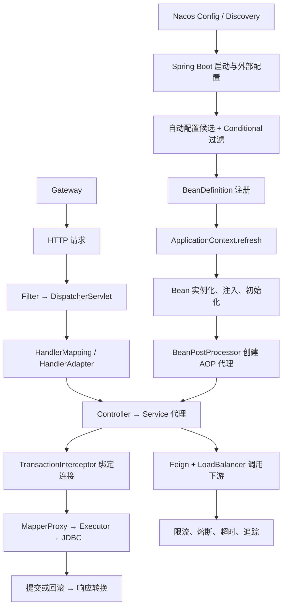

# Spring 生态：本章总结与复习

> [!abstract] 一句话总结
> Spring 生态的主线是由 IoC 容器创建和装配 Bean，用 AOP 代理接入事务等横切能力，再由 Spring Boot 完成条件化基础设施装配，并通过 MVC、MyBatis 与 Spring Cloud 串起请求、数据访问和微服务治理。

## 核心知识概览

| 模块 | 核心问题 | 关键结论 | 对应笔记 |
| --- | --- | --- | --- |
| IoC 与 Bean 生命周期 | 对象如何从配置变成可用 Bean | 配置先解析为 BeanDefinition，再经实例化、依赖注入、Aware、初始化和 BeanPostProcessor 包装进入容器；三级缓存只解决部分单例属性注入循环依赖 | [[01-IoC容器与Bean生命周期]] |
| AOP 代理 | 横切逻辑如何进入方法调用链 | 自动代理创建器按 Advisor 匹配 Bean，并用 JDK 代理或 CGLIB 构造拦截器链；只有经过 Spring 代理的外部方法调用才会被增强 | [[02-AOP原理与应用]] |
| 事务管理 | 数据库操作如何共享连接并提交或回滚 | TransactionInterceptor 通过 PlatformTransactionManager 管理事务，并由 TransactionSynchronizationManager 将连接绑定到当前线程；传播、回滚规则和代理边界共同决定结果 | [[03-Spring事务管理]] |
| Boot 自动装配 | 为什么加依赖或改属性会出现不同 Bean | Boot 3 从 AutoConfiguration.imports 加载候选配置，再按 class、bean、property 等条件注册默认 Bean；排查以 ConditionEvaluationReport 为准 | [[04-SpringBoot自动配置原理]] |
| Starter 交付 | 如何把基础设施封装成开箱即用依赖 | starter 聚合依赖，autoconfigure 承载配置类、Properties 与条件装配；默认实现要可覆盖、可关闭、可测试并受 BOM 管理 | [[05-SpringBoot Starter机制]] |
| Web 请求链 | HTTP 请求如何找到 Controller 并生成响应 | DispatcherServlet 通过 HandlerMapping、HandlerAdapter、参数解析器、消息转换器和异常解析器完成调度；Filter、Interceptor、AOP 分属不同层级 | [[06-SpringMVC请求处理流程]] |
| 数据访问 | Mapper 接口为何无需实现类也能执行 SQL | MapperProxy 将接口调用映射到 MappedStatement，随后由 Executor、StatementHandler、ParameterHandler 和 ResultSetHandler 完成 JDBC 执行与映射 | [[07-MyBatis原理]] |
| 微服务治理 | 服务间如何发现、调用、保护和观测 | Discovery、Config、Feign/LoadBalancer、Gateway、Sentinel/Resilience4j 与 Tracing 各司其职；版本匹配、超时预算和避免重复治理是生产关键 | [[08-SpringCloud组件概览]] |

## 全章主线

## 快速复习

1. `refresh` 的关键顺序是准备 BeanFactory、执行 BeanFactoryPostProcessor、注册 BeanPostProcessor、预实例化非懒加载单例；单个 Bean 再经历实例化、属性填充、Aware、初始化前后处理和销毁。
2. BeanFactoryPostProcessor 修改 BeanDefinition，BeanPostProcessor 处理 Bean 实例；AOP 代理通常由后者在初始化后创建。`new` 出来的对象不会获得注入、生命周期回调或代理增强。
3. 三级缓存通过 ObjectFactory 延迟暴露早期引用，为 early proxy 留出机会；它能处理部分单例属性注入循环依赖，不能解决构造器循环依赖。
4. Spring AOP 的核心是 Advisor 匹配与 `proceed` 拦截器链。本类自调用、private 方法和 CGLIB 无法覆盖的 final 方法都会让增强失去入口，环绕通知还必须正确传播异常。
5. Spring 事务本质是 AOP + 事务管理器 + 线程连接绑定。默认只对 RuntimeException 和 Error 回滚；异常被吞、异步切线程、多数据源事务管理器不匹配都会破坏预期事务边界。
6. REQUIRED 加入已有事务，REQUIRES_NEW 挂起外层并占用新连接，NESTED 在同一物理事务中使用保存点。事务中执行慢 RPC 会延长连接与锁持有时间，DB + MQ 一致性可用 outbox 解耦。
7. Boot 3 自动配置从 `META-INF/spring/org.springframework.boot.autoconfigure.AutoConfiguration.imports` 加载，并按 classpath、属性和已有 Bean 过滤；“为什么生效/没生效”应查看 conditions report。
8. Starter 主要负责依赖聚合，autoconfigure 负责装配逻辑。公共 starter 要避免重依赖、后台线程无销毁钩子和无法覆盖的默认 Bean，并用 ApplicationContextRunner 验证条件分支。
9. MVC 主入口是 `DispatcherServlet#doDispatch`；请求依次经历 handler 查找、拦截器、参数解析与校验、Controller、返回值处理和异常解析。Filter 在 Servlet 层，Interceptor 在 Handler 层，AOP 在 Bean 方法层。
10. MyBatis 通过 MapperProxy 将接口方法定位到 MappedStatement；`${}` 是字符串拼接并有注入风险，一级缓存属于 SqlSession，最终性能仍要用实际 BoundSql 和执行计划判断。
11. Spring Cloud 先按职责分层：Nacos Discovery 管实例，Config 管配置，Feign 负责声明式 HTTP，LoadBalancer 选实例，Gateway 管入口，Sentinel/Resilience4j 做保护，Tracing 建立观测闭环。
12. 微服务故障应沿 Gateway、调用客户端与连接池、注册/配置、治理规则和下游 RT 分层定位；多层重试、阻塞 Gateway event loop、版本错配和重复熔断限流都可能放大故障。

## 自测问题

1. 能否从 `ApplicationContext.refresh` 讲到一个普通 Bean 最终成为 AOP 代理，并说明 BeanFactoryPostProcessor 与 BeanPostProcessor 的先后和职责？
2. 为什么构造器循环依赖无法通过三级缓存解决？为什么存在 AOP 时只提前暴露原始对象又会产生问题？
3. `@Transactional` 方法本类自调用、捕获异常不抛、抛受检异常和切换异步线程时分别会发生什么，应该如何修复？
4. REQUIRED、REQUIRES_NEW 与 NESTED 如何影响物理事务、连接占用和外层回滚？什么情况下 REQUIRES_NEW 会拖垮连接池？
5. 引入一个 starter 后出现了意外 Bean，应如何利用 classpath、ConditionalOnMissingBean、配置属性和 conditions report 还原装配原因？
6. 一次 JSON 请求从 Filter 到 Controller、事务 Service、Mapper 和 JDBC 的关键调用链是什么？404、415/406、SQL 错误分别优先看哪一层？
7. 如何说明 Nacos Discovery 与 Config、Feign 与 LoadBalancer、Gateway 与服务内治理、Sentinel 与 Resilience4j 的职责边界？

## 下一章衔接

下一章进入 [[../05-数据库与存储/_index|数据库与存储]]：继续深入 Spring 事务和 MyBatis 最终依赖的数据库事务、隔离级别、锁、索引、执行计划、连接池与缓存机制。

## 相关编号双链

- 容器、代理与事务：[[01-IoC容器与Bean生命周期]] · [[02-AOP原理与应用]] · [[03-Spring事务管理]]
- Boot 装配：[[04-SpringBoot自动配置原理]] · [[05-SpringBoot Starter机制]]
- 请求与数据访问：[[06-SpringMVC请求处理流程]] · [[07-MyBatis原理]]
- 微服务体系：[[08-SpringCloud组件概览]]
