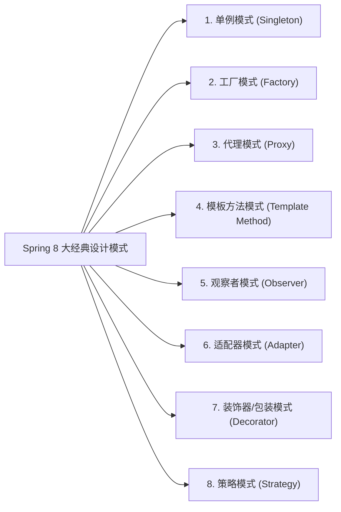

# 🏆 99 · Spring 生态通关总复盘与大厂面试全景图

> **一句话导读**：恭喜你成功穿越了 Spring 帝国的庞大版图！从 IoC 底座内功到 Spring Boot 现代魔法，再到微服务联邦共和国，这里将全章的核心骨架、生动比喻、**8 大经典设计模式**与大厂面试高频必杀题提炼为终极通关秘籍。

---

## 🗺️ Spring 核心宇宙大一统全景图

```mermaid
flowchart TD
    classDef root fill:#ffd666,stroke:#d48806,stroke-width:2px;
    classDef branch fill:#bae7ff,stroke:#1890ff,stroke-width:1px;

    Spring["Spring 生态全景宇宙"]:::root

    Spring --> C1["1. 核心容器与控制反转"]:::branch
    C1 --> C11["IoC 容器机制与 Bean 生命周期 ([[01-IoC容器与Bean生命周期]])"]
    C1 --> C12["单例循环依赖与三级缓存机制 ([[13-Spring循环依赖与三级缓存]])"]
    C1 --> C13["AOP 动态代理与自调用失效破解 ([[02-AOP原理与应用]])"]
    C1 --> C14["声明式事务管理与 7 大失效场景 ([[03-Spring事务管理]])"]
    C1 --> C15["事件驱动机制与事务同步监听 ([[11-Spring事件机制]])"]

    Spring --> C2["2. Web 与持久化机制"]:::branch
    C2 --> C21["SpringMVC 请求分发处理全链路 ([[06-SpringMVC请求处理流程]])"]
    C2 --> C22["MyBatis 动态代理与执行器核心机制 ([[07-MyBatis原理]])"]
    C2 --> C23["Spring Security 认证授权与过滤器链 ([[12-Spring-Security]])"]
    C2 --> C24["声明式缓存与高并发防线 ([[16-SpringCache与分布式缓存实战]])"]

    Spring --> C3["3. 现代 Spring Boot 架构"]:::branch
    C3 --> C31["自动配置原理与条件注解装配 ([[04-SpringBoot自动配置原理]])"]
    C3 --> C32["起步依赖规范与自定义 Starter 实战 ([[05-SpringBoot Starter机制]])"]
    C3 --> C33["SpringApplication 启动时序与生命周期事件 ([[10-SpringBoot启动流程]])"]
    C3 --> C34["异步并发任务与上下文透传 ([[15-Spring异步与线程池体系]])"]
    C3 --> C35["生产白盒监控、K8s双探针与优雅停机 ([[14-SpringBoot生产运维与Actuator]])"]

    Spring --> C4["4. 分布式与微服务生态"]:::branch
    C4 --> C41["微服务治理九大支柱：Nacos/Feign/Gateway/Sentinel/Seata ([[08-SpringCloud组件概览]])"]
    C4 --> C42["WebFlux 响应式非阻塞与虚拟线程并发选型 ([[09-WebFlux与响应式编程]])"]
```

---

## 🎨 大厂面试必考加分项：Spring 内部 8 大经典设计模式盘点

面试官最喜欢问：“你在读 Spring 源码或者日常使用中，见过哪些经典的设计模式？”

| 设计模式 | Spring 源码中的典型落地点与实现机制 | 场景类比说明（辅助理解） |
| :--- | :--- | :--- |
| **单例模式 (Singleton)** | 默认的 Bean 作用域（`Scope = "singleton"`），由 `DefaultSingletonBeanRegistry` 维护的一级缓存（ConcurrentHashMap）统一实现全局单例复用。 | 类比为全局共享唯一定位实例 |
| **工厂模式 (Factory)** | **`BeanFactory`**（简单工厂/抽象工厂）负责 IoC 容器 Bean 的统一实例化；**`FactoryBean`** 专门用于封装定制复杂 Bean 的创建过程（如 MyBatis 的 `MapperFactoryBean`）。 | 类比为标准化加工装配车间 |
| **代理模式 (Proxy)** | **Spring AOP**（`JdkDynamicAopProxy` 基于接口与 `CglibAopProxy` 基于子类字节码生成），在运行时无侵入为目标对象织入事务、日志、鉴权。 | 类比为中介代理托管业务执行 |
| **模板方法 (Template Method)** | **`JdbcTemplate`**、**`TransactionTemplate`** 固化资源获取与释放流程；容器启动核心骨架 `AbstractApplicationContext.refresh()` 定义初始化生命周期步骤。 | 类比为固化流水线模板，开放局部扩展点 |
| **观察者模式 (Observer)** | **Spring 事件驱动机制**（`ApplicationEventPublisher` 发布事件，`ApplicationListener` 监听消费事件），实现组件间的发布-订阅解耦。 | 类比为消息广播与多端协同响应 |
| **适配器模式 (Adapter)** | **`HandlerAdapter`** 将不同接口签名的处理器（注解式 Controller、实现 Controller 接口的 Bean）适配为统一的 `ModelAndView handle(...)` 调用。 | 类比为多接口规格统一转换器 |
| **装饰器模式 (Decorator)** | `TransactionAwareCacheDecorator` 对底层 Cache 进行事务同步包装；Spring Session 的 `SessionRepositoryFilter` 对原生 `HttpServletRequest` 的包装替换。 | 类比为在不改变原接口的前提下进行能力增强包裹 |
| **策略模式 (Strategy)** | **`InstantiationStrategy`**（根据配置决定通过无参构造反射还是 CGLIB 动态生成实例化）；`ResourceLoader` 按协议前缀（classpath: / file:）选择加载策略。 | 类比为根据环境动态切换执行策略算法 |

---

## ⚡ 30 秒极速秒杀：大厂高频面试速查卡片

| 核心问题 | 一句话秒杀核心答题要点 |
| :--- | :--- |
| **IoC 与 DI** | 控制反转是设计思想，依赖注入是具体实现；把对象的创建、装配与生命周期交由 Spring 容器统一托管；生产强推**构造器注入**（保证不可变性、线程安全、杜绝空指针风险并显露架构坏味道）。 |
| **Bean 生命周期** | 核心六步：**BeanDefinition 加载 -> 反射实例化（createBeanInstance） -> 属性填充（populateBean） -> Aware 接口回调 -> 初始化前后后置处理（BeanPostProcessor，在 postProcessAfterInitialization 中织入 AOP 代理） -> 销毁（@PreDestroy）**。 |
| **循环依赖与三级缓存** | 一级缓存存完全就绪成品，二级缓存存提前暴露半成品（保证引用地址唯一），三级缓存存 `ObjectFactory`；**为什么必须三级？** 为保证 Bean 的生命周期规范，在无循环依赖时不提前创建代理，仅在检测到循环依赖时通过工厂延迟生成代理对象。**构造器循环依赖无法被三级缓存解决**（可加 `@Lazy` 延迟解析）。 |
| **AOP 动态代理** | JDK 动态代理基于接口（生成实现了目标接口的代理类），CGLIB 基于子类继承（修改字节码生成派生子类）；Spring Boot 2.x+ 默认优先开启 CGLIB（`proxyTargetClass=true`）；**内部自调用失效**是因为 `this.method()` 调用绕过了 Spring 生成的代理类，直接执行目标原生对象。 |
| **Spring 事务失效 7 场景** | 1. 方法非 `public`；2. 类内自调用绕过 AOP 代理；3. 异常被内部 `try-catch` 吞噬未向外抛出；4. 抛出受检异常（Checked Exception）未显式配置 `rollbackFor = Exception.class`；5. 底层存储引擎不支持事务（如 MySQL MyISAM）；6. 业务类未交由 Spring 容器托管（未加 `@Service` 等）；7. 在开启的新线程中异步执行数据库操作（跨线程丢失 ThreadLocal 连接绑定）。 |
| **SpringMVC 请求流程** | `DispatcherServlet` 接收请求 -> `HandlerMapping` 查找 `HandlerExecutionChain` -> `HandlerAdapter` 适配并利用 `HandlerMethodArgumentResolver` 解析参数 -> 调用业务 Controller -> 利用 `HttpMessageConverter`（如 Jackson）进行序列化并写回客户端。 |
| **MyBatis 接口执行原理** | 基于 **JDK 动态代理 `MapperProxy`**，将接口全限定名+方法名映射到 XML 的 `MappedStatement`；底层由 `Executor` 调度三大处理器（`StatementHandler`、`ParameterHandler`、`ResultSetHandler`）协同工作；使用 **`#{}`** 预编译参数化查询防 SQL 注入，严禁使用 `${}` 文本拼接。 |
| **Spring 异步与线程池** | `@Async` 底层基于 AOP 代理；默认 `SimpleAsyncTaskExecutor` 绝不复用线程（极易 OOM）；生产强制配置 `ThreadPoolTaskExecutor` 有界队列；跨线程 `ThreadLocal`（MDC traceId / SecurityContext）丢失必须通过 `TaskDecorator` 在提交前快照并在子线程恢复与清空；配置优雅停机等待在途任务。 |
| **Spring Cache 高并发防线** | 声明式统一缓存抽象；三大防线：1. 防击穿：`@Cacheable(sync = true)` 本地互斥锁防 Dogpile 效应；2. 防穿透：允许缓存 null 值并设短暂 TTL，前置布隆过滤器；3. 防雪崩：基础 TTL 叠加随机时间抖动（Jitter）；超高并发采用 L1 Caffeine + L2 Redis 两级缓存，配合 MQ 广播失效 L1。 |
| **Spring Boot 自动配置** | `@SpringBootApplication` 复合注解引入 `@EnableAutoConfiguration`；通过 `ImportSelector` 加载 `META-INF/spring/org.springframework.boot.autoconfigure.AutoConfiguration.imports` 候选清单；结合 **`@Conditional` 条件注解家族（尤其是 `@ConditionalOnMissingBean`）** 实现自动化按需装配与开发者自定义优先覆盖。 |
| **微服务治理核心架构** | **Nacos**（注册中心+动态配置） + **OpenFeign**（声明式 RPC，生产必换连接池） + **Gateway**（非阻塞响应式 API 网关） + **Sentinel**（熔断限流降级） + **Seata**（分布式事务协调） + **SkyWalking / Micrometer**（链路追踪） + **Spring Cloud Stream**（消息驱动）。 |
| **生产运维与优雅停机** | **Spring Boot Actuator** 暴露运维端点：`/actuator/health` 对接 K8s 存活/就绪双探针；`/actuator/loggers` 线上秒级动态热更新日志级别；配置 `server.shutdown: graceful` + 30s 宽限期实现服务发布无损停机。 |
| **WebFlux vs 虚拟线程** | I/O 密集的普通微服务业务，推荐升级 **Java 21 + Spring Boot 3 虚拟线程**（兼顾同步编程模型的简单性与高并发吞吐）；高并发网关路由（Gateway）及长连接/AI 流式打字推送（SSE）坚守 **WebFlux (Reactor Netty)**。 |

---

## 📜 生产 Spring 开发十大约法三章（血泪规约）

1. **【依赖注入规约】** 坚决废弃 `@Autowired` 字段注入，一律采用 Lombok `@RequiredArgsConstructor` + `final` 属性的**构造器注入**。
2. **【事务回滚规约】** 声明式事务一律显式加上 `@Transactional(rollbackFor = Exception.class)`，杜绝受检异常不回滚事故。
3. **【事务粒度规约】** 严禁在 `@Transactional` 方法中执行耗时长的第三方 HTTP、RPC 调用或发邮件操作，避免打爆数据库连接池！大事务改用 `TransactionTemplate` 编程式事务。
4. **【循环依赖规约】** 架构设计应避免循环依赖，严禁使用构造器循环依赖；Spring Boot 2.6+ 默认已关闭循环依赖允许，必须重构代码。
5. **【Starter 命名规约】** 团队自研起步依赖一律以 `xxx-spring-boot-starter` 命名，严禁使用官方 `spring-boot-starter-xxx` 命名空间。
6. **【全局异常规约】** 统一采用 `@RestControllerAdvice` 集中捕获全局异常并输出统一 Result 结构体，严禁向前端泄露未处理的后端错误堆栈。
7. **【SQL 注入规约】** MyBatis 传参强制使用 `#{}`，严禁随意使用 `${}` 进行文本拼接；动态表名、排序字段必须经过白名单强校验。
8. **【事件事务安全规约】** 涉及数据库写操作的事件监听器，一律使用 `@TransactionalEventListener(phase = AFTER_COMMIT)`，确保数据完全落盘后再触发外部通知。
9. **【微服务超时规约】** 凡是使用 OpenFeign 进行远程调用，必须显式配置连接超时与读取超时时间（建议 1~3 秒），严禁无限死等。
10. **【缓存安全规约】** 生产分布式微服务集群坚决禁用 MyBatis 二级缓存，一律拥抱外部集中式 Redis 缓存。

---

## 🎓 恭喜通关！

至此，你已经完整攻克了 Java 后端开发中最庞大、最重要的基石领域——**Spring 全家桶生态**！
你可以随时通过 [[_index]] 查阅各个关卡的详细实战手册，祝你在技术进阶与面试实战中所向披靡，早日成长为独当一面的技术专家！
