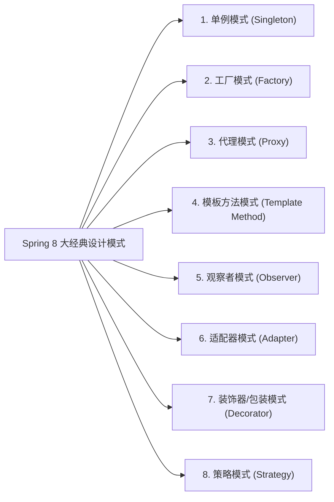

# 🏆 99 · Spring 生态通关总复盘与大厂面试全景图

> **一句话导读**：恭喜你成功穿越了 Spring 帝国的庞大版图！从 IoC 底座内功到 Spring Boot 现代魔法，再到微服务联邦共和国，这里将全章的核心骨架、生动比喻、**8 大经典设计模式**与大厂面试高频必杀题提炼为终极通关秘籍。

---

## 🗺️ Spring 核心宇宙大一统全景图

```mermaid
flowchart TD
    classDef root fill:#ffd666,stroke:#d48806,stroke-width:2px;
    classDef branch fill:#bae7ff,stroke:#1890ff,stroke-width:1px;

    Spring["Spring 生态全景宇宙"]:::root

    Spring --> C1["1. 核心容器与控制反转"]:::branch
    C1 --> C11["IoC 容器机制与 Bean 生命周期 ([[01-IoC容器与Bean生命周期]])"]
    C1 --> C12["单例循环依赖与三级缓存机制 ([[13-Spring循环依赖与三级缓存]])"]
    C1 --> C13["AOP 动态代理与自调用失效破解 ([[02-AOP原理与应用]])"]
    C1 --> C14["声明式事务管理与 7 大失效场景 ([[03-Spring事务管理]])"]
    C1 --> C15["事件驱动机制与事务同步监听 ([[11-Spring事件机制]])"]

    Spring --> C2["2. Web 与持久化机制"]:::branch
    C2 --> C21["SpringMVC 请求分发处理全链路 ([[06-SpringMVC请求处理流程]])"]
    C2 --> C22["MyBatis 动态代理与执行器核心机制 ([[07-MyBatis原理]])"]
    C2 --> C23["Spring Security 认证授权与过滤器链 ([[12-Spring-Security]])"]
    C2 --> C24["声明式缓存与高并发防线 ([[16-SpringCache与分布式缓存实战]])"]

    Spring --> C3["3. 现代 Spring Boot 架构"]:::branch
    C3 --> C31["自动配置原理与条件注解装配 ([[04-SpringBoot自动配置原理]])"]
    C3 --> C32["起步依赖规范与自定义 Starter 实战 ([[05-SpringBoot Starter机制]])"]
    C3 --> C33["SpringApplication 启动时序与生命周期事件 ([[10-SpringBoot启动流程]])"]
    C3 --> C34["异步并发任务与上下文透传 ([[15-Spring异步与线程池体系]])"]
    C3 --> C35["生产白盒监控、K8s双探针与优雅停机 ([[14-SpringBoot生产运维与Actuator]])"]

    Spring --> C4["4. 分布式与微服务生态"]:::branch
    C4 --> C41["微服务治理九大支柱：Nacos/Feign/Gateway/Sentinel/Seata ([[08-SpringCloud组件概览]])"]
    C4 --> C42["WebFlux 响应式非阻塞与虚拟线程并发选型 ([[09-WebFlux与响应式编程]])"]
```

---

## 🎨 大厂面试必考加分项：Spring 内部 8 大经典设计模式盘点

面试官最喜欢问：“你在读 Spring 源码或者日常使用中，见过哪些经典的设计模式？”

| 设计模式 | Spring 源码中的典型落地点与实现机制 | 场景类比说明（辅助理解） |
| :--- | :--- | :--- |
| **单例模式 (Singleton)** | 默认的 Bean 作用域（`Scope = "singleton"`），由 `DefaultSingletonBeanRegistry` 维护的一级缓存（ConcurrentHashMap）统一实现全局单例复用。 | 类比为全局共享唯一定位实例 |
| **工厂模式 (Factory)** | **`BeanFactory`**（简单工厂/抽象工厂）负责 IoC 容器 Bean 的统一实例化；**`FactoryBean`** 专门用于封装定制复杂 Bean 的创建过程（如 MyBatis 的 `MapperFactoryBean`）。 | 类比为标准化加工装配车间 |
| **代理模式 (Proxy)** | **Spring AOP**（`JdkDynamicAopProxy` 基于接口与 `CglibAopProxy` 基于子类字节码生成），在运行时无侵入为目标对象织入事务、日志、鉴权。 | 类比为中介代理托管业务执行 |
| **模板方法 (Template Method)** | **`JdbcTemplate`**、**`TransactionTemplate`** 固化资源获取与释放流程；容器启动核心骨架 `AbstractApplicationContext.refresh()` 定义初始化生命周期步骤。 | 类比为固化流水线模板，开放局部扩展点 |
| **观察者模式 (Observer)** | **Spring 事件驱动机制**（`ApplicationEventPublisher` 发布事件，`ApplicationListener` 监听消费事件），实现组件间的发布-订阅解耦。 | 类比为消息广播与多端协同响应 |
| **适配器模式 (Adapter)** | **`HandlerAdapter`** 将不同接口签名的处理器（注解式 Controller、实现 Controller 接口的 Bean）适配为统一的 `ModelAndView handle(...)` 调用。 | 类比为多接口规格统一转换器 |
| **装饰器模式 (Decorator)** | `TransactionAwareCacheDecorator` 对底层 Cache 进行事务同步包装；Spring Session 的 `SessionRepositoryFilter` 对原生 `HttpServletRequest` 的包装替换。 | 类比为在不改变原接口的前提下进行能力增强包裹 |
| **策略模式 (Strategy)** | **`InstantiationStrategy`**（根据配置决定通过无参构造反射还是 CGLIB 动态生成实例化）；`ResourceLoader` 按协议前缀（classpath: / file:）选择加载策略。 | 类比为根据环境动态切换执行策略算法 |

---

## ⚡ 大厂面试必杀 13 连问（精准金句提炼）

> [!question]- Q1：IoC 与 DI 有什么本质区别？为什么生产环境强烈推荐构造器注入？
> - **概念剖析**：控制反转（IoC）是软件架构的**设计思想**，核心是将对象的创建、装配与生命周期托管给第三方容器；依赖注入（DI）是实现 IoC 的**具体工程手段**。
> - **推荐构造器注入**：① 保证注入依赖的不可变性（`final` 修饰）；② 杜绝运行时 `NullPointerException`（类实例化时强制校验全参）；③ 方便进行轻量级单元测试（无需启动 Spring 容器或借助反射直接 `new`）；④ 避免字段过多引发的架构坏味道显性暴露。

> [!question]- Q2：请详细拆解 Spring Bean 的完整生命周期与核心扩展点？
> 核心六大阶段：
> 1. **定义解析**：加载 `BeanDefinition`；
> 2. **反射实例化**：调用 `createBeanInstance` 创建裸对象；
> 3. **属性填充**：调用 `populateBean` 进行依赖注入；
> 4. **Aware 回调**：触发 `BeanNameAware`、`ApplicationContextAware` 获取容器资源；
> 5. **初始化与 AOP 织入**：执行 `BeanPostProcessor.postProcessBeforeInitialization` -> 调用 `@PostConstruct` / `InitializingBean` -> 执行 `postProcessAfterInitialization`（**AOP 动态代理在此阶段由后置处理器生成并替换原生对象**）；
> 6. **销毁**：触发 `@PreDestroy` 或 `DisposableBean`。

> [!question]- Q3：Spring 为什么需要三级缓存解决单例循环依赖？二级缓存到底差在哪？
> - **三级缓存分工**：一级缓存 `singletonObjects` 存完全初始化就绪的成品单例；二级缓存 `earlySingletonObjects` 存提前暴露的半成品裸对象/代理对象（确保被多个循环依赖方引用时单例唯一）；三级缓存 `singletonFactories` 存延迟生成对象的工厂 `ObjectFactory`。
> - **为什么必须三级**：为了**遵循 Spring 的标准生命周期规约**。Spring 的设计原则要求 AOP 代理对象的创建必须延迟到 Bean 初始化后置处理阶段。若只保留两级缓存，Spring 必须在每个 Bean 刚实例化的瞬间，无差别地为所有 Bean 提前生成 AOP 代理放入二级缓存，严重违背标准生命周期设计。**注：构造器注入的循环依赖三级缓存无法解决，需加 `@Lazy` 延迟解析**。

> [!question]- Q4：JDK 动态代理与 CGLIB 有什么区别？为什么内部方法自调用会导致 AOP 失效？
> - **代理实现原理**：JDK 动态代理基于**接口**（生成实现了目标接口的 `$Proxy` 类）；CGLIB 基于**子类继承**（通过 ASM 操作字节码生成派生子类并覆盖非 final 方法）。Spring Boot 2.x+ 默认全量开启 CGLIB（`proxyTargetClass=true`）。
> - **自调用失效根因**：AOP 的增强逻辑是织入在生成的代理对象（Proxy）中的。当类内方法 `a()` 直接调用 `this.b()` 时，走的是当前原生对象内部的普通本地方法调用，**完全绕过了 Spring 的代理对象**，导致切面逻辑无法被拦截触发。解法：注入自身代理类，或通过 `AopContext.currentProxy()` 显式调用。

> [!question]- Q5：Spring 声明式事务（@Transactional）在哪些高频场景下会失效？
> 七大经典失效场景：
> 1. 修饰的方法非 `public`（AOP 默认只拦截 public 方法）；
> 2. 目标类内自调用 `this.method()` 绕过了 AOP 代理；
> 3. 业务异常在方法内部被 `try-catch` 捕获且未向外重新抛出；
> 4. 抛出了受检异常（Checked Exception），但未显式配置 `@Transactional(rollbackFor = Exception.class)`；
> 5. 底层存储引擎不支持事务（如 MySQL MyISAM）；
> 6. 业务类本身没有被 Spring 容器托管（漏加 `@Service` 等注解）；
> 7. 在开启的新线程中异步执行数据库写操作（跨线程丢失了 ThreadLocal 中绑定的数据库连接与事务上下文）。

> [!question]- Q6：SpringMVC 请求处理的核心 11 步链路与组件流转是怎样的？
> 核心处理链路：
> 1. 客户端发起 HTTP 请求到达 `DispatcherServlet`；
> 2. `DispatcherServlet` 委托 `HandlerMapping` 匹配对应的 `HandlerExecutionChain`（包含 Handler 与 Interceptor 链）；
> 3. 找到对应的 `HandlerAdapter` 适配器；
> 4. 执行拦截器的 `preHandle()`；
> 5. 适配器通过 `HandlerMethodArgumentResolver` 解析并校验入参；
> 6. 调用开发者编写的 Controller 业务方法；
> 7. Controller 返回结果，由 `HttpMessageConverter`（如 Jackson）将对象序列化并写入响应体；
> 8. 执行拦截器的 `postHandle()`；
> 9. 解析异常（若有）通过 `HandlerExceptionResolver`；
> 10. 执行拦截器的 `afterCompletion()` 进行资源清理；
> 11. 将最终 HTTP 响应写回客户端。

> [!question]- Q7：MyBatis 无实现类的 Mapper 接口是如何执行 SQL 的？#{} 与 ${} 有什么区别？
> - **接口执行机制**：MyBatis 在启动时通过 **JDK 动态代理 `MapperProxy`** 为 Mapper 接口生成代理实例。当业务调用接口方法时，代理对象截获请求，根据“接口全限定名 + 方法名”在全局配置中找到对应的 `MappedStatement`，交由 `Executor` 调度底层 `StatementHandler`、`ParameterHandler`、`ResultSetHandler` 执行 JDBC 操作。
> - **#{} 与 ${} 区别**：`#{}` 采用 JDBC 原生的 `PreparedStatement` 参数化预编译机制，自动进行类型转义并使用 `?` 占位符，**彻底杜绝 SQL 注入**；`${}` 是底层的字符串直接拼接，存在严重 SQL 注入风险，仅在动态传入表名、列名等预编译不支持的场景下配合严格白名单校验使用。

> [!question]- Q8：Spring 异步任务（@Async）底层原理是什么？在生产环境有哪些深水坑？
> - **底层原理**：基于 AOP 动态代理机制，通过 `AsyncAnnotationBeanPostProcessor` 为标注 `@Async` 的类生成代理对象，将方法执行包装为 `Callable/Runnable` 提交给配置的 `TaskExecutor` 异步执行。
> - **生产级大坑与对策**：
>   1. **默认执行器 OOM 隐患**：默认使用 `SimpleAsyncTaskExecutor`，每来一个任务直接新建物理线程（绝不池化复用），高并发下极易打爆系统线程数与内存；**对策**：必须显式配置自定义 `ThreadPoolTaskExecutor` 并指定有界阻塞队列；
>   2. **跨线程上下文丢失**：异步线程无法获取主线程的 `ThreadLocal`（如 MDC TraceId、Security 鉴权信息）；**对策**：必须配置 `TaskDecorator`，在任务提交瞬间快照抓取上下文，并在子线程执行前后完成载入与清空；
>   3. **支持优雅停机**：必须开启 `setWaitForTasksToCompleteOnShutdown(true)`，等待在途任务执行完成。

> [!question]- Q9：Spring Cache 如何构建高并发三道防线？如何解决两级缓存一致性？
> - **三大防线构建**：
>   1. **防击穿**：配置 `@Cacheable(sync = true)`，启用本地 JVM 互斥锁，杜绝热点 Key 过期引发的并发 Dogpile 回源冲击；
>   2. **防穿透**：底层存储开启缓存 null 空值并设置极短 TTL，外层前置布隆过滤器拦截非法请求；
>   3. **防雪崩**：在基准 TTL 基础上叠加动态随机抖动时间（Jitter），打散集体过期时间点。
> - **两级缓存方案**：超高并发采用 **L1 Caffeine（JVM 进程内，纳秒级）+ L2 Redis（分布式，毫秒级）**，更新数据时先更新 DB 并删除 Redis，再通过 Redis Pub/Sub 或 RocketMQ 广播消息淘汰所有节点的 L1 Caffeine 本地缓存。

> [!question]- Q10：Spring Boot 自动配置的底层工作原理是怎样的？
> 核心装配三部曲：
> 1. **注解驱动**：主启动类标注 `@SpringBootApplication`，其内部组合了 `@EnableAutoConfiguration`；
> 2. **清单加载**：`@EnableAutoConfiguration` 借助 `@Import(AutoConfigurationImportSelector.class)`，在应用启动时扫描 classpath 下所有 Jar 包中的 `META-INF/spring/org.springframework.boot.autoconfigure.AutoConfiguration.imports`（Spring Boot 2.7 前为 `spring.factories`），读取候选全量自动配置类列表；
> 3. **条件装配过滤**：各配置类上标注了丰富的 **`@Conditional` 条件注解家族**（如 `@ConditionalOnClass` 检查依赖存在、`@ConditionalOnProperty` 检查配置开启、`@ConditionalOnMissingBean` 保障用户自定义 Bean 优先退让），最终仅对满足条件的配置类进行反射加载与 Bean 注入。

> [!question]- Q11：现代微服务治理的核心体系包括哪些关键组件？各自承担什么职责？
> 核心体系由七大支柱构成：
> 1. **服务注册与动态配置**：**Nacos / Consul**，负责微服务实例的健康探测、寻址与配置秒级动态热更新；
> 2. **声明式 RPC 通信**：**OpenFeign**，封装 HTTP REST 客户端，生产必须替换为连接池（Apache HttpClient / OkHttp）；
> 3. **客户端负载均衡**：**Spring Cloud LoadBalancer**，基于轮询、权重或自定义标签实现就近路由与灰度染色；
> 4. **API 网关**：**Spring Cloud Gateway**，基于 WebFlux 响应式高并发架构，负责统一鉴权、全局限流、黑白名单与请求路由分发；
> 5. **熔断限流与降级**：**Sentinel / Resilience4j**，保护下游服务免受级联雪崩冲击；
> 6. **分布式事务**：**Seata**（AT/TCC/Saga 模式）或基于 MQ 的可靠消息最终一致性；
> 7. **全链路可观测性**：**SkyWalking / Micrometer + OpenTelemetry**，统一收集 Trace、Metric、Log。

> [!question]- Q12：Spring Boot 生产运维中，如何利用 Actuator 对接 K8s 并实现优雅停机？
> - **K8s 双探针集成**：引入 `spring-boot-starter-actuator`，开启健康端点：
>   - `/actuator/health/liveness`：对接 K8s 存活探针（Liveness Probe），当 JVM 死锁或致命崩溃时触发 Pod 重启；
>   - `/actuator/health/readiness`：对接 K8s 就绪探针（Readiness Probe），当服务启动完成且各依赖就绪后才开始接引流量；
> - **优雅停机（Graceful Shutdown）**：配置 `server.shutdown: graceful` 与 `spring.lifecycle.timeout-per-shutdown-phase: 30s`。当接收到 SIGTERM 信号后，Tomcat 立即停止接收新流量并从注册中心注销，预留 30 秒宽限期等待在途 HTTP 请求处理完毕后再退出进程。

> [!question]- Q13：WebFlux 响应式编程与 Java 21 虚拟线程在现代微服务中如何技术选型？
> - **选型原则**：
>   1. **普通业务微服务（I/O 密集型）**：**坚决升级 Java 21 + 虚拟线程（Virtual Threads）**。无需重构代码，继续保留简单直观的命令式同步编程模型，即可获得与响应式媲美的高并发吞吐量与极低内存消耗；
>   2. **高吞吐网关与流式推送场景**：**坚守 WebFlux (Reactor Netty)**。Spring Cloud Gateway 本身基于反应式事件循环构建；在长连接、流式背压数据流（如大模型 SSE 打字机吐字、Websocket 实时通信）场景下，WebFlux 的响应式流原语与内存效率依然无可替代。

---

## 📜 生产 Spring 开发十大约法三章（血泪规约）

1. **【依赖注入规约】** 坚决废弃 `@Autowired` 字段注入，一律采用 Lombok `@RequiredArgsConstructor` + `final` 属性的**构造器注入**。
2. **【事务回滚规约】** 声明式事务一律显式加上 `@Transactional(rollbackFor = Exception.class)`，杜绝受检异常不回滚事故。
3. **【事务粒度规约】** 严禁在 `@Transactional` 方法中执行耗时长的第三方 HTTP、RPC 调用或发邮件操作，避免打爆数据库连接池！大事务改用 `TransactionTemplate` 编程式事务。
4. **【循环依赖规约】** 架构设计应避免循环依赖，严禁使用构造器循环依赖；Spring Boot 2.6+ 默认已关闭循环依赖允许，必须重构代码。
5. **【Starter 命名规约】** 团队自研起步依赖一律以 `xxx-spring-boot-starter` 命名，严禁使用官方 `spring-boot-starter-xxx` 命名空间。
6. **【全局异常规约】** 统一采用 `@RestControllerAdvice` 集中捕获全局异常并输出统一 Result 结构体，严禁向前端泄露未处理的后端错误堆栈。
7. **【SQL 注入规约】** MyBatis 传参强制使用 `#{}`，严禁随意使用 `${}` 进行文本拼接；动态表名、排序字段必须经过白名单强校验。
8. **【事件事务安全规约】** 涉及数据库写操作的事件监听器，一律使用 `@TransactionalEventListener(phase = AFTER_COMMIT)`，确保数据完全落盘后再触发外部通知。
9. **【微服务超时规约】** 凡是使用 OpenFeign 进行远程调用，必须显式配置连接超时与读取超时时间（建议 1~3 秒），严禁无限死等。
10. **【缓存安全规约】** 生产分布式微服务集群坚决禁用 MyBatis 二级缓存，一律拥抱外部集中式 Redis 缓存。

---

## 🎓 恭喜通关！

至此，你已经完整攻克了 Java 后端开发中最庞大、最重要的基石领域——**Spring 全家桶生态**！
你可以随时通过 [[_index]] 查阅各个关卡的详细实战手册，祝你在技术进阶与面试实战中所向披靡，早日成长为独当一面的技术专家！
